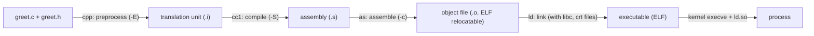

A C program is *text* until a toolchain turns it into machine code and a loader turns that into a process. Understanding each hand-off explains most mysterious build errors (`undefined reference`, `multiple definition`, `relocation truncated`), runtime failures (`cannot open shared object file`, segfaults at startup), and what code the compiler really emitted. The running example (`greet.c`, `greet.h`):

{{include c/pipeline/greet.h}}

{{include c/pipeline/greet.c}}

The `gcc` command is a *driver* that runs these programs (`cpp`/`cc1`, `as`, `collect2`/`ld`) in order; `gcc -v` prints the exact invocations.

## 1. Preprocessing (`gcc -E`)

The preprocessor performs purely textual transformation: it inserts `#include`d files, expands macros, removes comments, evaluates `#if` conditionals and joins continued lines. The output is one **translation unit**, the unit the compiler sees. Everything the compiler knows about `printf` came from `<stdio.h>` pasted in.

{{run c/pipeline :: gcc -E greet.c | tail -n 12}}

Note `GREETING` became `"hello"`. (The full output begins with hundreds of lines from `stdio.h`; `-E -P` strips line markers.) Preprocessing errors are always about missing files, unbalanced `#if`, or macro mistakes; type errors can't occur here.

## 2. Compilation (`gcc -S`)

The compiler front end parses the translation unit, checks types and semantics, builds an intermediate representation, optimizes (`-O0` … `-O3`, `-Os`), and the back end emits assembly for the target architecture. Look at what `-O1` produced for `add` and `main`:

{{run c/pipeline :: gcc -S -O1 -fno-asynchronous-unwind-tables -fcf-protection=none greet.c -o - | sed -n 1,40p}}

Observations:

- `add(a, b)` compiled to **one instruction** `leal 42(%rdi,%rsi), %eax` (a + b + 42) plus the increment of `call_count(%rip)`. The static variable `secret` disappeared: the optimizer saw it is never modified and **folded the constant**. At `-O0` it remains a real variable (see `nm` below). Optimizing compilers erase variables, reorder statements and inline functions, which is why debugging optimized code looks different and why undefined behavior is dangerous.
- Arguments arrive in `%edi`, `%esi` (the x86-64 System V convention: next note) and the result goes in `%eax`.
- Data is placed in **sections**: code in `.text`, the string literal in `.rodata.str1.1` (read-only), `banner` (a pointer with an initial value) in `.data.rel.local`, and `call_count` (zero-initialized) in `.bss`.
- `call printf@PLT` references a function that doesn't exist yet: the assembler can't know its address.

## 3. Assembly (`gcc -c`)

The assembler converts text to machine code in an **ELF relocatable object file** (`.o`). Because each source file is compiled separately, any reference to something defined elsewhere (`printf`, `call_count` from another file, even `add` from `main` across sections) is left as a **relocation**: a note saying "patch these bytes with the final address of symbol X".

{{run c/pipeline :: gcc -c -O0 greet.c -o greet0.o && file greet0.o && size greet0.o && nm greet0.o}}

`nm` letters: `T` code (global), `t` local code, `D`/`d` initialized data (global/local), `B`/`b` zero-initialized `.bss`, `R`/`r` read-only data, **`U` undefined** (to be resolved by the linker), `W` weak. Here `secret` is a lowercase `d`: **internal linkage** (`static`) makes the symbol local to this object file, so no other file can link against it, and it can't collide with another file's `secret`.

The disassembly shows the placeholders and their relocations:

{{run c/pipeline :: gcc -c -O1 greet.c -o greet.o && objdump -dr --no-show-raw-insn greet.o | sed -n 6,32p}}

Each `call 1f` has operand zero and an entry `R_X86_64_PLT32 add-0x4` beneath it: "put the PC-relative offset of `add` here" (the `-4` accounts for the instruction pointer being at the end of the 4-byte field). The same applies to `banner`, `call_count`, and `printf`. These patch records live in `.rela.text` and `.rela.data`.

### ELF in one page

An ELF file has a header and two views of the same bytes:

| View | Table | Used by | Contents |
|---|---|---|---|
| **Sections** | section header table | linker, debuggers, tools | `.text` (code), `.rodata`, `.data` (initialized writable), `.bss` (zero-initialized, takes no file space), `.symtab`/`.strtab` (symbols), `.rela.*` (relocations), `.debug_*` (DWARF), `.eh_frame` (unwind info), `.init_array`/`.fini_array` (constructors/destructors), `.got`/`.plt` (dynamic linking), `.dynsym`/`.dynamic` |
| **Segments** | program header table | kernel and `ld.so` loader | `LOAD` (mapped regions with permissions R, RX, RW), `INTERP`, `DYNAMIC`, `GNU_RELRO`, `GNU_STACK` |

Object files (`ET_REL`) have sections only; executables (`ET_EXEC`/`ET_DYN` PIE) and shared libraries have segments. `size` splits into `text` (code + read-only data), `data` (initialized), `bss` (zero-initialized): `bss` costs memory but no file size.

## 4. Linking

The linker `ld` combines object files and libraries: it

1. **Merges sections** of the same kind from all inputs (all `.text` together…) and assigns final addresses (relative to a base, for PIE),
2. **Resolves symbols**: each undefined symbol must match exactly one global definition (or a weak/shared-library one) and reports `undefined reference to 'foo'` or `multiple definition of 'foo'` otherwise,
3. **Applies relocations**: patches all those placeholder fields with final addresses/offsets,
4. Adds startup code (`crt1.o`: `_start`; `crti.o`, `crtn.o`; `crtbegin/end`), pulls in needed archive members, and records dynamic dependencies.

{{run c/pipeline :: gcc -O0 greet.c -o greet && ./greet && file greet | cut -c1-120 && nm greet | grep -E ' (_start|main|add|banner|call_count|secret|printf)'}}

Symbols now have addresses; `printf` is still undefined (`U printf@GLIBC_2.2.5`): it will be bound by the dynamic loader at run time. Linking order matters for **static archives** (`libfoo.a`): the linker scans left to right, pulling in members only to satisfy symbols still undefined, so put libraries *after* the objects that use them (`gcc main.o -lfoo -lm`). Common errors: `undefined reference` (forgot the file or `-l`, wrong order, C++ name mangling, declared but never defined), `multiple definition` (a function defined in a header included twice without `static`/`inline`, or a global defined — not just declared `extern` — in a header), and `relocation truncated to fit` (code model too small).

### Header and linkage rules (why the example looks like it does)

- **Declaration** tells the compiler a name exists (`int add(int, int);`, `extern int call_count;`); **definition** creates the entity (`int add(...) {...}`, `int call_count = 0;`). Put declarations in headers, definitions in exactly one `.c` file (the **One Definition Rule** for C: exactly one definition of each external identifier in the program).
- `static` at file scope = **internal linkage**: one private copy per translation unit. Use it for helper functions and file-private state.
- Include guards (`#ifndef GREET_H`) prevent redefinition when a header is included twice.

## 5. The executable: segments and entry point

{{run c/pipeline :: readelf -h greet | grep -E 'Type|Entry' && readelf -lW greet | grep -E 'INTERP|LOAD|DYNAMIC|GNU_RELRO|GNU_STACK|Requesting' | cut -c1-110}}

- Type `DYN (Position-Independent Executable)`: the default; the kernel loads it at a **random base address** each run (ASLR), and addresses inside are offsets.
- `INTERP` names the dynamic loader `/lib64/ld-linux-x86-64.so.2`.
- Four `LOAD` segments with different permissions: read-only headers, **`R E`** code, **`R`** read-only data, and **`RW`** data+bss. **No segment is both writable and executable** (W^X), and `GNU_STACK` is `RW` only (non-executable stack: NX).
- `GNU_RELRO`: after relocation processing the loader makes the GOT/`.init_array` region read-only, preventing certain exploit techniques.
- The **entry point** (`0x1050`) is not `main` but `_start`:

{{run c/pipeline :: objdump -d --no-show-raw-insn greet | awk '/<_start>:/,/hlt/'}}

`_start` clears `%rbp`, aligns the stack to 16 bytes, and calls `__libc_start_main(main, argc, argv, init, fini, ...)`. That glibc function initializes the C library (stdio buffers, `environ`, TLS, locale), runs constructors in `.init_array`, calls your `main`, and passes its return value to `exit()`, which runs `atexit` handlers, flushes stdio streams and finally invokes the `_exit` system call. Hence `return 0;` from `main` ≡ `exit(0)`, and `printf` output without a newline still appears when `main` returns normally but is lost if the process dies by `_exit`, `abort` or a signal.

## 6. Loading and running

`execve("./greet")` makes the kernel read the ELF headers, map each `LOAD` segment into a new address space (file-backed pages shared via the page cache; `.bss` anonymous zero pages), set up the stack with `argv`, `envp` and the **auxiliary vector** (`AT_ENTRY`, `AT_RANDOM`, `AT_SYSINFO_EHDR` = the vDSO...). Because the file has an `INTERP`, the kernel maps the **dynamic loader** too and starts execution *there*: `ld.so` loads the needed shared libraries (`NEEDED` entries; `ldd` lists them), performs relocations, resolves symbols (eagerly or lazily through the PLT/GOT), runs library constructors, then jumps to the program's entry point.

{{run c/pipeline :: ldd greet && readelf -d greet | grep -E 'NEEDED|FLAGS_1' && readelf --dyn-syms greet | grep -E ' (printf|__libc_start_main)@?' | cut -c1-90}}

(The next linking note covers PLT/GOT, symbol versioning and `LD_LIBRARY_PATH`/`RPATH`.) `LD_DEBUG=libs ./greet` shows the library search; `LD_DEBUG=bindings` the symbol resolution.

## Inspecting any binary

| Question | Command |
|---|---|
| What type of file is this? | `file a.out` |
| Which symbols does it define/need? | `nm -C a.out`, `nm -D lib.so` (dynamic), `readelf -s` |
| What are the section sizes? | `size a.out`, `readelf -SW a.out` |
| Show the program headers | `readelf -lW a.out` |
| Which libraries does it need? | `ldd a.out`, `readelf -d a.out \| grep NEEDED` |
| Disassemble | `objdump -d -M intel --no-show-raw-insn a.out`, `objdump -S` (interleave source with `-g`), `gdb -batch -ex 'disassemble main'` |
| Which compiler flags/hardening? | `readelf -p .comment`, `checksec --file=a.out`, `gcc -Q --help=optimizers` |
| Where does `foo` come from in source? | `addr2line -e a.out -f 0x1139`, `-g` debug info |
| See the commands gcc runs | `gcc -v`, `gcc -save-temps` (keeps `.i`, `.s`, `.o`) |
| Preview relocation/link behavior | `ld --trace`, `-Wl,-Map=out.map`, `-Wl,--verbose` |
| Strip for release | `strip a.out`, `objcopy --only-keep-debug` + `--add-gnu-debuglink` |

Compile the same file at `-O0` and `-O2` and diff the assembly (`gcc -S`) or paste it into Compiler Explorer to see how the optimizer transforms code: invaluable for learning what is cheap and what isn't.

## Key takeaways

- Stages: preprocess (text), compile (to assembly), assemble (to a relocatable object with undefined symbols and relocations), link (merge sections, resolve symbols, apply relocations), load (kernel maps segments, `ld.so` resolves shared libraries).
- ELF has a section view (for linkers/tools) and a segment view (for the loader); `.bss` has size but no file bytes; W^X, NX stack and RELRO are visible in the program headers.
- `static` = internal linkage (a local symbol); one definition per external symbol; declarations go in headers.
- Execution starts at `_start`, which calls `__libc_start_main` → `main` → `exit`; `main`'s return value becomes the exit status.
- Learn `nm`, `objdump -dr`, `readelf`, `ldd`, `gcc -E/-S/-c`: they turn linker and loader mysteries into readable facts.
