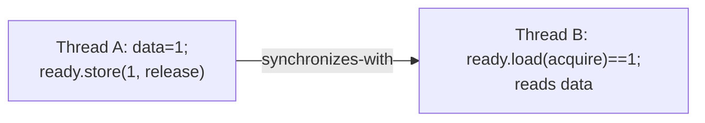

Before C11 the language had no concept of a thread: concurrency was a library (POSIX threads) whose rules lived outside the standard, and compilers could not be told what a "shared variable" was. C11 added a **memory model**, `<threads.h>` and `<stdatomic.h>`. The model answers one question: *when a thread writes a variable, when must another thread see it, and in what order?*

## Data races are undefined behaviour

Two accesses to the same object **conflict** if at least one is a write. They form a **data race** if they come from different threads and are not ordered by *happens-before* (§5.1.2.4). A data race is **undefined behaviour**, not "a stale value". The compiler is entitled to assume there are none: it can keep a shared variable in a register across a loop (so a `while (!flag);` spins forever), reorder, split or duplicate accesses.

Three things people reach for that do **not** fix a race:

- `volatile`: it prevents the compiler from eliding accesses, but gives no atomicity and no ordering with respect to other memory. It is for memory-mapped I/O, not threads.
- Using a `bool`/`int` flag "because writes are atomic on x86": the compiler, not the CPU, is what breaks you.
- "It worked in testing".

The tools are **mutexes** (which establish happens-before on lock/unlock), **atomics**, and joining a thread.

## Threads: POSIX and C11

POSIX `pthread_create`/`pthread_join`/`pthread_mutex_*`/`pthread_cond_*` is what real code uses on Linux and macOS (link with `-pthread`). C11's optional `<threads.h>` (`thrd_create`, `mtx_lock`, `cnd_wait`) mirrors it but is optional and absent on some platforms (glibc added it only in 2.28). Prefer pthreads unless you target a toolchain that has `<threads.h>` and need portability beyond POSIX.

Rules worth memorising: always join or detach every thread; condition variables need a predicate loop (`while (!cond) pthread_cond_wait(...)`) because of spurious wakeups; never hold a lock across a blocking call you can avoid; define one global lock order to prevent deadlock; `fork()` in a multithreaded process leaves only the calling thread in the child, and only async-signal-safe functions are safe afterward.

## Atomics and the memory orders

`_Atomic int x;` (or `atomic_int`) makes loads, stores and read-modify-write operations on `x` indivisible. Every atomic operation also takes a **memory order** that says how much *other* memory it orders:

| Order | Guarantee | Use |
|---|---|---|
| `memory_order_relaxed` | atomicity only; no ordering of other accesses | counters, statistics |
| `memory_order_acquire` (load) | later reads/writes in this thread cannot move before it | take a lock, consume a published pointer |
| `memory_order_release` (store) | earlier reads/writes cannot move after it | release a lock, publish data |
| `memory_order_acq_rel` | both, for read-modify-write | CAS in lock-free structures |
| `memory_order_seq_cst` | acquire+release **and** one global total order of all seq_cst operations | the default; simplest to reason about |
| `memory_order_consume` | like acquire, only for data-dependent loads | unusable in practice; compilers treat it as acquire |

If you omit the order (`atomic_store(&x, 1)`), you get `seq_cst`. Start there and weaken only where profiling shows it matters and you can justify it in a comment.

### Atomic counters

Four threads each add 1,000,000 to a shared counter, first with a plain (racy) `int`, then an atomic, then a mutex:

{{include c/concurrency/counter.c}}

{{run c/concurrency :: gcc -O2 -Wall -Wextra -pthread counter.c -o counter && ./counter}}

The racy counter loses most of its updates (the exact figure changes every run, because `x += 1` is a load, an add and a store, and two threads can both load the same value). Both the atomic and the mutex are exact. The atomic needs only `relaxed` because the counter orders nothing else.

### Publishing data: release and acquire

A **release** store pairs with an **acquire** load that reads the value it wrote: everything the producer did before the release is visible to the consumer after the acquire. That is how you hand a buffer to another thread without a lock:

{{include c/concurrency/mp.c}}

{{run c/concurrency :: gcc -O2 -Wall -Wextra -pthread mp.c -o mp && ./mp}}

Without the release/acquire pair the consumer could legally see `ready == 1` and still read stale `data` (the compiler may move the plain writes after the flag store, and on weakly ordered CPUs the hardware may too).

### What the orders cost: read the instructions

{{include c/concurrency/orders.c}}

{{run c/concurrency :: gcc -O2 -S -o - orders.c | grep -E '^(store|load|fetch|cas)|movl|xchg|lock'}}

On x86-64 (a **total-store-order** machine) every normal load already behaves like an acquire and every normal store like a release, so `release` and `acquire` compile to ordinary `mov`. Only `seq_cst` **stores** pay: `xchg` (an implicitly locked instruction) drains the store buffer. Read-modify-writes use the `lock` prefix whatever the order. On ARM64 and POWER the picture reverses: relaxed is cheap, release/acquire use `stlr`/`ldar`, and the compiler really emits barriers (`dmb`). Code that uses `relaxed` or omits `release/acquire` can pass every test on x86 and fail on a phone. That is the strongest argument for writing the correct order even where x86 would forgive you.

### Why seq_cst exists: store buffering

Each x86 core buffers its stores, so a core can read a later location before its own earlier store is visible to others. The classic litmus test: initially `x = y = 0`; thread 0 does `x = 1; r0 = y`, thread 1 does `y = 1; r1 = x`. Under sequential consistency at least one thread must read 1, but with store buffers both can read 0 unless a full barrier (`seq_cst` store, `mfence`) separates each store from the following load (Intel SDM Vol. 3A §8.2.3.4).

{{include c/concurrency/litmus.c}}

{{run c/concurrency :: gcc -O2 -Wall -Wextra -pthread litmus.c -o litmus && ./litmus}}

Be careful about what this does and does not show. In this run the "both read 0" outcome did not appear for any order, including relaxed, although the CPU permits it: the window is a few nanoseconds wide and depends on how tightly the two threads start together, which a VM with noisy neighbours does not give. **A test that fails to show a reordering proves nothing**; the model, not the experiment, defines what is allowed. Tools like `herd7` and `litmus7` enumerate the outcomes exhaustively, and ThreadSanitizer finds the race that makes such code incorrect.

## A spinlock from atomics

`atomic_flag` is the one type guaranteed lock-free. A test-and-set lock needs *acquire* on lock and *release* on unlock so that data protected by the lock is ordered correctly:

{{include c/concurrency/spinlock.c}}

{{run c/concurrency :: gcc -O2 -Wall -Wextra -pthread spinlock.c -o spinlock && ./spinlock}}

Real spinlocks add a CPU pause hint (`pause` / `yield`), exponential backoff, and test-and-test-and-set (spin on a plain read before attempting the write to avoid bouncing the cache line). Use them only for very short critical sections and when the holder cannot be descheduled; otherwise a mutex (futex-based on Linux, which spins briefly then sleeps) is better.

## Finding races: ThreadSanitizer

`-fsanitize=thread` instruments every access and tracks happens-before; it reports races that *might* happen even if this run did not corrupt anything. Counting its reports for the two programs above:

{{run c/concurrency :: gcc -O1 -g -fsanitize=thread -pthread counter.c -o c_tsan && ./c_tsan 2>&1 | grep -c "WARNING: ThreadSanitizer: data race"}}

{{run c/concurrency :: gcc -O1 -g -fsanitize=thread -pthread mp.c -o mp_tsan && ./mp_tsan 2>&1 | grep -c "ThreadSanitizer"}}

The first reports races on the plain counter (the exact number depends on how many distinct access pairs it sees); the release/acquire program, which is correct, is clean (0 reports). TSan costs roughly 5-15x in time and 5-10x in memory, cannot be combined with ASan in the same binary, and only sees paths that actually execute, so run it in CI over your test suite.

## Traps beyond the basics

- **False sharing**: two threads writing different variables on the same 64-byte cache line make the line ping-pong between cores. Pad or align hot per-thread data (`_Alignas(64)`). A per-thread counter array with no padding can be many times slower than padded.
- **The ABA problem**: a lock-free pop reads head `A`, is preempted, others pop `A` and `B` and push `A` back; the CAS of head from `A` to `A->next` succeeds but `A->next` is stale. Fixes: tagged pointers (pointer plus a version counter, in a double-width CAS), hazard pointers, epoch-based reclamation, or just not freeing nodes while readers exist.
- **Memory reclamation** is the hard part of lock-free structures, not the CAS. If you do not need lock-freedom, use a mutex.
- **Lock-free is not wait-free**: lock-free guarantees system-wide progress; an individual thread may starve.
- **Signal handlers** may only use `volatile sig_atomic_t` or lock-free atomics.
- **Initialisation once**: use `pthread_once` or a function-local static guarded by a C11 `call_once`; double-checked locking without atomics is broken.
- **Thread-local storage** (`_Thread_local`, `__thread`) removes the need to synchronise at all; prefer per-thread data merged at the end over shared counters.
- **`_Atomic` struct** operations may fall back to a hidden lock; check `atomic_is_lock_free()` and link `-latomic` where needed.

## Key takeaways

- A data race is undefined behaviour. `volatile` does not fix it; mutexes, atomics and thread joins do.
- Every atomic operation has a memory order; default `seq_cst` is correct, `release`/`acquire` is the idiom for publishing data, `relaxed` is only for independent counters.
- x86-64's strong ordering hides missing barriers; the same code can break on ARM. Reason from the C11 model, not from the machine you tested on.
- Test absence of reordering proves nothing; use ThreadSanitizer for races and model checkers for litmus-level questions.
- Watch for false sharing, ABA and reclamation; prefer mutexes and per-thread data until measurements say otherwise.
