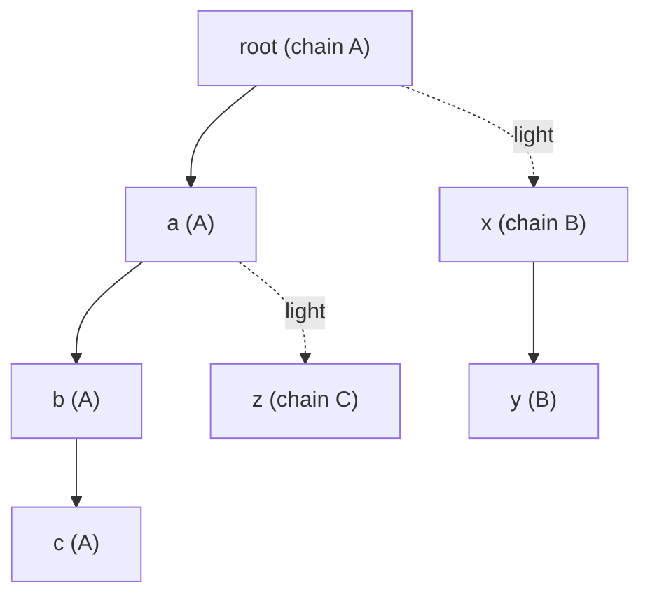

Many problems hand you a tree once and then ask thousands or millions of questions about it: "where do these two nodes' root paths meet?", "what is the sum of values on the path between *u* and *v* after this update?", "how far is *v* from the nearest highlighted node?". Walking the tree per query costs O(depth) — up to O(n) on a path — so 10^6 queries on 10^6 nodes is 10^12 steps. This note builds the three standard structures that bring each query to O(log n) or better, as one header whose pieces are tested against naive code.

All traversals are **iterative** (BFS order and an explicit stack): a path of a million vertices would overflow the call stack of a recursive DFS, and it is exactly the input a test-setter will use.

## Foundation: parents, depths and subtree sizes

From a rooted tree we compute, with one BFS and one reverse pass, the arrays everything else needs: `par[v]`, `depth[v]`, the BFS `order`, the subtree `size[v]`, and each vertex's **heavy child**, the child with the largest subtree.

## Lowest common ancestor

The **LCA** of *u* and *v* is the deepest vertex that is an ancestor of both. Distance between them is `depth[u] + depth[v] − 2·depth[lca]`, so LCA also gives tree distances.

### Binary lifting: O(n log n) memory, O(log n) per query

Store `up[j][v]` = the 2^j-th ancestor of *v*. First lift the deeper vertex up to the depth of the other by the binary digits of the depth difference; then lift both together, largest jump first, as long as the ancestors differ. The LCA is the parent of where they stop. Simple, supports "k-th ancestor" queries too, and is the best default when you need ancestors, not just LCA.

### Preorder plus sparse table: O(1) per query

Number the vertices in preorder. For `tin[u] < tin[v]`, the LCA is the **parent of the shallowest vertex among preorder positions (tin[u], tin[v]]**. A sparse table (a range-minimum structure with O(n log n) memory and O(1) queries, keyed by depth) answers that range query with two overlapping power-of-two blocks. Fastest queries, but the sparse table is the heaviest in memory.

### Heavy-light: no extra tables

Next to the structures above, **heavy-light decomposition (HLD)** gives LCA for free, because it makes the "climb" take few steps, as explained in the next section.

## Heavy-light decomposition

Mark each vertex's edge to its heavy child as *heavy*; the other edges are *light*. The heavy edges form vertical **chains**, and the key fact is:

> Any root-to-vertex path crosses at most **log₂ n** light edges, because each light edge at least halves the subtree size.

So any path in the tree decomposes into O(log n) pieces, each a contiguous part of one chain. If we lay each chain out contiguously in an array (`pos[v]`, chain start `head[v]`), then a path query becomes O(log n) **range queries** on an ordinary array structure — here a Fenwick tree (see the range-query note), which supports point updates and prefix sums in O(log n). A segment tree in its place handles range updates, max/min or any monoid.

A path query from *u* to *v*: while their chain heads differ, take the vertex whose head is **deeper**, query the segment from its head down to it, and jump to the head's parent; once both are on the same chain, query the segment between them. The same loop returns the LCA (the shallower of the two at the end). Cost O(log n) light-edge jumps × O(log n) per Fenwick query = **O(log² n)** per path query, usually much less in practice.

## Centroid decomposition

A **centroid** of a tree with *n* vertices is a vertex whose removal leaves components of size at most n/2; one always exists. Remove it, recurse into each component, and you get a **centroid tree** of depth O(log n). Every path *u → v* in the original tree passes through the centroid that is the first common ancestor of *u* and *v* in the centroid tree. That turns path questions into "combine information stored at O(log n) ancestors".

Example, **nearest marked vertex with updates**: for every vertex store its distance to each of its ≤ log n centroid ancestors (`dist[level][v]`), and for each centroid the closest marked vertex in its component (`best[c]`). Marking *v* updates `best` at all its centroid ancestors; a query for *v* takes `min(best[c] + dist(c, v))` over those ancestors. Both are O(log n), memory O(n log n). The same pattern counts paths of a given length, finds the closest pair at distance ≤ K, and answers many "all paths through a vertex" problems.

## The implementation

{{include dsa/treequery/treeq.h}}

### Verification

Each structure is compared with a naive implementation (walk up for the LCA, walk the path for the sum, multi-source BFS for the nearest marked vertex) on five tree shapes — random, path, star, complete binary, caterpillar — for every size 1 to 19 and then sizes in steps up to 300, with random interleaved updates and queries. Small sizes include the boundary cases (a single vertex, two vertices, root as the LCA).

{{include dsa/treequery/test.c}}

{{run dsa/treequery :: gcc -O1 -g -Wall -Wextra -Wno-unused-function -fsanitize=address,undefined test.c -o t && ASAN_OPTIONS=detect_leaks=0 ./t}}

(Leak detection is switched off only because the test does not free its trees between cases.)

### Scale: one million vertices

{{include dsa/treequery/bench.c}}

{{run dsa/treequery :: gcc -O2 -Wall -Wextra -Wno-unused-function bench.c -o bench && ./bench}}

How to read the numbers (exact values vary by machine and run):

- On the **path**, the depth is 999,999 and a naive climb would average hundreds of thousands of steps per query. Binary lifting needs about 20 jumps (~1.5 µs, poor locality), the sparse table a handful of loads (~0.1–0.2 µs), and HLD is fastest because the whole path is **one chain** and the loop body runs zero times.
- On the **random tree**, depth is only about 30, so all methods are fast; here the sparse table wins and HLD pays for crossing many short chains (about half a million chains for a random tree).
- Centroid decomposition costs the most to build (about a second for a million vertices: n log n BFS work and n log n memory in the distance table), but then answers nearest-marked queries in under a microsecond and supports updates, which no other structure here does.
- HLD's build is cheap (tens of milliseconds); updates and path sums stay in the low microseconds.

## Choosing and extending

| Need | Use |
|---|---|
| LCA only, static tree, many queries | preorder + sparse table |
| LCA plus k-th ancestor, simple code | binary lifting |
| Path aggregate with point/range updates | HLD + Fenwick / segment tree |
| Subtree aggregate | the preorder (Euler) interval of the subtree: a segment tree over `tin..tout` |
| Distance-based queries ("nearest", "count pairs at distance ≤ K") | centroid decomposition |
| Edges rather than vertices | store each edge's value at its deeper endpoint |
| The tree itself changes (link/cut) | link-cut trees (Sleator–Tarjan), outside this note |
| Offline, all queries known | Tarjan's offline LCA with union-find, O((n + q) α) |

## Pitfalls

- **Recursion depth** on a path graph: do the DFS iteratively, or raise the stack limit and still expect trouble.
- **Edge vs vertex values**: path queries over edges must exclude the LCA's own value; storing values on the deeper endpoint of each edge and skipping the topmost vertex in the last segment is the standard fix.
- **Off-by-one in the sparse-table range**: the query is over (tin[u], tin[v]], not [tin[u], tin[v]]; the version above also handles `u == v` separately.
- **Overflow**: sums over a million vertices of values up to 10^9 need 64-bit accumulators.
- **Memory**: lifting and the centroid distance table are O(n log n); at n = 10^7 that is gigabytes. HLD and the sparse-table-free approach are O(n).
- **Multiple roots / forests**: add a virtual root or run per component.

## Key takeaways

- Per-query tree walks are O(depth); the structures here make the query O(log n) or O(1) after preprocessing.
- LCA: binary lifting (simple, k-th ancestor), preorder + sparse table (O(1) queries), HLD (no extra tables, and also gives path queries).
- HLD turns any tree path into O(log n) contiguous array ranges, because any root path crosses at most log₂ n light edges.
- Centroid decomposition gives a depth-log n hierarchy for distance-type queries with updates, at O(n log n) memory.
- Do traversals iteratively and test against naive code on paths, stars and random trees.
