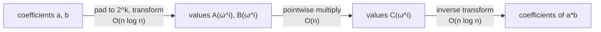

The product of two polynomials of degree *n* takes O(n²) coefficient multiplications by the schoolbook method: each term of one is multiplied by each term of the other. The same operation, called **convolution**, is hiding in many problems: multiplying huge integers (digits are coefficients), counting how many pairs of items sum to each value, matching patterns with wildcards, combining probability distributions, and smoothing signals. The **fast Fourier transform (FFT)** computes it in O(n log n).

## Two ways to represent a polynomial

A polynomial of degree less than *n* can be stored as its **coefficients** `a₀ … a_{n−1}` or as its **values** at *n* distinct points. Both determine it uniquely. Multiplying in coefficient form is a convolution (slow). Multiplying in **value form** is trivial: if you know `A(x)` and `B(x)` at the same points, then `C(x) = A(x)·B(x)` at each point, which is *n* multiplications. (The product has degree up to 2n−2, so evaluate at 2n−1 or more points.)

So the plan is: convert both polynomials to value form, multiply pointwise, convert back. Doing the conversions naively costs O(n²) (evaluate at *n* points by Horner's rule), no better than before. The FFT makes the conversions cost O(n log n) by choosing the evaluation points cleverly.

## Roots of unity and the DFT

Choose as evaluation points the *n* complex **n-th roots of unity**: `ω_n^k` for `k = 0 … n−1`, where `ω_n = e^{2πi/n}`. The values `A(ω^0), A(ω^1), …, A(ω^{n−1})` form the **discrete Fourier transform (DFT)** of the coefficient vector. Two properties make it fast:

- **Halving:** split `A(x) = A_even(x²) + x·A_odd(x²)`. The squares of the *n* roots of unity are only the *n/2* roots of unity (each appears twice), so evaluating `A` at all *n* roots requires evaluating two polynomials of half the size at *n/2* roots, then combining with one multiplication and one addition per output. That is the recurrence `T(n) = 2T(n/2) + O(n)`, which solves to **O(n log n)**.
- **Inversion:** the inverse DFT is the same algorithm with `ω⁻¹` in place of `ω`, followed by dividing by *n*. So one routine does both directions.

The combining step is the **butterfly**: for `k < n/2`, with `u = A_even(ω^{2k})` and `v = ω^k · A_odd(ω^{2k})`, output `u + v` at position *k* and `u − v` at position *k + n/2*. Implementations run it **in place and iteratively**: first permute the input into **bit-reversed** index order (so the recursion's leaves are in place), then perform log₂ n rounds of butterflies with block lengths 2, 4, 8, … n. The length must be a power of two, so inputs are padded with zeros up to the next power of two ≥ the product's length.

## The number-theoretic transform (NTT): exact arithmetic

Complex roots of unity bring floating-point rounding. All we really need is a number system with a **primitive n-th root of unity** ω (ω^n = 1, and ω^k ≠ 1 for 0 < k < n). Finite fields have these: in the integers modulo a prime *p*, a primitive root *g* has order *p−1*, and `g^((p−1)/n)` is a primitive *n*-th root of unity whenever *n* divides *p−1*. The transform computed this way is the **NTT**, and it is **exact**: no rounding, no error analysis, results are integers modulo *p*.

The popular prime is `p = 998244353 = 119·2²³ + 1` with primitive root 3: it supports lengths up to 2²³ ≈ 8.4 million, and products fit in 64 bits (p² < 2⁶⁰). Other common ones: `469762049 = 7·2²⁶ + 1` and `167772161 = 5·2²⁵ + 1`, both with root 3.

{{include dsa/fft/ntt.h}}

### Verification

The product is checked against the schoolbook algorithm on 3,000 random polynomial pairs of random lengths with full-range 30-bit coefficients (including length-1 polynomials), and the transform is checked to invert itself. The last line verifies the root: 3 has order *p−1*, the facts the construction depends on.

{{include dsa/fft/test.c}}

{{run dsa/fft :: gcc -O2 -Wall -Wextra -fsanitize=address,undefined test.c -o t && ./t}}

## Multiplying very large integers

An integer in base 10 is the polynomial of its digits evaluated at x = 10, so multiplying integers is multiplying polynomials and then propagating **carries**. The convolution coefficients are at most `81 · (digits)` (each term is a product of two digits), which stays below *p* up to roughly 12 million digits, so the modular result is the true result. (Larger numbers use bigger bases per coefficient, a second or third modulus combined with the Chinese remainder theorem, or splitting.)

{{include dsa/fft/bigmul.c}}

{{run dsa/fft :: gcc -O2 -Wall -Wextra bigmul.c -o bigmul && ./bigmul}}

The first line is a known-answer check (the product printed is correct). The table compares the schoolbook algorithm with the NTT on random inputs of growing size, verifying each time that both results are identical. Each time the size is multiplied by 4 the schoolbook time grows about 16 times (quadratic), while the NTT time grows 4-5 times (n log n), so at 64,000 digits the transform is faster by a factor of over two hundred and the gap keeps widening. The crossover is small: even at 1,000 digits the transform already wins here, though a tuned schoolbook or **Karatsuba** (O(n^1.585), splitting each number in halves and doing three half-size multiplications) is typically best below a few hundred machine words. Practical big-number libraries (GMP) switch among schoolbook, Karatsuba, Toom-Cook and FFT-based **Schönhage–Strassen** as sizes grow; Harvey and van der Hoeven proved in 2019 that O(n log n) integer multiplication is possible, though that algorithm is a theoretical landmark rather than a practical tool.

## Floating-point FFT: fast but approximate

With ordinary `double` complex numbers the FFT is available everywhere (and extremely well optimized: FFTW, vendor libraries, SIMD). The price is rounding error that grows with the transform length and with the magnitude of the coefficients. The program multiplies random integer polynomials, computes every exact coefficient by direct summation, and reports the worst deviation:

{{include dsa/fft/fft.c}}

{{run dsa/fft :: gcc -O2 -Wall -Wextra fft.c -o fft -lm && ./fft}}

Reading the table: the error scales with the **size of the products** (n · M²): at coefficients below 100,000 it stays well below 0.5, so rounding to the nearest integer recovers the exact answer, but at coefficients below 10,000,000 the error is already in the tens or hundreds and **the rounded result is wrong**. The rule of thumb is that a double FFT is safe while the largest possible result coefficient (n · M²) stays below roughly 10¹⁴ to 10¹⁵ (with an accurate twiddle-factor computation as done here, `cexp` evaluated for every butterfly); with the common trick of precomputing twiddle factors by repeated multiplication it is much worse. Remedies: split coefficients into smaller pieces (for example 15-bit halves) and combine several FFTs, use long double, use an NTT with one or more primes and the Chinese remainder theorem, or accept approximate results where that is the goal (signal processing).

## Choosing the tool

| Situation | Use |
|---|---|
| Exact integer or modular answer, length up to ~8 million | NTT modulo 998244353 |
| Answer needed modulo an arbitrary number (1e9+7) | three NTT primes + Chinese remainder theorem, or FFT with splitting |
| Real-valued signals, approximate results | floating-point FFT (FFTW, `numpy.fft`), using real-input transforms (half the work) |
| Very small sizes (< ~64 terms) | schoolbook; the transform's overhead exceeds its savings |
| Medium sizes without a power-of-two or prime constraint | Karatsuba |
| Multiplying a polynomial by itself, many times | transform once, keep values, multiply pointwise repeatedly |

### Applications beyond multiplication

- **Counting pair sums:** if `a[v]` is the number of items with value *v* and `b[v]` likewise in another collection, then the convolution `c[s] = Σ a[v]·b[s−v]` is the number of pairs with sum *s*. (With the NTT counts must stay below *p*.)
- **Pattern matching with wildcards or mismatch counting:** the number of positions where the text and a reversed pattern agree is a convolution of indicator vectors.
- **Probability:** the distribution of the sum of two independent discrete random variables is the convolution of their distributions.
- **Polynomial arithmetic:** division, inverse, `exp`, and `ln` of formal power series using Newton iteration, all built on fast multiplication, power many competitive-programming and computer-algebra tools.
- **Signal processing:** convolution with a filter of length *m* on a signal of length *n* costs O(n log n) via FFT (overlap-add and overlap-save for long signals).

## Pitfalls

- **Length:** the transform size must be a power of two at least `na + nb − 1`; a smaller size makes the result wrap around (cyclic convolution) and silently corrupt the high coefficients.
- **Modulus limits:** the NTT requires the modulus *p* to satisfy `n | p − 1`; with 998244353 the size is capped at 2²³. A coefficient result larger than *p* is reduced modulo *p*: if you need exact large counts, use more primes.
- **Overflow:** multiply in 64 bits and reduce immediately; for moduli above 2³² use `unsigned __int128` or Montgomery arithmetic.
- **Floating-point exactness:** never assume `round(fft)` is exact without bounding n · M².
- **Memory and cache:** each transform streams through the array log₂ n times; for large *n* use blocking or radix-4 and avoid recomputing twiddle factors with `pw` inside inner loops (a precomputed table is faster; the version above keeps the code short).

## Key takeaways

- Convolution (polynomial or integer multiplication) is O(n²) on coefficients but O(n) on values; the FFT converts between the two in O(n log n) by evaluating at roots of unity.
- The divide-and-conquer relies on the squares of the n-th roots being the n/2-th roots; the iterative form uses bit-reversal and in-place butterflies.
- The NTT does the same in the integers modulo a prime with a suitable root (998244353, root 3) and is exact; verify against schoolbook multiplication.
- Floating-point FFT is fast and ubiquitous but only trustworthy while n · M² stays far below 2⁵³; the measurements above show where it breaks.
- Pad to a power of two at least as long as the result, and prefer simpler methods for small inputs.
