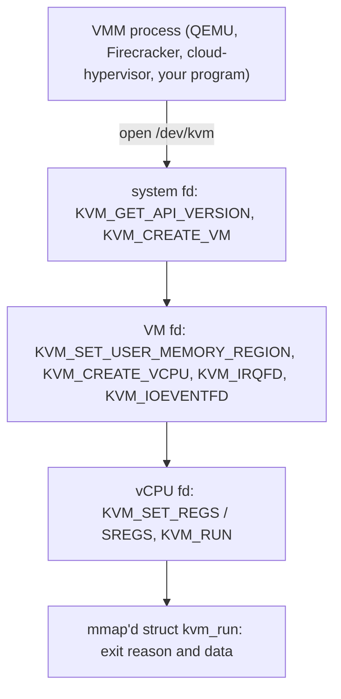

**Virtualization** presents software with a complete, isolated machine: a virtual CPU, memory and devices. Where containers share one kernel and isolate with namespaces and cgroups, a virtual machine (VM) runs its *own kernel* on virtual hardware, which is a stronger isolation boundary (the attack surface is the hypervisor and its device models rather than the whole syscall interface) at the price of a second kernel, memory overhead and boot time.

## Hardware-assisted virtualization

Before 2005, x86 could not be virtualized efficiently: some privileged instructions behaved differently in user mode without trapping. Intel **VT-x (VMX)** and AMD **AMD-V (SVM)** added a new execution mode:

- **Two modes**: *root mode* (the hypervisor) and *non-root mode* (the guest). The guest runs at full speed on the real CPU, with all four rings available, until it does something the hypervisor wants to intercept.
- A **VM exit** switches from guest to hypervisor and saves the guest state in a control structure (**VMCS** on Intel, **VMCB** on AMD); a **VM entry** (`VMLAUNCH`/`VMRESUME`) resumes the guest. The structure also holds the *controls*: which events cause exits (I/O instructions, `CPUID`, certain MSR accesses, external interrupts, `HLT`, EPT violations).
- **Second-level address translation (EPT on Intel, NPT on AMD)**: the CPU walks the guest page tables (guest-virtual to guest-physical) *and* the hypervisor's tables (guest-physical to host-physical) in hardware. A guest page fault does not exit; only a missing host mapping (**EPT violation**) does. This removed the shadow-page-table overhead of early virtualization and is why guest memory access runs near native speed.
- **Posted interrupts, APIC virtualization, VMCS shadowing** reduce exits further; **IOMMU** (VT-d/AMD-Vi) lets devices do DMA to guest addresses safely.

Check the host: `grep -E -o 'vmx|svm' /proc/cpuinfo | sort -u`, `ls -l /dev/kvm`, and `lscpu | grep Virtualization`. Other architectures have equivalents (Arm virtualization extensions with EL2, RISC-V H-extension).

## KVM: the kernel's hypervisor interface

**KVM** is a Linux kernel module (`kvm.ko` plus `kvm-intel.ko` or `kvm-amd.ko`) that turns the kernel into a hypervisor. It does only the part that needs ring-0 privileges: executing the guest and handling the exits it can handle quickly (EPT faults, most interrupts, many MSR/CPUID exits). Everything else is delegated to a user-space process through ioctls on a few file descriptors:



Key design decisions:

- A VM is a **file descriptor**, a vCPU is a **thread** of the VMM process that sits inside `ioctl(KVM_RUN)`. The Linux scheduler schedules vCPUs like any thread, so `taskset`, cgroups and nice values all apply to virtual CPUs.
- Guest RAM is **ordinary memory of the VMM process**, registered with `KVM_SET_USER_MEMORY_REGION`. The host's memory manager can swap it, compact it, back it with huge pages, share it (KSM) or move it (NUMA balancing).
- Everything KVM cannot handle returns from `KVM_RUN` with an **exit reason** (I/O port access, MMIO access, `HLT`, shutdown...) written into the shared `kvm_run` page. The VMM emulates the device, then calls `KVM_RUN` again.

### A complete virtual machine monitor

The program below creates a VM with 64 KiB of RAM and one vCPU in 16-bit real mode, copies in a few machine-code instructions (add two numbers, then write characters to I/O port `0x3f8`, the first serial port, then halt), and runs it. This is essentially what QEMU does, minus 500,000 lines of device emulation.

{{include linux/kvm/minivmm.c}}

{{run linux/kvm :: gcc -O2 -Wall -Wextra minivmm.c -o minivmm && ./minivmm}}

The guest computed 2 + 3, and its output appears on this program's stdout. Each `out` instruction **caused a VM exit** (`KVM_EXIT_IO`) and the program printed the byte, so the 5 port writes (`H`, `i`, space, the digit, newline) produced 5 I/O exits, plus the final `HLT` exit. The final `ax=10` is the newline loaded last; `bx=5` is the sum kept in a register. Nothing here required root: access to `/dev/kvm` is a normal permission on the `kvm` group.

### What a VM exit costs

Guest code that touches no device runs at native speed; exits are the overhead. The next program measures both: a guest loop that writes an I/O port in every iteration, and one that only computes.

{{include linux/kvm/exits.c}}

{{run linux/kvm :: gcc -O2 -Wall -Wextra exits.c -o exits && ./exits}}

The computing loop ran at roughly a third of a nanosecond per iteration (about one CPU cycle) with *one* exit in total: **a guest runs at hardware speed**. The loop that exits on every iteration costs on the order of ten microseconds per round trip here. That is a large number because this test machine is itself a virtual machine (**nested virtualization**: the guest exit is handled by a hypervisor running in a hypervisor); on bare metal a trip to a user-space VMM costs a few microseconds and an exit handled inside the kernel well under one. The lesson is the design rule behind all virtualization performance work: **count exits per I/O**, and move the common path out of user space (`vhost`, `ioeventfd`, `irqfd`) or out of the hypervisor entirely (passthrough).

## QEMU, TCG and device models

QEMU is the standard VMM. It plays several roles: machine and device emulation (chipsets, disks, NICs, USB, GPU, ...), the monitor and management protocol (QMP), and device backends. It can run a guest in two ways:

- **TCG** (Tiny Code Generator): software translation of guest instructions, usable for any architecture on any host, 5-50x slower; used when KVM is unavailable or for cross-architecture work (`qemu-system-aarch64` on x86).
- **KVM acceleration** (`-accel kvm` or `-enable-kvm`): the guest runs natively under KVM. This is what "KVM virtual machine" means in practice: KVM in the kernel, QEMU in user space.

```bash
qemu-system-x86_64 -accel kvm -cpu host -smp 4 -m 4G \
  -drive file=disk.qcow2,if=virtio,cache=none,aio=native \
  -netdev tap,id=n0,vhost=on -device virtio-net-pci,netdev=n0 \
  -nographic
```

`-cpu host` exposes the host CPU's features to the guest (best performance, but not migratable between different CPU models); a named model such as `Skylake-Server` gives a stable baseline for migration. Disk images are usually **qcow2** (copy-on-write, snapshots, backing files, compression) or raw on LVM/ZFS/Ceph for speed. **libvirt** (`virsh`, `virt-manager`, domain XML) provides a stable management layer: storage pools, networks, security labels (sVirt with SELinux/AppArmor so one VM escape cannot touch another), and live-migration orchestration.

## virtio: paravirtual devices

Emulating a real NIC or disk controller register by register means dozens of exits per packet. **virtio** is a standard for devices designed for virtualization: the guest knows it is virtual and uses an efficient shared-memory protocol. The same driver works with QEMU, Firecracker, cloud-hypervisor and others.

- A **virtqueue** is a ring in guest memory. In the (split) layout it has three parts: a **descriptor table** (address, length, flags, next index for each buffer chain), an **available ring** (indexes of chains the guest has made available to the device) and a **used ring** (chains the device has finished, with lengths). The guest posts buffers, rings a **doorbell** (a notification: one MMIO or I/O write, an exit), and the device consumes and signals completion with an interrupt. Both notifications can be suppressed when the other side is already busy polling, so a busy device exits rarely.
- Transports: virtio-pci (typical on x86), virtio-mmio (microVMs, embedded), virtio-ccw (s390).
- Devices: `virtio-net`, `virtio-blk`/`virtio-scsi`, `virtio-fs` (shared directory via FUSE, instead of 9p), `virtio-vsock` (host/guest sockets without a network), `virtio-balloon` (reclaim guest memory), `virtio-rng`, `virtio-gpu`, `virtio-console`.
- **Packed rings** (virtio 1.1) improve cache behaviour; **multi-queue** gives each vCPU its own queue pair.

### vhost: taking user space out of the data path

With plain virtio-net QEMU's I/O thread handles every doorbell and copies packets, taking a user-space round trip per batch. **vhost-net** moves the virtqueue processing into a kernel thread: QEMU hands over the queue addresses once, and then guest doorbells arrive as an **ioeventfd** (the kernel signals the vhost thread directly) and completions as an **irqfd** (the vhost thread injects the guest interrupt directly), with no user-space involvement. **vhost-user** does the same with a separate user-space process, such as DPDK/OVS-DPDK or SPDK, over a Unix socket, to run polling-mode data planes.

## Passthrough: VFIO and SR-IOV

For maximum I/O performance or for GPUs and accelerators, give the guest the real device. **VFIO** exposes a PCI device to user space with IOMMU protection: the IOMMU translates device DMA through tables that point only at that guest's memory, so a device (or a malicious guest driving it) cannot read other memory. Devices are grouped by what the IOMMU can isolate (**IOMMU groups**); all devices in a group go to the same VM. **SR-IOV** lets one physical NIC present many **virtual functions** (VFs), each a lightweight PCI device assignable to a different VM, with a hardware switch in the NIC. Costs: no live migration without special support, loss of host-side filtering and observability, and a fixed number of VFs.

## Memory management for VMs

- **Overcommit**: because guest RAM is process memory, the sum of guest sizes may exceed host RAM, relying on idle guests. Danger: the host swaps or the OOM killer kills a VM.
- **Ballooning**: the `virtio-balloon` driver in the guest allocates pages and gives them back to the host (a cooperative way to shrink a guest); free page reporting returns unused pages automatically.
- **KSM** (kernel samepage merging) deduplicates identical pages across VMs; saves memory, costs CPU, and is a side-channel risk, so often disabled in multi-tenant clouds.
- **Huge pages** for guest RAM (`hugetlbfs` or THP) cut both the guest-physical and host page-table walk cost under EPT, since a TLB miss under nested paging can take up to 24 memory references with small pages. Together with **NUMA pinning** (vCPUs and memory on the same node) they are the first tuning step for large VMs.

## Live migration

Moving a running VM to another host with downtime of milliseconds uses **pre-copy**: the source tracks which guest pages are modified (**dirty logging** via `KVM_GET_DIRTY_LOG` or the dirty ring), copies all memory while the guest keeps running, repeatedly re-sends pages dirtied in the meantime, and when the remaining dirty set is small enough to send within the allowed downtime it pauses the guest, sends the CPU and device state plus the last pages, and resumes on the destination. A guest that dirties memory faster than the network can copy never converges; remedies are **auto-converge** (throttle the guest's vCPUs), **post-copy** (switch early and fetch missing pages on demand via `userfaultfd`) and compression. Requirements: compatible CPU models, shared or migrated storage, matching device configuration.

## MicroVMs and containers

**Firecracker** (AWS Lambda and Fargate), **Cloud Hypervisor** and `crosvm` use KVM with a minimal VMM written in Rust: a few virtio devices, no PCI/BIOS legacy, boot in about 100-150 ms and a memory overhead of a few MiB. They aim for VM-grade isolation with container-like density. **Kata Containers** runs each pod in such a microVM behind the normal OCI runtime interface. **gVisor** takes a third path: a user-space kernel that intercepts the container's syscalls (and may use KVM as a platform).

## Security and operations

- The boundary is the hypervisor plus QEMU's device models; most VM-escape bugs are in emulated legacy devices (floppy, USB, NIC emulation), so production configurations remove unneeded devices, run QEMU as an unprivileged user inside a seccomp sandbox and confine it with SELinux/AppArmor (libvirt does this by default).
- **Side channels** (Spectre/Meltdown family, L1TF, MDS, cache and DRAM timing attacks) cross VM boundaries on shared cores; mitigations include microcode updates, core scheduling, disabling SMT between tenants, and not sharing a core between trust domains.
- **Confidential computing** (AMD SEV-SNP, Intel TDX) encrypts guest memory and protects it from the host, with attestation of the guest's initial state; KVM and QEMU support both.
- Operational checks: `virsh list`, `virsh dominfo`, `virsh domstats`, `perf kvm stat` (counts exits by reason), `/sys/kernel/debug/kvm`, `kvm_stat`, and the `kvm:*` tracepoints. A high exit rate for a reason like `EPT_MISCONFIG` or `IO_INSTRUCTION` points to emulated device I/O that should use virtio or vhost.
- Performance recipe for a latency-sensitive VM: pin vCPUs to dedicated host cores, give it huge pages on the same NUMA node, use `-cpu host`, virtio with vhost or SR-IOV, isolate host housekeeping from those cores (see the latency note), and keep the host's own overcommit at zero.

## Key takeaways

- VT-x/AMD-V run guest code natively and exit to the hypervisor on sensitive events; EPT/NPT make guest memory access nearly native. Exits, not instructions, are the overhead (measured above: ~0.3 ns per computing iteration, microseconds per I/O exit).
- KVM exposes this through ioctls: a VM is an fd, a vCPU is a thread running `KVM_RUN`, guest RAM is process memory, and anything KVM does not handle returns to the VMM as an exit reason.
- QEMU supplies device models and management; virtio replaces register-level emulation with shared-memory rings, vhost moves them into the kernel or another process, and VFIO/SR-IOV bypass emulation entirely.
- Live migration is iterative pre-copy driven by dirty-page tracking; it needs a converging dirty rate or auto-converge/post-copy.
- Choose containers for density, VMs for isolation, microVMs for both; harden the VMM, watch side channels, and tune with pinning, huge pages and NUMA.
