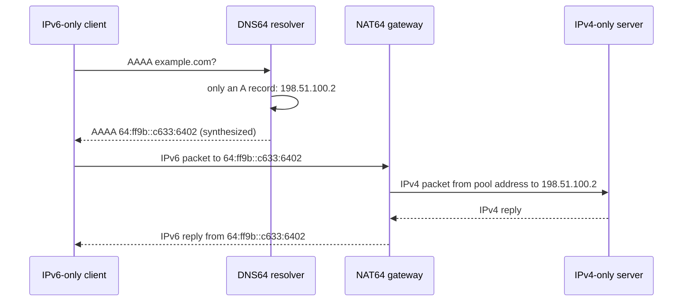

Dual-stack means running IPv4 and IPv6 side by side, which doubles the operational surface: two address plans, two sets of ACLs, two routing tables. An **IPv6-only** network drops IPv4 on the client side, but most of the Internet's servers still speak only IPv4. **Translation** bridges the two: the client uses IPv6 only, and a gateway rewrites packets to IPv4 on the way out. The pieces are:

| Piece | Job | Standard |
|---|---|---|
| **Address embedding** | put an IPv4 address inside an IPv6 prefix so the gateway can recover it | RFC 6052 |
| **DNS64** | answer a AAAA query for an IPv4-only name with a synthesized AAAA inside the NAT64 prefix | RFC 6147 |
| **SIIT** | stateless rewrite of IP and ICMP headers between versions | RFC 7915 |
| **NAT64** | SIIT plus a port-mapping table, so many IPv6 hosts share a few IPv4 addresses | RFC 6146 |
| **464XLAT** | a stateless translator (CLAT) on the device, so IPv4-only apps still work | RFC 6877 |

## Address embedding (RFC 6052)

The well-known prefix `64:ff9b::/96` carries the IPv4 address in its last 32 bits, so `198.51.100.2` becomes `64:ff9b::c633:6402`. An operator may use a network-specific prefix of length 32, 40, 48, 56, 64 or 96 from their own space. For prefixes shorter than 96 bits the IPv4 address is **split around bits 64-71**, which must be zero (the "u" octet of the old interface-identifier format), and the bytes after the address are also zero ("suffix"). The code below implements the RFC and prints its section 2.4 example for each length:

{{include networking/nat64/dns64.py}}

{{run networking/nat64 :: python3 dns64.py}}

Notice how `192.0.2.33` (`c0 00 02 21`) is cut into pieces for the /40, /48 and /56 cases, with a zero byte in the middle. Use the well-known prefix only for **global** IPv4 destinations: RFC 6052 forbids translating private ranges with it, which is why networks that need to translate 10.0.0.0/8 or similar use a network-specific prefix.

## DNS64

A DNS64 resolver asks for AAAA records on behalf of the client. If the name has none, it asks for A records and synthesizes AAAA records by embedding each address in the NAT64 prefix. Names with real AAAA records are returned unchanged (preferred). Two gotchas:

- **DNSSEC**: a validating client that asks for AAAA and checks signatures sees an answer the zone never signed. The validation must happen in the DNS64 resolver itself (using the CD/DO bits as RFC 6147 describes); a stub validator on the client will reject the synthesized record.
- **Prefix discovery**: how does the client know the NAT64 prefix (needed for 464XLAT and literals)? Either by querying the special name `ipv4only.arpa` (RFC 7050; this name has only IPv4 addresses, so the synthesized AAAA reveals the prefix) or from the **PREF64** option in Router Advertisements (RFC 8781), which is the preferred approach.

## SIIT: translating the headers

Stateless IP/ICMP translation maps fields one to one:

| IPv6 → IPv4 | Treatment |
|---|---|
| Traffic Class / Flow Label | Traffic Class becomes ToS; the flow label is dropped |
| Payload Length | recomputed into the IPv4 Total Length |
| Next Header | becomes Protocol; ICMPv6 (58) becomes ICMP (1) |
| Hop Limit | becomes TTL, **decremented** by 1 like any router |
| Addresses | taken from the mapping; IPv6 extension headers are mostly dropped |
| Fragmentation | IPv4 fragments needing 8-byte units; IPv6 Fragment header becomes IPv4 fields; DF bit is set for unfragmented packets |
| Checksum | TCP/UDP checksum covers a **pseudo-header with addresses**, so it must be recomputed; IPv4 header checksum is new; UDP checksum is mandatory in IPv6, so zero-checksum UDP from IPv4 must be recomputed by the translator |
| ICMP | ICMPv6 echo (128/129) ↔ ICMP echo (8/0); error messages (Packet Too Big ↔ Fragmentation Needed) are re-encoded, including their embedded packet |

MTU is the hardest part: IPv6 routers never fragment, IPv4 packets often do, and a path through a translator has a smaller MTU on one side. The translator must emit Packet Too Big or fragment IPv4 packets appropriately, and path-MTU discovery must work end to end (see the ICMP note).

## Stateful NAT64

SIIT needs one IPv4 address per IPv6 host. **NAT64** (RFC 6146) instead keeps a **binding table** like NAPT: `(IPv6 source, source port, protocol)` ↔ `(pool IPv4 address, mapped port)`. Bindings are created by outbound packets only; there is no way to initiate a connection *toward* an IPv6 host from IPv4 (unless a static mapping exists). Entries are removed after protocol-specific timeouts (RFC 6146 defaults: UDP 5 min, TCP established 2 h 4 min, TCP transitory 4 min, ICMP 60 s). State has consequences: the gateway is a single point of failure unless state is synchronized, and its port pool (about 64k ports per IPv4 address per protocol and destination) bounds the number of concurrent flows.

## Lab: a NAT64 gateway on a TUN device

A TUN device hands raw IP packets to a user-space program and injects whatever it writes back into the kernel. The translator below is therefore a real gateway: it reads IPv6 packets routed to `64:ff9b::/96`, rewrites them according to the rules above (including checksums), and writes the IPv4 packet out through the same device; return packets addressed to the pool address come back through it the other way. It covers ICMP echo, UDP and TCP, without fragmentation or ICMP errors, and the TCP handling is stateless (the handshake and teardown pass through untouched, so there is no connection tracking).

{{include networking/nat64/nat64.py}}

Topology: `c6` is an IPv6-only client with no IPv4 address on its interface, `n64` is the gateway, `s4` an IPv4-only server. The client and server programs are:

{{include networking/nat64/client.py}}

{{include networking/nat64/server.py}}

{{include networking/nat64/lab.sh}}

{{run networking/nat64 :: unshare -Urnm sh lab.sh 2>&1}}

What the output shows:

- The client interface has **no IPv4 address**, yet it pings and connects to an IPv4-only server using the synthesized address `64:ff9b::c633:6402`.
- The server sees every connection coming from the **pool address** `203.0.113.64` with a mapped port (40001, 40002, ...): it knows nothing about the client's IPv6 address, exactly as with NAPT.
- The ICMP reply `ttl=61` shows the hop limit being decremented in both translations plus the router hops.
- The gateway log shows one binding created per outbound flow (ICMP echo identifiers play the role of ports), and all IPv6-to-IPv4 and IPv4-to-IPv6 translated packet counts.
- The 20,000-byte TCP stream crossing the translator and coming back upper-cased proves the checksum recomputation is right in both directions, since a wrong TCP checksum would be silently dropped by either kernel.

## 464XLAT and the IPv4-literal problem

NAT64 needs the client to use DNS: an app that connects to a literal `203.0.113.5` or uses an IPv4-only socket API has no synthesized address. **464XLAT** (RFC 6877) fixes this with two translators in series:

1. The **CLAT** on the device presents a private IPv4 address (commonly `192.0.0.x`, from the 192.0.0.0/29 DS-Lite range) to apps and statelessly translates IPv4 to IPv6 with SIIT into the operator's translation prefix.
2. The operator's **PLAT** is a stateful NAT64 that carries the traffic to the IPv4 Internet.

This is how Android, iOS and many mobile networks run IPv6-only on the access side while IPv4-only apps still work. In 2026 it is also how "IPv6-mostly" LANs work (RFC 8925 DHCPv4 option 108 asks capable clients to stay IPv6-only, while legacy clients keep their IPv4 lease).

## Operating a NAT64 service

- **Log bindings** (time, IPv6 source, pool address and port, destination): attribution of abuse requires them, as for CGNAT.
- **Size the pool** from concurrent flows per user, not from users; one busy browser or an app using many parallel connections consumes hundreds of ports.
- **Monitor the translation of ICMP errors and PMTUD**; black holes here are the classic failure mode.
- **Keep DNS64 and NAT64 consistent**: the same prefix, and reachability of that prefix routed to the gateway (anycast several gateways in the same routing domain for scale; state is per gateway so asymmetric routing breaks flows).
- **What breaks**: IPv4 literals without a CLAT; protocols that carry IP addresses in their payload (old FTP, SIP, some games) need an ALG; DNSSEC-validating stubs; peer-to-peer services that need inbound connections.

## Key takeaways

- IPv6-only access with NAT64/DNS64 reaches IPv4-only servers: DNS64 synthesizes AAAA records inside a NAT64 prefix, and the gateway recovers the IPv4 destination from the last 32 bits (or the RFC 6052 split layout for shorter prefixes).
- SIIT translates headers statelessly and must recompute pseudo-header checksums; stateful NAT64 adds a port-binding table, created only by IPv6-side traffic.
- 464XLAT adds a device-side CLAT so IPv4 literals and IPv4-only apps work over an IPv6-only access network.
- DNSSEC validation, MTU/PMTUD handling and binding logs are the operational points that go wrong first.
