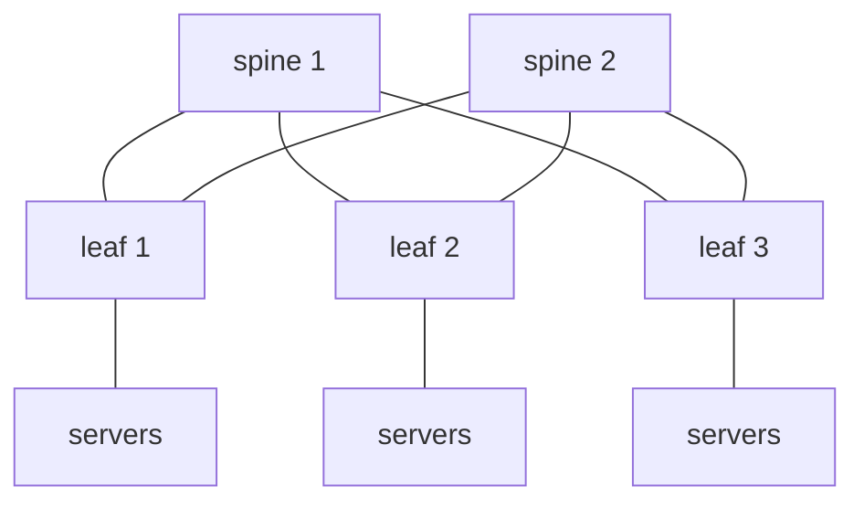

The classic campus design is a **tree**: access switches under distribution switches under a core. Traffic between two servers may have to climb to the top, so the top links carry the sum of everything below them, and spanning tree blocks the redundant links to avoid loops. That suits "north-south" traffic (clients to a few servers). Modern data centres are dominated by **east-west** traffic (servers talking to servers: storage replication, microservices, distributed training) and want predictable bandwidth and latency between *any* two servers. The answer is a **folded Clos network**, usually called **leaf-spine**.

## The leaf-spine topology

- Every **leaf** (top-of-rack switch) connects to **every spine**. Leaves never connect to leaves; spines never connect to spines.
- Servers attach only to leaves. Any server-to-server path across racks is **leaf → spine → leaf**: always exactly three switch hops, so latency is uniform.
- With *k* spines there are *k* equal-cost paths between any two leaves. Add bandwidth by adding spines; add ports by adding leaves. A 3-stage fabric scales until spine port count runs out; bigger fabrics add a **super-spine** layer (5-stage Clos), typically built from *pods* (a set of leaves and spines) joined by a super-spine plane.
- No spanning tree: every link is a **routed** point-to-point link and every path is used at once.

### Sizing and oversubscription

If a leaf has *d* downlink ports to servers and *u* uplink ports (one per spine), its **oversubscription ratio** is (d × downlink speed) / (u × uplink speed). 48 × 25G down and 6 × 100G up is 1200G over 600G = 2:1. A ratio of 1:1 is non-blocking (expensive); 3:1 is common for general compute. The number of leaves is bounded by the spine's port count, and the number of spines by the leaf's uplink count: with 64-port switches, 32 down + 32 up gives 32 spines × 64 leaves = 2048 server ports at 1:1 in a three-stage fabric.

Design rules that follow: all links the same speed (or ECMP weights get awkward), no failure of one spine should cut more than 1/*k* of capacity, and the fabric should be built from identical, cheap boxes rather than a few huge chassis (the original motivation in Clos's 1953 telephone-switching paper).

## The underlay: routed, with eBGP

RFC 7938 documents why large operators run **eBGP** as the underlay protocol, even though BGP is an exterior protocol:

- **Simple and well understood**: one protocol, no flooding domain. A link-state IGP floods every topology change to every node, and in a fabric with thousands of nodes that churn is global; BGP spreads reachability by prefix and keeps failures local.
- **Policy**: communities and AS-path filtering control exactly where routes go (for example, keep a rack's prefix from being re-advertised upward during maintenance).
- **ECMP for free**: with the same AS-path *length*, BGP can install several paths (multipath).
- Runs over TCP on directly connected links, with fast failure detection through BFD or link-down events.

A common layout gives **each leaf its own private ASN** (4-byte private AS numbers, RFC 6793) and **all spines of a tier a shared ASN**. Because the two leaves are in different ASes, paths leaf→spine→leaf look like AS-paths of equal length, so a remote prefix is learned from every spine with the same length and multipath works. The shared spine ASN also gives **loop prevention for free**: a route that went leaf → spine → another leaf and tried to come back up through a spine would contain the spine's ASN and be rejected, which is exactly the "valley-free" routing rule (never go up, down, then up again).

Practical details:

| Topic | Typical choice |
|---|---|
| Neighbour discovery | **BGP unnumbered**: eBGP over IPv6 link-local with the IPv4 next hop carried per RFC 5549, so no /30 or /31 addresses to allocate per link |
| Multipath across different ASes | enable multipath-relax (`bestpath as-path multipath-relax`) so paths via different neighbour ASNs of the same length count as equal |
| Timers | BFD (see the BFD note) or aggressive keepalive/hold timers; many fabrics rely on link-down detection |
| Prefixes advertised | server subnets and loopbacks only; **no default** needed from leaf to spine, defaults only at the border |
| Convergence | leaf failure affects its servers only; spine failure removes 1/*k* of the capacity and every leaf drops that next hop |
| Overlay | VXLAN with BGP EVPN (see that note) runs on top, so VLAN/tenant mobility doesn't need L2 in the fabric |

The underlay only has to deliver the VTEP loopbacks; the overlay carries tenant networks. Keep the underlay as stateless and boring as possible.

## ECMP: how a packet picks a spine

When a route has several next hops, the forwarding plane hashes some packet fields and uses the result to select one. Two properties are essential (RFC 2992 analyses the common algorithms):

1. **Per-flow, not per-packet**. All packets with the same hash input follow the same path, which keeps TCP segments in order. Per-packet spraying would reorder packets and trigger spurious retransmissions.
2. **The hash input decides the balance**. Hash on only source and destination IP and every flow between two hosts uses the same path; hash on the 5-tuple (addresses, protocol, ports) and flows spread.

Consequences that surprise people:

- **A single flow never exceeds one link**: a single TCP stream between two servers is limited to one 100G uplink even if there are 8 of them. Parallel streams (multiple connections, QUIC with varied ports, RoCE with varied UDP source ports) are how applications use the fabric.
- **Elephant flows collide**: with few large flows, random hashing can put two on one link while another sits idle. The balance only evens out with *many* flows.
- **Hash polarization**: if every tier uses the same hash function and fields, the flows that picked "uplink 1" at the leaf all pick "uplink 1" again at the spine, and some links stay empty. Switches avoid this with a per-switch hash seed.
- **Failures reshuffle**: with plain modulo hashing, removing one of *k* next hops may remap many flows, not just those on the failed link; **resilient hashing** and consistent-hash schemes minimise this.
- **Alternatives**: flowlet switching, packet-spraying with reordering tolerance in the NIC, and adaptive routing (in AI/HPC fabrics) trade the per-flow guarantee for better balance.

## Lab: a four-switch fabric in namespaces

Two leaves (`l1`, `l2`), two spines (`s1`, `s2`), a host behind each leaf, all links routed. Leaf `l1` has a two-way ECMP route to the far subnet, as BGP would install it. The script then sends 200 UDP packets from distinct source ports and counts packets leaving `l1` on each uplink, under the two Linux hash policies (`fib_multipath_hash_policy` 0 = layer 3 only, 1 = layer 4 5-tuple), then repeats with one single flow, then takes an uplink down.

{{include networking/clos/lab.sh}}

{{run networking/clos :: unshare -Urnm sh lab.sh 2>&1}}

What the output shows:

- **Policy 0 (L3)**: all 200 flows, and the single flow, use one spine. The hash sees only `10.1.0.2 → 10.2.0.2`, which is identical for every packet, so the "load balancing" is a no-op. This is the Linux default for forwarded IPv4 traffic, which is why a routed Linux box doing ECMP between two hosts uses just one path until you change the policy. (The one extra packet in the 201 count is the ARP/neighbour traffic that crossed the link first.)
- **Policy 1 (L4)**: the 200 flows split about evenly (roughly 100/100; exact split varies with the ports used), but the **single flow still goes entirely to one spine**, as the per-flow rule demands.
- **Link down**: the route is marked `dead linkdown` for the failed next hop; all traffic now uses the remaining spine. No routing protocol ran here; with a real protocol the dead next hop would be withdrawn through BGP/BFD, but the *kernel* reaction to the carrier loss is immediate if you set `net.ipv4.conf.<if>.ignore_routes_with_linkdown=1`, and in this case Linux already skipped the dead next hop of a multipath route.

## Operating a fabric

- **Verify symmetry**: every leaf should see *k* next hops for every remote prefix. A missing next hop quietly halves capacity without breaking connectivity, so alert on next-hop count, not only reachability.
- **Drain before maintenance**: set a community or AS-path prepend (or shut the BGP session gracefully with **graceful shutdown**, RFC 8326) so traffic moves off a device before it is touched.
- **Watch link utilisation spread** across uplinks: a persistent imbalance means polarization, a hash that is missing the L4 ports, or a few elephant flows.
- **MTU**: VXLAN adds about 50 bytes; set the underlay to jumbo (e.g. 9216) so the overlay can carry 1500-byte or 9000-byte tenant packets without fragmentation.
- **Failure domains**: size pods so that losing one leaf or one spine is a routine event, and keep control-plane state (route counts per leaf) well below table limits.

## Key takeaways

- Leaf-spine gives uniform three-hop latency and scales by adding spines (bandwidth) or leaves (ports); oversubscription is the ratio of downlink to uplink capacity at the leaf.
- The underlay is routed point-to-point links with eBGP (RFC 7938): per-leaf ASNs, shared spine ASN, multipath, BGP unnumbered; the overlay (VXLAN/EVPN) carries tenant networks.
- ECMP is per flow. Which fields are hashed decides whether load spreads; one flow can never use more than one path.
- On Linux, `fib_multipath_hash_policy=1` (or 2/3 for inner headers) is needed for real balancing of forwarded IPv4 traffic; the default L3 policy sends one host pair down a single path.
- Monitor next-hop counts and per-uplink spread; avoid hash polarization and drain devices gracefully before maintenance.
