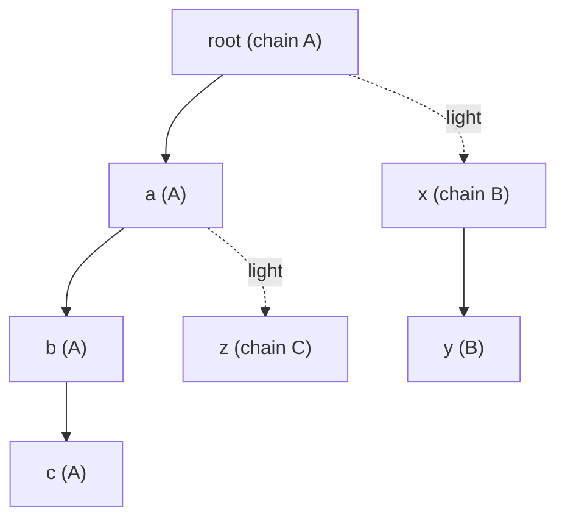

Many problems hand you a tree once and then ask thousands or millions of questions about it: "where do these two nodes' root paths meet?", "what is the sum of values on the path between *u* and *v* after this update?", "how far is *v* from the nearest highlighted node?". Walking the tree per query costs O(depth) — up to O(n) on a path — so 10^6 queries on 10^6 nodes is 10^12 steps. This note builds the three standard structures that bring each query to O(log n) or better, as one header whose pieces are tested against naive code.

All traversals are **iterative** (BFS order and an explicit stack): a path of a million vertices would overflow the call stack of a recursive DFS, and it is exactly the input a test-setter will use.

## Foundation: parents, depths and subtree sizes

From a rooted tree we compute, with one BFS and one reverse pass, the arrays everything else needs: `par[v]`, `depth[v]`, the BFS `order`, the subtree `size[v]`, and each vertex's **heavy child**, the child with the largest subtree.

## Lowest common ancestor

The **LCA** of *u* and *v* is the deepest vertex that is an ancestor of both. Distance between them is `depth[u] + depth[v] − 2·depth[lca]`, so LCA also gives tree distances.

### Binary lifting: O(n log n) memory, O(log n) per query

Store `up[j][v]` = the 2^j-th ancestor of *v*. First lift the deeper vertex up to the depth of the other by the binary digits of the depth difference; then lift both together, largest jump first, as long as the ancestors differ. The LCA is the parent of where they stop. Simple, supports "k-th ancestor" queries too, and is the best default when you need ancestors, not just LCA.

### Preorder plus sparse table: O(1) per query

Number the vertices in preorder. For `tin[u] < tin[v]`, the LCA is the **parent of the shallowest vertex among preorder positions (tin[u], tin[v]]**. A sparse table (a range-minimum structure with O(n log n) memory and O(1) queries, keyed by depth) answers that range query with two overlapping power-of-two blocks. Fastest queries, but the sparse table is the heaviest in memory.

### Heavy-light: no extra tables

Next to the structures above, **heavy-light decomposition (HLD)** gives LCA for free, because it makes the "climb" take few steps, as explained in the next section.

## Heavy-light decomposition

Mark each vertex's edge to its heavy child as *heavy*; the other edges are *light*. The heavy edges form vertical **chains**, and the key fact is:

> Any root-to-vertex path crosses at most **log₂ n** light edges, because each light edge at least halves the subtree size.

So any path in the tree decomposes into O(log n) pieces, each a contiguous part of one chain. If we lay each chain out contiguously in an array (`pos[v]`, chain start `head[v]`), then a path query becomes O(log n) **range queries** on an ordinary array structure — here a Fenwick tree (see the range-query note), which supports point updates and prefix sums in O(log n). A segment tree in its place handles range updates, max/min or any monoid.



A path query from *u* to *v*: while their chain heads differ, take the vertex whose head is **deeper**, query the segment from its head down to it, and jump to the head's parent; once both are on the same chain, query the segment between them. The same loop returns the LCA (the shallower of the two at the end). Cost O(log n) light-edge jumps × O(log n) per Fenwick query = **O(log² n)** per path query, usually much less in practice.

## Centroid decomposition

A **centroid** of a tree with *n* vertices is a vertex whose removal leaves components of size at most n/2; one always exists. Remove it, recurse into each component, and you get a **centroid tree** of depth O(log n). Every path *u → v* in the original tree passes through the centroid that is the first common ancestor of *u* and *v* in the centroid tree. That turns path questions into "combine information stored at O(log n) ancestors".

Example, **nearest marked vertex with updates**: for every vertex store its distance to each of its ≤ log n centroid ancestors (`dist[level][v]`), and for each centroid the closest marked vertex in its component (`best[c]`). Marking *v* updates `best` at all its centroid ancestors; a query for *v* takes `min(best[c] + dist(c, v))` over those ancestors. Both are O(log n), memory O(n log n). The same pattern counts paths of a given length, finds the closest pair at distance ≤ K, and answers many "all paths through a vertex" problems.

## The implementation

```c
// Tree queries on a rooted tree with n vertices (0..n-1), root 0. All traversals are iterative (a path graph of
// 10^6 vertices would overflow the call stack if we recursed). Memory: O(n log n) for lifting and centroid distances.
#include <stdint.h>
#include <stdlib.h>
#include <string.h>

typedef struct {
    int n, *adj_start, *adj;          // CSR adjacency
    int *par, *depth, *order;         // order: BFS order from the root; par[0] = -1
    int *size, *heavy;                // subtree size, heavy child (-1 for leaves)
} tree_t;

static void tree_build(tree_t *t, int n, const int (*edges)[2]) {
    t->n = n;
    t->adj_start = calloc(n + 2, sizeof(int)); t->adj = malloc(2 * (n > 1 ? n - 1 : 1) * sizeof(int));
    for (int i = 0; i < n - 1; i++) { t->adj_start[edges[i][0] + 1]++; t->adj_start[edges[i][1] + 1]++; }
    for (int i = 0; i < n; i++) t->adj_start[i + 1] += t->adj_start[i];
    int *fill = malloc(n * sizeof(int)); memcpy(fill, t->adj_start, n * sizeof(int));
    for (int i = 0; i < n - 1; i++) { int a = edges[i][0], b = edges[i][1]; t->adj[fill[a]++] = b; t->adj[fill[b]++] = a; }
    free(fill);
    t->par = malloc(n * sizeof(int)); t->depth = malloc(n * sizeof(int)); t->order = malloc(n * sizeof(int));
    t->size = malloc(n * sizeof(int)); t->heavy = malloc(n * sizeof(int));
    int head = 0, tail = 0; t->order[tail++] = 0; t->par[0] = -1; t->depth[0] = 0;
    while (head < tail) {
        int v = t->order[head++];
        for (int e = t->adj_start[v]; e < t->adj_start[v + 1]; e++) {
            int w = t->adj[e]; if (w == t->par[v]) continue;
            t->par[w] = v; t->depth[w] = t->depth[v] + 1; t->order[tail++] = w;
        }
    }
    for (int i = 0; i < n; i++) { t->size[i] = 1; t->heavy[i] = -1; }
    for (int i = n - 1; i > 0; i--) { int v = t->order[i], p = t->par[v]; t->size[p] += t->size[v]; }
    for (int i = n - 1; i > 0; i--) { int v = t->order[i], p = t->par[v]; if (t->heavy[p] < 0 || t->size[v] > t->size[t->heavy[p]]) t->heavy[p] = v; }
}

/* ---------- LCA 1: binary lifting, O(n log n) memory, O(log n) per query ---------- */
typedef struct { int log; int **up; const tree_t *t; } lift_t;
static void lift_build(lift_t *L, const tree_t *t) {
    int lg = 1; while ((1 << lg) < t->n) lg++;
    L->log = lg; L->t = t; L->up = malloc(lg * sizeof(int *));
    L->up[0] = malloc(t->n * sizeof(int));
    for (int v = 0; v < t->n; v++) L->up[0][v] = t->par[v] < 0 ? v : t->par[v];     // the root is its own ancestor
    for (int j = 1; j < lg; j++) {
        L->up[j] = malloc(t->n * sizeof(int));
        for (int v = 0; v < t->n; v++) L->up[j][v] = L->up[j - 1][L->up[j - 1][v]];
    }
}
static int lift_lca(const lift_t *L, int u, int v) {
    const tree_t *t = L->t;
    if (t->depth[u] < t->depth[v]) { int x = u; u = v; v = x; }
    int diff = t->depth[u] - t->depth[v];
    for (int j = 0; j < L->log; j++) if (diff >> j & 1) u = L->up[j][u];
    if (u == v) return u;
    for (int j = L->log - 1; j >= 0; j--) if (L->up[j][u] != L->up[j][v]) { u = L->up[j][u]; v = L->up[j][v]; }
    return L->up[0][u];
}

/* ---------- LCA 2: preorder + sparse table, O(n log n) build, O(1) per query ---------- */
// In preorder, for tin[u] < tin[v] the LCA is the parent of the shallowest vertex in preorder positions (tin[u], tin[v]].
typedef struct { int *tin, **sp, *lg; const tree_t *t; } rmq_t;
static int shallower(const tree_t *t, int a, int b) { return t->depth[a] <= t->depth[b] ? a : b; }
static void rmq_build(rmq_t *R, const tree_t *t) {
    int n = t->n; R->t = t; R->tin = malloc(n * sizeof(int));
    int *stack = malloc(n * sizeof(int)), *pre = malloc(n * sizeof(int)), sp = 0, cnt = 0;
    stack[sp++] = 0;
    while (sp) {                                   // iterative preorder
        int v = stack[--sp]; R->tin[v] = cnt; pre[cnt++] = v;
        for (int e = t->adj_start[v]; e < t->adj_start[v + 1]; e++) if (t->adj[e] != t->par[v]) stack[sp++] = t->adj[e];
    }
    R->lg = malloc((n + 1) * sizeof(int)); R->lg[1] = 0;
    for (int i = 2; i <= n; i++) R->lg[i] = R->lg[i / 2] + 1;
    int K = R->lg[n] + 1; R->sp = malloc(K * sizeof(int *));
    R->sp[0] = pre;
    for (int k = 1; k < K; k++) {
        R->sp[k] = malloc(n * sizeof(int));
        for (int i = 0; i + (1 << k) <= n; i++) R->sp[k][i] = shallower(t, R->sp[k - 1][i], R->sp[k - 1][i + (1 << (k - 1))]);
    }
    free(stack);
}
static int rmq_lca(const rmq_t *R, int u, int v) {
    if (u == v) return u;
    int l = R->tin[u], r = R->tin[v]; if (l > r) { int x = l; l = r; r = x; }
    l++;                                           // range (tin[u], tin[v]]
    int k = R->lg[r - l + 1];
    return R->t->par[shallower(R->t, R->sp[k][l], R->sp[k][r - (1 << k) + 1])];
}

/* ---------- Heavy-light decomposition: path queries as O(log n) contiguous ranges ---------- */
typedef struct { const tree_t *t; int *head, *pos; long long *bit; } hld_t;     // bit: Fenwick tree over positions
static void bit_add(long long *b, int n, int i, long long d) { for (i++; i <= n; i += i & -i) b[i] += d; }
static long long bit_sum(const long long *b, int i) { long long s = 0; for (i++; i > 0; i -= i & -i) s += b[i]; return s; }   // sum of [0..i]

static void hld_build(hld_t *H, const tree_t *t) {
    int n = t->n; H->t = t; H->head = malloc(n * sizeof(int)); H->pos = malloc(n * sizeof(int)); H->bit = calloc(n + 1, sizeof(long long));
    int cur = 0;
    for (int i = 0; i < n; i++) {
        int v = t->order[i];
        if (t->par[v] >= 0 && t->heavy[t->par[v]] == v) continue;       // not the start of a chain
        for (int w = v; w >= 0; w = t->heavy[w]) { H->head[w] = v; H->pos[w] = cur++; }   // lay a whole chain out contiguously
    }
}
static void hld_add(hld_t *H, int v, long long d) { bit_add(H->bit, H->t->n, H->pos[v], d); }
// sum of vertex values on the path u..v (inclusive)
static long long hld_path_sum(const hld_t *H, int u, int v) {
    const tree_t *t = H->t; long long s = 0;
    while (H->head[u] != H->head[v]) {
        if (t->depth[H->head[u]] < t->depth[H->head[v]]) { int x = u; u = v; v = x; }
        s += bit_sum(H->bit, H->pos[u]) - bit_sum(H->bit, H->pos[H->head[u]] - 1);   // whole chain prefix up to u
        u = t->par[H->head[u]];
    }
    if (t->depth[u] > t->depth[v]) { int x = u; u = v; v = x; }
    return s + bit_sum(H->bit, H->pos[v]) - bit_sum(H->bit, H->pos[u] - 1);
}
static int hld_lca(const hld_t *H, int u, int v) {          // HLD also gives an LCA with no extra tables
    const tree_t *t = H->t;
    while (H->head[u] != H->head[v]) {
        if (t->depth[H->head[u]] < t->depth[H->head[v]]) { int x = u; u = v; v = x; }
        u = t->par[H->head[u]];
    }
    return t->depth[u] < t->depth[v] ? u : v;
}

/* ---------- Centroid decomposition: nearest marked vertex, with updates ---------- */
typedef struct { int n, *cpar, *level; int **dist; int *best; int maxlevel; } cent_t;   // dist[l][v]: distance from v to its level-l centroid ancestor
#define INF 0x3fffffff
static void cent_build(cent_t *C, const tree_t *t) {
    int n = t->n; C->n = n; C->cpar = malloc(n * sizeof(int)); C->level = malloc(n * sizeof(int)); C->best = malloc(n * sizeof(int));
    int L = 1; while ((1 << L) <= n) L++; L += 1; C->maxlevel = L;
    C->dist = malloc(L * sizeof(int *)); for (int l = 0; l < L; l++) C->dist[l] = malloc(n * sizeof(int));
    char *removed = calloc(n, 1);
    int *q = malloc(n * sizeof(int)), *p = malloc(n * sizeof(int)), *sz = malloc(n * sizeof(int));
    int *wstart = malloc(n * sizeof(int)), *wpar = malloc(n * sizeof(int)), *wlev = malloc(n * sizeof(int)), ws = 0;   // explicit work stack
    wstart[ws] = 0; wpar[ws] = -1; wlev[ws] = 0; ws++;
    while (ws) {
        ws--; int s = wstart[ws], cp = wpar[ws], lev = wlev[ws];
        int h = 0, tl = 0; q[tl++] = s; p[s] = -1;                            // BFS over the current component
        while (h < tl) { int v = q[h++]; for (int e = t->adj_start[v]; e < t->adj_start[v + 1]; e++) { int w = t->adj[e]; if (!removed[w] && w != p[v]) { p[w] = v; q[tl++] = w; } } }
        for (int i = tl - 1; i >= 0; i--) { int v = q[i]; sz[v] = 1; }
        for (int i = tl - 1; i > 0; i--) sz[p[q[i]]] += sz[q[i]];
        int c = s;                                                            // walk toward the heavy side until balanced
        for (;;) { int nx = -1; for (int e = t->adj_start[c]; e < t->adj_start[c + 1]; e++) { int w = t->adj[e]; if (!removed[w] && w != p[c] && sz[w] * 2 > tl) nx = w; } if (nx < 0) break; c = nx; }
        C->cpar[c] = cp; C->level[c] = lev; C->best[c] = INF;
        h = 0; tl = 0; q[tl++] = c; p[c] = -1; C->dist[lev][c] = 0;           // distances from the centroid to its whole component
        while (h < tl) { int v = q[h++]; for (int e = t->adj_start[v]; e < t->adj_start[v + 1]; e++) { int w = t->adj[e]; if (!removed[w] && w != p[v]) { p[w] = v; C->dist[lev][w] = C->dist[lev][v] + 1; q[tl++] = w; } } }
        removed[c] = 1;
        for (int e = t->adj_start[c]; e < t->adj_start[c + 1]; e++) { int w = t->adj[e]; if (!removed[w]) { wstart[ws] = w; wpar[ws] = c; wlev[ws] = lev + 1; ws++; } }
    }
    free(removed); free(q); free(p); free(sz); free(wstart); free(wpar); free(wlev);
}
static void cent_mark(cent_t *C, int v) {
    for (int a = v; a >= 0; a = C->cpar[a]) { int d = C->dist[C->level[a]][v]; if (d < C->best[a]) C->best[a] = d; }
}
static int cent_nearest(const cent_t *C, int v) {              // distance to the nearest marked vertex (INF if none)
    int r = INF;
    for (int a = v; a >= 0; a = C->cpar[a]) if (C->best[a] < INF) { int d = C->best[a] + C->dist[C->level[a]][v]; if (d < r) r = d; }
    return r;
}
```

### Verification

Each structure is compared with a naive implementation (walk up for the LCA, walk the path for the sum, multi-source BFS for the nearest marked vertex) on five tree shapes — random, path, star, complete binary, caterpillar — for every size 1 to 19 and then sizes in steps up to 300, with random interleaved updates and queries. Small sizes include the boundary cases (a single vertex, two vertices, root as the LCA).

```c
// Differential test of every structure in treeq.h against naive implementations, on trees of several shapes.
#include "treeq.h"
#include <stdio.h>

static uint64_t rng = 0x2545F4914F6CDD1DULL;
static uint64_t rnd(void) { rng ^= rng << 13; rng ^= rng >> 7; rng ^= rng << 17; return rng; }

enum { RANDOM, PATH, STAR, BINARY, CATERPILLAR, SHAPES };
static const char *shape_name[] = {"random", "path", "star", "binary", "caterpillar"};

static void gen(int shape, int n, int (*e)[2]) {                 // random labels: shuffle so root 0 is not special
    int *perm = malloc(n * sizeof(int)); for (int i = 0; i < n; i++) perm[i] = i;
    for (int i = n - 1; i > 0; i--) { int j = rnd() % (i + 1); int x = perm[i]; perm[i] = perm[j]; perm[j] = x; }
    for (int i = 1; i < n; i++) {
        int p = shape == RANDOM ? (int)(rnd() % i) : shape == PATH ? i - 1 : shape == STAR ? 0 : shape == BINARY ? (i - 1) / 2 : (i % 2 ? (i - 1) / 2 * 2 : i - 1);
        if (shape == CATERPILLAR) p = i % 2 ? (i > 1 ? i - 2 : 0) : i - 1;     // spine of even vertices, leaves hanging from them
        e[i - 1][0] = perm[p]; e[i - 1][1] = perm[i];
    }
    free(perm);
}

static int naive_lca(const tree_t *t, int u, int v) {
    while (t->depth[u] > t->depth[v]) u = t->par[u];
    while (t->depth[v] > t->depth[u]) v = t->par[v];
    while (u != v) { u = t->par[u]; v = t->par[v]; }
    return u;
}
static long long naive_path_sum(const tree_t *t, const long long *val, int u, int v) {
    long long s = 0;
    while (u != v) { if (t->depth[u] >= t->depth[v]) { s += val[u]; u = t->par[u]; } else { s += val[v]; v = t->par[v]; } }
    return s + val[u];
}
static int naive_nearest(const tree_t *t, const char *marked, int src) {
    int n = t->n; int *d = malloc(n * sizeof(int)), *q = malloc(n * sizeof(int)); for (int i = 0; i < n; i++) d[i] = -1;
    int h = 0, tl = 0; q[tl++] = src; d[src] = 0; int ans = INF;
    while (h < tl) { int v = q[h++]; if (marked[v] && d[v] < ans) ans = d[v];
        for (int e = t->adj_start[v]; e < t->adj_start[v + 1]; e++) { int w = t->adj[e]; if (d[w] < 0) { d[w] = d[v] + 1; q[tl++] = w; } } }
    free(d); free(q); return ans;
}

int main(void) {
    long checks = 0;
    for (int shape = 0; shape < SHAPES; shape++)
        for (int n = 1; n <= 300; n += (n < 20 ? 1 : 37)) {
            int (*e)[2] = malloc((n > 1 ? n - 1 : 1) * sizeof *e); gen(shape, n, e);
            tree_t t; tree_build(&t, n, (const int (*)[2])e);
            lift_t L; lift_build(&L, &t); rmq_t R; rmq_build(&R, &t); hld_t H; hld_build(&H, &t); cent_t C; cent_build(&C, &t);
            long long *val = calloc(n, sizeof(long long)); char *marked = calloc(n, 1);
            for (int op = 0; op < 400; op++) {
                int u = rnd() % n, v = rnd() % n, w = naive_lca(&t, u, v);
                if (lift_lca(&L, u, v) != w || rmq_lca(&R, u, v) != w || hld_lca(&H, u, v) != w) { printf("LCA mismatch (%s, n=%d)\n", shape_name[shape], n); return 1; }
                int x = rnd() % n; long long d = (long long)(rnd() % 2001) - 1000; val[x] += d; hld_add(&H, x, d);
                if (hld_path_sum(&H, u, v) != naive_path_sum(&t, val, u, v)) { printf("path sum mismatch (%s, n=%d)\n", shape_name[shape], n); return 1; }
                if (op % 3 == 0) { int m = rnd() % n; marked[m] = 1; cent_mark(&C, m); }
                if (cent_nearest(&C, u) != naive_nearest(&t, marked, u)) { printf("nearest mismatch (%s, n=%d)\n", shape_name[shape], n); return 1; }
                checks += 4;
            }
            free(e); free(val); free(marked);
        }
    printf("%ld cross-checks against naive implementations passed (5 tree shapes, n = 1..300)\n", checks);
    return 0;
}
```

```text
$ gcc -O1 -g -Wall -Wextra -Wno-unused-function -fsanitize=address,undefined test.c -o t && ASAN_OPTIONS=detect_leaks=0 ./t
216000 cross-checks against naive implementations passed (5 tree shapes, n = 1..300)
```

(Leak detection is switched off only because the test does not free its trees between cases.)

### Scale: one million vertices

```c
// Build and query cost on n = 1,000,000 vertices: a path (the worst case for depth) and a random tree.
#include "treeq.h"
#include <stdio.h>
#include <time.h>

static uint64_t rng = 0x9E3779B97F4A7C15ULL;
static uint64_t rnd(void) { rng ^= rng << 13; rng ^= rng >> 7; rng ^= rng << 17; return rng; }
static double now(void) { struct timespec t; clock_gettime(CLOCK_MONOTONIC, &t); return t.tv_sec + t.tv_nsec * 1e-9; }

static void bench(const char *name, int path) {
    int n = 1000000, Q = 1000000;
    int (*e)[2] = malloc((n - 1) * sizeof *e);
    for (int i = 1; i < n; i++) { e[i - 1][0] = path ? i - 1 : (int)(rnd() % i); e[i - 1][1] = i; }
    tree_t t; double t0 = now(); tree_build(&t, n, (const int (*)[2])e); double d_tree = now() - t0;
    lift_t L; t0 = now(); lift_build(&L, &t); double d_lift = now() - t0;
    rmq_t R;  t0 = now(); rmq_build(&R, &t);  double d_rmq = now() - t0;
    hld_t H;  t0 = now(); hld_build(&H, &t);  double d_hld = now() - t0;
    cent_t C; t0 = now(); cent_build(&C, &t); double d_cent = now() - t0;
    int *us = malloc(Q * sizeof(int)), *vs = malloc(Q * sizeof(int));
    for (int i = 0; i < Q; i++) { us[i] = rnd() % n; vs[i] = rnd() % n; }
    long long sink = 0;
    t0 = now(); for (int i = 0; i < Q; i++) sink += lift_lca(&L, us[i], vs[i]); double q_lift = (now() - t0) / Q * 1e9;
    t0 = now(); for (int i = 0; i < Q; i++) sink += rmq_lca(&R, us[i], vs[i]);  double q_rmq  = (now() - t0) / Q * 1e9;
    t0 = now(); for (int i = 0; i < Q; i++) sink += hld_lca(&H, us[i], vs[i]);  double q_hld  = (now() - t0) / Q * 1e9;
    t0 = now(); for (int i = 0; i < Q; i++) sink += hld_path_sum(&H, us[i], vs[i]); double q_sum = (now() - t0) / Q * 1e9;
    t0 = now(); for (int i = 0; i < 1000; i++) cent_mark(&C, us[i]); double m = (now() - t0) / 1000 * 1e9;
    t0 = now(); for (int i = 0; i < Q; i++) sink += cent_nearest(&C, vs[i]); double q_near = (now() - t0) / Q * 1e9;
    int maxdepth = 0; for (int i = 0; i < n; i++) if (t.depth[i] > maxdepth) maxdepth = t.depth[i];
    int chains = 0; for (int i = 0; i < n; i++) if (H.head[i] == i) chains++;
    printf("%s: n=%d, depth %d, %d heavy chains\n", name, n, maxdepth, chains);
    printf("  build (ms):  tree %.0f  lifting %.0f  sparse-table %.0f  HLD %.0f  centroid %.0f\n", d_tree * 1e3, d_lift * 1e3, d_rmq * 1e3, d_hld * 1e3, d_cent * 1e3);
    printf("  query (ns):  LCA lifting %.0f  LCA sparse-table %.0f  LCA via HLD %.0f  HLD path sum %.0f  centroid nearest %.0f  centroid mark %.0f\n", q_lift, q_rmq, q_hld, q_sum, q_near, m);
    if (sink == 42) puts("");
    free(e); free(us); free(vs);
}

int main(void) { bench("path", 1); bench("random tree", 0); return 0; }
```

```text
$ gcc -O2 -Wall -Wextra -Wno-unused-function bench.c -o bench && ./bench
path: n=1000000, depth 999999, 1 heavy chains
  build (ms):  tree 44  lifting 55  sparse-table 83  HLD 10  centroid 709
  query (ns):  LCA lifting 1319  LCA sparse-table 171  LCA via HLD 22  HLD path sum 205  centroid nearest 904  centroid mark 1711
random tree: n=1000000, depth 33, 500532 heavy chains
  build (ms):  tree 183  lifting 53  sparse-table 185  HLD 49  centroid 1422
  query (ns):  LCA lifting 907  LCA sparse-table 69  LCA via HLD 125  HLD path sum 608  centroid nearest 247  centroid mark 894
```

How to read the numbers (exact values vary by machine and run):

- On the **path**, the depth is 999,999 and a naive climb would average hundreds of thousands of steps per query. Binary lifting needs about 20 jumps (~1.5 µs, poor locality), the sparse table a handful of loads (~0.1–0.2 µs), and HLD is fastest because the whole path is **one chain** and the loop body runs zero times.
- On the **random tree**, depth is only about 30, so all methods are fast; here the sparse table wins and HLD pays for crossing many short chains (about half a million chains for a random tree).
- Centroid decomposition costs the most to build (about a second for a million vertices: n log n BFS work and n log n memory in the distance table), but then answers nearest-marked queries in under a microsecond and supports updates, which no other structure here does.
- HLD's build is cheap (tens of milliseconds); updates and path sums stay in the low microseconds.

## Choosing and extending

| Need | Use |
|---|---|
| LCA only, static tree, many queries | preorder + sparse table |
| LCA plus k-th ancestor, simple code | binary lifting |
| Path aggregate with point/range updates | HLD + Fenwick / segment tree |
| Subtree aggregate | the preorder (Euler) interval of the subtree: a segment tree over `tin..tout` |
| Distance-based queries ("nearest", "count pairs at distance ≤ K") | centroid decomposition |
| Edges rather than vertices | store each edge's value at its deeper endpoint |
| The tree itself changes (link/cut) | link-cut trees (Sleator–Tarjan), outside this note |
| Offline, all queries known | Tarjan's offline LCA with union-find, O((n + q) α) |

## Pitfalls

- **Recursion depth** on a path graph: do the DFS iteratively, or raise the stack limit and still expect trouble.
- **Edge vs vertex values**: path queries over edges must exclude the LCA's own value; storing values on the deeper endpoint of each edge and skipping the topmost vertex in the last segment is the standard fix.
- **Off-by-one in the sparse-table range**: the query is over (tin[u], tin[v]], not [tin[u], tin[v]]; the version above also handles `u == v` separately.
- **Overflow**: sums over a million vertices of values up to 10^9 need 64-bit accumulators.
- **Memory**: lifting and the centroid distance table are O(n log n); at n = 10^7 that is gigabytes. HLD and the sparse-table-free approach are O(n).
- **Multiple roots / forests**: add a virtual root or run per component.

## Key takeaways

- Per-query tree walks are O(depth); the structures here make the query O(log n) or O(1) after preprocessing.
- LCA: binary lifting (simple, k-th ancestor), preorder + sparse table (O(1) queries), HLD (no extra tables, and also gives path queries).
- HLD turns any tree path into O(log n) contiguous array ranges, because any root path crosses at most log₂ n light edges.
- Centroid decomposition gives a depth-log n hierarchy for distance-type queries with updates, at O(n log n) memory.
- Do traversals iteratively and test against naive code on paths, stars and random trees.
