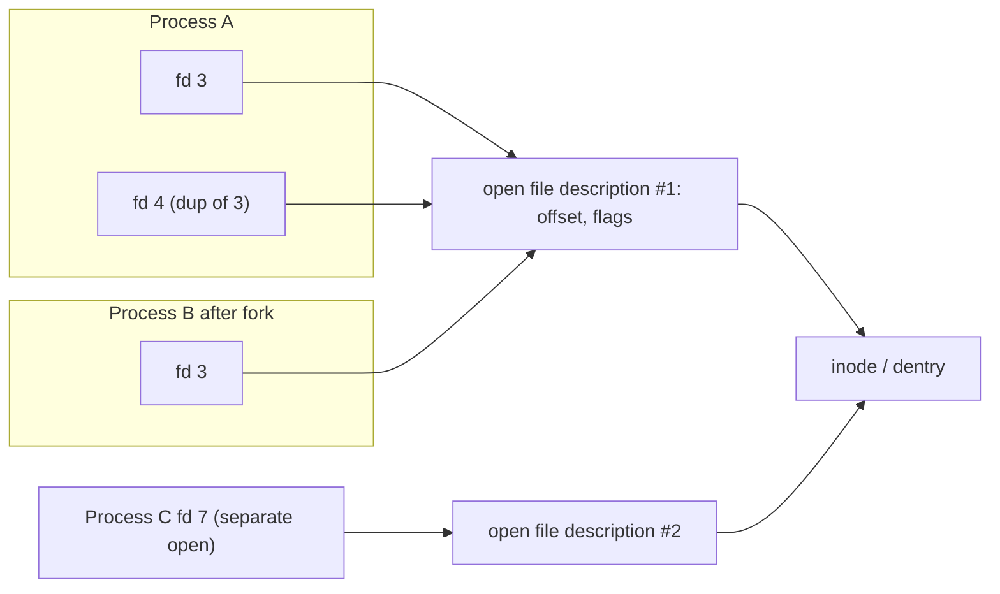

Linux presents a single tree rooted at `/`. Everything — files, directories, devices, pipes, sockets, kernel state — is reached through the same system calls (`open`, `read`, `write`, `close`, `stat`). The abstraction that makes this possible is the **Virtual File System (VFS)**.

## The directory layout (FHS)

| Path | Purpose |
|---|---|
| `/` | root of the tree |
| `/usr` | the bulk of installed software: `/usr/bin`, `/usr/sbin`, `/usr/lib`, `/usr/share`. On modern distros `/bin`, `/sbin`, `/lib` are **symlinks into `/usr`** ("merged-usr") |
| `/usr/local`, `/opt` | locally built / third-party software, outside the package manager |
| `/etc` | host-specific configuration (text files) |
| `/var` | variable data: `/var/log`, `/var/lib` (state: databases, packages), `/var/cache`, `/var/spool` |
| `/run` | runtime state since boot (PID files, sockets): a **tmpfs**, cleared at reboot (`/var/run` → `/run`) |
| `/tmp`, `/var/tmp` | temporary files (`/tmp` cleared at boot or tmpfs; `/var/tmp` persists) |
| `/home`, `/root` | user home directories; root's home |
| `/dev` | device nodes (**devtmpfs**, managed by udev): `/dev/sda`, `/dev/null`, `/dev/tty` |
| `/proc` | process and kernel information (**procfs**, virtual) |
| `/sys` | kernel objects and device model (**sysfs**, virtual) |
| `/boot` | kernel, initramfs, bootloader files |
| `/mnt`, `/media` | temporary / removable mounts |
| `/srv` | data served by this system |

Mounting attaches a filesystem to a directory (the *mount point*); `findmnt` shows the tree, `lsblk -f` the devices, `df -hT` the usage. The same device can be visible at several places (**bind mounts**), and each process can have its own view of mounts (**mount namespaces**, which containers use).

## VFS: four core objects

The VFS is a kernel layer defining a common interface that each filesystem (ext4, XFS, tmpfs, NFS, procfs...) implements.

| Object | Represents | Lives |
|---|---|---|
| **superblock** | a mounted filesystem instance (type, block size, state) | one per mount of a device |
| **inode** | a file's metadata and data location: type, mode, owner, size, timestamps, link count, block/extents map; **not its name** | on disk + cached in memory |
| **dentry** (directory entry) | a name → inode binding, one component of a path; the **dcache** caches path lookups | memory only (cache) |
| **file** (open file description) | an open instance: current offset, flags, pointer to the dentry/inode | memory, per `open()` |

Path resolution (`/usr/bin/gcc`) walks the dcache: root dentry → `usr` → `bin` → `gcc`, checking **execute (search) permission on every directory** and handling mount points and symlinks along the way. `strace -e trace=file` shows these syscalls; the lookups are why deep paths and directories with millions of entries cost time.

### Inodes

An inode holds: file type and permission bits, owner UID/GID, size, three timestamps (`atime` access, `mtime` content modification, `ctime` inode change, plus `crtime` creation on some filesystems), **link count**, and pointers to data blocks (ext4: an extent tree; ext2/3: block maps). Inode numbers are unique **per filesystem**.

A **directory** is a file whose content is a table of `name → inode number`. This is the key to understanding links.

```bash
$ stat f
  File: f
  Size: 3        Blocks: 8        IO Block: 4096   regular file
Device: 0,40     Inode: 42830     Links: 2
Access: (0644/-rw-r--r--)  Uid: (1000/ user)   Gid: (1000/ user)
$ ls -li f hard soft
42830 -rw-r--r-- 2 user user 3 f
42830 -rw-r--r-- 2 user user 3 hard         # same inode, link count 2
42831 lrwxrwxrwx 1 user user 1 soft -> f     # its own inode, content is the path "f"
```

Note `Blocks: 8` (512-byte units) for a 3-byte file: space is allocated in filesystem blocks (4 KiB).

### Hard links vs. symbolic links

| | Hard link | Symbolic link |
|---|---|---|
| What it is | another directory entry for the **same inode** | a tiny file containing a **path string** |
| Across filesystems | no (inode numbers are per fs) | yes |
| To directories | no (would create loops) | yes |
| If the target is deleted/renamed | still works (the inode lives while link count > 0) | **dangling** link |
| Created by | `ln target name` | `ln -s target name` |
| Permissions | share the inode's | irrelevant (the link's own mode is ignored; the target's apply) |

`unlink()` removes a name; the inode and its data are freed only when the **link count is 0 AND no process has the file open**. Consequences:

- **Deleting an open file does not free space**: a process (e.g. a log writer) still holds an fd; `df` shows the disk full while `du` doesn't. Find them with `lsof +L1` (open files with link count 0) and restart the process or truncate via `/proc/<pid>/fd/<n>` (`: > /proc/PID/fd/N`).
- `rename()` within a filesystem is **atomic** (the standard way to replace a file safely: write temp file, `fsync`, `rename`).
- Directory link counts: a directory has `2 + number of subdirectories` links (`.` and the parent's entry for it, plus each subdirectory's `..`).

### Space accounting

`df` reports filesystem-level blocks; `du` sums file blocks. Differences: deleted-but-open files, sparse files (`ls -ls` vs `du`), reserved blocks (ext4 reserves 5 % for root), snapshots/subvolumes. **Inode exhaustion** (`df -i` at 100 %) prevents creating files though space remains: typical with millions of tiny files (mail spool, session files). ext4 fixes the inode count at `mkfs` time; XFS and Btrfs allocate inodes dynamically.

## File descriptors and open file descriptions

Three kernel tables sit between a process and the inode:



1. **File descriptor table** (per process): small integers → pointers; holds the `FD_CLOEXEC` flag. `0,1,2` = stdin, stdout, stderr by convention. Limit: `ulimit -n`, `/proc/sys/fs/nr_open`.
2. **Open file description** (system-wide table): the file offset, access mode and status flags (`O_APPEND`, `O_NONBLOCK`). Shared by `dup()` and across `fork()`.
3. **Inode / dentry**.

Consequences:

- `dup2(fd, 1)` is how shells implement redirection; both descriptors share one offset.
- Two processes that each `open()` the same path get **independent offsets**, while a forked child shares the parent's.
- `O_APPEND` makes each write atomic-seek-to-end; without it concurrent writers can overwrite each other.
- `lseek` on a shared description moves it for everyone.
- Per-process view: `ls -l /proc/<pid>/fd`, details in `/proc/<pid>/fdinfo/<n>` (offset, flags).
- System limits: `fs.file-max`, `/proc/sys/fs/file-nr` (allocated, unused, max). "Too many open files" (`EMFILE`) is a per-process limit; `ENFILE` is system-wide.

## File types

`ls -l` first character: `-` regular, `d` directory, `l` symlink, `b` block device, `c` character device, `p` named pipe (FIFO), `s` socket. A **device node** is an inode with a major/minor number that routes I/O to a driver (`ls -l /dev/sda /dev/null` → `brw-rw---- 8, 0`; `crw-rw-rw- 1, 3`). Pseudo-files such as `/proc/cpuinfo` have no on-disk storage: reads run kernel code.

## Special filesystems worth knowing

| Type | Backing | Notes |
|---|---|---|
| `tmpfs` | RAM (and swap) | `/run`, `/dev/shm`, `/tmp` on some distros; size-limited |
| `proc`, `sysfs` | kernel data structures | tunables in `/proc/sys` (sysctl) and `/sys` |
| `devtmpfs` | device nodes | populated by the kernel, adjusted by udev |
| `cgroup2` | resource control tree | `/sys/fs/cgroup` |
| `overlayfs` | union of layers | containers: lower (read-only) + upper (writable) |
| `fuse` | userspace filesystem | sshfs, rclone mounts |
| `nfs`, `cifs` | network | semantics differ (attribute caching, locking) |

## Practical commands

```bash
stat -c '%i %h %U %a %n' file       # inode, links, owner, mode
find / -xdev -size +1G              # large files on one filesystem
find . -samefile file               # all hard links to a file
lsof +L1                            # deleted files still open
lsof -p PID ; ls -l /proc/PID/fd    # what a process has open
df -hT ; df -i ; findmnt            # space, inodes, mount tree
mount --bind /src /dst              # bind mount
```

## Key takeaways

- Names live in directories; metadata and data belong to inodes; hard links are extra names, symlinks are path strings.
- Space is freed only when link count is 0 **and** no process holds the file open.
- A file descriptor points to an open file description (offset and flags, shared by `dup`/`fork`), which points to the inode.
- Understand `df` vs `du`, `df -i`, and `lsof +L1` when disks "fill up" mysteriously.
- The VFS lets ext4, XFS, tmpfs, procfs, overlayfs and NFS share one set of system calls.
