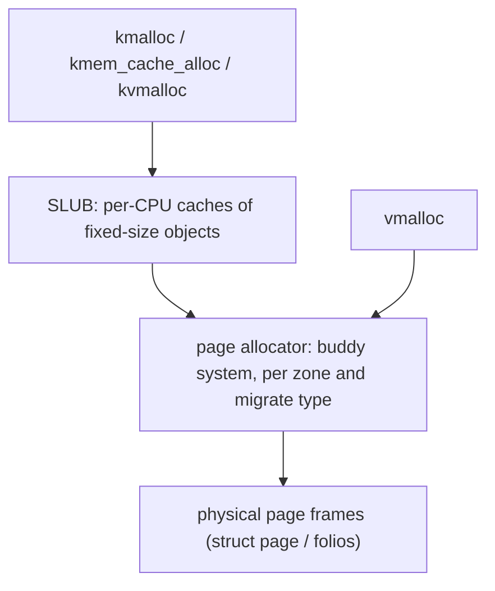

User space asks the kernel for memory through `mmap` and `brk` and gets virtual memory that is filled lazily. The kernel itself has a different problem: it needs memory for page tables, socket buffers, inodes, dentries, task structs and thousands of other objects, often **while handling an interrupt** or while the system is already short of memory, and often from many CPUs at once. Its answer is a layered set of allocators and, for read-mostly shared data, a synchronization scheme called RCU that makes reads free.

## Layers of kernel allocation



### The page allocator and the buddy system

Physical memory is divided into **zones** (DMA, DMA32, Normal, and others) because some devices can address only low memory. In each zone, free pages are kept in lists by **order**: order *n* is a block of 2^n contiguous pages (order 0 = 4 KiB, order 10 = 4 MiB). To allocate order *k*: take a block from the order-*k* list, or split a larger block into two **buddies** and use one. To free: if the block's buddy (its neighbour of the same size, found by flipping one address bit) is also free, merge them into the next order, repeating upward. That makes coalescing cheap and keeps large contiguous blocks available when possible.

`/proc/buddyinfo` shows, for each zone, how many free blocks exist at each order (the columns are orders 0 to 10). A healthy machine has non-zero counts in the high orders; a machine whose counts are concentrated in orders 0-2 is **fragmented**, and an allocation of a large contiguous block (a huge page, a driver's DMA buffer, a high-order skb) can fail or stall in compaction even though plenty of memory is free in total. `/proc/pagetypeinfo` further splits free blocks by **migrate type** (unmovable, movable, reclaimable), which is how the kernel groups pages so that movable ones can be migrated away to rebuild large blocks (compaction).

Other mechanisms in this layer:

- **Watermarks** (min, low, high per zone): when free memory drops below *low*, the background reclaimer `kswapd` wakes; below *min*, allocators must reclaim directly (direct reclaim stalls the allocating process) or fail.
- **Per-CPU page lists** make order-0 allocations lock-free in the common case.
- **GFP flags** say what the allocator is allowed to do (see below).
- **CMA** (contiguous memory allocator) reserves a region that serves movable pages normally but can be evacuated for large contiguous device allocations.
- **Memory cgroups** charge pages (and many slab objects) to the allocating container, so `memory.max` limits kernel memory used on a cgroup's behalf too.

### GFP flags: what an allocation may do

| Flag | Meaning |
|---|---|
| `GFP_KERNEL` | normal; may sleep, reclaim memory, start I/O. **Only valid in process context.** |
| `GFP_ATOMIC` | may not sleep: for interrupt handlers and under spinlocks. Draws on emergency reserves, fails more readily |
| `GFP_NOWAIT` | like atomic without dipping into reserves; the caller must handle failure |
| `GFP_NOIO` / `GFP_NOFS` | do not start I/O / filesystem calls during reclaim; prevents deadlock when the allocation is itself inside the I/O or filesystem path |
| `__GFP_ZERO` | return zeroed memory (`kzalloc`) |
| `__GFP_ACCOUNT` | charge the memory cgroup |
| `__GFP_NOWARN`, `__GFP_RETRY_MAYFAIL`, `__GFP_NORETRY` | tune retry and failure reporting |

The common kernel bug here is allocating with `GFP_KERNEL` while holding a spinlock or in interrupt context ("sleeping function called from invalid context"); the scheduler-debugging options catch it.

### SLUB, kmalloc and caches

Most kernel objects are small and of a few fixed sizes. Asking the page allocator for a 4 KiB page for a 200-byte inode would waste memory and be slow. The **slab allocator** (default implementation **SLUB**) manages **caches**, one per object type (`task_struct`, `dentry`, `inode_cache`, `kmalloc-64`, ...). Each cache takes pages from the page allocator and carves them into equal objects. Allocation pops an object from the current CPU's freelist without a lock; free pushes it back. Benefits: no per-object header overhead, hot objects stay in the same CPU's cache, and a constructor-initialised object can stay initialised across reuse.

`kmalloc(size, gfp)` is a convenience that picks one of the generic `kmalloc-*` caches rounded up to a power-of-two-ish size (8, 16, 32, 64, 96, 128, 192, ... bytes), so a 65-byte request uses the 96-byte cache and wastes 31 bytes (internal fragmentation). For frequently allocated object types create a dedicated cache with `kmem_cache_create` and allocate with `kmem_cache_alloc`. Requests above a couple of pages go straight to the page allocator.

Observing slabs:

```bash
grep -E 'Slab|SReclaimable|SUnreclaim' /proc/meminfo   # total slab memory, reclaimable (dentries, inodes) vs not
sudo slabtop -o                                        # per-cache objects, size, active (root only)
sudo cat /proc/slabinfo                                # raw per-cache statistics (root only)
ls /sys/kernel/slab                                    # tunables and counters per cache (root-readable files)
```

`SReclaimable` is mostly dentry and inode caches: it can be dropped under pressure (`echo 2 | sudo tee /proc/sys/vm/drop_caches` is a diagnostic tool, not a tuning knob). A large and growing `SUnreclaim` often points at a kernel or driver leak; boot with `slab_debug` or enable KASAN/kmemleak in a debug kernel to find it.

### kmalloc vs vmalloc vs kvmalloc

| API | Memory | When |
|---|---|---|
| `kmalloc` | physically contiguous, from slab or page allocator | small objects, DMA buffers; fails if no contiguous block exists |
| `vmalloc` | virtually contiguous, physically scattered (page tables built per allocation) | large buffers that need no physical contiguity (module code, big tables); slower, TLB pressure |
| `kvmalloc` | tries `kmalloc`, falls back to `vmalloc` | large allocations of unknown size: the right default for big arrays |
| `alloc_pages(order)` | raw pages | when you need whole pages or specific order |

## RCU: reads that cost nothing

Many kernel structures are read constantly and changed rarely: routing tables, the dentry hash, lists of network devices, module lists. A reader-writer lock makes every reader write to a shared cache line (the lock counter), so reads from many CPUs bounce the line between them and scale poorly. **Read-copy-update (RCU)** removes the lock from the read side entirely.

The recipe for updating a structure:

1. **Read side**: `rcu_read_lock()`; `p = rcu_dereference(ptr)`; use `p`; `rcu_read_unlock()`. In non-preemptible kernels these calls compile to almost nothing: they only mark a region in which the thread must not block.
2. **Update**: allocate a new copy, change it, and publish it with `rcu_assign_pointer(ptr, new)` (a release store: the contents are visible before the pointer).
3. **Wait** for a **grace period**: every CPU has passed through a *quiescent state* (context switch, idle, or user mode), so no reader that started before the update can still be running. `synchronize_rcu()` blocks for this; `call_rcu(&old->head, free_fn)` queues a callback instead and returns immediately.
4. **Reclaim** the old copy.

Readers may see either the old or the new version, never a half-updated one, and they never block the writer from publishing. The cost moves to the writer, which waits for a grace period (typically milliseconds) and must allocate and copy. RCU therefore fits **read-mostly** data. Kernel variants: **RCU-bh/sched** merged into the main flavour, **SRCU** (sleepable readers, per-domain), **Tasks RCU** (for tracing trampolines), and list helpers such as `list_for_each_entry_rcu`, `hlist_add_head_rcu`.

Rules readers must follow: no sleeping inside a normal read-side section (except SRCU); fetch the pointer with `rcu_dereference` once and use the local copy; do not keep the pointer after `rcu_read_unlock`. Writers must serialise among themselves with a normal lock (RCU coordinates readers and writers, not writers with each other).

### A user-space QSBR RCU you can run

Kernel RCU detects quiescent states from the scheduler. In user space the application has to announce them, which gives the **quiescent-state-based reclamation (QSBR)** flavour (as in `liburcu`'s `qsbr`). Readers pay nothing per access; each reader thread calls `rcu_quiescent_state()` periodically ("I hold no protected pointer right now"), and `synchronize_rcu()` waits until every registered reader has done so after the update.

```c
// A minimal quiescent-state-based RCU (QSBR) for user space, in the style of liburcu's "qsbr" flavour.
// Readers pay NOTHING per access; they only announce "I hold no RCU-protected pointer" at points of their choosing.
#include <pthread.h>
#include <sched.h>
#include <stdatomic.h>

#define MAX_READERS 16
static atomic_ulong global_epoch = 1;
static atomic_ulong reader_epoch[MAX_READERS];           // 0 = offline (not registered / not reading)
static atomic_int   nreaders;

static int rcu_register_thread(void) {                    // returns this reader's slot
    int id = atomic_fetch_add(&nreaders, 1);
    atomic_store(&reader_epoch[id], atomic_load(&global_epoch));
    return id;
}
static void rcu_quiescent_state(int id) {                 // "I am between read-side critical sections"
    atomic_store_explicit(&reader_epoch[id], atomic_load_explicit(&global_epoch, memory_order_acquire), memory_order_seq_cst);
}
static void rcu_thread_offline(int id) { atomic_store(&reader_epoch[id], 0); }
__attribute__((unused)) static void rcu_thread_online(int id)  { atomic_store(&reader_epoch[id], atomic_load(&global_epoch)); }

// Wait for a grace period: every online reader has passed through a quiescent state since we started.
// After this returns, no reader can still hold a pointer that was reachable before the call.
static void synchronize_rcu(void) {
    unsigned long target = atomic_fetch_add(&global_epoch, 1) + 1;
    int n = atomic_load(&nreaders);
    for (int i = 0; i < n; i++)
        for (;;) {
            unsigned long e = atomic_load(&reader_epoch[i]);
            if (e == 0 || e >= target) break;              // offline, or has announced a quiescent state after the update
            sched_yield();
        }
}

// publish / consume: the release store makes the object's contents visible before the pointer is; the acquire load pairs with it
#define rcu_assign_pointer(p, v) atomic_store_explicit(&(p), (v), memory_order_release)
#define rcu_dereference(p)       atomic_load_explicit(&(p), memory_order_acquire)
```

The first experiment: four readers repeatedly follow a shared pointer to a record whose invariant is `a + b == 100`, and a writer keeps replacing the record, poisoning and freeing the old one. With `synchronize_rcu()` before the free, no reader ever sees a poisoned record. Without it, the writer frees memory that readers still hold, and readers observe the poison (a stand-in for a crash or corrupted data; in real code this is a use-after-free).

```c
// Readers follow a shared pointer to a record whose invariant is a + b == 100. The writer replaces the record
// (copy, update, publish) and must not reclaim the old one until a grace period has elapsed.
#include "qsbr.h"
#include <stdio.h>
#include <stdlib.h>
#include <string.h>
#include <time.h>

typedef struct { long a, b; } rec_t;
static _Atomic(rec_t *) shared;
static atomic_int stop;
static atomic_long violations, reads_total;
static int safe_mode;                                      // 1: wait a grace period before reclaiming; 0: reclaim immediately (WRONG)

static void *reader(void *arg) {
    (void)arg;
    int id = rcu_register_thread();
    long reads = 0, bad = 0;
    while (!atomic_load(&stop)) {
        for (int i = 0; i < 1000; i++) {                  // a batch of read-side critical sections
            rec_t *r = rcu_dereference(shared);
            long a = r->a;
            for (volatile int k = 0; k < 20; k++) ;        // time spent holding the pointer: a window for the writer to misbehave
            long b = r->b;
            if (a + b != 100) bad++;
            reads++;
        }
        rcu_quiescent_state(id);                           // between batches: no pointer is held
    }
    rcu_thread_offline(id);
    atomic_fetch_add(&violations, bad); atomic_fetch_add(&reads_total, reads);
    return NULL;
}

static void *writer(void *arg) {
    (void)arg;
    long v = 0;
    while (!atomic_load(&stop)) {
        rec_t *n = malloc(sizeof *n); n->a = v % 101; n->b = 100 - n->a; v++;    // copy-update
        rec_t *old = shared;
        rcu_assign_pointer(shared, n);                    // publish
        if (safe_mode) synchronize_rcu();                 // wait until no reader can still hold 'old'
        old->a = -1000000; old->b = -1000000;             // poison, then free: a reader still using it would see a + b != 100
        free(old);
        struct timespec ts = {0, 50000}; nanosleep(&ts, NULL);
    }
    return NULL;
}

static void run(int safe) {
    safe_mode = safe; atomic_store(&stop, 0); atomic_store(&violations, 0); atomic_store(&reads_total, 0);
    atomic_store(&nreaders, 0);
    rec_t *first = malloc(sizeof *first); first->a = 40; first->b = 60; atomic_store(&shared, first);
    pthread_t r[4], w;
    for (int i = 0; i < 4; i++) pthread_create(&r[i], NULL, reader, NULL);
    pthread_create(&w, NULL, writer, NULL);
    struct timespec ts = {1, 0}; nanosleep(&ts, NULL);
    atomic_store(&stop, 1);
    for (int i = 0; i < 4; i++) pthread_join(r[i], NULL);
    pthread_join(w, NULL);
    printf("%-34s reads %9ld, invariant violations: %ld\n", safe ? "with synchronize_rcu before free:" : "freeing immediately (no grace period):", atomic_load(&reads_total), atomic_load(&violations));
}

int main(void) { run(1); run(0); return 0; }
```

```text
$ gcc -O2 -Wall -Wextra -pthread demo.c -o demo && ./demo
with synchronize_rcu before free:  reads  94327000, invariant violations: 0
freeing immediately (no grace period): reads  93819000, invariant violations: 8671
```

With the grace period the violation count is zero over about 90 million reads; without it, violations appear within a second. The second run frees memory a reader may still hold, so it is undefined behavior; it is shown only to demonstrate the failure, and its violation count varies from run to run.

The second experiment compares read-side throughput for the same workload (4 readers, one writer updating every 50 µs) under a mutex, a reader-writer lock and RCU:

```c
// Read-side cost: 4 reader threads and 1 writer updating every 50 microseconds, for 1 second each, under three schemes.
#include "qsbr.h"
#include <stdio.h>
#include <stdlib.h>
#include <time.h>

typedef struct { long a, b; } rec_t;
static _Atomic(rec_t *) shared;
static rec_t plain = {40, 60};                          // used by the lock-based variants
static pthread_mutex_t mu = PTHREAD_MUTEX_INITIALIZER;
static pthread_rwlock_t rw = PTHREAD_RWLOCK_INITIALIZER;
static atomic_int stop, mode;
static atomic_long total_reads;

static void *reader(void *arg) {
    (void)arg;
    int id = rcu_register_thread(); long reads = 0, sink = 0;
    while (!atomic_load(&stop)) {
        for (int i = 0; i < 1000; i++) {
            switch (mode) {
            case 0: pthread_mutex_lock(&mu); sink += plain.a + plain.b; pthread_mutex_unlock(&mu); break;
            case 1: pthread_rwlock_rdlock(&rw); sink += plain.a + plain.b; pthread_rwlock_unlock(&rw); break;
            default: { rec_t *r = rcu_dereference(shared); sink += r->a + r->b; }
            }
            reads++;
        }
        rcu_quiescent_state(id);
    }
    rcu_thread_offline(id);
    atomic_fetch_add(&total_reads, reads + (sink == 12345));
    return NULL;
}
static void *writer(void *arg) {
    (void)arg; long v = 0;
    while (!atomic_load(&stop)) {
        long a = v++ % 101;
        switch (mode) {
        case 0: pthread_mutex_lock(&mu); plain.a = a; plain.b = 100 - a; pthread_mutex_unlock(&mu); break;
        case 1: pthread_rwlock_wrlock(&rw); plain.a = a; plain.b = 100 - a; pthread_rwlock_unlock(&rw); break;
        default: { rec_t *n = malloc(sizeof *n); n->a = a; n->b = 100 - a; rec_t *old = shared; rcu_assign_pointer(shared, n); synchronize_rcu(); free(old); }
        }
        struct timespec ts = {0, 50000}; nanosleep(&ts, NULL);
    }
    return NULL;
}
int main(void) {
    const char *name[] = {"pthread mutex", "pthread rwlock", "RCU (QSBR)"};
    double base = 0;
    for (int m = 0; m < 3; m++) {
        mode = m; atomic_store(&stop, 0); atomic_store(&total_reads, 0); atomic_store(&nreaders, 0);
        rec_t *f = malloc(sizeof *f); f->a = 40; f->b = 60; atomic_store(&shared, f);
        pthread_t r[4], w;
        for (int i = 0; i < 4; i++) pthread_create(&r[i], NULL, reader, NULL);
        pthread_create(&w, NULL, writer, NULL);
        struct timespec ts = {1, 0}; nanosleep(&ts, NULL); atomic_store(&stop, 1);
        for (int i = 0; i < 4; i++) pthread_join(r[i], NULL);
        pthread_join(w, NULL);
        double rate = atomic_load(&total_reads) / 1e6; if (m == 0) base = rate;
        printf("%-16s %8.1f million reads/s   (%.1fx the mutex)\n", name[m], rate, rate / base);
    }
    return 0;
}
```

```text
$ gcc -O2 -Wall -Wextra -pthread bench.c -o bench && ./bench
pthread mutex        13.5 million reads/s   (1.0x the mutex)
pthread rwlock       16.0 million reads/s   (1.2x the mutex)
RCU (QSBR)         1506.3 million reads/s   (111.8x the mutex)
```

RCU readers do a pointer load and two plain reads, with no atomic read-modify-write and no shared-cache-line writes; the lock-based readers all contend for the lock word. The ratio (about two orders of magnitude here) depends heavily on core count and update rate, but the shape is general: lock-based read paths do not scale with readers, RCU read paths do. The price shows on the write side: each update here must wait for all readers to reach a quiescent state.

## Putting the two halves together

RCU is why memory reclamation in the kernel is deferred: a dentry or route entry removed from a hash table cannot be freed immediately because lock-free readers may still be looking at it. It is freed by a `call_rcu` callback or with `kfree_rcu(ptr, rcu_head)`, and slab caches created with `SLAB_TYPESAFE_BY_RCU` go further: the *memory* stays valid as the same type of object even after free (readers must re-validate the object after taking a reference). Heavy `call_rcu` use can delay memory reuse, so on a system short of memory check for a backlog of RCU callbacks (the `rcutree` tracepoints) and RCU stall warnings in `dmesg`.

## Diagnostics

- **RCU stall warnings** (`rcu_sched detected stalls on CPUs/tasks`) in `dmesg`: a CPU stayed in a read-side critical section or with preemption disabled so long that grace periods could not end. Causes: a busy-looping driver, a long loop under `rcu_read_lock`, a CPU that never reschedules.
- **Allocation failures** (`page allocation failure: order:N`): high-order allocation with fragmented memory. Look at `/proc/buddyinfo`, consider `vm.min_free_kbytes`, `vm.compact_memory` (diagnostic), or change the caller to `kvmalloc`.
- **Memory growth**: `/proc/meminfo` `SUnreclaim`, `slabtop`, `/proc/vmallocinfo`; kernel debugging tools `kmemleak`, `KASAN` for leaks and use-after-free; `perf` and tracepoints `kmem:*` for allocation profiles.
- **Direct reclaim latency**: PSI (`/proc/pressure/memory`) and the `allocstall` counters in `/proc/vmstat`.

## Key takeaways

- The kernel allocates in layers: the buddy allocator hands out physical pages in power-of-two blocks (fragmentation shows in `/proc/buddyinfo`), SLUB turns pages into caches of fixed-size objects, and `vmalloc`/`kvmalloc` give virtually contiguous memory for large buffers.
- GFP flags encode what the allocator may do; `GFP_KERNEL` may sleep and must never be used in atomic contexts.
- RCU makes the read side free by deferring reclamation: publish with `rcu_assign_pointer`, wait a grace period (`synchronize_rcu`/`call_rcu`), then free. Readers see the old or the new version, never a mix.
- Freeing before the grace period ends is a use-after-free; the demonstration above shows the failure and a throughput advantage of roughly two orders of magnitude for readers over a mutex.
- Use RCU for read-mostly data and accept more costly, delayed updates.
