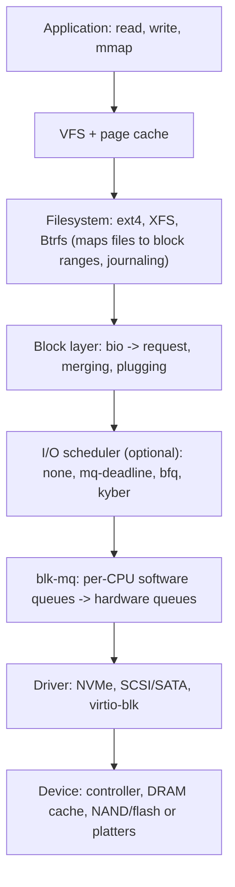

## The storage stack



- Applications see byte streams; the filesystem translates a file offset into **logical block addresses (LBAs)**.
- A **bio** (block I/O) describes a contiguous range plus memory pages; the block layer turns bios into **requests**, merging adjacent ones and sorting/plugging them to reduce overhead.
- Below the filesystem, everything is just *sectors*: the units a device addresses (**logical block size** 512 B or 4 KiB; **physical** often 4 KiB: "512e" drives emulate 512 B logical on 4 KiB physical, and misaligned writes cause read-modify-write). Partitions should be aligned (1 MiB start; modern tools do this): `lsblk -o NAME,LOG-SEC,PHY-SEC,MIN-IO,OPT-IO`.

Devices are named `/dev/sdX` (SCSI/SATA/USB), `/dev/nvmeXnY`, `/dev/vdX` (virtio), `/dev/mapper/*` (device-mapper), `/dev/mdX` (software RAID). **Names are unstable** across boots: refer to `/dev/disk/by-uuid|by-id|by-path|by-label` or `UUID=` in fstab (`blkid`, `lsblk -f`).

## Multi-queue block layer (blk-mq)

The old single request queue protected by one lock capped out near a million IOPS. **blk-mq** (default since 3.13/5.0) scales on multi-core with fast devices:

- **Software queues**: one (or a few) per CPU, no cross-CPU locking, where bios are staged, merged and scheduled.
- **Hardware dispatch queues**: map to the device's own queues (`nr_hw_queues`); an NVMe SSD may expose 32–128+ submission/completion queue pairs, one per CPU, each with its own interrupt (MSI-X) so completions are handled on the submitting core (`/proc/interrupts`).
- **Tags** identify in-flight requests (queue depth).

### I/O schedulers

A scheduler orders and merges requests *before* dispatch. Select per device in `/sys/block/<dev>/queue/scheduler`:

| Scheduler | Behavior | Use |
|---|---|---|
| **none** | pass through FIFO per queue | fast NVMe with deep queues (default for NVMe); the device does the reordering |
| **mq-deadline** | sorts by sector, with per-request deadlines (reads 500 ms, writes 5 s) to avoid starvation | SATA/SAS SSDs and HDDs, virtual disks (`[mq-deadline]` seen on virtual block devices); good default |
| **bfq** | budget fair queueing: per-process fairness, low latency for interactive/foreground I/O, supports weights and `ioprio` | desktops, slow disks, mixed workloads; more CPU overhead |
| **kyber** | token-based throttling targeting read/write latency goals | fast multiqueue devices where latency targets matter |

```bash
cat /sys/block/sda/queue/scheduler          # none [mq-deadline] kyber bfq
echo bfq > /sys/block/sda/queue/scheduler   # runtime change (udev rules to persist)
```

HDDs benefit from sorting by sector (seek minimization) with `mq-deadline`/`bfq`; SSDs have no seek penalty, so the scheduler matters mostly for fairness/latency isolation.

### Useful queue attributes (`/sys/block/<dev>/queue/`)

| Attribute | Meaning |
|---|---|
| `rotational` | 1 = HDD; influences readahead and scheduler defaults |
| `nr_requests` | max queued requests (e.g. 256) |
| `read_ahead_kb` | readahead window (128–256 KiB; raise for sequential workloads: `blockdev --setra`) |
| `max_sectors_kb`, `max_hw_sectors_kb` | largest I/O per request |
| `logical_block_size`, `physical_block_size`, `minimum_io_size`, `optimal_io_size` | alignment hints (RAID stripe size) |
| `write_cache` | `write back` (volatile device cache, needs flushes) or `write through` |
| `discard_max_bytes` | TRIM support |
| `nomerges`, `rq_affinity`, `add_random` | tuning |

## Performance arithmetic

Typical **latency** of one random read (orders of magnitude):

| Medium | Latency |
|---|---|
| CPU L1 / DRAM | 1 ns / ~100 ns |
| NVMe SSD (random 4K read) | 10–100 µs (Optane ~10 µs) |
| SATA SSD | 100–200 µs |
| HDD (seek + rotation) | 5–10 ms |
| Network storage / cloud block volume | 0.5–5 ms |

**Little's law** links the three metrics: `IOPS = queue depth / latency`. A device with 100 µs latency and queue depth 1 gives 10,000 IOPS; with QD 32 it can reach 320,000 IOPS if internal parallelism permits. Hence synchronous single-threaded I/O leaves flash devices idle, and benchmarks must state QD and block size. **Throughput = IOPS × block size.**

Latency under load rises with queue depth (queueing): average latency is not the metric that hurts; **tail latency** (p99, p99.9) is, driven by garbage collection, write amplification, queue buildup and noisy neighbors. Test with `fio`:

```bash
fio --name=randread --filename=/dev/nvme0n1 --rw=randread --bs=4k --iodepth=32 --numjobs=4 \
    --ioengine=io_uring --direct=1 --runtime=30 --time_based --group_reporting
fio --name=sync-commit --filename=/data/test --rw=write --bs=4k --fsync=1 --size=1g --direct=1   # database-like commit latency
```

(Always `--direct=1` to bypass the page cache; **never run write tests against a device holding data**.)

## Reading `iostat -x`

```bash
iostat -x -d 1
Device  r/s   w/s   rkB/s  wkB/s  r_await w_await aqu-sz rareq-sz wareq-sz  %util
nvme0n1 4500  1200  18000  9600   0.12    0.45    0.8    4.0      8.0       35.0
```

| Field | Meaning |
|---|---|
| `r/s`, `w/s`, `rkB/s`, `wkB/s` | IOPS and bandwidth |
| `rareq-sz`, `wareq-sz` | average request size (small = random) |
| `r_await`, `w_await` | average time (queue + service) in ms: **the latency users feel** |
| `aqu-sz` | average queue length (concurrency) |
| `%util` | fraction of time with ≥ 1 request in flight: **100 % does not mean saturated on SSD/NVMe/RAID**, which process many requests in parallel; saturation is judged by latency rising with load |

Related: `iotop -oPa` / `pidstat -d` (per process), `biolatency`/`biosnoop` (bcc/bpftrace), `blktrace`/`blkparse`, `perf trace`, `/proc/diskstats`, PSI `io` (`/proc/pressure/io`), `vmstat` `wa` (iowait = CPU idle while I/O pending: a symptom, not a metric of the disk).

## SSD and NVMe specifics

- **NAND flash** is written in pages (4–16 KiB) but erased in large blocks (MiB). The **FTL** (flash translation layer) in the controller remaps logical to physical pages, spreads wear, and performs **garbage collection**. Consequences: **write amplification** (actual NAND writes > host writes), performance drop and latency spikes when the drive is full or lacks over-provisioning, and **endurance** limits (TBW / DWPD). Leave 10–20 % unpartitioned/free for write-heavy workloads.
- **TRIM / discard** tells the SSD which blocks are unused so it can erase them ahead of time. Prefer the weekly `fstrim.timer` (or `fstrim -av`) to mounting with `discard` (synchronous, can add latency). Through LVM/dm-crypt/RAID, discard must be allowed (`issue_discards`, `--allow-discards`; note the privacy trade-off with LUKS).
- **Volatile write cache**: drives acknowledge writes from DRAM before they reach flash; the kernel issues **FLUSH/FUA** commands for `fsync`, journaling and barriers. Enterprise SSDs with **power-loss protection** (capacitors) make flush nearly free; consumer drives pay the full cost, and some firmware lies. This dominates `fsync` latency (see the filesystem note).
- **NVMe**: PCIe-attached, up to 65,535 I/O queue pairs of up to 65,536 entries; commands are 64 bytes, completion entries 16; doorbell registers, MSI-X interrupts per queue. *Namespaces* partition the drive; `nvme-cli`: `nvme list`, `nvme smart-log /dev/nvme0` (temperature, percentage used, media errors, unsafe shutdowns), `nvme id-ctrl`, `nvme format`, `nvme sanitize`. NVMe-oF extends it over RDMA/TCP/FC for remote disks.
- Health: `smartctl -a /dev/sda` (SMART attributes: reallocated sectors, pending sectors, wear), `smartd` alerts; kernel errors appear as `blk_update_request: I/O error`, `nvme nvme0: I/O ... timeout, reset controller`, `ata1: exception Emask`.
- **HDDs**: sequential bandwidth ~150–250 MB/s but 100–200 random IOPS; SMR drives rewrite bands and pause on sustained random writes; spread workloads with RAID/`bcache`/`lvmcache`.

## Controlling and isolating I/O

- `ionice -c3` (idle class) or `-c2 -n7` for batch jobs: honored by `bfq`, ignored by `none`.
- **cgroup v2 io controller**: `io.max` (hard `rbps/wbps/riops/wiops` limits per device), `io.weight` (proportional with bfq/`io.cost`), `io.latency` (protect a workload's latency target), `io.stat`; systemd: `IOWeight=`, `IOReadBandwidthMax=`. Buffered writes are accounted correctly only with cgroup v2 and writeback support.
- Avoid page-cache-induced stalls: bound dirty memory (`vm.dirty_bytes`), use `fsync` batches, `sync_file_range`/`O_DIRECT` for streaming writers, `posix_fadvise` to drop cache after use.

## Key takeaways

- A request flows: page cache → filesystem → bio/request → (scheduler) → blk-mq hardware queue → driver → device; names in `/dev` are unstable, use UUIDs.
- Use `none` for fast NVMe, `mq-deadline` as the sane default, `bfq` for fairness/interactive; schedulers matter far less on SSDs than on HDDs.
- `IOPS = queue depth / latency`; judge devices by tail latency and by latency under load, not average or `%util`.
- SSDs: TRIM weekly, leave free space, understand write amplification, volatile caches and flush cost; NVMe's many queues scale with cores.
- Isolate with ionice, cgroup `io.max/io.weight/io.latency`, and watch PSI `io`.
