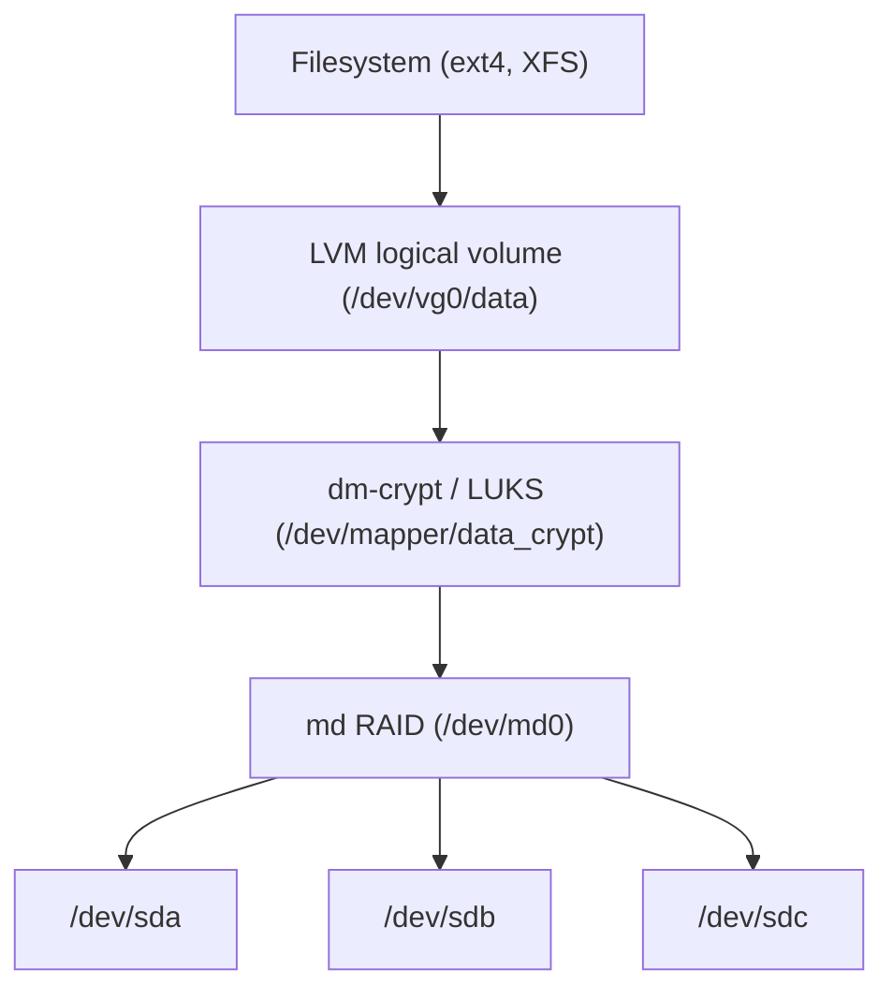

Raw partitions are inflexible: fixed size, one disk, no redundancy or encryption. Linux layers abstractions between the block device and the filesystem: **device-mapper** (LVM, dm-crypt, thin, cache), **md** (software RAID) and, in other designs, filesystem-integrated volume management (Btrfs, ZFS).



Layers can be stacked in any order: the common choices are RAID → LUKS → LVM → filesystem (encrypt once, volumes inside) or LVM → LUKS per volume (separate keys).

## Device mapper

**Device-mapper** is a kernel framework that creates virtual block devices by **mapping ranges of sectors** onto other devices through a *target* driver. A table line looks like `start length target args`:

| Target | Function |
|---|---|
| `linear` | map a range one-to-one (LVM volumes) |
| `striped` | RAID-0-like striping |
| `mirror`, `raid` | mirroring / md-RAID personalities |
| `snapshot`, `snapshot-origin` | copy-on-write snapshots |
| `thin`, `thin-pool` | thin provisioning |
| `cache`, `writecache` | SSD caching in front of slow storage |
| `crypt` | transparent encryption (dm-crypt) |
| `verity` | read-only integrity via a Merkle tree (Android, ChromeOS, container image signing) |
| `integrity` | per-sector checksums |
| `multipath` | multiple paths to one SAN LUN |
| `zero`, `error`, `delay`, `flakey` | testing (inject failures/latency) |

```bash
dmsetup ls --tree        # devices and what they sit on
dmsetup table            # the mapping tables
lsblk                    # tree view
```

## LVM

**Logical Volume Manager** abstracts physical disks into a pool:

| Object | Meaning |
|---|---|
| **PV** (physical volume) | a disk/partition/RAID device initialised for LVM |
| **VG** (volume group) | pool of PVs, divided into **physical extents** (PE, default 4 MiB) |
| **LV** (logical volume) | a volume carved from the VG, appears as `/dev/<vg>/<lv>` = `/dev/mapper/<vg>-<lv>` |

```bash
pvcreate /dev/sdb /dev/sdc
vgcreate vg0 /dev/sdb /dev/sdc
lvcreate -n data -L 200G vg0                       # or -l 100%FREE
mkfs.xfs /dev/vg0/data && mount /dev/vg0/data /srv

# grow online (LV first, then filesystem; -r does both)
lvextend -r -L +50G /dev/vg0/data
# move data off a failing disk while mounted, then remove it
pvmove /dev/sdb ; vgreduce vg0 /dev/sdb ; pvremove /dev/sdb
pvs ; vgs ; lvs -a -o +devices                     # inventory
```

Capabilities:

- **Online grow** (ext4, XFS), offline-or-online shrink only for filesystems that support it (**XFS cannot shrink**). Always shrink in the order *filesystem, then LV*, grow in the order *LV, then filesystem*, and take a backup first: shrinking an LV below the filesystem size destroys data.
- **Striped and mirrored LVs** (`-i 2`, `--type raid1`) using the md personalities.
- **Snapshots** (`lvcreate -s -n snap -L 10G vg0/data`): classic COW snapshots keep original blocks in the snapshot's space; writes to the origin slow down (copy first); if the snapshot space fills it becomes invalid. Useful for consistent backups (`fsfreeze` or quiesce the database first).
- **Thin provisioning** (`lvcreate --type thin-pool`, `lvcreate -V 1T --thinpool tp vg0`): allocate on write, overcommit the pool, cheap snapshots with no per-snapshot size. **Danger**: if the pool (data or metadata) fills, I/O errors and corruption follow; monitor `lvs -o+data_percent,metadata_percent` and set `thin_pool_autoextend_threshold`.
- **Caching** (`lvmcache`/`dm-writecache`): SSD tier for HDD volumes.
- VG metadata is stored on every PV (backups in `/etc/lvm/backup`, `vgcfgrestore`); activate with `vgchange -ay`; device filters in `lvm.conf`; clustered setups use `lvmlockd`.

## Software RAID (md)

`mdadm` manages RAID in the kernel's **md** driver.

| Level | Min disks | Capacity | Tolerates | Read | Write | Notes |
|---|---|---|---|---|---|---|
| **0** (stripe) | 2 | N | **none** | N× | N× | any disk lost = all lost |
| **1** (mirror) | 2 | 1 disk | N−1 | up to N× | 1× | simple, fast rebuild |
| **5** (stripe + parity) | 3 | N−1 | 1 disk | ~(N−1)× | small writes cost 4 I/Os (read-modify-write) | **write hole** without journal/bitmap |
| **6** (dual parity) | 4 | N−2 | 2 disks | ~(N−2)× | worse than 5 | recommended for large HDD arrays |
| **10** (mirrors then stripe) | 4 | N/2 | ≥ 1 per mirror pair | high | good | best general performance + safety |

Why parity RAID needs care:

- **Rebuild time and unrecoverable read errors (URE).** Rebuilding a large RAID 5 reads every remaining sector; with consumer drives rated 1 URE per 10^14 bits (~12.5 TB), rebuilding multi-TB arrays has a real chance of hitting one, so RAID 5 on large HDDs is discouraged; use RAID 6 or RAID 10 (or erasure coding in distributed storage). Disk failures also correlate (same batch, same age).
- **Write hole**: a crash mid-stripe-update leaves parity inconsistent; the data may be silently wrong after a later disk failure. Mitigate with a **write-intent bitmap** (fast resync) and a **journal device** (`--write-journal`, md RAID5/6 journal), or use ZFS/Btrfs-style checksums (md RAID cannot tell which copy is right on a mismatch; periodic `check` finds mismatches).
- Chunk size (`--chunk=512K`), filesystem alignment (`mkfs.xfs` auto-detects `su/sw`), and spare disks (`--spare-devices`) matter.

```bash
mdadm --create /dev/md0 --level=6 --raid-devices=6 --chunk=512 /dev/sd[b-g]
mdadm --detail /dev/md0 ; cat /proc/mdstat           # state, resync progress, [UUUUUU]
mdadm --detail --scan >> /etc/mdadm/mdadm.conf       # persist assembly, update initramfs
mdadm /dev/md0 --fail /dev/sdc --remove /dev/sdc     # replace a failing disk
mdadm /dev/md0 --add /dev/sdh                        # rebuild starts automatically
echo check > /sys/block/md0/md/sync_action           # scrub; monthly cron/timer
```

Monitor with `mdadm --monitor` (mail alerts), `smartd`, and test restores. **RAID is availability, not backup**: it won't save you from deletion, corruption, ransomware or controller bugs. Hardware RAID cards add a battery/flash-backed write cache (fast safe writes) but hide disks and tie you to the controller; HBA + md/ZFS/Btrfs is generally preferred.

## LUKS and dm-crypt

**dm-crypt** encrypts a block device transparently with the kernel crypto API; **LUKS** (Linux Unified Key Setup) standardizes the on-disk header and key management (LUKS2 current).

- A random **master (volume) key** encrypts the data (default `aes-xts-plain64`, 512-bit key = AES-256-XTS; hardware AES-NI makes it ≈ line rate: check `cryptsetup benchmark`).
- Up to 32 **keyslots** each hold the master key encrypted with a key derived from a passphrase (via **PBKDF**, Argon2id in LUKS2, deliberately slow and memory-hard), a keyfile, a TPM2 policy, or FIDO2 token. Changing a passphrase re-encrypts only the keyslot, not the data; **destroying all keyslots (or the header) makes data unrecoverable**: back up the header (`cryptsetup luksHeaderBackup`).
- LUKS2 adds JSON metadata, integrity (authenticated encryption, dm-integrity), online re-encryption (`cryptsetup reencrypt`), and `--sector-size 4096`.

```bash
cryptsetup luksFormat /dev/sdb1                    # destroys data; prompts for passphrase
cryptsetup open /dev/sdb1 data_crypt               # -> /dev/mapper/data_crypt
mkfs.ext4 /dev/mapper/data_crypt
cryptsetup luksDump /dev/sdb1                      # header, keyslots, cipher
cryptsetup luksAddKey /dev/sdb1 keyfile            # additional keyslot
systemd-cryptenroll --tpm2-device=auto --tpm2-pcrs=7 /dev/sdb1    # unlock with TPM2 bound to Secure Boot state
# /etc/crypttab:   data_crypt  UUID=...  none  luks,discard
```

Threat model notes: protects data **at rest** (stolen disk, discarded hardware) only while the volume is closed; once open (or the key is in RAM: cold-boot, DMA attacks) data is exposed; `/boot` and the initramfs are typically unencrypted (use Secure Boot + UKI/measured boot to defend against tampering). Passing `discard` through LUKS reveals which blocks are free (usually acceptable; avoid when confidentiality of usage patterns matters). Encrypt swap too (or use an encrypted LV). Performance: ~5–15 % CPU overhead without AES-NI; modern NVMe may need `--perf-no_read_workqueue --perf-no_write_workqueue` (kernel ≥ 5.9) for best latency.

## Safe procedures

1. **Grow storage** (cloud volume resize): grow the disk → `growpart /dev/sda 1` → (LUKS: `cryptsetup resize name`) → (LVM: `pvresize`, `lvextend -r`) → filesystem `resize2fs`/`xfs_growfs`.
2. **Replace a failed RAID member**: identify via `mdadm --detail`/`smartctl`, `--fail --remove`, physically replace, partition identically, `--add`, watch `/proc/mdstat`; keep the array online but expect degraded performance and risk.
3. **Consistent backups**: LVM snapshot (+ `fsfreeze -f /mnt` for filesystems without freeze integration, then `-u`), back up the snapshot, `lvremove`.
4. **Recovery**: boot a live system, `vgscan`, `vgchange -ay`, `cryptsetup open`, `mdadm --assemble --scan`; check `dmesg` for I/O errors; never `--create` over existing members (use `--assemble`, as `--create` rewrites metadata).
5. **Test your recovery path**: key escrow for LUKS, header backups, documented boot procedure, monitored arrays.

## Key takeaways

- device-mapper maps sector ranges to targets; LVM (PV/VG/LV), thin pools, snapshots and caches are built on it.
- Resize in the right order (grow LV then filesystem; shrink filesystem then LV); XFS cannot shrink; thin pools must never fill.
- RAID 0 has no redundancy; RAID 5 on big HDDs risks UREs and the write hole; prefer RAID 6/10; RAID is not backup.
- LUKS2 keeps a master key wrapped in keyslots: back up the header, use strong KDF-protected passphrases or TPM2/FIDO2, and remember it protects only data at rest.
