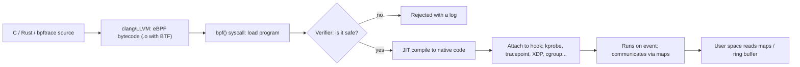

**eBPF** (extended Berkeley Packet Filter) lets you load small, verified programs into the running kernel and attach them to events — a function entry, a tracepoint, a packet arriving at the NIC, a syscall decision — without changing kernel source or loading a risky module. It turned the Linux kernel into a programmable platform and underpins modern observability (bpftrace, Parca), networking (Cilium, Katran, XDP) and security tools (Falco, Tetragon).

## How it works



- **Bytecode and VM**: 11 64-bit registers (R0 return value, R1–R5 arguments, R6–R9 callee-saved, R10 read-only frame pointer), a 512-byte stack, and a RISC-like instruction set. Programs are JIT-compiled to native instructions on x86-64, arm64, etc. (`net.core.bpf_jit_enable=1`), so they run at near-native speed.
- **The verifier** statically proves, before the program runs, that it cannot harm the kernel: it explores all paths, ensures termination (loops must be provably bounded; back-edges allowed only with bounded iteration since 5.3, or via `bpf_loop`), all memory accesses are in bounds and typed (pointer arithmetic is tracked, null checks enforced), no uninitialized reads, no leaking kernel pointers, limited complexity (1 million processed instructions), only allowed helper calls. This safety is the key difference from kernel modules. Verifier rejections are the main developer frustration: the log shows the offending instruction and register state.
- **Helpers and kfuncs**: stable helper functions (`bpf_map_lookup_elem`, `bpf_get_current_pid_tgid`, `bpf_probe_read_kernel`, `bpf_ktime_get_ns`, `bpf_perf_event_output`, `bpf_ringbuf_reserve`, `bpf_redirect`...) are the only way to call out; newer `kfuncs` expose kernel functions with BTF type checking.
- **Maps** are kernel-resident key/value stores shared between BPF programs and user space: hash, array, per-CPU hash/array (lock-free counters), LRU hash, LPM trie (prefix lookup), stack-trace, perf-event array, **ring buffer** (`BPF_MAP_TYPE_RINGBUF`, the preferred event channel), sockmap/devmap/cpumap (redirect), queue/stack, bloom filter, `prog_array` (tail calls).
- **Pinning** in bpffs (`/sys/fs/bpf`) keeps maps and programs alive after the loader exits.

## Program types and hooks

| Area | Program types / attach points | Examples |
|---|---|---|
| **Tracing** | `kprobe`/`kretprobe` (almost any kernel function), `uprobe`/`uretprobe` (user functions: libc, OpenSSL, Go), `tracepoint` and `raw_tracepoint` (stable kernel events), `fentry`/`fexit` (faster, typed via BTF), `perf_event` (sampling), USDT | latency histograms, file/exec/connect tracing, off-CPU analysis, profiling |
| **Networking** | **XDP** (at the driver, before skb allocation), `tc` `cls_bpf` (ingress/egress), socket filters, `sk_msg`/`sockmap`, `sk_lookup`, cgroup `sock`/`sock_addr`/`skb` | DDoS drop, L4 load balancing, NAT, service mesh acceleration, per-cgroup egress policy |
| **Security** | **BPF-LSM** (hook LSM decisions), seccomp (classic BPF), cgroup `device` | runtime enforcement, syscall policies |
| **Scheduling/kernel extension** | `struct_ops` (TCP congestion control in BPF), `sched_ext` (BPF schedulers, 6.12+), iterators | custom algorithms without kernel patches |

### XDP

XDP programs run in the NIC driver's receive path on each packet buffer, and return a verdict: `XDP_DROP` (discard at line rate, ~20–100 Mpps/core), `XDP_PASS` (continue into the stack), `XDP_TX` (bounce out the same port), `XDP_REDIRECT` (to another NIC, CPU or AF_XDP socket), `XDP_ABORTED`. Modes: *native* (driver support), *offload* (SmartNIC), *generic* (slow fallback). Used for DDoS mitigation (Cloudflare), L4 load balancing (Meta Katran), and kernel-bypass packet processing with **AF_XDP** sockets.

```c
/* Illustrative XDP program: drop all UDP packets to port 53 */
#include <linux/bpf.h>
#include <linux/if_ether.h>
#include <linux/ip.h>
#include <linux/udp.h>
#include <bpf/bpf_helpers.h>
#include <bpf/bpf_endian.h>

SEC("xdp")
int drop_dns(struct xdp_md *ctx) {
    void *data = (void *)(long)ctx->data, *end = (void *)(long)ctx->data_end;
    struct ethhdr *eth = data;
    if ((void *)(eth + 1) > end) return XDP_PASS;                  /* bounds checks are mandatory */
    if (eth->h_proto != bpf_htons(ETH_P_IP)) return XDP_PASS;
    struct iphdr *ip = (void *)(eth + 1);
    if ((void *)(ip + 1) > end || ip->protocol != IPPROTO_UDP) return XDP_PASS;
    struct udphdr *udp = (void *)ip + ip->ihl * 4;
    if ((void *)(udp + 1) > end) return XDP_PASS;
    return udp->dest == bpf_htons(53) ? XDP_DROP : XDP_PASS;
}
char LICENSE[] SEC("license") = "GPL";
```

Build and attach: `clang -O2 -g -target bpf -c drop_dns.c -o drop_dns.o && ip link set dev eth0 xdp obj drop_dns.o sec xdp`; remove with `ip link set dev eth0 xdp off`. Without the explicit bounds checks the verifier refuses the program: that is the safety model at work.

## Portability: BTF and CO-RE

Kernel structures change between versions, and tracing programs read them directly. **BTF** (BPF Type Format) is compact type information embedded in the kernel (`/sys/kernel/btf/vmlinux`, `CONFIG_DEBUG_INFO_BTF=y`); **CO-RE** ("Compile Once, Run Everywhere") records field accesses as relocations (`BPF_CORE_READ(task, mm, start_code)`) that **libbpf** adjusts at load time to the running kernel's layout. This replaced bcc's approach of compiling at runtime on every host (which required kernel headers and clang). Modern tools ship a precompiled `.bpf.o` and a small loader.

## Tooling

| Tool | Level | Use |
|---|---|---|
| **bpftrace** | high-level scripting (awk-like DSL) | ad-hoc investigation; one-liners |
| **bcc** | Python/Lua + C, runtime compile | the large `*-bpfcc` tool collection (opensnoop, execsnoop, biolatency, tcplife...) |
| **libbpf + bpftool** | C skeleton workflow (`bpftool gen skeleton`) | production tools; Rust (`aya`, `libbpf-rs`), Go (`cilium/ebpf`, `libbpfgo`) |
| **bpftool** | inspect/manage | `bpftool prog show`, `map dump`, `net`, `btf dump`, `feature probe` |
| **perf, ftrace** | complementary | stack sampling, function graphs (see tracing note) |
| Products | Cilium/Hubble (K8s networking & visibility), Falco/Tetragon (runtime security), Pixie, Parca/Pyroscope (continuous profiling), Katran (L4 LB) |

### bpftrace one-liners

```bash
bpftrace -e 'tracepoint:raw_syscalls:sys_enter { @[comm] = count(); }'               # syscalls by process
bpftrace -e 'tracepoint:syscalls:sys_enter_openat { printf("%s %s\n", comm, str(args->filename)); }'   # opensnoop
bpftrace -e 'kprobe:vfs_read { @bytes = hist(arg2); }'                                # read-size histogram
bpftrace -e 'tracepoint:block:block_rq_issue { @start[args->dev, args->sector] = nsecs; }
             tracepoint:block:block_rq_complete /@start[args->dev, args->sector]/ {
               @us = hist((nsecs - @start[args->dev, args->sector]) / 1000); delete(@start[args->dev, args->sector]); }'   # disk latency
bpftrace -e 'profile:hz:99 /pid == 1234/ { @[ustack] = count(); }'                   # CPU profile for a flame graph
bpftrace -e 'kprobe:tcp_retransmit_skb { @[kstack] = count(); }'                      # who triggers retransmits
```

Filters in `/ ... /` select events; `@name` are maps; aggregation functions: `count()`, `sum()`, `avg()`, `min()`/`max()`, `hist()` (power-of-2), `lhist()` (linear); built-ins: `pid`, `tid`, `comm`, `nsecs`, `arg0..argN`, `retval`, `ustack`/`kstack`, `cpu`, `cgroup`. This is "dynamic tracing with production safety": overhead is small, but high-frequency events (every packet, every `malloc`) can still cost 10–30 %: measure.

### Typical bcc/libbpf tools

`execsnoop` (new processes), `opensnoop` (file opens), `biolatency` (disk latency histogram), `biosnoop`, `runqlat` (scheduler latency), `cpudist`, `offcputime` (blocked time stacks), `tcpconnect`/`tcpaccept`/`tcplife`/`tcpretrans`, `ext4slower`, `memleak`, `profile`, `funccount`, `trace`, `argdist`. Use them as the "modern replacement" for per-event `strace` and `tcpdump` when you need system-wide visibility at low overhead.

## Security and operations

- **Privilege**: loading BPF requires `CAP_BPF` (since 5.8) plus `CAP_PERFMON` (tracing) or `CAP_NET_ADMIN` (networking), or root. `kernel.unprivileged_bpf_disabled` = 1 or 2 blocks unprivileged use (recommended); BPF JIT hardening `net.core.bpf_jit_harden`.
- **Attack surface**: the verifier is complex code and has had privilege-escalation bugs; keep kernels updated, restrict `CAP_BPF` in containers, and consider `bpf` in seccomp profiles.
- **Observability of eBPF itself**: `bpftool prog list` shows loaded programs (including by malware and rootkits); `kernel.bpf_stats_enabled=1` adds run counts and CPU time per program.
- **Limits**: stack 512 B, instruction and complexity limits, no unbounded loops, no arbitrary kernel calls, `memlock`/memcg accounting for maps (`RLIMIT_MEMLOCK` on old kernels), per-CPU map memory multiplied by CPU count.
- **Stability**: tracepoints and `fentry` on kernel internals can change across versions; prefer tracepoints and stable hooks, and CO-RE-guard field accesses.

## When to use eBPF

| Need | Fit |
|---|---|
| Answer "why is this slow?" on a live system with low overhead | excellent (bpftrace/bcc, profilers) |
| Packet filtering/LB/DDoS at line rate | excellent (XDP, tc) |
| Container networking/security with identity (Cilium) | excellent |
| Complex stateful processing, large memory | limited: use AF_XDP or user space |
| Needs to be portable to non-Linux | not applicable (Windows has a separate eBPF port) |

## Key takeaways

- eBPF runs verified, JIT-compiled programs inside the kernel, attached to events, communicating through maps and ring buffers.
- The verifier (bounded, memory-safe, typed) is what makes it safer than modules; bounds checks and null checks are mandatory.
- XDP gives line-rate packet processing at the driver; kprobes/tracepoints/uprobes give system-wide tracing without restarts.
- CO-RE + BTF give portable precompiled tools; use bpftrace for investigation and libbpf for products.
- Lock it down with `CAP_BPF`, `unprivileged_bpf_disabled`, and keep the kernel patched.
