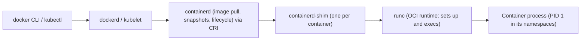

## The pieces

The word "container" covers a stack of components, each with a clear job:



| Component | Role |
|---|---|
| **Image registry** (Docker Hub, GHCR, ECR, Harbor) | stores images, served via the OCI Distribution API |
| **Engine / orchestrator agent** (dockerd, Podman, kubelet) | user interface, networking, volumes |
| **High-level runtime** (containerd, CRI-O) | pulls and unpacks images, manages snapshots (overlayfs), container lifecycle, exposes the **CRI** gRPC API used by Kubernetes |
| **Shim** | stays alive per container so the runtime can restart without killing containers, holds stdio and exit status |
| **Low-level OCI runtime** (**runc**, crun, youki; sandboxed: gVisor `runsc`, Kata) | given a bundle, creates namespaces, cgroups, mounts, drops privileges, `execve`s the process |
| Kernel | namespaces, cgroups, seccomp, LSM, overlayfs |

**Podman** has no central daemon (fork/exec model, rootless-first, systemd integration via Quadlet); **Docker** uses `dockerd`; Kubernetes uses containerd or CRI-O.

## OCI specifications

### Image spec

An image is a set of content-addressed blobs:

- a **manifest** (JSON): the config digest plus an ordered list of **layer** digests (each layer a tar+gzip/zstd archive of filesystem changes);
- a **config** (JSON): entrypoint, cmd, env, working dir, user, exposed ports, labels, `rootfs.diff_ids`, history;
- optionally an **index** (multi-arch: one manifest per platform, `linux/amd64`, `linux/arm64`).

Digests are `sha256:…`, so layers are shared and deduplicated across images and verified on pull (pinning `image@sha256:…` gives immutability; tags like `latest` are mutable pointers). Layers are **immutable and stack**: later layers add, modify or delete (via *whiteout* files) paths of earlier ones.

### Runtime spec: the bundle

A **bundle** is a directory with a `rootfs/` and a `config.json` describing exactly what the runtime must do: process (args, env, cwd, user, capabilities, `noNewPrivileges`, rlimits), root (path, readonly), mounts, and the `linux` section (namespaces, cgroups resources, seccomp, masked/readonly paths, UID/GID mappings, devices). `runc create/start/kill/delete/state` implements the lifecycle.

## A real container with runc

Everything a container engine does can be reproduced in a few commands. A rootless run of a BusyBox filesystem:

```bash
mkdir -p rootfs/{bin,proc,sys,dev,tmp,etc}
cp /bin/busybox rootfs/bin/ ; (cd rootfs/bin && ln -s busybox sh && ln -s busybox ps && ln -s busybox id && ln -s busybox hostname)
# if busybox is dynamically linked, copy the libraries listed by `ldd` into rootfs
runc spec --rootless          # writes config.json with user namespace mapping etc.
# edit config.json: process.args, terminal=false ...
runc run demo                 # create + start + wait, in the foreground
```

The default spec created for the rootless case selects these namespaces and capabilities:

```text
namespaces:   pid, ipc, uts, mount, cgroup, user
capabilities: CAP_AUDIT_WRITE, CAP_KILL, CAP_NET_BIND_SERVICE
```

and the command inside printed:

```text
pid=1 host=runc uid=0
PID   USER     COMMAND
    1 0        /bin/sh -c ...
    9 0        ps
CapEff: 0000000020000420    NoNewPrivs: 1    uid_map: 0 1000 1
mounts:  tmpfs / tmpfs · proc /proc · tmpfs /dev · devpts /dev/pts · shm /dev/shm · mqueue /dev/mqueue · sysfs /sys
```

Observe that the process is PID 1 with host name `runc`, UID 0 (mapped to an unprivileged host UID), a private `/proc`, a tmpfs `/dev` with `devpts`, and a bounded capability set. There is no hypervisor or guest kernel: `uname -r` inside equals the host's.

What runc does, in order: clone with the namespace flags → set up the **user namespace** mapping → create the container's **cgroup** and apply limits → in the new **mount namespace** make mounts private, mount the rootfs, `/proc`, `/dev` (tmpfs + device nodes), `/sys` → `pivot_root` into the rootfs → mask sensitive paths → apply capabilities, `no_new_privs`, **seccomp** (last, so setup syscalls aren't blocked) → `execve` the entrypoint.

## overlayfs

Images are layered, but processes need one writable directory tree. **overlayfs** is a union filesystem presenting a *merged* view of read-only **lower** directories plus one writable **upper**.

```bash
mount -t overlay overlay -o lowerdir=l2:l1,upperdir=u,workdir=w /merged
#   lowerdir: read-only layers, leftmost on top (image layers, shared across containers)
#   upperdir: the container's writable layer (deleted with the container)
#   workdir:  scratch space on the same filesystem as upperdir (needed for atomic operations)
```

Experiment (real output; unprivileged via user+mount namespace on kernel ≥ 5.11): two files in `lower`, then modify one, delete the other and create a third through the merged view.

```text
merged view:
a.txt
c.txt
lower untouched:
from lower
lower b
upper dir contents:
-rw-r--r-- a.txt          (7 bytes: the modified copy)
c--------- b.txt          (character device 0:0: a WHITEOUT)
-rw-r--r-- c.txt          (new file)
```

Semantics:

- **Reads** come from the topmost layer containing the path.
- **Copy-up**: the first *write* (or metadata change, `chmod`) to a lower file **copies the whole file** into the upper layer, then modifies the copy. Appending a byte to a 1 GiB lower file copies 1 GiB first: put large mutable data on **volumes**, not in the container layer. Newer kernels support metadata-only copy-up (`metacopy=on`) and `redirect_dir`.
- **Deletion** of a lower file creates a **whiteout** in upper: a character device with device number 0/0 (seen above as `b.txt`) that hides the lower entry. Deleting a lower directory creates a whiteout and an **opaque** directory marker (xattr `trusted.overlay.opaque`) when recreated. In image layers (tar), whiteouts are `.wh.<name>` files.
- **Rename of directories** across layers can return `EXDEV` unless `redirect_dir` is on; most tools handle it by copying.
- All layers must be on filesystems supporting xattrs and `d_type` (ext4, XFS with `ftype=1`); not on NFS for the upper.
- **Performance**: first-open of many-layer lookups (default max 128 layers; fewer is faster), copy-up latency, `fsync` costs pass to the upper fs; the page cache is shared between containers using the same lower file (dedup in memory!), which makes starting 100 copies of the same image cheap.
- Storage drivers: Docker `overlay2` (default), `btrfs`/`zfs` snapshots, `fuse-overlayfs` for rootless on older kernels; containerd "snapshotters" (overlayfs, native, stargz/nydus for lazy pulling).

## Volumes, mounts and storage choices

| Kind | Use |
|---|---|
| **Writable layer** (overlay upper) | ephemeral scratch only: slow for heavy I/O (copy-up), lost on removal |
| **Named volume** (`docker volume`) | persistent data managed by the engine under `/var/lib/docker/volumes`; direct filesystem speed |
| **Bind mount** | host path into the container (dev workflows, config); watch permissions/UID mapping and SELinux labels (`:z`) |
| **tmpfs** | RAM-backed scratch/secrets (`--tmpfs /tmp`) |
| **Kubernetes** `emptyDir`, `configMap`/`secret` (tmpfs-backed), `persistentVolumeClaim` (CSI) | |

Databases and anything write-heavy belong on a volume (direct ext4/XFS/block storage), not the overlay.

## Networking in brief

Per container network namespace + **veth** pair; modes: `bridge` (default: a Linux bridge `docker0`/`cni0`, NAT via `iptables -t nat POSTROUTING MASQUERADE`, `-p` publish via DNAT rules), `host` (shares the host stack: no isolation, no NAT cost), `none`, `container:<id>` (Kubernetes pod sandbox), `macvlan`/`ipvlan` (L2 presence on the LAN), overlay networks (VXLAN) for Swarm; Kubernetes uses **CNI plugins** (Calico, Cilium, Flannel) that wire pod interfaces and routes. Published ports are forwarded in the kernel (netfilter), not by a userland proxy, except for localhost-to-container cases. Debug with `nsenter -n`, `iptables-save -t nat`, `conntrack -L`, `ip link`, `bridge fdb`.

## Images: building well

- **Small, minimal bases** (distroless, Alpine/musl compatibility caveats, Debian-slim, scratch for static binaries) reduce size, attack surface and CVE noise.
- **Layer order**: put rarely changing steps first (dependencies) and frequently changing code last to maximize cache hits; each `RUN`, `COPY`, `ADD` creates a layer; deleting a file in a later layer doesn't shrink the image (it's whiteouted): combine create+cleanup in one `RUN` (`apt-get install … && rm -rf /var/lib/apt/lists/*`).
- **Multi-stage builds**: compile in a fat builder stage, `COPY --from=builder` only artifacts into a slim runtime stage.
- `.dockerignore`, no secrets in layers or build args (use BuildKit `--mount=type=secret`), `USER` non-root, `HEALTHCHECK`, `ENTRYPOINT` in **exec form** (`["/app"]`) so the app is PID 1 and receives signals (shell form wraps in `/bin/sh -c`).
- **PID 1 duties**: reap zombies and forward signals: use `--init` (tini) or an init-aware app; handle `SIGTERM` for graceful stop (Docker waits 10 s, Kubernetes `terminationGracePeriodSeconds` 30 s, then `SIGKILL`).
- Reproducibility and supply chain: pin base digests, SBOM (Syft), vulnerability scanning (Trivy/Grype), signing/verification (cosign/sigstore), provenance (SLSA).

## Observing and debugging

```bash
docker inspect -f '{{.State.Pid}}' web          # host PID of the container's PID 1
ls -l /proc/<pid>/ns ; ls /proc/<pid>/root/    # its namespaces and filesystem
nsenter -t <pid> -a /bin/sh                     # enter all namespaces (when `docker exec` isn't possible)
cat /sys/fs/cgroup/system.slice/docker-<id>.scope/{memory.max,memory.events,cpu.stat}
docker logs / journalctl CONTAINER_NAME=web     # stdout/stderr (log drivers: json-file, journald, fluentd)
crictl ps ; crictl inspect ; ctr -n k8s.io containers ls     # Kubernetes node level
kubectl debug -it pod --image=busybox --target=app           # ephemeral debug container sharing namespaces
```

Misconceptions to avoid: containers are **not** lightweight VMs (no separate kernel; kernel version and sysctls are the host's); `docker stop` is a signal not a shutdown of dependencies; logs and data inside the writable layer vanish; time, entropy and clock are the host's; and "works on my machine" differences usually come from kernel features (cgroup v1 vs v2, seccomp, userns), architecture (arm64 vs amd64) or libc (musl vs glibc).

## Key takeaways

- The stack is engine → containerd → shim → runc → kernel; runc turns an OCI bundle (`config.json` + `rootfs`) into namespaces, cgroups, a `pivot_root` and a capability/seccomp-restricted `execve`.
- Images are stacked content-addressed layers; overlayfs merges read-only lowers with a writable upper using copy-up and whiteouts (a char device 0:0 marks a deleted file).
- Put write-heavy or persistent data on volumes; keep layers few and small; use exec-form entrypoints and handle PID 1 duties.
- You can reproduce a container with runc and BusyBox in a few commands — which is the best way to understand and debug one.
