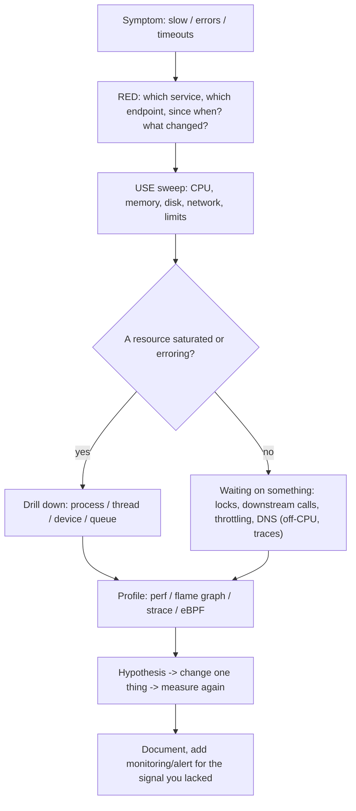

Performance work fails when it becomes folklore: tuning kernel parameters copied from a blog, restarting things until the symptom disappears, optimizing the code that is easiest to change. A methodology replaces guessing with a **process of elimination driven by measurement**.

## Define the problem first

1. **What is slow?** Latency (one request), throughput (work per second), or resource use (cost)? For whom, since when, how much?
2. **What changed?** Deploy, traffic pattern, data growth, configuration, kernel/driver, noisy neighbor, certificate/DNS, time of day. A regression with a clear start time is usually solved by the change log.
3. **Is it reproducible?** Under which load? Can you see it in metrics you already collect (dashboards)?
4. **What is the goal?** "p99 under 200 ms at 5,000 rps" is testable; "faster" is not.

## Two frameworks

### USE: for every resource

For each **resource** (CPU, memory, storage devices, network interfaces, buses, locks, file descriptors), check:

- **U**tilization: fraction of time busy (or capacity used).
- **S**aturation: extra work queued that it can't service (queue length, wait time).
- **E**rrors: error counts.

Errors are cheap to check and are often the answer (dropped packets, I/O errors, retransmits, ECC); saturation explains latency even when utilization looks moderate; utilization alone (e.g. 60 %) hides short bursts.

| Resource | Utilization | Saturation | Errors |
|---|---|---|---|
| **CPU** | `mpstat -P ALL 1` (per-CPU `%usr+%sys`) | run-queue length `vmstat r` > CPUs, `/proc/pressure/cpu`, `runqlat` | machine-check exceptions, `dmesg` |
| **Memory** | `free -m` (**available**), `MemAvailable` | swapping (`vmstat si/so`), reclaim stalls (`pgscan_direct`, PSI memory), OOM kills | `dmesg` OOM, ECC (`edac-util`) |
| **Disk** | `iostat -x` (`%util` is weak for SSD), bandwidth/IOPS vs spec | `aqu-sz`, `await` rising, PSI io | `smartctl`, `dmesg` I/O errors |
| **Network** | `sar -n DEV 1` (rx/tx vs link speed), `ip -s link` | drops/overruns (`ip -s link`, `nstat TcpExtListenDrops`), qdisc backlog (`tc -s qdisc`), socket queues (`ss -tn` Send-Q) | `ethtool -S` errors, CRC, retransmits (`nstat TcpRetransSegs`) |
| **Threads/locks** | mutex hold time | contention (`perf lock`, off-CPU time) | deadlock |
| **File descriptors / PIDs / ports** | `/proc/sys/fs/file-nr`, `cat /proc/loadavg` | `EMFILE` | "Too many open files" |
| **Cgroup limits** | `memory.current/max`, `cpu.stat` | `nr_throttled`, `memory.events` | OOM kill |

### RED: for every service (requests)

**R**ate (requests/s), **E**rrors (failed requests/s), **D**uration (latency distribution, *percentiles*, never just the mean). Google's four golden signals add **Saturation**. Start from the service-level symptoms with RED, then use USE to find which resource explains it.

## The 60-second checklist

Run on the suspect host; each tool answers a specific question:

```bash
uptime                       # load averages (1/5/15 min): trend and magnitude
dmesg -T | tail              # OOM kills, TCP drops, I/O errors, hardware faults
vmstat 1                     # r (run queue), b, swpd/si/so, bi/bo, in/cs, us/sy/id/wa/st
mpstat -P ALL 1              # per-CPU: is one CPU pegged (single-thread bottleneck)?
pidstat 1                    # which processes use CPU (rolling)
iostat -xz 1                 # disk latency (await), queue (aqu-sz), throughput
free -m                      # memory: look at "available", swap used
sar -n DEV 1                 # network throughput per interface
sar -n TCP,ETCP 1            # TCP: active/passive opens, retransmits
top                          # a final overview; sort by CPU (P) or memory (M)
```

Example `vmstat` columns (header line): `r b swpd free buff cache si so bi bo in cs us sy id wa st`. `r` = runnable tasks (CPU saturation if consistently > CPU count), `b` = blocked on I/O, `si/so` = swap in/out in KB/s (nonzero sustained = memory pressure), `bi/bo` = block in/out, `in` = interrupts/s, `cs` = context switches/s, `us/sy/id/wa/st` = CPU time percentages.

## Reading CPU metrics

CPU time is accounted in categories (`/proc/stat`; `top`, `mpstat`):

| Field | Meaning | High value suggests |
|---|---|---|
| `us` | user-space code | application CPU (profile it) |
| `sy` | kernel on behalf of processes | syscall-heavy (I/O, locking, small reads), networking stack, page faults, context switching |
| `ni` | niced user processes | background jobs |
| `id` | idle | headroom |
| `wa` | idle *while I/O is outstanding* | a hint of storage waits, not CPU use; unreliable on multi-core systems |
| `hi`, `si` | hard/soft interrupts | NIC interrupt/softirq saturation (`/proc/softirqs`, RPS/RSS, IRQ affinity) |
| `st` | stolen by hypervisor | noisy neighbor / oversold VM: you can't fix this inside the guest |
| `guest` | running a guest | |

An experiment: three processes — one computing, one making syscalls in a loop, one sleeping — per-process counters from `/proc/PID/stat` (fields 14 `utime`, 15 `stime`, in clock ticks of 10 ms) after 6 seconds:

```text
compute loop   user_ticks=307 sys_ticks=0   state=R     <- user-bound: profile the application code
syscall loop   user_ticks=56  sys_ticks=250 state=R     <- kernel-bound: reduce syscalls, batch, or fix the kernel path
sleeper        user_ticks=0   sys_ticks=2   state=S     <- not CPU-bound at all
```

Interpretation guide:

- **High `us`, low `sy`**: CPU profile (`perf`, flame graphs) of the app.
- **High `sy`**: use `strace -c`, `perf trace`, `perf top` (kernel symbols), look for tiny reads/writes, excessive `futex`, `epoll` spin, memory allocation (`mmap/munmap`, page faults), network packet rate, or kernel mitigations cost.
- **One CPU at 100 % while others idle**: serialization (single-threaded process, interrupt on one core, lock). Aggregate "50 % CPU" on 2 cores can mean a saturated bottleneck.
- **Low CPU, high latency**: waiting (I/O, locks, network, downstream services, throttling): use **off-CPU analysis** (`offcputime`, `strace -T`, thread states), and check cgroup `cpu.stat` throttling.
- **Context switches (`cs`)** in the hundreds of thousands per second with high `sy` = scheduler/lock thrash; `pidstat -w` splits voluntary vs involuntary.
- **IPC** (instructions per cycle, `perf stat`): IPC < 1 usually means the CPU is stalled on memory; > 2 means compute-bound and efficient.
- **CPU frequency and C-states** affect latency (`cpupower frequency-info`, governor `performance` for latency-critical hosts); virtualization hides some counters.

### Load average

`uptime` or `/proc/loadavg` (`6.22, 5.12, 4.69`) report the exponentially damped average, over 1, 5 and 15 minutes, of tasks that are runnable **or in uninterruptible sleep** (disk/NFS waits count on Linux). Compare against CPU count and trend: 12 on an 8-CPU host is queueing, but if CPUs are idle and `b`/`wa` are high the load is I/O wait. A rising 1-minute value above the 15-minute value means getting worse; the opposite means recovering. Per-resource **PSI** (`/proc/pressure/{cpu,memory,io}`: `some`/`full` stall percentages for 10/60/300 s) is more precise than load average.

## Memory metrics

(See the memory notes.) Use `free -m`'s **available** column, not "free"; `vmstat si/so` and `pgscan_direct/allocstall` for reclaim; PSI memory `full`; per-process RSS/PSS; page-fault rates; slab; cgroup `memory.events`. **High `buff/cache` is good**; **swap in/out activity** and reclaim stalls are the symptoms of trouble. A memory leak looks like monotonically growing RSS (or anonymous memory in cgroup `memory.stat`) across idle periods; a cache looks like growth to a plateau.

## Latency, percentiles and queueing

- **Never trust the mean.** Request latency is usually long-tailed; report **p50/p95/p99/p99.9** and look at histograms. A system "averaging 20 ms" may have 1 % of requests at 2 s.
- **Little's law**: `L = λ × W` (concurrency = arrival rate × latency). Doubling latency at constant rate doubles in-flight requests, which exhausts thread pools/connection pools.
- **Utilization vs latency**: queueing delay grows hyperbolically (`1/(1−ρ)` in an M/M/1 queue): at 50 % utilization the wait is ~1× service time, at 90 % ~9×, at 95 % ~19×. Keep latency-sensitive resources below ~70 %.
- **Amdahl's law**: speedup from `N` CPUs is limited by the serial fraction `s`: `1/(s + (1−s)/N)`; with 5 % serial work, 64 cores give < 16×. The **Universal Scalability Law** adds contention and coherency costs, which explain why throughput can *decrease* beyond a certain concurrency.
- **Coordinated omission**: a load generator that waits for each response before sending the next under-reports latency during stalls. Use open-loop generators with fixed arrival rates (wrk2, k6 constant-arrival-rate, `vegeta`) and HdrHistogram.

## Benchmarking correctly

1. Benchmark the thing you care about, with realistic data sizes and concurrency; a microbenchmark of a function says little about the system.
2. **Warm up** (JIT, caches, connection pools), then measure a **steady state** long enough to include GC/compaction/writeback cycles.
3. Control the environment: pin CPU governor/frequency, disable turbo variance if needed, isolate noisy neighbors, fix NUMA placement, same kernel/config, same dataset state (fragmentation, cache temperature: drop with `echo 3 > drop_caches` *only* for cold tests).
4. Run **multiple iterations**, report variance (min/median/max, confidence intervals), and **change one variable at a time**; A/B against a baseline in the same session.
5. Mind the **observer effect**: tracing, `strace`, debug logging and profiling slow the system; use sampling and low-overhead tools in production.
6. Tools: `fio` (storage), `iperf3` (network), `wrk2`/`k6`/`vegeta` (HTTP), `sysbench` (CPU/mem/DB), `stress-ng` (stressors), `perf bench`, application-specific (pgbench, redis-benchmark). Record the exact command, version and host details for reproducibility.

## A decision flow



## Common bottlenecks and first moves

| Symptom | Likely cause | First move |
|---|---|---|
| High load, CPUs busy, high `us` | inefficient code, too much work | CPU flame graph; reduce work; scale |
| High `sy`, high `cs` | syscall/lock storm, small I/O | `strace -c`, `perf trace`, batch I/O |
| Low CPU, high load, high `wa` | disk or NFS stall | `iostat -x`, `pidstat -d`, D-state wchan |
| Latency spikes every N seconds | GC, writeback/`fsync`, cron, THP compaction, CPU quota throttling | correlate timestamps; `cpu.stat`, `vmstat bo`, GC logs |
| One core at 100 % | single-threaded stage, IRQ affinity, lock | per-thread `top -H`, `/proc/interrupts` |
| Growing memory, swapping | leak, cache misconfiguration, undersized | `smem`, heap profiler, PSI memory |
| Throughput plateaus, CPU idle | pool/connection limit, lock, downstream | queue metrics, thread dumps, tracing |
| Network retransmits, drops | congestion, MTU/PMTUD, NIC ring overflow, conntrack full | `nstat`, `ss -ti`, `ethtool -S`, `dmesg` |
| Works on host, slow in container | CPU quota throttling, memory limit, overlay I/O, DNS, wrong thread counts | cgroup files, `GOMAXPROCS`/JVM flags, volumes |

## Key takeaways

- Use a method: USE (utilization, saturation, errors per resource) and RED (rate, errors, duration per service), starting from the symptom and what changed.
- The 60-second checklist (`uptime`, `dmesg`, `vmstat`, `mpstat`, `pidstat`, `iostat`, `free`, `sar`, `top`) locates the bottleneck class quickly.
- Interpret CPU `us` vs `sy` vs `wa` vs `st`, load average (runnable + uninterruptible), and PSI; one saturated core hides behind a low average.
- Measure latency with percentiles and open-loop generators; remember queueing and Amdahl/USL limits.
- Benchmark with warm-up, controls, repeats and one change at a time; keep a record.
