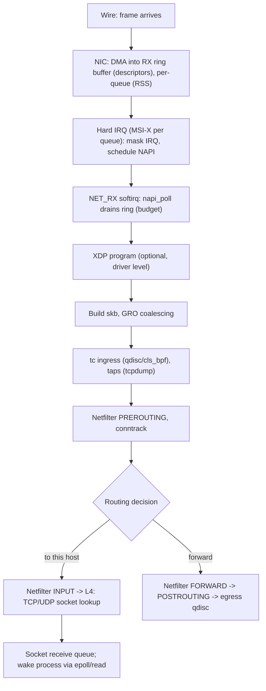
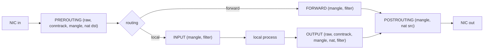

Network performance and packet loss problems almost always live in a specific stage of the kernel's pipeline. Knowing the stages — and which counter belongs to each — turns "packets are being dropped somewhere" into a short list of suspects.

## Receive path

### 1. NIC, ring buffers and DMA

The NIC writes arriving frames by DMA into host memory buffers described by an **RX ring** of descriptors (typically 256–4096 entries per queue; `ethtool -g eth0` shows and sets the sizes). If frames arrive faster than the driver refills/drains the ring, the NIC drops them: **`rx_missed_errors` / `rx_fifo_errors` / `rx_no_buffer_count`** in `ethtool -S` and `ip -s link` "overruns". Larger rings absorb bursts at the cost of latency (bufferbloat in the NIC).

### 2. Interrupts and NAPI

Interrupt per packet is unaffordable at millions of packets per second. **NAPI** (New API) combines interrupts and polling:

1. The NIC raises an interrupt; the handler (top half) **disables further RX interrupts** for that queue and schedules the NAPI poll via the **NET_RX softirq**.
2. In softirq context (bottom half, usually on the same CPU), the driver's `poll()` function processes up to a **budget** of packets. System-wide knobs: `net.core.netdev_budget` (300 packets) and `net.core.netdev_budget_usecs` (8000 µs) per softirq cycle.
3. If the ring is drained, interrupts are re-enabled; otherwise polling continues (and may be deferred to the `ksoftirqd/N` thread under overload).

Visibility: `/proc/interrupts` (per-queue interrupt counts and CPU), `/proc/softirqs` (`NET_RX`, `NET_TX` per CPU), **`/proc/net/softnet_stat`** (one row per CPU, hex columns: processed, **dropped** (backlog full), **time_squeeze** (budget exhausted with work remaining), … ). A rising `time_squeeze` means the budget is too small for the load: raise `netdev_budget` or spread load; rising `dropped` means the per-CPU backlog queue (`net.core.netdev_max_backlog`, default 1000) overflowed (used by RPS and loopback). High `%soft` in `mpstat` on one CPU and `ksoftirqd` at 100 % mean a softirq bottleneck.

### 3. Multi-queue scaling: RSS, RPS, RFS, XPS

A single CPU can only process so many packets per second (~1–2 Mpps for the full stack). To scale:

| Mechanism | Level | What it does |
|---|---|---|
| **RSS** (Receive Side Scaling) | hardware | NIC hashes the flow (src/dst IP, ports; Toeplitz hash) to select an RX queue, each with its own interrupt pinned to a CPU: `ethtool -l` (channels), `ethtool -x` (indirection table), `ethtool -N` (flow rules) |
| **RPS** (Receive Packet Steering) | software | spreads packets to other CPUs via IPI after the hash, for NICs with one queue (`/sys/class/net/eth0/queues/rx-0/rps_cpus`) |
| **RFS** / aRFS | software / HW | steers packets to the CPU where the consuming application thread runs (cache locality) |
| **XPS** (Transmit Packet Steering) | software | selects the TX queue by CPU to avoid lock contention |
| IRQ affinity | `/proc/irq/N/smp_affinity`, `irqbalance` | pins queues' interrupts to cores (ideally on the NIC's NUMA node) |

Flow hashing keeps all packets of a flow on one CPU (in-order, cache-friendly); so one fat flow (an elephant, or a single TCP connection) is limited to one CPU: multiple connections are needed to use many cores.

### 4. GRO, skb and offloads

The driver wraps data in a **`sk_buff`** (skb): a metadata structure plus references to packet data pages. **GRO** (Generic Receive Offload) merges consecutive segments of the same flow into one large skb (up to 64 KB) so the stack processes fewer, bigger packets. **Checksum offload** lets the NIC verify/compute checksums; **TSO/GSO** (TCP/Generic Segmentation Offload) let the stack hand a 64 KB "super-packet" to the driver on transmit, and the NIC (or GSO in software at the last moment) cuts it into MSS-sized frames. Consequences:

- `tcpdump` on the host may show packets bigger than the MTU (up to 64 KB) because it captures *before* segmentation/after coalescing. That is normal, not a bug. Turn off for debugging: `ethtool -K eth0 gro off gso off tso off`.
- Wrong checksums in captures ("bad cksum" in tcpdump for locally generated packets) are normal with TX checksum offload (the NIC fills them in).
- Routers/bridges must not leave GRO enabled with forwarding (`gro` is automatically segmented by GSO on output, but LRO is incompatible with forwarding).
- Check state with `ethtool -k eth0 | grep -E 'tcp-segmentation|generic-receive|checksum'`.

### 5. XDP and tc ingress

If an **XDP** program is attached it runs first, directly on the packet buffer in the driver (before skb allocation): drop, redirect, or pass. Then the **tc ingress** hook (`clsact`, `cls_bpf`, `tc filter`) can classify/police/redirect. Packet taps (`AF_PACKET`, tcpdump) see packets around this point, which is why traffic dropped by iptables is still visible in tcpdump on ingress (but not on egress).

### 6. Netfilter and conntrack

**Netfilter** provides hooks at five points; `iptables`/`nftables` attach rules (chains) to them, and subsystems (conntrack, NAT, bridge-nf) register callbacks.

- **conntrack** tracks every flow (5-tuple + state NEW/ESTABLISHED/RELATED/INVALID) in a hash table (`nf_conntrack_max`, e.g. 262,144); it enables stateful filtering and NAT, but costs memory and CPU, and **"nf_conntrack: table full, dropping packet"** is a classic outage. Bypass for traffic that doesn't need it with `raw` table `NOTRACK`/`notrack`; monitor with `conntrack -S`, `conntrack -L | wc -l`, `/proc/sys/net/netfilter/nf_conntrack_count`.
- Rule evaluation is linear per chain in iptables (thousands of rules = latency): use `ipset`/nftables sets/maps, or eBPF (Cilium). `nft list ruleset`, `iptables-save`, counters via `-v`, trace with `nft monitor trace`.
- Bridges: `br_netfilter` makes bridged frames traverse iptables (often an unintended side effect on Kubernetes nodes; `sysctl net.bridge.bridge-nf-call-iptables`).

### 7. Routing and forwarding

After PREROUTING the kernel does a route lookup (see the forwarding note): local delivery vs forward. Forwarding requires `net.ipv4.ip_forward=1`; `rp_filter` drops packets with invalid source reachability (reverse-path check). Forwarded packets get TTL decremented, may need fragmentation (ICMP "frag needed"), then go to POSTROUTING and the egress qdisc.

### 8. Transport and socket delivery

TCP/UDP lookup the socket by 4-tuple (hash tables; `SO_REUSEPORT` groups for load balancing), run protocol logic (sequence/ACK processing for TCP), and queue payload on the **socket receive buffer** (`sk_rcvbuf`, limited by `net.ipv4.tcp_rmem` autotuning or `SO_RCVBUF`). If the application reads slowly the buffer fills: TCP advertises a smaller window (flow control), UDP **drops** (`UdpRcvbufErrors` in `nstat`, `RcvbufErrors` in `/proc/net/snmp`; raise `SO_RCVBUF` and `net.core.rmem_max`). The softirq then wakes the process (epoll/`read`), often on another CPU: tail latency lives in this wakeup (scheduler, C-states).

## Transmit path

1. `write()/send()` copies data into the socket **send buffer** (`tcp_wmem`); blocks (or `EAGAIN`) when full.
2. TCP segments data to the MSS (or builds a GSO super-packet up to 64 KB), applies congestion/flow control windows, **TSQ** (TCP Small Queues: limits bytes per flow queued below the stack to reduce bufferbloat) and pacing (`fq`).
3. IP: route lookup (cached in the socket), Netfilter OUTPUT/POSTROUTING, fragmentation if needed (rare for TCP).
4. **Queueing discipline (qdisc)** on the egress device (`tc qdisc show dev eth0`): the default is `fq_codel` on modern distributions (`net.core.default_qdisc`), or `mq` with per-queue children on multi-queue NICs; this is where shaping, fairness and AQM happen (see the QoS note). `pfifo_fast` on old systems.
5. The driver places descriptors on the **TX ring** (`ethtool -g` TX size) and rings the NIC's doorbell; the NIC DMAs the frame and transmits; a TX-completion interrupt (or polling) frees the skb.
6. `tcpdump` captures at the point packets pass `dev_queue_xmit` (before the NIC), so you can capture packets that never reach the wire if the NIC or qdisc drops them. Check `tc -s qdisc` (dropped, overlimits, requeues), `ethtool -S` (tx_dropped, tx_timeout_count), `ip -s link` (TX errors/dropped/carrier).

## Where packets get lost: a table

| Drop point | Counter | Meaning / fix |
|---|---|---|
| NIC FIFO/ring overflow | `ethtool -S`: `rx_missed`, `rx_no_buffer`; `ip -s link` RX overruns/missed | bigger ring (`ethtool -G`), more queues/RSS, IRQ affinity, faster polling |
| Softirq budget | `softnet_stat` col 3 (time_squeeze) | raise `netdev_budget`, spread flows, XDP |
| Per-CPU backlog | `softnet_stat` col 2 (dropped) | raise `netdev_max_backlog`; spread RPS |
| Checksum/length errors | `ip -s link` RX errors, `nstat IpInHdrErrors`, `UdpInErrors` | cable/NIC/driver, MTU mismatch |
| Netfilter / conntrack | `nft`/`iptables -v` counters, `conntrack -S` `drop`/`invalid`, `dmesg` table full | rules, table size |
| Routing / rp_filter | `nstat IpInAddrErrors`, `IpInNoRoutes`, martian logs (`log_martians`) | routes, reverse path |
| Listen queue overflow | `nstat TcpExtListenOverflows`, `TcpExtListenDrops`; `ss -ltn` Recv-Q ≥ Send-Q | raise backlog and `somaxconn`, speed up `accept` |
| Socket buffer full | `UdpRcvbufErrors`, TCP zero-window | read faster; raise buffers |
| Qdisc | `tc -s qdisc` dropped/overlimits | shape/queue sizing, AQM |
| TX ring / NIC | `ethtool -S` `tx_dropped`, `tx_timeout` | driver/firmware, link |
| Bytes lost in the wire | switch/router counters | out of scope for the host |

Tools that localize drops: `dropwatch -l kas` / `perf trace -e skb:kfree_skb` / `bpftrace -e 'tracepoint:skb:kfree_skb { @[args->reason, kstack(3)] = count(); }'` (kernel 5.17+ gives drop reasons), `nstat -az`, `ss -s`, `ip -s -s link`, `ethtool -S`.

## Bypassing the stack

For extreme packet rates the kernel path (≈ 1–2 µs and 1–3 Mpps per core) is too slow: **XDP** (in-driver programs), **AF_XDP** sockets (zero-copy to user space), **DPDK** (poll-mode drivers in user space, dedicated cores, hugepages), **netmap**, **SR-IOV/virtio vDPA** for VMs, and SmartNIC offload. Trade-offs: loss of kernel features (firewall, routing, TCP) unless re-implemented, dedicated cores, more operational complexity.

## Key takeaways

- RX: NIC DMA ring → IRQ → NAPI softirq poll (budget) → XDP → skb/GRO → tc → netfilter → routing → socket buffer → process wakeup. TX is the mirror with TSO, qdisc, TX ring.
- Scale with RSS queues, IRQ affinity, RPS/RFS/XPS; one flow stays on one CPU.
- GRO/TSO/checksum offload explain jumbo-sized and "bad checksum" packets in captures.
- Identify drops with `ethtool -S`, `/proc/net/softnet_stat` (dropped, time_squeeze), `nstat`, `tc -s`, conntrack counters and the skb drop tracepoints.
- Conntrack and netfilter rule count are common hidden costs; bypass or replace them for high rates.
