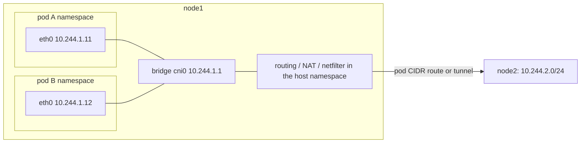

Kubernetes networking looks like a large system, but it is a short list of Linux features arranged by convention. If you understand network namespaces, veth pairs, bridges, routing, NAT and netfilter (earlier notes), you already understand how it works; what Kubernetes adds is automation and a set of rules about what must be reachable.

## The model: four rules

1. Every **pod** gets its own IP address, in its own network namespace.
2. All pods can reach all other pods **without NAT**, on any node.
3. Agents on a node (kubelet) can reach all pods on that node.
4. A pod sees its own IP as others see it.

These rules are a contract, not an implementation. Something has to create the namespaces, assign addresses and make cross-node pod traffic work; that is the **CNI plugin**. Beyond pod-to-pod there are three more concerns: **Services** (stable virtual IPs for sets of pods), **name resolution** (cluster DNS), and **access control** (NetworkPolicy), plus **ingress** from outside.

## A pod is a namespace

A pod is one network namespace shared by all its containers (that is why containers in a pod talk over `localhost`). The container runtime creates an empty "pause" container that holds the namespace, then calls the CNI plugin with the namespace path. A typical plugin does what the labs in this series did by hand:



1. Create a veth pair; move one end into the pod namespace as `eth0`.
2. Attach the other end to a bridge (or give it a routed /32 with proxy ARP, as Calico does).
3. Assign the pod an address from the node's **pod CIDR** (IPAM) and set its default route to the node.

## CNI: the plugin interface and the main designs

The **CNI specification** defines how the runtime invokes a plugin: executable file or daemon called with `ADD`, `DEL`, `CHECK` and a JSON config naming the namespace, interface name and IPAM settings; the plugin returns the interfaces and addresses it set up. Plugins differ in how they connect nodes:

| Design | How cross-node traffic moves | Examples | Notes |
|---|---|---|---|
| **Routed, no encapsulation** | each node has a route to every other node's pod CIDR (static routes, or BGP) | Flannel `host-gw`, Calico BGP, Cilium native routing | best performance; nodes must be L2-adjacent or run BGP with the fabric |
| **Overlay** | pod packets are encapsulated in UDP between nodes (VXLAN, Geneve, WireGuard) | Flannel VXLAN, Calico VXLAN/IPIP, Cilium tunnel mode, Weave | works on any underlay; 50-byte overhead (lower the pod MTU), no visibility for the underlay |
| **Cloud-native** | the cloud's VPC routes or assigns pod addresses directly (secondary ENI IPs, alias ranges) | AWS VPC CNI, Azure CNI, GKE | pods are first-class VPC citizens; limited by the cloud's IP quotas |
| **eBPF dataplane** | eBPF programs at `tc`/XDP route and filter, replacing iptables/bridges | Cilium, Calico eBPF mode | fewer hops, identity-based policy, no kube-proxy |

Common problems: **MTU mismatch** with overlays (large packets silently dropped; the pod MTU must be the node MTU minus the encapsulation), exhausted pod CIDRs, and conflicting CIDRs between cluster and the corporate network.

## Services: a virtual IP implemented by rewriting packets

Pods are ephemeral, so clients should not use pod IPs. A **Service** has a stable **ClusterIP** (a virtual address from a separate range, e.g. 10.96.0.0/12, that no interface owns) and a selector; the control plane maintains the set of ready pod addresses as **EndpointSlices**. The ClusterIP does not exist on any interface: it is implemented entirely in the data plane by **kube-proxy** on each node (or by the CNI), which programs the kernel so that packets addressed to the ClusterIP are **destination-NAT'ed** to one of the endpoints.

- **iptables mode** (long the default): a chain per Service and per endpoint in the `nat` table; selection via `-m statistic --mode random --probability`. Rule evaluation is linear, so with tens of thousands of Services updates and lookups slow down.
- **IPVS mode**: uses the kernel's IP Virtual Server load balancer (hash tables, multiple schedulers such as round robin or least connections), scales to very large Service counts.
- **nftables mode**: the successor to iptables mode using verdict maps and sets, with efficient updates.
- **eBPF replacement** (Cilium): the translation happens at socket level (`connect()` is rewritten in a cgroup BPF hook so packets never carry the ClusterIP) or at the tc layer; no conntrack entry per connection for in-cluster traffic.

Where the rule is applied: for traffic from a pod, in the node's `PREROUTING` after it leaves the pod's veth; for traffic originating on the node itself, in `OUTPUT`. Because DNAT happens once, when the connection's first packet is processed, and the connection tracker remembers the choice, **all packets of a connection go to the same endpoint**; the load balancing is **per connection, not per packet**.

### Lab: a Service built from nftables

The script builds two nodes with pod bridges (`cni0`), two pods per node, a routed pod network between the nodes (the *host-gw* design: each node has a route to the other's pod CIDR), then implements a Service with the same mechanism as kube-proxy's nftables mode: a chain that picks an endpoint with `numgen random` and jumps to a chain that DNATs to it. Three pods run a tiny responder that returns its own name and the client address it saw.

```bash
#!/bin/sh
# Two "nodes", each with a bridge (cni0) and two pods. Pod CIDRs are routed between nodes (host-gw style, like Flannel host-gw / Calico without encapsulation).
# A Service 10.96.0.10:80 (ClusterIP) is implemented the way kube-proxy does it: DNAT in the nat table, chosen at random per new connection.
mount -t tmpfs tmpfs /run; mkdir -p /run/netns
for n in node1 node2 client p11 p12 p21 p22; do ip netns add $n; ip -n $n link set lo up; done
for n in node1 node2; do ip netns exec $n sysctl -qw net.ipv4.ip_forward=1; done
# node-to-node link
ip link add n1 type veth peer name n2; ip link set n1 netns node1; ip link set n2 netns node2
ip -n node1 addr add 192.168.0.1/24 dev n1; ip -n node2 addr add 192.168.0.2/24 dev n2; ip -n node1 link set n1 up; ip -n node2 link set n2 up
mknode() { # node podcidr-prefix pod_a pod_b
    ip -n $1 link add cni0 type bridge; ip -n $1 addr add 10.244.$2.1/24 dev cni0; ip -n $1 link set cni0 up
    i=10; for pod in $3 $4; do i=$((i+1))
        ip link add h$pod type veth peer name eth0; ip link set eth0 netns $pod; ip link set h$pod netns $1
        ip -n $1 link set h$pod master cni0; ip -n $1 link set h$pod up
        ip -n $pod addr add 10.244.$2.$i/24 dev eth0; ip -n $pod link set eth0 up; ip -n $pod route add default via 10.244.$2.1
    done
}
mknode node1 1 p11 p12; mknode node2 2 p21 p22
ip -n node1 route add 10.244.2.0/24 via 192.168.0.2; ip -n node2 route add 10.244.1.0/24 via 192.168.0.1     # the "CNI": pod CIDR routes between nodes
echo "== pod to pod, different nodes =="; ip netns exec p11 ping -c 1 -W 2 10.244.2.11 | grep -E "bytes from"
# the traffic leaves node1 with the pod's own address (no NAT):
echo; echo "== the service: pods p12, p21, p22 run an HTTP-like responder that returns its own name =="
cat > /tmp/resp.py <<'PY'
import socket, sys
name, ip = sys.argv[1], sys.argv[2]
s = socket.socket(); s.setsockopt(socket.SOL_SOCKET, socket.SO_REUSEADDR, 1); s.bind((ip, 80)); s.listen(50)
s.settimeout(12)
try:
    while True:
        c, a = s.accept(); c.recv(100); c.sendall(f"{name} (saw client {a[0]})\n".encode()); c.close()
except socket.timeout: pass
PY
for p in "p12 10.244.1.12" "p21 10.244.2.11" "p22 10.244.2.12"; do set -- $p; ip netns exec $1 python3 /tmp/resp.py $1 $2 & done
sleep 1
# kube-proxy (nftables mode, simplified): in the nat table, a service chain picks one endpoint per new connection at random
nat() { cat <<NFT
table ip kube {
  chain services {
    type nat hook prerouting priority dstnat; policy accept;
    ip daddr 10.96.0.10 tcp dport 80 jump svc_web
  }
  chain output_services {
    type nat hook output priority -100; policy accept;
    ip daddr 10.96.0.10 tcp dport 80 jump svc_web
  }
  chain svc_web {
    numgen random mod 3 vmap { 0 : goto ep1, 1 : goto ep2, 2 : goto ep3 }
  }
  chain ep1 { meta l4proto tcp dnat to 10.244.1.12:80; }
  chain ep2 { meta l4proto tcp dnat to 10.244.2.11:80; }
  chain ep3 { meta l4proto tcp dnat to 10.244.2.12:80; }
  chain post {
    type nat hook postrouting priority srcnat; policy accept;
    ct status dnat ip saddr 10.244.1.0/24 ip daddr 10.244.1.0/24 masquerade    # endpoint on the client's own node: force the reply back through the node
  }
}
NFT
}
# the client pod p11 reaches the ClusterIP; its default route is its node (node1), where the DNAT rules live
nat | ip netns exec node1 nft -f -
echo '$ nft list chain ip kube svc_web   (on node1)'; ip netns exec node1 nft list chain ip kube svc_web
echo; echo "== 30 new connections from pod p11 to the Service IP 10.96.0.10:80 =="
for i in $(seq 1 30); do ip netns exec p11 python3 -c "
import socket; s=socket.socket(); s.settimeout(3); s.connect(('10.96.0.10',80)); s.sendall(b'GET /'); print(s.recv(100).decode().split()[0])"; done | sort | uniq -c
echo; echo "== one connection, conntrack view: the client talks to the VIP, the endpoint answers it =="
ip netns exec p11 python3 -c "
import socket; s=socket.socket(); s.connect(('10.96.0.10',80)); print('connected to', s.getpeername()); s.sendall(b'GET /'); print('reply:', s.recv(100).decode().strip())"
echo; echo "== endpoint p22 removed from the Service (as when its pod is deleted or fails readiness): new connections avoid it =="
ip netns exec node1 nft flush chain ip kube svc_web
ip netns exec node1 nft add rule ip kube svc_web numgen random mod 2 vmap '{ 0 : goto ep1, 1 : goto ep2 }'
for i in $(seq 1 30); do ip netns exec p11 python3 -c "
import socket; s=socket.socket(); s.settimeout(3); s.connect(('10.96.0.10',80)); s.sendall(b'GET /'); print(s.recv(100).decode().split()[0])"; done | sort | uniq -c
kill $(jobs -p) 2>/dev/null; wait 2>/dev/null; rm -f /tmp/resp.py
```

```text
$ unshare -Urnm sh lab.sh 2>&1
== pod to pod, different nodes ==
64 bytes from 10.244.2.11: icmp_seq=1 ttl=62 time=0.215 ms

== the service: pods p12, p21, p22 run an HTTP-like responder that returns its own name ==
$ nft list chain ip kube svc_web   (on node1)
table ip kube {
	chain svc_web {
		numgen random mod 3 vmap { 0 : goto ep1, 1 : goto ep2, 2 : goto ep3 }
	}
}

== 30 new connections from pod p11 to the Service IP 10.96.0.10:80 ==
     12 p12
     11 p21
      7 p22

== one connection, conntrack view: the client talks to the VIP, the endpoint answers it ==
connected to ('10.96.0.10', 80)
reply: p21 (saw client 10.244.1.11)

== endpoint p22 removed from the Service (as when its pod is deleted or fails readiness): new connections avoid it ==
     13 p12
     17 p21
```

What to take from it:

- **Pod to pod across nodes** works by plain IP routing (`ttl=62`: pod to node, node to node, node to pod). No NAT, as the model requires.
- The Service chain shows the whole mechanism: `numgen random mod 3 vmap {...}` selects one of three endpoint chains, each ending in a `dnat`. There is no process in the data path and no interface owns `10.96.0.10`.
- **30 new connections** spread across the three pods roughly evenly (random, so not exactly 10/10/10). A real kube-proxy also keeps this stable per connection through conntrack, as the second experiment's single connection shows: the client believes it is talking to the VIP (`getpeername` shows the ClusterIP) while the reply comes from a pod.
- For endpoints on **other nodes** the endpoint sees the **real pod IP of the client** (`10.244.1.11`), because the DNAT happens on the client's node and the reply route passes back through that same node, where conntrack restores the Service address. An endpoint on the **client's own node** (`p12` here) is different: after DNAT the request travels on the same bridge and the reply would go straight back to the client, bypassing the node, so the client would see an unexpected source address and drop it. kube-proxy fixes this with a **masquerade** rule for that hairpin case, which is what the `post` chain does; the endpoint then sees the node's bridge address.
- **Removing an endpoint** is only a rule change: with one pod taken out of the rule set, new connections avoid it, while established connections stay in conntrack. This is exactly what happens on a rolling update; draining depends on readiness probes and the pod's termination handling, because connections already in conntrack keep going to the old pod until they end.

### Service types and traffic policy

| Type | Meaning |
|---|---|
| `ClusterIP` | virtual IP reachable inside the cluster only |
| `NodePort` | additionally opens the same port (30000-32767 by default) on every node; traffic to any node's IP:port is DNAT'ed to an endpoint, possibly on another node (extra hop plus SNAT, hiding the client IP unless `externalTrafficPolicy: Local`) |
| `LoadBalancer` | asks the cloud (or MetalLB/ BGP speaker) for an external IP that forwards to the NodePorts or directly to pods |
| `ExternalName` | a DNS CNAME to an external name, no proxying |
| Headless (`clusterIP: None`) | no virtual IP; DNS returns the pod IPs directly (used by StatefulSets) |

`externalTrafficPolicy: Local` keeps traffic on the node that received it and preserves the client source IP, at the cost of uneven balance (a node without a local endpoint drops the traffic, so the load balancer's health check must exclude it). `internalTrafficPolicy` and topology-aware routing prefer endpoints in the same node or zone to save latency and cross-zone cost.

## DNS

CoreDNS runs as a Service (typically `10.96.0.10`) and answers names like `web.default.svc.cluster.local` (A record = ClusterIP, or all pod IPs for a headless Service) and `10-244-1-12.default.pod.cluster.local`. Each pod's `/etc/resolv.conf` has `nameserver <CoreDNS ClusterIP>`, `search default.svc.cluster.local svc.cluster.local cluster.local` and **`options ndots:5`**. With `ndots:5`, a name with fewer than five dots such as `api.example.com` is first tried with every search suffix (`api.example.com.default.svc.cluster.local`, ...) before the literal name, producing several useless NXDOMAIN queries per lookup, a frequent cause of DNS load and latency. Mitigations: fully qualified names with a trailing dot, a lower `ndots`, NodeLocal DNSCache, and CoreDNS autoscaling. Conntrack races on UDP DNS (parallel A and AAAA queries from the same source port) were a well-known source of 5-second delays on older kernels.

## Ingress and Gateway API

External HTTP(S) enters through a **load balancer to an ingress controller** (NGINX, Envoy-based such as Contour/Emissary/Istio gateway, HAProxy, Traefik), a normal pod that reads `Ingress` or **Gateway API** resources (`Gateway`, `HTTPRoute`) and configures routing by host and path, TLS termination and retries. Gateway API is the newer, role-oriented replacement for Ingress. Non-HTTP traffic uses `LoadBalancer` Services or `TCPRoute`/`UDPRoute`.

## NetworkPolicy

By default every pod can talk to every other pod. A **NetworkPolicy** selects pods (by label) and defines allowed **ingress** and/or **egress** peers (pod labels, namespaces, IP blocks) and ports; a pod selected by at least one policy is default-deny for that direction, and policies are additive allows. Kubernetes only stores the object; the **CNI plugin enforces it**: with iptables/nftables sets (Calico), eBPF programs matching on **identity** (Cilium), or not at all (Flannel alone ignores policies). Typical baseline: a default-deny policy per namespace, then explicit allows (DNS egress to CoreDNS, app tiers, ingress from the controller). Policies are L3/L4; L7 rules need Cilium's L7 policy or a service mesh.

## Service mesh

Sidecar or ambient meshes (Istio, Linkerd, Cilium service mesh) add mTLS between pods, L7 routing, retries, observability and policy. Sidecar proxies are inserted with `iptables` REDIRECT rules in the pod's namespace (`istio-init`) so that all pod traffic passes through a local Envoy; ambient modes move that into per-node proxies. The cost is latency, memory and operational complexity; use it when you need mTLS and traffic management uniformly.

## Troubleshooting method

Work the path in order:

1. **Pod networking**: `kubectl exec` into the pod (or `nsenter -t <pid> -n`), then `ip addr`, `ip route`, `ping` the node gateway and another pod. Failure: CNI problem, MTU, pod CIDR route missing.
2. **Cross-node**: from node A, `ip route get <pod IP on B>`, `tcpdump -i any host <pod IP>` on both nodes; check overlay UDP ports (8472 VXLAN, 6081 Geneve, 51820 WireGuard) are allowed between nodes.
3. **Service**: does the Service have endpoints (`kubectl get endpointslices`)? Does the readiness probe pass? On the node, `nft list ruleset | grep <ClusterIP>` or `iptables-save -t nat | grep <ClusterIP>`, `ipvsadm -Ln`, `conntrack -L -d <ClusterIP>`.
4. **DNS**: `kubectl exec ... -- nslookup kubernetes.default`, check CoreDNS pods and logs, `resolv.conf`, the `ndots` behavior.
5. **Policy**: look for a default-deny; test with the policy removed; use the CNI's flow log (`hubble observe`, Calico flow logs).
6. **Ingress/external**: the load balancer's health checks, `externalTrafficPolicy`, security groups, node ports.

Symptoms: connection hangs only for some requests (a bad endpoint in the rule set), 5-second DNS delays (conntrack race or missing UDP retry), large requests fail while small succeed (MTU), Service works from some nodes only (kube-proxy not running there, or the route/`rp_filter`), external clients show node IPs (SNAT from NodePort or `externalTrafficPolicy: Cluster`).

## Key takeaways

- A pod is a network namespace connected by a veth pair; a CNI plugin sets up the interface, address and cross-node reachability (routes, BGP, or an overlay) so that pods reach each other without NAT.
- A Service's ClusterIP is not an interface address: kube-proxy (iptables, IPVS, nftables) or an eBPF dataplane rewrites packets with destination NAT to a ready endpoint, chosen per connection and remembered by conntrack.
- Hairpin traffic and NodePort need masquerade; `externalTrafficPolicy: Local` preserves client IPs at the cost of balance.
- DNS (`ndots:5`), MTU and endpoint readiness are the usual sources of mysterious latency and partial failures.
- NetworkPolicy is enforced by the CNI, not by Kubernetes itself; start from default-deny per namespace.
