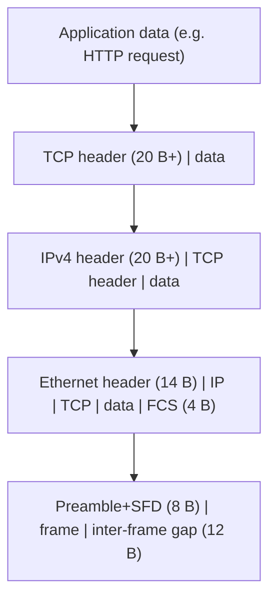

## Two models, one reality

The **OSI model** (ISO 7498) has seven layers and was designed top-down as a reference. The **TCP/IP model** (described in RFC 1122) grew bottom-up from running protocols and has four. Real networks follow TCP/IP; OSI survives as the shared vocabulary ("a layer 2 problem", "an L7 load balancer").

| OSI | TCP/IP (RFC 1122) | Typical protocols | PDU name |
|---|---|---|---|
| 7 Application | Application | HTTP, DNS, SSH, BGP | data / message |
| 6 Presentation | | TLS, encodings | |
| 5 Session | | | |
| 4 Transport | Transport | TCP, UDP, QUIC, SCTP | segment / datagram |
| 3 Network | Internet | IPv4, IPv6, ICMP, IPsec | packet |
| 2 Data link | Link | Ethernet, 802.11, PPP, ARP* | frame |
| 1 Physical | | 1000BASE-T, fiber, SFP+ | bits / symbols |

\* ARP and NDP sit awkwardly between 2 and 3. BGP runs over TCP, so it is an application protocol that controls layer 3. Do not over-trust the layer boundaries: they are a teaching device, and several technologies (MPLS, VXLAN, IPsec, GRE) deliberately blur them.

### Why layering works (and its cost)

Each layer offers a **service** to the layer above and uses only the service of the layer below, so Ethernet can be replaced by Wi-Fi without changing TCP. The costs are redundancy (checksums at several layers), header overhead, and hidden interactions, e.g. TCP's congestion control misreading Wi-Fi loss as congestion.

The **end-to-end principle** (Saltzer, Reed & Clark; RFC 1958) argues that functions like reliability and security can only be completely implemented at the endpoints, so the network should stay simple and fast. This is why IP is best-effort and TCP handles retransmission. Middleboxes (NAT, firewalls, DPI) break this model, which is a recurring source of operational pain.

## Encapsulation

On send, each layer adds its own header (and sometimes a trailer) around the data it received from above. On receive, each layer strips and interprets its header.

Headers carry a **demultiplexing key** telling the receiver what is inside:

| Layer | Field | Examples |
|---|---|---|
| Ethernet | EtherType | `0x0800` IPv4, `0x86DD` IPv6, `0x0806` ARP |
| IPv4 | Protocol | 1 ICMP, 6 TCP, 17 UDP, 47 GRE, 50 ESP, 89 OSPF |
| IPv6 | Next Header | 6 TCP, 17 UDP, 58 ICMPv6, 44 Fragment |
| TCP / UDP | Port | 22 SSH, 53 DNS, 179 BGP, 443 HTTPS |

A typical TCP segment of 1460 bytes of data therefore occupies `1460 + 20 (TCP) + 20 (IP) + 14 + 4 (Ethernet)` = 1518 bytes on the wire (1538 including preamble and gap). The **MSS** (1460) is derived from the MTU (1500) minus the IP and TCP headers; tunnels reduce the effective MTU and are a classic cause of "small packets work, big ones hang".

Encapsulation can also be nested: a VXLAN packet is `Ethernet | IP | UDP | VXLAN | Ethernet | IP | TCP | data`, adding 50 bytes of overhead. IPsec tunnel mode, GRE and MPLS all follow the same recursive pattern.

## What each device looks at

| Device | Looks at | Decision | Domains |
|---|---|---|---|
| Repeater/hub (obsolete) | nothing: it repeats bits | broadcast to all ports | one collision domain, one broadcast domain |
| Switch / bridge | Ethernet header (+ VLAN tag) | forward by destination MAC | each port is its own collision domain; one broadcast domain per VLAN |
| Router | IP header | forward by destination IP prefix | splits broadcast domains |
| Layer-3 switch | both | switches within VLANs, routes between them in hardware | |
| Firewall | IP + transport (stateful), sometimes L7 | permit/deny by policy and connection state | |
| Load balancer | L4 (IP+port) or L7 (HTTP) | pick a backend | |

A **collision domain** exists only on shared media (hubs, half-duplex); with full-duplex switching it is a historical concept. A **broadcast domain** is the set of devices that receive a layer 2 broadcast, and it is the thing you limit by VLANs and routers because broadcast traffic scales with the number of hosts.

## Planes

Every forwarding device has three conceptual planes, and many outages come from confusing them:

- **Data plane (forwarding plane)**: moves packets, in hardware (ASIC/NPU) on serious devices. It uses tables (FDB, FIB, adjacency, ACL TCAM) and cares about throughput, per-packet latency and predictability.
- **Control plane**: the protocols that *build* those tables: STP, OSPF, BGP, ARP/NDP, LACP. It runs on the device CPU and cares about convergence and correctness.
- **Management plane**: SSH, SNMP, NETCONF/gNMI, syslog, telemetry.

Traffic is also classified by whether it is *transit* (passes through, handled by the data plane) or *punted* to the CPU (addressed to the device, TTL expired, ARP/NDP, routing protocol packets). The CPU path is small, so devices protect it with **control-plane policing (CoPP)**: flooding a router with TTL-expiry or ARP traffic can take a healthy data plane's control plane down.

**Software-defined networking** moves the control plane out of the device onto a controller (OpenFlow, or today more often gNMI/EVPN-driven fabrics); the data plane stays in hardware.

## Standards bodies and who owns what

| Body | Owns | Documents |
|---|---|---|
| **IEEE 802** | L1/L2: Ethernet (802.3), bridging (802.1D/Q), Wi-Fi (802.11), LLDP (802.1AB), 802.1X | numbered standards, paid (free after 6 months via "Get IEEE 802") |
| **IETF** | L3 and up: IP, TCP, routing, DNS, TLS | RFCs, free |
| **ITU-T** | telecom: optical transport (OTN), G.8032 ring protection | recommendations |
| **IANA** | registries: protocol numbers, EtherTypes, ports, ASNs | |

When someone says "the standard" for Ethernet they mean IEEE 802.3; for BGP, RFC 4271.

## Key takeaways

- Learn the OSI layers as vocabulary and TCP/IP as reality; real protocols cross the boundaries.
- Encapsulation = header + demux key per layer; overhead (and MTU) accumulates with every tunnel.
- Switches decide on MACs, routers on IP prefixes; the broadcast domain is the scaling unit.
- Keep the data plane, control plane and management plane separate in your head, and protect the CPU path.
- IEEE owns the link layer, IETF owns the rest: that tells you where to look for the authoritative text.
