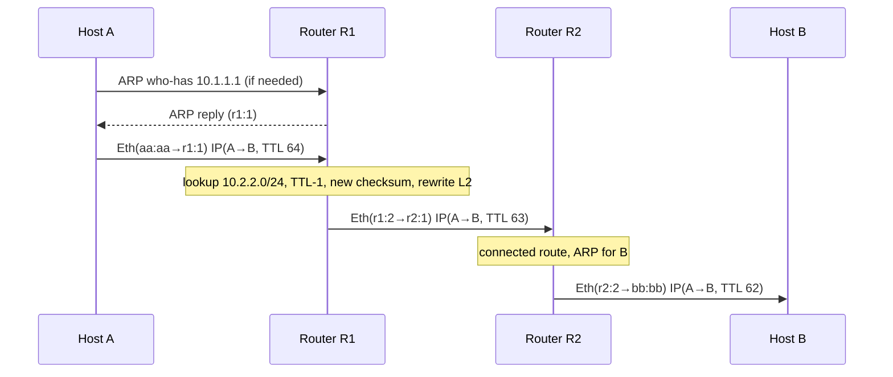

The single most useful mental model in networking is this: **IP addresses identify the end-to-end endpoints and stay constant; MAC addresses identify the next hop and change at every router.** Everything else follows.

## The topology

```text
Host A 10.1.1.10/24            Router R1                     Router R2             Host B 10.2.2.20/24
MAC aa:aa  --- LAN 1 --- gw 10.1.1.1  mac r1:1 | r1:2 --- 192.0.2.0/30 --- r2:1 | gw 10.2.2.1 --- LAN 2 --- MAC bb:bb
```

Host A sends one IP packet to Host B (`10.1.1.10 → 10.2.2.20`).

## Step 1: the host decides "local or remote?"

Host A applies its netmask to the destination:

```text
10.2.2.20 AND 255.255.255.0 = 10.2.2.0     # A's own network is 10.1.1.0, so B is remote
```

For a remote destination it uses its routing table: the **default route** `0.0.0.0/0 via 10.1.1.1`. This means the packet is addressed *at layer 3* to B, but *at layer 2* to the gateway. Confirm on Linux:

```bash
ip route get 10.2.2.20
# 10.2.2.20 via 10.1.1.1 dev eth0 src 10.1.1.10 uid 1000
```

## Step 2: resolve the next hop's MAC

A needs the MAC of **10.1.1.1** (not of B). If it is not in the neighbor cache, A broadcasts an ARP request (`ff:ff:ff:ff:ff:ff`) and R1 replies by unicast. Only then can the frame be built (see the ARP note). The packet waits (Linux queues a few) until resolution completes; failure produces `Destination Host Unreachable` from the local host.

## Step 3: the frame leaves A

| Layer | Source | Destination |
|---|---|---|
| Ethernet | `aa:aa` (A) | `r1:1` (R1, LAN-1 side) |
| IPv4 | `10.1.1.10` | `10.2.2.20` |
| IPv4 TTL | 64 | |

## Step 4: the router forwards

R1 receives the frame on its LAN-1 interface because the destination MAC matches its own (or broadcast/multicast it subscribes to). Per RFC 1812 §5.2, a router then:

1. Validates the Ethernet FCS and the IP header (version, header length, header checksum). Invalid → silently discard.
2. Checks that the destination is **not** one of its own addresses (otherwise it processes locally).
3. **Decrements TTL**; if the result is 0 it discards the packet and sends **ICMP Time Exceeded (type 11)** to the source.
4. Recomputes the **IPv4 header checksum**. Because only TTL changed it can be updated incrementally (RFC 1624), so the cost is trivial.
5. Looks up the destination in the FIB with **longest-prefix match**: `10.2.2.0/24 via 192.0.2.2`.
6. If the egress MTU is smaller than the packet: fragment (if DF is clear) or drop and send **ICMP Fragmentation Needed (type 3 code 4)** (if DF is set).
7. Resolves the next-hop MAC (ARP again, on the egress network), **rewrites the Ethernet header** and transmits. A new FCS is calculated.



## What changes and what does not

| Field | Hop 1 (A→R1) | Hop 2 (R1→R2) | Hop 3 (R2→B) |
|---|---|---|---|
| Ethernet src | `aa:aa` | `r1:2` | `r2:2` |
| Ethernet dst | `r1:1` | `r2:1` | `bb:bb` |
| IP src / dst | A / B | A / B | A / B |
| IP TTL | 64 | 63 | 62 |
| IP header checksum | c₀ | c₁ | c₂ |
| TCP/UDP ports & payload | same | same | same |

Exceptions to "IP addresses never change": **NAT** rewrites addresses and ports (and the checksums that cover them, including the TCP/UDP pseudo-header); **tunnels** add an outer IP header with different endpoints; **proxies** terminate and restart the connection.

## Return path and asymmetry

B's reply follows *its own* routing decisions. Routing in the Internet is frequently **asymmetric**: the forward and reverse paths use different routers. This matters when you interpret `traceroute` (which shows only the forward path), when a stateful firewall sees only one direction of a flow, and with `rp_filter`:

```bash
sysctl net.ipv4.conf.all.rp_filter    # 1 = strict reverse-path filtering (RFC 3704)
```

Strict mode drops packets whose source address would not be routed back out the ingress interface, which silently breaks asymmetric multihomed setups.

## Observing each hop

```bash
traceroute -n 10.2.2.20          # TTL-limited probes; each router answers Time Exceeded
tcpdump -eni eth0 host 10.2.2.20 # -e shows the MACs: the first-hop MAC is the GATEWAY's
ip neigh show                     # which next-hop MACs this host knows
mtr -n 10.2.2.20                  # continuous traceroute with per-hop loss
```

Two common diagnostic conclusions: if A's tcpdump shows *no ARP reply* for the gateway, the problem is layer 2 (VLAN, cable, switch); if the frame leaves A with the right gateway MAC and nothing comes back, look at the router's route or ACL.

## Key takeaways

- IP src/dst are end-to-end; MAC src/dst are hop-by-hop and rewritten by every router.
- A host decides local vs. remote with its mask, then ARPs for the *next hop*, not the destination.
- A router: validate, TTL−1, checksum update, LPM lookup, MTU check, L2 rewrite.
- ICMP errors (TTL exceeded, fragmentation needed) are how the network talks back to the sender.
- NAT, tunnels and proxies are the exceptions that change the end-to-end identity.
