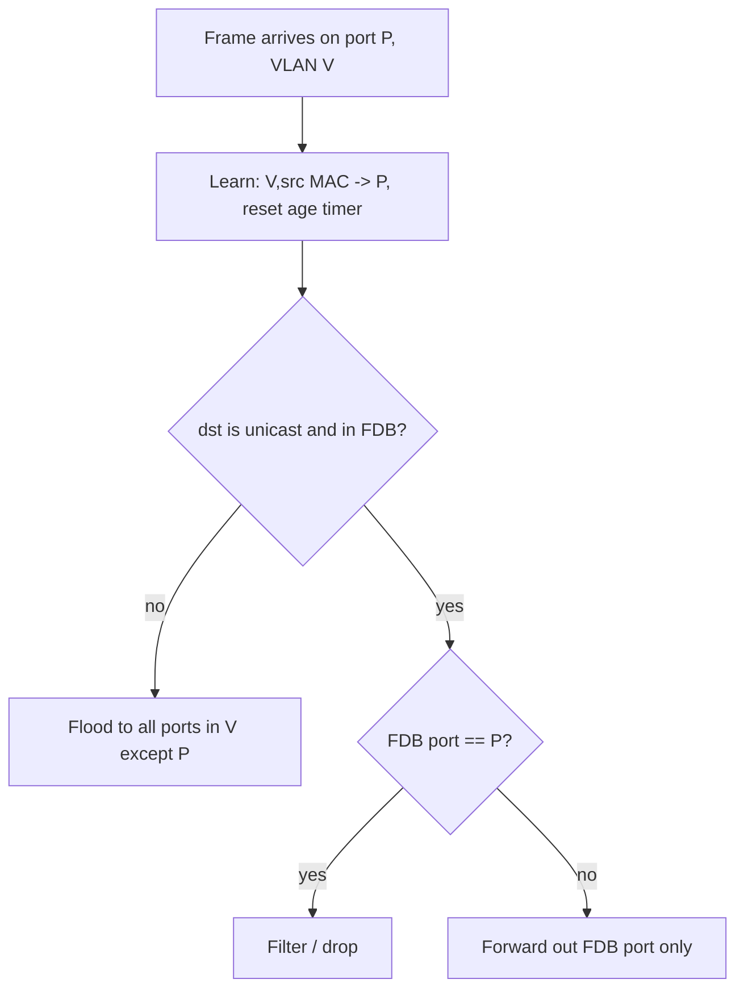

Ethernet is specified by **IEEE 802.3** (the MAC and PHY) and bridged by **IEEE 802.1** (`802.1D`, `802.1Q`). The IETF only describes how upper-layer protocols *ride* on it (e.g. RFC 894 for IPv4). Knowing the split tells you which document to open when a behavior surprises you.

## The frame on the wire

```text
+----------+-----+---------+---------+-----------+----------------+-----+
| Preamble | SFD | Dst MAC | Src MAC | EtherType | Payload (+pad) | FCS |
|  7 bytes | 1 B |  6 B    |  6 B    |   2 B     |  46 – 1500 B   | 4 B |
+----------+-----+---------+---------+-----------+----------------+-----+
            \_________________ the "frame" (64 – 1518 B) ________________/
```

| Field | Size | Notes |
|---|---|---|
| Preamble | 7 B | `10101010` repeated; lets the receiver's clock recover. Not part of the frame. |
| SFD | 1 B | `10101011`; the final `11` marks the start of the frame. |
| Destination / Source | 6 B each | 48-bit MAC addresses. |
| EtherType / Length | 2 B | See below. |
| Payload | 46–1500 B | Padded to 46 B if shorter, so the frame reaches the 64 B minimum. |
| FCS | 4 B | CRC-32 (polynomial `0x04C11DB7`) over destination through payload. |

Between frames the sender must leave an **inter-frame gap** of 96 bit times (12 B). Per-frame line overhead is therefore `7 + 1 + 12 = 20 B`, and the best-case efficiency for a 1500 B payload is `1500 / 1538 ≈ 97.5%`. This is why small packets can never reach line rate in *goodput* terms, and why packets-per-second, not bits-per-second, is the real limit of a forwarding device (a 10 GbE link at minimum size carries ≈ 14.88 Mpps).

### Why 64 bytes minimum?

CSMA/CD needs a sender to still be transmitting when a collision signal returns from the far end of the segment. The 802.3 *slot time* is 512 bit times, so a frame must last at least that long: 512 bits = 64 B. Full-duplex links have no collisions, but the minimum was retained for compatibility.

### EtherType vs. Length

The 2-byte field after the addresses is overloaded:

- **≥ 0x0600 (1536)** → an **EtherType** (Ethernet II / DIX framing): `0x0800` IPv4, `0x0806` ARP, `0x86DD` IPv6, `0x8100` 802.1Q, `0x88A8` 802.1ad, `0x8847` MPLS unicast, `0x88CC` LLDP.
- **≤ 1500** → a **length** (original 802.3), followed by an 802.2 LLC header (`DSAP/SSAP/Control`), possibly with SNAP.
- **1501–1535** → undefined.

IP uses Ethernet II framing (RFC 894 for IPv4; the same applies to IPv6). LLC framing survives in STP BPDUs and a few legacy protocols.

## MAC addresses

A MAC address is 48 bits; the first three octets form the **OUI** assigned by the IEEE Registration Authority. Two bits of the first octet carry meaning (IEEE 802-2014):

| Bit (of 1st octet) | Name | 0 | 1 |
|---|---|---|---|
| bit 0 (LSB) | I/G | Individual (unicast) | Group (multicast/broadcast) |
| bit 1 | U/L | Universally administered | Locally administered |

So `02:00:00:00:00:01` is a locally administered unicast, while `01:00:5e:…` is multicast. Bits are transmitted **least-significant bit first** within each octet, which is why the I/G bit is the first bit seen on the wire and a receiver can decide "multicast?" as early as possible.

Well-known ranges:

- **Broadcast**: `ff:ff:ff:ff:ff:ff`
- **IPv4 multicast**: `01:00:5e` + the low 23 bits of the group address (so 32 groups share each MAC — 5 bits are lost).
- **IPv6 multicast**: `33:33` + the low 32 bits of the group address.
- **Bridge-reserved**: `01:80:c2:00:00:00`–`0f`. Compliant 802.1D/Q bridges **do not forward** these; they are link-local. Examples: `…:00` STP BPDU, `…:01` PAUSE (802.3x), `…:02` LACP/slow protocols, `…:0e` LLDP.

## 802.1Q VLAN tag

A VLAN tag is **4 bytes inserted between the source MAC and the EtherType**:

```text
| Dst | Src | TPID 0x8100 | PCP(3) DEI(1) VID(12) | EtherType | Payload | FCS |
```

- **TPID** `0x8100` takes the place of the EtherType, so a parser seeing `0x8100` knows a TCI follows.
- **PCP**: 3-bit priority code point (802.1p class of service).
- **DEI**: drop-eligible indicator.
- **VID**: 12 bits → 4096 values; `0` means "priority-tagged only" and `4095` is reserved, leaving **1–4094** usable.

The tag grows the maximum frame to **1522 B** (802.3ac). The payload MTU is still 1500, which is why a trunk link with a mismatched frame-size limit silently drops full-size tagged frames. With **802.1ad (QinQ)** a second tag with TPID `0x88A8` stacks outside the customer tag, for 1526 B.

On an *access* port frames are untagged and the switch assigns the port's VLAN (PVID). On a *trunk* port frames carry tags, except for the optional native/untagged VLAN. Mismatched native VLANs on two ends of a trunk leak traffic between VLANs, a classic misconfiguration.

## How a bridge learns

An 802.1Q bridge keeps a **filtering database (FDB)**, informally the "MAC table" or "CAM table", keyed by *(VID, MAC)* and valued by egress port. It follows two rules for every frame arriving on port *P* in VLAN *V*:

1. **Learn**: record `(V, source MAC) → P` and refresh its age timer. Only unicast sources are learned.
2. **Forward**: look up `(V, destination MAC)`:
   - found, port ≠ *P* → send out that port only;
   - found, port = *P* → **filter** (drop; the destination is on the same segment);
   - not found (*unknown unicast*), multicast or broadcast → **flood** to every other port in VLAN *V*.



Entries expire after the **ageing time** (default 300 s in 802.1D/Q). A host that moves ports is re-learned on its next frame, so the table self-heals. A topology change (see STP) shortens the ageing time temporarily so stale entries disappear quickly.

### Consequences worth internalizing

- **Ethernet has no TTL.** A loop in the topology makes broadcasts circulate forever and multiply, a *broadcast storm*. Preventing loops is the reason STP/RSTP exists.
- **MAC flapping**: one MAC seen alternately on two ports (a loop, or a misbehaving VM migration) makes the FDB entry oscillate. Most switches log this.
- **FDB capacity is finite.** A flood of random source MACs (*MAC flooding* attack) fills the table; the switch then floods unknown unicast, so an attacker can see other hosts' traffic. Port security and dynamic ARP inspection mitigate this.
- **Store-and-forward vs. cut-through**: store-and-forward buffers the whole frame and checks the FCS before forwarding; cut-through starts forwarding after reading the destination MAC (lower latency, but may propagate corrupt frames).

## Hands-on with Linux

A Linux bridge implements exactly this behavior:

```bash
# build a two-port bridge from a pair of veth devices
ip link add br0 type bridge
ip link add v0 type veth peer name v0p
ip link set v0 master br0
ip link set br0 up; ip link set v0 up; ip link set v0p up

bridge fdb show br br0        # the learned (MAC, VLAN, port) table
bridge -d link                # per-port state, flags, learning on/off
ip -d link show br0           # ageing_time is in centiseconds (30000 = 300 s)
tcpdump -e -nn -i v0p         # -e prints the link-layer header: MACs, EtherType, VLAN tag
```

In Wireshark, filter with `eth.dst.ig == 1` for group addresses, `vlan.id == 100` for a VLAN, and `eth.fcs.status` to inspect the FCS. Note that NICs usually strip the FCS before the capture, so you will rarely see it unless you enable the right offload settings.

## Key takeaways

- The frame is `Dst | Src | [Tag] | EtherType | Payload | FCS`; the minimum is 64 B and the standard maximum 1518 B (1522 B tagged).
- The EtherType/length split is `0x0600`; IP uses EtherType framing.
- Bit 0 of the first octet marks multicast and bit 1 marks locally administered.
- Bridges learn from the *source* and forward by the *destination*; unknown unicast floods.
- With no TTL at layer 2, loop prevention is mandatory, which leads directly to Spanning Tree.
