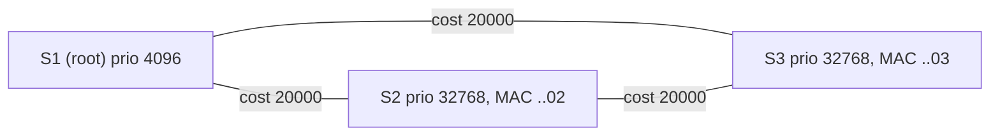

Ethernet has no TTL, so a loop in the bridged topology makes frames circulate forever, and broadcasts multiply into a **broadcast storm** that can take down the L2 domain in seconds. Redundant links are nonetheless desirable. The **Spanning Tree Protocol** resolves this by logically **blocking** enough ports to leave a loop-free tree, and un-blocking them when links fail.

Three generations exist; all interoperate (RSTP and MSTP fall back to STP when they hear an older neighbor):

| Protocol | Standard | Failover | Notes |
|---|---|---|---|
| STP | 802.1D-1998 | 30–50 s | timer-driven |
| RSTP | 802.1w → 802.1D-2004 → 802.1Q | typically < 1 s | handshake-driven |
| MSTP | 802.1s → 802.1Q Clause 13 | like RSTP | multiple trees for VLAN groups |

## Core concepts

**Bridge ID** (8 bytes) = **priority** (16 bits) + **MAC address** (48 bits). Since 802.1t the priority is split into a 4-bit *priority* (multiples of 4096, default **32768**) and a 12-bit **system ID extension** (the VLAN for per-VLAN STP, the instance for MSTP). The lowest Bridge ID wins.

**Port ID** (16 bits) = 4-bit port priority (multiples of 16, default **128**) + 12-bit port number.

**Path cost** is assigned per port, typically from link speed. Two scales exist and you must not mix them within a domain:

| Link speed | Short (802.1D-1998) | Long (802.1D-2004) |
|---|---|---|
| 10 Mb/s | 100 | 2,000,000 |
| 100 Mb/s | 19 | 200,000 |
| 1 Gb/s | 4 | 20,000 |
| 10 Gb/s | 2 | 2,000 |
| 100 Gb/s | 1 | 200 |

The long cost is `20 Tb/s ÷ link speed`, which keeps resolution at modern speeds. Mixing short and long costs yields suboptimal or surprising trees.

## The algorithm in four steps

Every bridge originally believes it is the root and advertises a **priority vector** in BPDUs:

`{root bridge ID, root path cost, designated bridge ID, designated port ID}`

Each bridge keeps the *best* vector (numerically lowest, compared in that order) it has seen and derives roles from it.

1. **Elect the root bridge**: the lowest Bridge ID in the domain.
2. **Root port on every non-root bridge**: the port that offers the lowest *root path cost* (received cost + the port's own cost). Ties: lowest sender Bridge ID, then lowest sender Port ID, then the lowest local Port ID.
3. **Designated port on every segment**: of all bridges attached to a segment, the one offering the lowest root path cost (then lowest bridge ID, then lowest port ID) forwards for that segment. All ports of the root bridge are designated.
4. **Everything else is blocked (STP) / alternate or backup (RSTP).**

Only root and designated ports forward. Blocked ports still **receive BPDUs** (so they know when to wake up) but neither forward user frames nor learn MACs.

### Worked example



- S1 has the lowest priority → root. All its ports are designated.
- S2: root port is the link to S1 (path cost 20000). S3: same.
- Segment S2–S3: both offer root path cost 20000 (via S1 + 20000 from their own root port), so ties break on the **bridge ID**: S2 (MAC ..02) wins. S2's port is designated, **S3's port toward S2 is blocked** (alternate in RSTP).
- If S3–S1 fails, S3's alternate port becomes its new root port (cost 40000 via S2).

## BPDU format

BPDUs are sent in 802.2 LLC frames (DSAP/SSAP `0x42`) to the reserved address **`01-80-C2-00-00-00`**. A Configuration BPDU is 35 bytes:

| Field | Bytes | Notes |
|---|---|---|
| Protocol Identifier | 2 | `0x0000` |
| Version | 1 | 0 = STP, 2 = RSTP, 3 = MSTP |
| Type | 1 | `0x00` Config, `0x80` TCN, `0x02` RST/MST |
| Flags | 1 | see below |
| Root Bridge ID | 8 | |
| Root Path Cost | 4 | |
| Bridge ID | 8 | the sender |
| Port ID | 2 | the sender's port |
| Message Age | 2 | units of 1/256 s |
| Max Age | 2 | 20 s default |
| Hello Time | 2 | 2 s default |
| Forward Delay | 2 | 15 s default |

RSTP adds a 1-byte *Version 1 Length* (=0), making an RST BPDU 36 bytes. A TCN BPDU (STP) is only 4 bytes.

RSTP **Flags** byte: bit 0 Topology Change, 1 Proposal, **2–3 Port Role** (01 alternate/backup, 10 root, 11 designated), 4 Learning, 5 Forwarding, 6 Agreement, 7 TC Acknowledgement.

## Classic STP behavior

### Port states and timers

Blocking → Listening → Learning → Forwarding, with Disabled outside the sequence.

| State | Receives BPDUs | Learns MACs | Forwards frames |
|---|---|---|---|
| Blocking | yes | no | no |
| Listening | yes | no | no |
| Learning | yes | yes | no |
| Forwarding | yes | yes | yes |

Timers: **Hello** 2 s (root sends, others relay), **Max Age** 20 s (how long stored BPDU info is valid), **Forward Delay** 15 s (time in each of Listening and Learning). The defaults assume a **network diameter ≤ 7 bridges**; changing timers without recomputing for diameter risks loops.

Convergence cases:

- *Direct link failure* on a root port with an alternate: the blocked port moves Listening → Learning → Forwarding = **30 s**.
- *Indirect failure* (no link-down signal): wait for Max Age to expire (20 s), then 2 × 15 s = **50 s**.

During this period users lose connectivity, the reason forwarding delays exist: Listening gives BPDUs time to propagate before frames can loop; Learning populates the FDB before forwarding starts so the switch doesn't flood.

### Topology changes

When a link goes up or down, a bridge sends **TCN BPDUs** toward the root, which then sets the Topology Change flag in its Config BPDUs for Max Age + Forward Delay. Receivers temporarily shorten FDB ageing to Forward Delay (15 s) to flush stale entries.

## RSTP: handshake instead of timers

RSTP (802.1w) keeps the same election but changes how ports go active:

**Roles**: root, designated, **alternate** (a blocked backup path to the root via another bridge: *pre-computed failover* for the root port), **backup** (a redundant path to the same segment through the same bridge), disabled. **States**: only *discarding*, *learning*, *forwarding*.

Key mechanisms:

1. **Edge ports**: a port connected to an end host (set manually, or detected) goes to forwarding immediately and doesn't cause topology changes. It loses edge status the moment a BPDU arrives.
2. **Link type**: full-duplex = point-to-point, which is eligible for fast handshake; half-duplex/shared uses timers.
3. **Proposal / Agreement (sync)**: a designated port that comes up sends a BPDU with the **Proposal** flag. The receiving bridge, if the proposal is superior, performs a **sync**: it puts all its *non-edge designated ports* into discarding (so no loop can form beneath it), then replies with an **Agreement** and makes its new port a root port, forwarding. The proposing port then goes forwarding immediately. The handshake proceeds hop by hop away from the root, taking milliseconds per hop.
4. **Every bridge generates BPDUs** every hello (2 s), not just relays them. A neighbor is declared lost after **3 missed hellos (6 s)**, or immediately on link loss.
5. **Topology Change** is raised only when a *non-edge* port moves to forwarding. It floods through the tree, and each bridge **flushes the FDB** entries learned on all other ports (except edge ports). That flush causes temporary unknown-unicast flooding.

Compatibility: an RSTP port that receives a legacy STP BPDU reverts to STP on that port (after a migrate delay of 3 s). A single old bridge can therefore slow down its neighbors.

## MSTP: one tree per group of VLANs

With one tree for all VLANs, blocked links carry no traffic at all. **Per-VLAN STP** (Cisco PVST+/Rapid-PVST+) gives each VLAN its own tree, which balances load, but runs hundreds of instances and CPU load grows with VLAN count. **MSTP** maps VLANs onto a small number of **instances**:

- A **region** is a set of bridges sharing the same **name**, **revision** and **VLAN-to-instance mapping** (compared as a 16-byte digest in the BPDU). Any difference puts a bridge in a different region.
- **MSTI 1…n** (up to 64 in 802.1Q) are the spanning trees inside the region; **IST** (instance 0) carries everything not mapped and speaks to the outside. The IST plus all connections between regions form the **CIST**, which is a single tree for the whole network.
- Each instance has its own root and priorities, so a typical design makes S1 root for VLANs 10–99 (instance 1) and S2 root for VLANs 100–199 (instance 2), using both uplinks.
- Only **one BPDU** per port carries all instances' information.

Pitfall: a typo in the region name or a missing VLAN in the mapping silently creates a separate region and the boundary behaves like plain RSTP, which defeats the load balancing or causes inconsistent blocking.

## Protection features

STP trusts BPDUs; any device can claim to be root. Standard hardening:

| Feature | Protects against | Behavior |
|---|---|---|
| **Edge port / PortFast** | slow host bring-up | immediate forwarding on access ports |
| **BPDU Guard** | rogue switch on an edge port | shuts the port (err-disable) when a BPDU is received |
| **Root Guard** | a switch becoming root unintentionally | port enters "root-inconsistent" (blocked) if it receives a superior BPDU; recovers automatically |
| **Loop Guard** | unidirectional link failure (BPDUs stop arriving without link-down) | non-designated ports that stop receiving BPDUs go to "loop-inconsistent" instead of forwarding |
| **BPDU Filter** | hides edge ports from STP | stops sending/receiving BPDUs; dangerous if misapplied |
| **UDLD / 802.3ah OAM** | unidirectional fiber | detects one-way links at L1/L2 |
| **Storm control** | residual storms | rate-limits broadcast/multicast/unknown unicast |

Design recommendations: set the root **deliberately** (priority 4096 on the primary core switch, 8192 on the secondary) so that an unmanaged switch with a low MAC cannot win; keep the STP domain small; put all host-facing ports in edge mode with BPDU guard; avoid STP altogether by using **routed access** (L3 to the access layer) or an overlay fabric (VXLAN/EVPN) where possible.

## Linux

The kernel bridge implements only classic STP (802.1D-1998). For RSTP/MSTP, use `mstpd`.

```bash
ip link set br0 type bridge stp_state 1          # kernel STP
bridge link show                                 # per-port state: blocking/forwarding, cost, priority
cat /sys/class/net/br0/bridge/root_id            # who the bridge thinks is root
mstpctl showbridge br0                           # with mstpd: root, topology changes, timers
mstpctl setportadminedge br0 eth1 yes            # edge port
mstpctl setportbpduguard br0 eth1 yes
```

On Wireshark use `stp` to see BPDUs and watch for continually changing **Topology Change** flags or root bridge IDs, which point to a flapping port or a rogue switch.

## Troubleshooting checklist

1. Who is the root? Is it the intended device? (`show spanning-tree root`, `mstpctl showbridge`.)
2. Are topology changes frequent? Find the source port (where TC was received last).
3. Any port in an inconsistent state (root-/loop-/BPDU-inconsistent)?
4. High CPU, MAC flapping, or utilization spike → suspect a loop, so shut down suspect ports one by one.
5. Verify path cost method, MST region config digests match across all switches.

## Key takeaways

- STP elects one root, gives every other bridge a root port, every segment a designated port, and blocks the rest.
- The comparison order is root ID → path cost → sender bridge ID → sender port ID.
- STP converges in 30–50 s using timers; RSTP uses a proposal/agreement handshake plus pre-computed alternate ports to converge in well under a second.
- MSTP maps VLANs to few instances inside a region; mismatched region config silently splits the region.
- Always hard-set the root, enable edge ports with BPDU guard, and use root/loop guard where appropriate.
