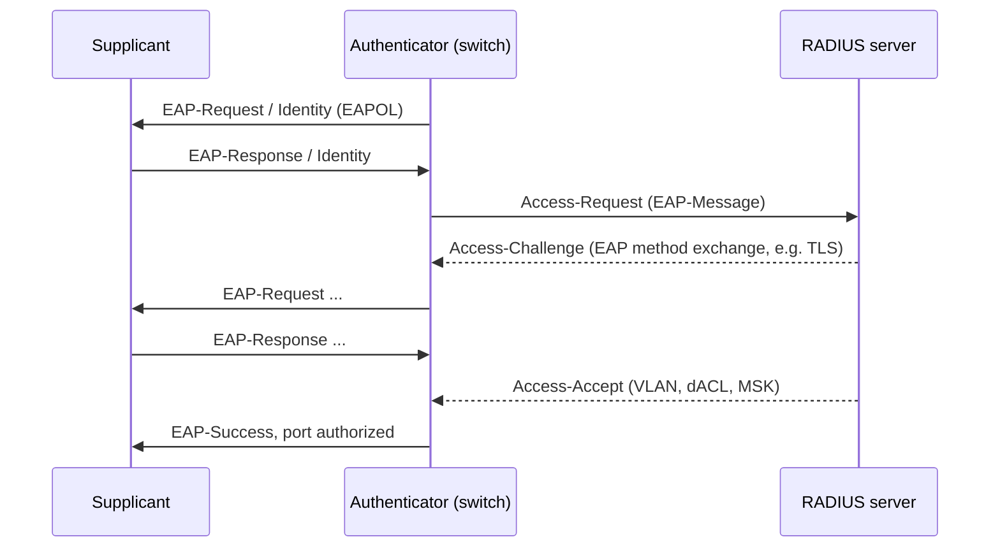

A switched LAN is trusted by default: any host can send any MAC, ARP reply or DHCP offer. These controls restore the trust boundary at the access edge, where hosts connect. Each addresses a specific attack, and they build on one another.

## Threat → control map

| Attack | Mechanism | Control |
|---|---|---|
| **CAM/MAC flooding** | thousands of random source MACs overflow the FDB; switch floods unicast like a hub | port security (MAC limit), storm control |
| **MAC spoofing** | claim another host's MAC to hijack its traffic | port security (sticky/static), 802.1X |
| **Rogue DHCP server** | answers DHCPDISCOVER with attacker gateway/DNS | DHCP snooping (trusted ports) |
| **DHCP starvation** | exhaust the pool with spoofed chaddr | snooping rate limit + chaddr check, port security |
| **ARP spoofing / MITM** | forged ARP replies / GARP | Dynamic ARP Inspection |
| **IP spoofing** | forged source IPs | IP Source Guard / uRPF |
| **Rogue switch / root hijack** | send superior BPDUs | BPDU guard, root guard |
| **VLAN hopping** | DTP trunk negotiation, double tagging | static access ports, unused native VLAN |
| **Unauthorized device** | plug into a free wall port | 802.1X / MAB, shutdown unused ports |
| **Sniffing / injection on the wire** | tap the cable or intercept inter-switch links | MACsec |

## Port security

Limits which and how many MAC addresses may appear on an access port:

- **Maximum** number of secure MACs (often 1–3; more for IP-phone-plus-PC).
- **Static**, **dynamic** (learned, lost on reboot) or **sticky** (learned and saved to config) addresses.
- **Violation action**: *protect* (drop excess frames silently), *restrict* (drop + log/counter), *shutdown* (error-disable the port). `shutdown` is the default and the safest, but can be abused for a DoS by deliberately triggering violations; configure `errdisable recovery`.

It defeats naive MAC flooding and plug-in-another-laptop, but not MAC *spoofing* of the learned address, and it is hard to manage at scale (VM migration, docking stations). 802.1X replaces it in managed environments.

## Storm control

Rate-limits broadcast, multicast and unknown-unicast on a port (percent of line rate or pps). Setting thresholds blocks the worst effects of loops and floods. It operates on *packet types*, not on identity, so a threshold too low drops legitimate ARP/DHCP bursts. Broadcast ≈ 1 % is a common starting point on access ports, and multicast storm control needs care with legitimate multicast video.

## DHCP snooping

The switch inspects DHCP messages and treats ports as **untrusted** (hosts) or **trusted** (uplinks, DHCP server). Behavior:

- **Server messages** (OFFER, ACK, NAK) arriving on an untrusted port are dropped → rogue DHCP servers blocked.
- It builds the **binding table**: *(MAC, IP, VLAN, port, lease time)* from client ACKs. This table is the foundation for DAI and IP Source Guard.
- Verifies DHCP packets' client hardware address (`chaddr`) equals the Ethernet source MAC (blocks some starvation attacks).
- **Rate limits** DHCP packets per port (e.g. 15 pps).
- **Option 82 (Relay Agent Information, RFC 3046)**: the switch can insert circuit-ID/remote-ID so the DHCP server knows which port the request came from. Pitfall: if the switch inserts option 82 and then forwards to a *relay-less* server, or the next switch drops packets that have option 82 without giaddr, DHCP stops working. Match this setting on all devices in the path.

Persist the binding table to flash; otherwise a reboot empties it and statically addressed or already-leased hosts are blocked by DAI until they renew.

## Dynamic ARP Inspection (DAI)

On trusted-uplink / untrusted-access ports, DAI intercepts ARP requests and replies and validates each: the *(sender IP, sender MAC)* pair must match a DHCP-snooping binding (or a manual ARP ACL for static hosts). Optionally also verifies that the Ethernet source MAC matches the ARP sender MAC, the destination MAC matches the target MAC (for replies), and that IP addresses are not `0.0.0.0`, multicast, or broadcast. Invalid packets are dropped and logged. Rate-limit ARP per port (default 15 pps on Cisco) because inspection is software-assisted on some platforms.

## IP Source Guard (IPSG) and uRPF

IPSG filters data traffic on an untrusted port so only packets with source IP/MAC matching the binding table are allowed, which stops IP spoofing, including *within* the subnet. On routed boundaries, **uRPF** (RFC 3704) provides the equivalent at layer 3. The IETF's SAVI framework (RFC 7513 for DHCP) standardizes the binding concept.

## 802.1X: port-based network access control

802.1X authenticates a device *before* a switch port (or Wi-Fi association) forwards normal traffic. Roles:

| Role | Example |
|---|---|
| **Supplicant** | the endpoint (laptop, phone) |
| **Authenticator** | the switch or access point (PAE: Port Access Entity) |
| **Authentication server** | RADIUS server (FreeRADIUS, ISE, NPS) |

Operation:

1. Before authentication, the port is **unauthorized**: only EAPOL frames (EtherType **`0x888E`**, to `01-80-C2-00-00-03` or the unicast MAC of the switch) pass.
2. The authenticator sends an **EAP-Request/Identity**; the supplicant answers with its identity.
3. The authenticator **relays** EAP inside RADIUS `Access-Request` messages (RFC 3579: EAP-Message attribute) to the server. The authentication method is chosen by the EAP type:
   - **EAP-TLS**: mutual certificate authentication (strongest, needs PKI).
   - **PEAP/MSCHAPv2**, **EAP-TTLS**: a server certificate builds a TLS tunnel, then username/password inside.
   - **EAP-FAST**, **EAP-MD5** (obsolete; no mutual authentication or key derivation).
4. On `Access-Accept` the port becomes **authorized**. The RADIUS reply can carry **authorization attributes**: VLAN (Tunnel-Private-Group-ID), downloadable ACL, SGT, reauthentication timer. This is how "dynamic VLAN assignment" works.
5. Re-authentication happens periodically; `EAPOL-Logoff` or link-down returns the port to unauthorized.

Operational modes and problems:

- **Single-host / multi-host / multi-domain / multi-auth** (several devices behind one port, e.g. phone + PC, each authenticated).
- **MAC Authentication Bypass (MAB)** for devices without a supplicant (printers): the switch uses the MAC as identity. It is weak (MACs are spoofable), so limit what MAB'd devices can reach.
- **Fail-open / guest VLAN / critical VLAN** policies decide what happens when no supplicant or the RADIUS server is down.
- Hosts that need the network before login (PXE boot, Wake-on-LAN) need special handling.
- 802.1X authenticates the *port* once; without MACsec, an attacker who inserts a hub or a device in line after authentication can ride the authorized port. The **MSK** exported by EAP can seed MACsec.

## MACsec (IEEE 802.1AE)

MACsec provides hop-by-hop **confidentiality, integrity and replay protection** for Ethernet frames, using AES-GCM (128 or 256-bit; GCM-AES-XPN adds 64-bit packet numbers for 40/100G links).

- A **SecTAG** (8 bytes, or 16 with an explicit SCI) is inserted after the source MAC (EtherType `0x88E5`, TCI/AN, short length, 32-bit packet number, optional Secure Channel Identifier); a 16-byte **ICV** follows the payload. Overhead is 24–32 bytes, so adjust the MTU.
- Keys are managed by **MKA (MACsec Key Agreement, 802.1X-2010 §9)**. A pre-shared **CAK** (or one derived from EAP) authenticates peers; MKA elects a key server which distributes the **SAK** (secure association key).
- Provides L2 protection **link by link**: frames are decrypted at each MACsec-capable switch, so it protects against taps on the cable and rogue devices, but not against a compromised switch. For end-to-end across routed networks use IPsec/TLS.
- Can leave the **VLAN tag in clear** ("confidentiality offset" 30/50 bytes) so that intermediate non-MACsec devices can still switch.
- Linux: `ip macsec add macsec0 tx sa 0 pn 1 on key 01 <hex>`, but production use is generally via `wpa_supplicant` (MKA) for 802.1X-derived keys.

## Defense in depth for the access layer

1. All unused ports: `shutdown` and assigned to a dead-end VLAN.
2. Access ports: static `access` mode, DTP off, BPDU guard + edge (PortFast), storm control, port security or 802.1X.
3. DHCP snooping on user VLANs → DAI + IPSG.
4. Management plane: SSH only, separate management VLAN/VRF, AAA with RADIUS/TACACS+, disable unneeded protocols (CDP/LLDP on edge, VTP, HTTP).
5. Monitor: syslog for MAC moves, err-disable, DHCP/ARP violations; NetFlow/IPFIX at distribution.

## Key takeaways

- Switches trust their hosts by default; each attack has a matching control, and DHCP snooping's binding table is the keystone for DAI and IPSG.
- Port security limits MACs but doesn't authenticate; 802.1X with EAP-TLS/PEAP and RADIUS does.
- Tune rate limits; DHCP/ARP inspection is partly CPU-based.
- MACsec encrypts frames link-by-link using keys from MKA (typically 802.1X-derived), protecting against taps and in-line devices.
