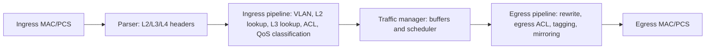

Understanding a switch's internals explains why features have limits (MAC table size, ACL entries), why *some* traffic patterns drop packets on a "non-blocking" box, and why latency varies by switch. This note is conceptual; exact numbers vary by ASIC.

## Forwarding pipeline

A modern switch ASIC is a pipeline of fixed-function (or programmable, as in P4/Tofino or Broadcom "Trident" flexible parsers) stages executed at line rate, with a fixed per-packet latency (hundreds of nanoseconds):



1. **Parse**: extract header fields into a metadata vector (MACs, VLAN, EtherType, IPs, ports, DSCP).
2. **Ingress lookup**: L2 (FDB), L3 (FIB / LPM, ARP/adjacency), and ACL, **in parallel** across several memories.
3. **Result resolution**: combine outputs by priority (ACL deny > route > bridge, etc.) into a forwarding decision: egress port(s), rewrite instructions, queue, mirror, police.
4. **Traffic manager**: enqueue to buffer memory for the egress port/queue and schedule.
5. **Egress**: apply rewrites (new MAC, TTL decrement, VLAN tags, encapsulation), compute checksums, transmit.

Software on the control-plane CPU programs these tables through the SDK, and on Linux through **switchdev**/**DSA** (the kernel offloads bridge FDB, VLANs, routes to hardware, so `bridge fdb` and `ip route` show the offloaded state with `offload` flags).

## Table memories

| Memory | Technology | Lookup | Examples | Constraint |
|---|---|---|---|---|
| **MAC table (FDB)** | hash tables in SRAM (e.g. d-left / cuckoo hashing) | exact match | (VLAN, MAC) → port | capacity ~16K–512K+; hash collisions mean effective capacity < nominal |
| **Host / ARP table** | hash | exact match | IP → MAC + port | scarce at /32 scale; EVPN fabrics hit this |
| **Route table (LPM)** | algorithmic (trie/hash-based) or TCAM | longest prefix | FIB | IPv6 /128 entries cost double or quadruple |
| **ACL / classification** | **TCAM** | ternary (0/1/don't-care) with priority | security ACLs, QoS, PBR | small (a few K entries), power-hungry |
| **Next-hop / ECMP groups** | SRAM | index | group of paths | group count and members limited |

**CAM** (content-addressable memory) returns the address matching a key in one cycle. **TCAM** adds a mask per bit, so entries can express prefixes and ranges, which is essential for ACLs and LPM, at the price of power, area and **range expansion**: a port range like `1024–65535` may need many TCAM entries (typically ≤ 16 prefixes). A seemingly small ACL can burn thousands of entries; platforms share TCAM between features ("TCAM carving"/templates), so enabling QoS or PBR may reduce routes available.

Capacity planning facts: a table's *usable* size depends on hash behavior; exceeding it makes new entries fail to install. Typical symptoms: ARP/FDB entries stuck in software (slow path, high CPU), "FIB TCAM full" logs, or traffic punted to the CPU.

## Forwarding modes and latency

- **Store-and-forward**: the whole frame is received and the FCS verified before forwarding. Adds latency = frame time (1518 B at 10 Gb/s ≈ 1.2 µs) but never forwards corrupt frames. Needed when speeds differ (ingress slower than egress) or for L3 rewrite with checksum.
- **Cut-through**: forwarding starts as soon as the destination is parsed (~64 B), giving consistent low latency (~300 ns on modern ASICs). Corrupt frames are forwarded (CRC stomping marks them), and it works only if the egress is idle and speeds are equal or the ingress is slower. Used in HPC, finance, and data-center leaf-spine.
- A device can switch between modes per frame depending on conditions.

## Buffering architectures

Packets must wait whenever two inputs target one output (**incast**) or speeds differ (a 100 G → 10 G transition). Where memory is placed determines behavior:

| Architecture | Description | Property |
|---|---|---|
| **Input-queued** | buffer at each ingress | simple memory, but **head-of-line (HOL) blocking**: a packet at the head of the FIFO waiting for a busy output blocks packets behind it destined to free outputs; limits throughput to ≈ 58.6 % for uniform traffic with a single FIFO |
| **Virtual output queues (VOQ)** | per-ingress, per-egress queues + a scheduler (iSLIP etc.) | eliminates HOL; used in chassis switches and many ASICs |
| **Output-queued** | packets written directly into egress queues; needs memory bandwidth of N× line rate | ideal performance; costly |
| **Shared-memory** | one pool of buffer used by all ports/queues, dynamically allocated (tens of MB on merchant-silicon data-center ASICs; check the datasheet) | most efficient use for bursty incast; per-queue thresholds avoid one port starving others |
| **Deep-buffer** | off-chip HBM/DRAM, GBs | WAN/edge aggregation, long-RTT TCP; higher latency |

Buffer size and congestion-control interplay: a rule of thumb is bandwidth × RTT / √(flows) (Appenzeller et al.) for WAN links; in data centers, shallow buffers plus **ECN marking** (DCTCP) keep queues short. Too-large buffers cause **bufferbloat** (high latency under load); too small causes microburst loss and TCP incast collapse.

### Why a "non-blocking" switch drops packets

Non-blocking = the fabric can carry the sum of port bandwidths. It does not mean zero loss: if 4 ports send at 10 Gb/s toward one 10 Gb/s port, 75 % must be buffered or dropped. Check queue counters, not utilization graphs (microbursts are shorter than the polling interval).

## Oversubscription

**Oversubscription ratio** = downlink capacity ÷ uplink capacity. A leaf with 48 × 25 G server ports (1200 Gb/s) and 6 × 100 G uplinks (600 Gb/s) is **2:1**. Considerations:

- Ratios of 3:1 at access and 2:1–1:1 above are typical in enterprise/campus; AI/ML and storage fabrics aim for 1:1 (non-blocking).
- Oversubscription only matters if traffic is simultaneous and crosses the uplinks: east-west heavy workloads can saturate uplinks; north-south often doesn't.
- A **leaf–spine (Clos)** fabric scales out by adding spines; with ECMP over equal-cost paths, flows hash to uplinks (collisions are possible, so use flowlet or per-packet spraying, or adaptive routing in HPC).
- Compute **packets per second** also: a switch advertising "6.4 Tb/s" achieves line rate only above a minimum packet size (typically ≥ 200–256 B); at 64 B frames it may deliver half.

## Observability

```bash
ethtool -S swp1 | egrep -i 'drop|discard|buffer|ecn|pfc'   # per-port hardware counters
bridge fdb show | grep offload                            # entries pushed to hardware (switchdev)
ip route show | grep offload                              # offloaded FIB entries
devlink sb show                                           # shared buffer pools (Mellanox/NVIDIA)
```

Vendor CLIs expose the equivalents: resource utilization of TCAM/FDB/host tables, per-queue drops, buffer watermarks (high-watermark per interval, which reveals microbursts), and INT/telemetry streaming.

## Key takeaways

- A switch is a pipeline of parser → parallel table lookups → traffic manager → egress rewrite, all at fixed latency.
- Exact-match tables (FDB/ARP) are hash SRAM; ACLs and some routes need TCAM, which is small and shared, so feature scale is capped by it.
- Cut-through minimizes latency; store-and-forward validates frames and bridges speed changes.
- VOQ and shared buffers avoid HOL blocking; "non-blocking" doesn't mean lossless under incast.
- Oversubscription = downlink ÷ uplink bandwidth, and pps limits matter as much as Tb/s.
