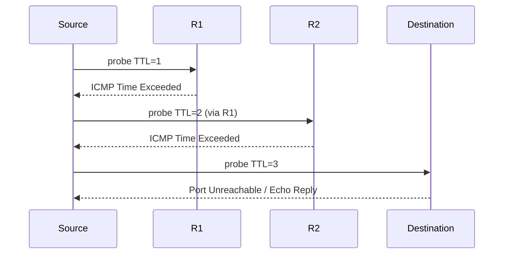

ICMP is the control and error channel of IP. It rides in IP (protocol 1), is not a transport protocol (no ports), and is mandatory: IP cannot work well without it.

## Message format

```text
+--------+--------+----------------+
|  Type  |  Code  |    Checksum    |   8 bytes header
+--------+--------+----------------+
|        Rest of header (varies)    |
+-----------------------------------+
|   Data (e.g. offending IP header + at least first 8 bytes of its payload) |
```

For **errors**, the data contains the original IP header plus at least 8 bytes of the original payload (RFC 792). That is enough for the TCP/UDP ports and sequence number, which is how the host finds the affected socket. Modern routers (RFC 1812) include as much of the original as fits within 576 bytes, and RFC 4884 defines a length field to carry extension objects (e.g. MPLS labels).

| Type | Name | Notable codes |
|---|---|---|
| 0 | Echo Reply | |
| 3 | **Destination Unreachable** | 0 network, 1 host, 2 protocol, 3 **port**, **4 fragmentation needed and DF set**, 5 source route failed, 9/10 network/host admin prohibited, 13 communication administratively prohibited |
| 5 | Redirect | 0 network, 1 host, 2/3 for TOS |
| 8 | Echo Request | |
| 9 / 10 | Router Advertisement / Solicitation (RFC 1256) | rarely used |
| 11 | **Time Exceeded** | 0 TTL exceeded in transit, 1 fragment reassembly time exceeded |
| 12 | Parameter Problem | 0 pointer indicates error |
| 13 / 14 | Timestamp Request / Reply | legacy; often blocked |
| 4 | Source Quench | **deprecated** (RFC 6633) |

Errors are never generated in response to: other ICMP errors, packets to broadcast/multicast, non-first fragments, packets with a non-unicast source. This prevents error storms.

## Ping

Sends Echo Request (type 8) with an identifier, sequence number and payload; the target returns the same data as Echo Reply. RTT = reply time − send time. Interpreting results:

- `Request timeout` means no reply: the target, firewall, or any router on the path may be dropping, or ICMP is rate limited.
- `Destination Host Unreachable` from a *local* address: ARP failed. From a *remote* router: no route/ARP failure there.
- `TTL expired in transit`: a loop or too small a TTL.
- The reply TTL hints at the target's OS and the hop count (initial 64/128/255 minus hops).
- `ping -M do -s N` tests path MTU; `ping -f`/`-i` for flood/interval (root only); `ping -I eth1` to choose the source interface/address.
- A successful ping proves only that ICMP echo works end to end. It does not prove that TCP port 443 does.
- Linux rate-limits ICMP **replies**: `net.ipv4.icmp_ratelimit` (1000 ms; per destination) and `icmp_ratemask` select which types; `icmp_echo_ignore_broadcasts=1` mitigates smurf amplification.

## Traceroute

Exploits TTL: send probes with TTL = 1, 2, 3, …; each router that decrements TTL to 0 returns **Time Exceeded** (with its ingress interface address as source), and the destination returns Echo Reply (ICMP mode) or Port Unreachable (UDP mode).



| Probe type | Command | Notes |
|---|---|---|
| UDP to high ports (default 33434+) | `traceroute -n host` | reaches closed port at destination → Port Unreachable |
| ICMP Echo | `traceroute -I host` / Windows `tracert` | passes firewalls that permit ping |
| TCP SYN | `traceroute -T -p 443 host` or `tcptraceroute` | best for firewalled services |
| Paris / flow-stable | `paris-traceroute`, `dublin-traceroute`, `mtr` (fixed flow per run) | keeps the flow identifiers constant so probes follow one ECMP path |

### Why traceroute lies

- **Asymmetric paths**: you see only the forward path; replies come back along a different route and each router's address is of the *ingress interface* facing the source.
- **ECMP**: classic traceroute varies the port per probe, so probes hash onto different paths and the output interleaves routers from different paths. Paris traceroute fixes the five-tuple to follow one path; running with several flow IDs maps all paths.
- **`* * *`** means no answer, not necessarily loss: the router may rate-limit or not send ICMP, or a firewall blocks it. Check whether later hops respond: if they do, ignore the silent one.
- **High latency at one hop** that doesn't continue after it is usually ICMP generation delay on the CPU (control plane), not forwarding delay. Only latency that persists to the destination is real.
- **MPLS**: label-switched routers may not decrement the IP TTL (`no mpls ip propagate-ttl`) or may forward ICMP errors to the egress before returning them, which skews RTTs; RFC 4950 lets them include the label stack.
- Load balancers, NAT and tunnels hide hops.

`mtr -n -w -c 100 host` combines traceroute with continuous statistics; use it to separate end-to-end loss from per-hop rate-limiting.

## Redirects

A router sends a Redirect (type 5) to tell a host "a better first hop exists for this destination, on the same subnet": e.g. the host's default gateway forwards a packet out the same interface it came in. Hosts update their routes. Redirects are an attack vector (route injection), and have been replaced by correct routing, so disable them:

```bash
sysctl -w net.ipv4.conf.all.accept_redirects=0 net.ipv4.conf.all.send_redirects=0
```

## Security and firewalling ICMP

Don't block ICMP wholesale. Recommended minimum to **permit**:

- Type 3 (all codes, especially 4), type 11 (TTL exceeded: required for traceroute), type 12.
- Echo request/reply: at least from monitoring systems; rate-limit from the Internet.
- Block or ignore: redirects from untrusted sources, timestamp, address-mask, router advertisement unless used, and broadcast echo.
- Remember **ICMP tunneling** (data hidden in echo payloads) and ping-flood DoS: rate-limit ICMP with `nft`/CoPP.

Example (nftables): `ip protocol icmp icmp type { destination-unreachable, time-exceeded, parameter-problem } accept` and `icmp type echo-request limit rate 10/second accept`.

## Key takeaways

- ICMP errors quote the offending IP header + 8 bytes (or more), so the sender can map the error to a socket.
- Type 3 code 4 powers PMTUD; type 11 powers traceroute; filtering them causes mysterious failures.
- Traceroute uses TTL expiry; asymmetric routing, ECMP, and ICMP rate-limiting make its output ambiguous (use Paris/mtr, and judge latency by the final hop).
- Disable redirects, rate-limit ICMP, and allow the essential error types.
