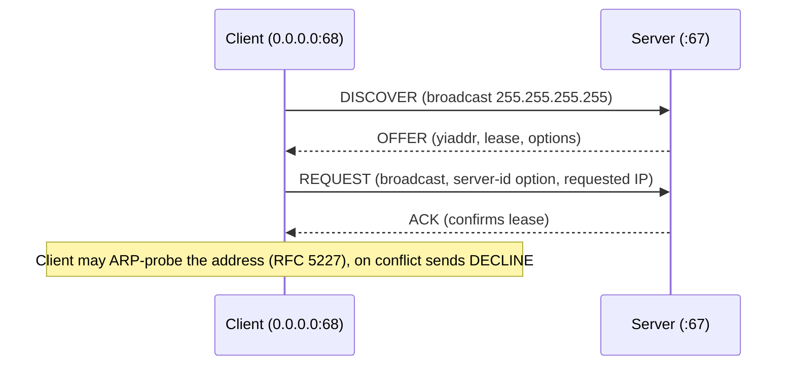

DHCP automates host configuration: address, mask, gateway, DNS, and more. It is carried over **UDP** (server port **67**, client port **68**), extending the older BOOTP packet format.

## The message

A fixed 236-byte BOOTP-style header, a 4-byte **magic cookie** (`99.130.83.99` = `0x63825363`), then variable options (TLV, ending with `255`).

| Field | Size | Meaning |
|---|---|---|
| `op` | 1 | 1 BOOTREQUEST (client→server), 2 BOOTREPLY |
| `htype`, `hlen` | 1+1 | 1/6 for Ethernet |
| `hops` | 1 | incremented by relays |
| `xid` | 4 | transaction ID, matches replies to requests |
| `secs` | 2 | seconds since client began |
| `flags` | 2 | bit 15 = **BROADCAST** flag |
| `ciaddr` | 4 | client's current IP (renew/rebind) |
| `yiaddr` | 4 | "your" IP: offered/assigned address |
| `siaddr` | 4 | next server (e.g. TFTP) |
| `giaddr` | 4 | **relay agent** address |
| `chaddr` | 16 | client hardware address |
| `sname`, `file` | 64+128 | server name, boot file (PXE) |
| options | var | type 53 first |

Message types (option 53): 1 DISCOVER, 2 OFFER, 3 REQUEST, 4 DECLINE, 5 ACK, 6 NAK, 7 RELEASE, 8 INFORM.

## The DORA exchange



1. **DISCOVER**: source `0.0.0.0`, destination `255.255.255.255`, source MAC = client. May request a specific address (option 50).
2. **OFFER**: one or several servers offer an address and keep it reserved briefly. Servers reply unicast to `yiaddr`+`chaddr` (via raw frame injection, since the client has no IP yet) unless the client set the BROADCAST flag.
3. **REQUEST**: the client picks one offer, and **broadcasts** the request with the chosen *server identifier* (option 54), so that other servers release their offers.
4. **ACK**: the server commits the binding; the client configures the interface. A **NAK** tells the client to restart (address unavailable/wrong network).

**Rapid Commit** (RFC 4039) shortens it to DISCOVER→ACK. **INFORM** asks for options only for a statically addressed host. **DECLINE** reports a conflict; **RELEASE** returns the lease politely.

## Lease lifecycle

- **T1 = 50 %** of lease: client unicasts REQUEST to its server to **renew**.
- **T2 = 87.5 %**: if still unsuccessful, client broadcasts REQUEST to **rebind** with any server.
- Lease expiry: client must stop using the address and restart discovery. (INIT-REBOOT: after reboot a client with a stored lease sends REQUEST for its old address directly.)
- Choose lease time to fit churn: hours for guest Wi-Fi, days for stable wired networks; short leases speed recovery but increase load. Servers often reserve an address by `chaddr` + client-identifier (option 61).

## Relay agents (`giaddr`)

Broadcasts don't cross routers. A router/L3 switch interface configured as a **DHCP relay** (`ip helper-address` / `dhcrelay`) catches the client's broadcast, sets `giaddr` to the interface address in the client's subnet, and **unicasts** it to the DHCP server. The server uses **giaddr to select the scope (subnet)** to allocate from and replies to `giaddr` on port 67; the relay forwards to the client. Optionally the relay inserts **option 82** (RFC 3046): circuit-ID (port/VLAN) and remote-ID (relay identity) allow the server to assign by physical location, or to enforce per-port limits.

Common failures: relay not configured on the SVI; server has no scope matching `giaddr`; firewall blocks UDP 67/68 between relay and server; **option 82** inserted twice by chained relays/snooping switches (server drops or mis-handles).

## Options that matter

| Code | Name | Notes |
|---|---|---|
| 1 | Subnet mask | |
| 3 | Router | default gateway(s) |
| 6 | DNS servers | |
| 12 | Host name | client hint |
| 15 / 119 | Domain name / search list | |
| 28 | Broadcast address | |
| 42 | NTP servers | |
| 43 | Vendor-specific info | encapsulated sub-options (e.g. Cisco AP controller discovery) |
| 50 / 54 | Requested IP / server identifier | |
| 51 | Lease time | seconds |
| 53 | Message type | |
| 55 | Parameter request list | what the client wants |
| 60 | Vendor class identifier | e.g. `PXEClient`, device-type matching |
| 61 | Client identifier | usually hw type + MAC; stable identity across NICs |
| 66 / 67 | TFTP server / bootfile name | PXE boot |
| 82 | Relay agent information | |
| 114 | Captive portal URI (RFC 8910) | |
| 121 | **Classless static routes** (RFC 3442) | replaces option 33; if present, option 3 is ignored (important for VPN-ish routes) |
| 252 | WPAD | non-standard |

## Reservations, pools and design

- Pools should exclude infrastructure addresses (gateway, servers, VIPs); use **reservations** (MAC/DUID → fixed IP) for printers and servers rather than hand-configured static addresses.
- Keep the pool bigger than the number of devices ×1.2; short lease + large Wi-Fi churn can exhaust a /24.
- **Redundancy**: ISC `dhcpd` failover (deprecated: ISC DHCP reached end of life in 2022), **Kea HA** (hot-standby/load-balancing), or the traditional **split-scope** 50/50 or 80/20 on two servers that don't communicate. Clients ping/ARP-check before use, so overlapping scopes without synchronization are unsafe.
- Dynamic DNS updates (RFC 4702/4703) let the server register names.
- DHCP gives out *information*, not authentication: pair with DHCP snooping/802.1X.

## Linux tooling

```bash
dhclient -v eth0                         # classic client (ISC, deprecated)
networkctl status eth0                   # systemd-networkd lease info
journalctl -u systemd-networkd | grep DHCP
nmcli -f DHCP4 dev show eth0             # NetworkManager
tcpdump -ni eth0 -vvv 'udp port 67 or udp port 68'
dnsmasq / kea-dhcp4 / isc-dhcp-server    # servers
```

Interpreting a capture: no DISCOVER → client/link/VLAN problem; DISCOVER without OFFER → server unreachable (relay, firewall, pool exhausted, scope mismatch); OFFER without REQUEST → client rejected it (e.g. rogue server offered something, or the offered address failed ARP probe); ACK but no connectivity → wrong gateway or routes option.

## Key takeaways

- DHCP = BOOTP header + options on UDP 67/68; DISCOVER/OFFER/REQUEST/ACK is broadcast until the client has an address.
- Renewal at 50 % (unicast), rebinding at 87.5 % (broadcast).
- Relays set `giaddr`, which selects the server scope; option 82 conveys port/location.
- Option 121 (classless routes) overrides option 3; options 66/67 serve PXE.
- Secure with DHCP snooping, and plan redundancy via Kea HA or split scopes.
