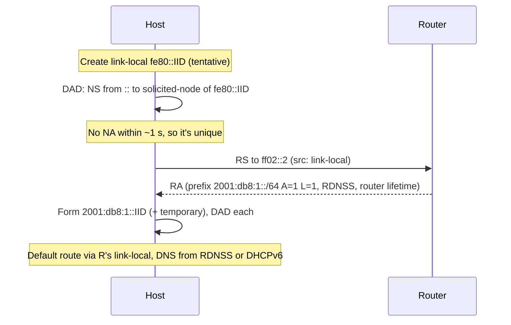

In IPv6, ICMPv6 is essential: NDP replaces ARP, router discovery, redirect and part of DHCP; PMTUD depends on it, and MLD multicast membership rides inside it. Blocking ICMPv6 as people do with ICMP in IPv4 **breaks IPv6**.

## ICMPv6 messages (RFC 4443)

Next Header = 58. The checksum covers a pseudo-header, so the source and destination addresses are protected.

| Type | Message | Notes |
|---|---|---|
| 1 | Destination Unreachable | codes: 0 no route, 1 admin prohibited, 2 beyond scope of source, 3 address unreachable, 4 port unreachable, 5 source policy failed, 6 reject route |
| 2 | **Packet Too Big** | carries the next-hop MTU; the only way hosts learn the path MTU |
| 3 | Time Exceeded | 0 hop limit exceeded, 1 fragment reassembly timeout |
| 4 | Parameter Problem | 0 erroneous header field, 1 unrecognized Next Header, 2 unrecognized option |
| 128 / 129 | Echo Request / Reply | ping6 |
| 130 / 131 / 132 / 143 | MLD Query / Report v1 / Done / Report v2 | multicast group membership |
| **133 / 134** | Router Solicitation / Router Advertisement | |
| **135 / 136** | Neighbor Solicitation / Neighbor Advertisement | |
| 137 | Redirect | |

Errors are rate limited and never sent in response to errors or multicast (with exceptions for PTB and Parameter Problem code 2 on multicast).

## Neighbor Discovery: the five messages

NDP messages are sent with **Hop Limit = 255**. A receiver discards messages whose hop limit isn't 255, which guarantees the sender is on-link, as no router could have forwarded the packet (GTSM-style protection). All options are TLVs (type, length in 8-byte units).

| Message | Sent to | Purpose |
|---|---|---|
| **RS** (133) | `ff02::2` | host asks routers to advertise now |
| **RA** (134) | `ff02::1` or unicast to RS sender | router announces prefixes, config flags and itself as default router |
| **NS** (135) | solicited-node multicast (resolution/DAD) or unicast (NUD) | "who has this address?" / "are you still reachable?" |
| **NA** (136) | unicast to NS sender or `ff02::1` (unsolicited) | answer, with flags **R**outer, **S**olicited, **O**verride |
| **Redirect** (137) | the source | "use that neighbor as the better next hop" |

Key options: **1** Source Link-Layer Address, **2** Target Link-Layer Address, **3** Prefix Information, **5** MTU, **24** Route Information (RFC 4191), **25** RDNSS (DNS servers, RFC 8106), **31** DNSSL, **37** captive portal (RFC 8910), **38** PREF64 (RFC 8781).

### Address resolution

To send to `2001:db8::5` on the link, host A computes the solicited-node address of the target (`ff02::1:ff00:5`), sends an NS there (Ethernet `33:33:ff:00:00:05`) with its own link-layer address in the SLLA option. The target answers with a unicast NA including its link-layer address (TLLA), and A caches it. No broadcast and no interruption of other hosts.

### Neighbor Unreachability Detection (NUD)

Like the Linux ARP state machine (INCOMPLETE → REACHABLE → STALE → DELAY → PROBE): an entry is REACHABLE for `ReachableTime` (default 30 s, randomized 0.5–1.5×) after a positive confirmation (solicited NA or upper-layer progress such as TCP ACKs). When it goes STALE the entry is still used; the next packet sends it to DELAY for 5 s, and if no hint of reachability arrives the host sends unicast NS probes (3 × 1 s) before declaring failure. NUD enables fast detection of dead next hops, including routers.

```bash
ip -6 neigh show                 # REACHABLE/STALE/DELAY/PROBE/FAILED, router flag
```

## Router discovery and SLAAC

**Router Advertisement** fields:

| Field | Meaning |
|---|---|
| Cur Hop Limit | suggested hop limit for hosts |
| **M** flag | Managed: get addresses via DHCPv6 |
| **O** flag | Other configuration (DNS, etc.) via DHCPv6 |
| Router Lifetime | seconds this router is a default router; **0** means it is *not* a default router |
| Reachable / Retrans Timer | NUD parameters |
| Default Router Preference | high/medium/low (RFC 4191) |
| Prefix Info option | prefix + length, **L** (on-link) flag, **A** (autonomous: usable for SLAAC) flag, valid lifetime, preferred lifetime |

Routers advertise unsolicited every 200–600 s by default (MaxRtrAdvInterval 600 s) and reply immediately to RS. Hosts learn: default router(s), on-link prefixes, MTU, DNS (RDNSS), and which flags to follow.

### SLAAC (RFC 4862)

For each Prefix Information option with **A = 1** (and prefix length 64), a host forms: `address = prefix (64) + interface identifier (64)`, then performs DAD.



Address **lifetimes**: *preferred* (can be used for new connections) then *deprecated* (kept for existing connections) until *valid* lifetime ends (address removed). Renumbering is done by advertising the old prefix with preferred lifetime 0 and the new one concurrently.

M/O flags guide DHCPv6: `M=1` → use DHCPv6 for addresses (and SLAAC only if A=1 as well, which can cause hosts to have both); `O=1` only → SLAAC for the address, DHCPv6 stateless for DNS etc. Android does not implement DHCPv6, so SLAAC + RDNSS is required for those clients.

### Duplicate Address Detection (DAD)

Before using any unicast address (tentative state), a node sends an **NS** with source `::` and target = the tentative address, to the solicited-node group; it waits `RetransTimer` (1 s, DupAddrDetectTransmits = 1). If a node responds with an NA (address in use), or sends its own DAD NS for the same address, the address is not used (`dadfailed`). DAD is skipped/optimistic in some cases (RFC 4429 Optimistic DAD speeds up connectivity; Enhanced DAD RFC 7527 detects looped-back NS). Switch features such as multicast snooping or port security can break DAD or NS.

## Redirect

A router sends Redirect (137) when a packet could have gone directly to a better on-link next hop. It carries the target address and TLLA. Hosts accept redirects only if sent from the current first-hop router's link-local address. Disable on untrusted networks.

## Security and operations

NDP is unauthenticated on the link, so equivalents of ARP spoofing exist:

| Attack | Defense |
|---|---|
| **Rogue RA** (fake default router, or flooding RAs so hosts exhaust resources) | **RA Guard** on switches (RFC 6105): drop RAs from untrusted ports; also RFC 7113 evasion fixes (extension-header tricks) |
| NA/NS spoofing | **ND inspection / snooping** using binding tables, SAVI (RFC 6620), SEND (RFC 3971, rarely deployed) |
| DAD DoS (attacker answers every DAD) | port security, ND inspection |
| **Neighbor cache exhaustion**: scanning a /64 makes the router create INCOMPLETE entries for each address | smaller subnets are no fix; use rate limiting, NDP table limits, `ND resolve` limits, and /127 on p2p links (RFC 6583) |
| Smurf-like multicast pings, MLD floods | filter ff02 echo replies, rate limit |

Firewall guidance (RFC 4890): **allow** ICMPv6 types 1, 2, 3, 4 (errors, PTB) and for on-link NDP (133–137) with hop limit 255 and link-local sources, as well as echo (rate limited); do not forward link-local scope messages across routers.

## Linux and tools

```bash
sysctl net.ipv6.conf.eth0.accept_ra=1            # hosts; =2 when also forwarding (a router that listens to RAs)
sysctl net.ipv6.conf.all.forwarding=1             # become a router
rdisc6 eth0                                       # send RS and print RAs (ndisc6 package)
ndisc6 2001:db8::5 eth0                           # NS/NA probe
tcpdump -ni eth0 icmp6 and 'ip6[40] >= 133 and ip6[40] <= 137'
```

`radvd` example (router side):

```text
interface eth1 {
  AdvSendAdvert on;
  AdvManagedFlag off; AdvOtherConfigFlag off;
  prefix 2001:db8:1::/64 { AdvOnLink on; AdvAutonomous on; };
  RDNSS 2001:db8:1::53 { };
};
```

## Key takeaways

- NDP = RS/RA/NS/NA/Redirect over ICMPv6, always with hop limit 255; multicast (solicited-node) instead of broadcast.
- SLAAC: RA prefix (A=1, /64) + IID → DAD → address; the default route comes from the RA (router lifetime > 0), DNS from RDNSS or DHCPv6.
- M/O flags steer DHCPv6; Android needs RDNSS because it doesn't support DHCPv6.
- Protect the link with RA Guard, ND inspection, and rate limits; never block ICMPv6 Packet Too Big or NDP.
