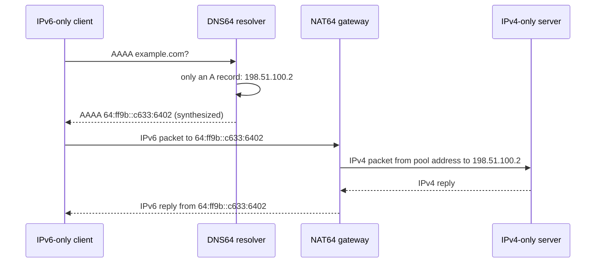

Dual-stack means running IPv4 and IPv6 side by side, which doubles the operational surface: two address plans, two sets of ACLs, two routing tables. An **IPv6-only** network drops IPv4 on the client side, but most of the Internet's servers still speak only IPv4. **Translation** bridges the two: the client uses IPv6 only, and a gateway rewrites packets to IPv4 on the way out. The pieces are:

| Piece | Job | Standard |
|---|---|---|
| **Address embedding** | put an IPv4 address inside an IPv6 prefix so the gateway can recover it | RFC 6052 |
| **DNS64** | answer a AAAA query for an IPv4-only name with a synthesized AAAA inside the NAT64 prefix | RFC 6147 |
| **SIIT** | stateless rewrite of IP and ICMP headers between versions | RFC 7915 |
| **NAT64** | SIIT plus a port-mapping table, so many IPv6 hosts share a few IPv4 addresses | RFC 6146 |
| **464XLAT** | a stateless translator (CLAT) on the device, so IPv4-only apps still work | RFC 6877 |



## Address embedding (RFC 6052)

The well-known prefix `64:ff9b::/96` carries the IPv4 address in its last 32 bits, so `198.51.100.2` becomes `64:ff9b::c633:6402`. An operator may use a network-specific prefix of length 32, 40, 48, 56, 64 or 96 from their own space. For prefixes shorter than 96 bits the IPv4 address is **split around bits 64-71**, which must be zero (the "u" octet of the old interface-identifier format), and the bytes after the address are also zero ("suffix"). The code below implements the RFC and prints its section 2.4 example for each length:

```python
#!/usr/bin/env python3
"""DNS64 synthesis (RFC 6147 / RFC 6052): turn an A record into an AAAA record inside a NAT64 prefix. Also checks the RFC 6052 test vectors."""
import ipaddress, sys

def synthesize(v4, prefix="64:ff9b::/96"):
    net = ipaddress.IPv6Network(prefix)
    n = net.prefixlen
    a = int(ipaddress.IPv4Address(v4)).to_bytes(4, "big"); p = bytearray(net.network_address.packed)
    if n == 96: p[12:16] = a
    elif n == 64: p[9:13] = a                                  # bits 64-71 (the "u" octet) must stay zero
    elif n == 32: p[4:8] = a
    elif n == 40: p[5:8] = a[:3]; p[9] = a[3]
    elif n == 48: p[6:8] = a[:2]; p[9:11] = a[2:]
    elif n == 56: p[7] = a[0]; p[9:12] = a[1:]
    else: raise ValueError("RFC 6052 allows /32 /40 /48 /56 /64 /96")
    return ipaddress.IPv6Address(bytes(p))

# RFC 6052 section 2.4 example, address 192.0.2.33 in each prefix length
if __name__ == "__main__":
  for prefix in ("2001:db8::/32", "2001:db8:100::/40", "2001:db8:122::/48", "2001:db8:122:300::/56", "2001:db8:122:344::/64", "2001:db8:122:344::/96", "64:ff9b::/96"):
      print(f"{prefix:<24} 192.0.2.33 -> {synthesize('192.0.2.33', prefix)}")
```

```text
$ python3 dns64.py
2001:db8::/32            192.0.2.33 -> 2001:db8:c000:221::
2001:db8:100::/40        192.0.2.33 -> 2001:db8:1c0:2:21::
2001:db8:122::/48        192.0.2.33 -> 2001:db8:122:c000:2:2100::
2001:db8:122:300::/56    192.0.2.33 -> 2001:db8:122:3c0:0:221::
2001:db8:122:344::/64    192.0.2.33 -> 2001:db8:122:344:c0:2:2100:0
2001:db8:122:344::/96    192.0.2.33 -> 2001:db8:122:344::c000:221
64:ff9b::/96             192.0.2.33 -> 64:ff9b::c000:221
```

Notice how `192.0.2.33` (`c0 00 02 21`) is cut into pieces for the /40, /48 and /56 cases, with a zero byte in the middle. Use the well-known prefix only for **global** IPv4 destinations: RFC 6052 forbids translating private ranges with it, which is why networks that need to translate 10.0.0.0/8 or similar use a network-specific prefix.

## DNS64

A DNS64 resolver asks for AAAA records on behalf of the client. If the name has none, it asks for A records and synthesizes AAAA records by embedding each address in the NAT64 prefix. Names with real AAAA records are returned unchanged (preferred). Two gotchas:

- **DNSSEC**: a validating client that asks for AAAA and checks signatures sees an answer the zone never signed. The validation must happen in the DNS64 resolver itself (using the CD/DO bits as RFC 6147 describes); a stub validator on the client will reject the synthesized record.
- **Prefix discovery**: how does the client know the NAT64 prefix (needed for 464XLAT and literals)? Either by querying the special name `ipv4only.arpa` (RFC 7050; this name has only IPv4 addresses, so the synthesized AAAA reveals the prefix) or from the **PREF64** option in Router Advertisements (RFC 8781), which is the preferred approach.

## SIIT: translating the headers

Stateless IP/ICMP translation maps fields one to one:

| IPv6 → IPv4 | Treatment |
|---|---|
| Traffic Class / Flow Label | Traffic Class becomes ToS; the flow label is dropped |
| Payload Length | recomputed into the IPv4 Total Length |
| Next Header | becomes Protocol; ICMPv6 (58) becomes ICMP (1) |
| Hop Limit | becomes TTL, **decremented** by 1 like any router |
| Addresses | taken from the mapping; IPv6 extension headers are mostly dropped |
| Fragmentation | IPv4 fragments needing 8-byte units; IPv6 Fragment header becomes IPv4 fields; DF bit is set for unfragmented packets |
| Checksum | TCP/UDP checksum covers a **pseudo-header with addresses**, so it must be recomputed; IPv4 header checksum is new; UDP checksum is mandatory in IPv6, so zero-checksum UDP from IPv4 must be recomputed by the translator |
| ICMP | ICMPv6 echo (128/129) ↔ ICMP echo (8/0); error messages (Packet Too Big ↔ Fragmentation Needed) are re-encoded, including their embedded packet |

MTU is the hardest part: IPv6 routers never fragment, IPv4 packets often do, and a path through a translator has a smaller MTU on one side. The translator must emit Packet Too Big or fragment IPv4 packets appropriately, and path-MTU discovery must work end to end (see the ICMP note).

## Stateful NAT64

SIIT needs one IPv4 address per IPv6 host. **NAT64** (RFC 6146) instead keeps a **binding table** like NAPT: `(IPv6 source, source port, protocol)` ↔ `(pool IPv4 address, mapped port)`. Bindings are created by outbound packets only; there is no way to initiate a connection *toward* an IPv6 host from IPv4 (unless a static mapping exists). Entries are removed after protocol-specific timeouts (RFC 6146 defaults: UDP 5 min, TCP established 2 h 4 min, TCP transitory 4 min, ICMP 60 s). State has consequences: the gateway is a single point of failure unless state is synchronized, and its port pool (about 64k ports per IPv4 address per protocol and destination) bounds the number of concurrent flows.

## Lab: a NAT64 gateway on a TUN device

A TUN device hands raw IP packets to a user-space program and injects whatever it writes back into the kernel. The translator below is therefore a real gateway: it reads IPv6 packets routed to `64:ff9b::/96`, rewrites them according to the rules above (including checksums), and writes the IPv4 packet out through the same device; return packets addressed to the pool address come back through it the other way. It covers ICMP echo, UDP and TCP, without fragmentation or ICMP errors, and the TCP handling is stateless (the handshake and teardown pass through untouched, so there is no connection tracking).

```python
#!/usr/bin/env python3
"""A small stateful NAT64 (RFC 6146 / RFC 7915 / RFC 6052) on a Linux TUN device, for TCP, UDP and ICMP echo.
usage: nat64.py POOL_V4 RUN_SECONDS      (prefix is the well-known 64:ff9b::/96)
Not handled on purpose: fragments, ICMP errors, TCP state tracking, port-range limits, hairpinning."""
import fcntl, ipaddress, os, select, socket, struct, sys, time

POOL = ipaddress.IPv4Address(sys.argv[1]).packed
PREFIX = ipaddress.IPv6Address("64:ff9b::").packed[:12]
fd = os.open("/dev/net/tun", os.O_RDWR)
fcntl.ioctl(fd, 0x400454ca, struct.pack("16sH", b"nat64", 0x0001 | 0x1000))          # TUNSETIFF: IFF_TUN | IFF_NO_PI
t0 = time.monotonic()
out_map, in_map, next_port, stats = {}, {}, 40000, {"6to4": 0, "4to6": 0, "no mapping": 0}

def csum(data):
    if len(data) % 2: data += b"\0"
    s = sum(struct.unpack("!%dH" % (len(data) // 2), data))
    while s >> 16: s = (s & 0xffff) + (s >> 16)
    return ~s & 0xffff

def l4_checksum(src, dst, proto, seg, v6):
    pseudo = src + dst + (struct.pack("!IBBBB", len(seg), 0, 0, 0, proto) if v6 else struct.pack("!BBH", 0, proto, len(seg)))
    return csum(pseudo + seg)

def ipv4_header(src, dst, proto, payload_len, ttl):
    h = struct.pack("!BBHHHBBH4s4s", 0x45, 0, 20 + payload_len, 0, 0x4000, ttl, proto, 0, src, dst)     # DF set, no fragmentation
    return h[:10] + struct.pack("!H", csum(h)) + h[12:]

def ipv6_header(src, dst, proto, payload_len, hop):
    return struct.pack("!IHBB16s16s", 0x60000000, payload_len, proto, hop, src, dst)

def log(msg): print(f"  [{(time.monotonic() - t0) * 1000:6.0f} ms] {msg}", flush=True)

def from_v6(pkt):
    global next_port
    plen, nh, hop = struct.unpack("!HBB", pkt[4:8]); src, dst = pkt[8:24], pkt[24:40]; body = pkt[40:40 + plen]
    if dst[:12] != PREFIX or hop <= 1: return None
    v4dst = dst[12:]                                                              # RFC 6052: the IPv4 address sits in the low 32 bits of the /96
    if nh in (6, 17):
        sport, dport = struct.unpack("!HH", body[:4]); key = (src, nh, sport)
        if key not in out_map:
            out_map[key] = next_port; in_map[(nh, next_port)] = (src, sport); next_port += 1
            log(f"new mapping: [{ipaddress.IPv6Address(src)}]:{sport} <-> {ipaddress.IPv4Address(POOL)}:{out_map[key]}  ({'TCP' if nh == 6 else 'UDP'}, dest {ipaddress.IPv4Address(v4dst)})")
        seg = bytearray(body); seg[0:2] = struct.pack("!H", out_map[key])
        ck = 16 if nh == 6 else 6
        seg[ck:ck + 2] = b"\0\0"; seg[ck:ck + 2] = struct.pack("!H", l4_checksum(POOL, v4dst, nh, bytes(seg), False) or (0xffff if nh == 17 else 0))
        return ipv4_header(POOL, v4dst, nh, len(seg), hop - 1) + bytes(seg)
    if nh == 58 and body[0] == 128:                                               # ICMPv6 echo request -> ICMP echo request
        ident = struct.unpack("!H", body[4:6])[0]; key = (src, 1, ident)
        if key not in out_map:
            out_map[key] = next_port; in_map[(1, next_port)] = (src, ident); next_port += 1
            log(f"new mapping: ICMP echo id {ident} from [{ipaddress.IPv6Address(src)}] <-> id {out_map[key]} to {ipaddress.IPv4Address(v4dst)}")
        msg = bytearray(body); msg[0] = 8; msg[4:6] = struct.pack("!H", out_map[key]); msg[2:4] = b"\0\0"; msg[2:4] = struct.pack("!H", csum(bytes(msg)))
        return ipv4_header(POOL, v4dst, 1, len(msg), hop - 1) + bytes(msg)
    return None

def from_v4(pkt):
    ihl = (pkt[0] & 15) * 4; proto = pkt[9]; src, dst = pkt[12:16], pkt[16:20]; body = pkt[ihl:struct.unpack("!H", pkt[2:4])[0]]
    if dst != POOL: return None
    v6src = PREFIX + src                                                          # the IPv4 server appears as 64:ff9b::a.b.c.d
    if proto in (6, 17):
        dport = struct.unpack("!H", body[2:4])[0]
        if (proto, dport) not in in_map: stats["no mapping"] += 1; return None
        v6dst, cport = in_map[(proto, dport)]
        seg = bytearray(body); seg[2:4] = struct.pack("!H", cport); ck = 16 if proto == 6 else 6
        seg[ck:ck + 2] = b"\0\0"; seg[ck:ck + 2] = struct.pack("!H", l4_checksum(v6src, v6dst, proto, bytes(seg), True) or (0xffff if proto == 17 else 0))
        return ipv6_header(v6src, v6dst, proto, len(seg), pkt[8] - 1) + bytes(seg)
    if proto == 1 and body[0] == 0:                                               # ICMP echo reply -> ICMPv6 echo reply
        ident = struct.unpack("!H", body[4:6])[0]
        if (1, ident) not in in_map: stats["no mapping"] += 1; return None
        v6dst, cid = in_map[(1, ident)]
        msg = bytearray(body); msg[0] = 129; msg[4:6] = struct.pack("!H", cid); msg[2:4] = b"\0\0"
        msg[2:4] = struct.pack("!H", l4_checksum(v6src, v6dst, 58, bytes(msg), True))
        return ipv6_header(v6src, v6dst, 58, len(msg), pkt[8] - 1) + bytes(msg)
    return None

log(f"NAT64 up: prefix 64:ff9b::/96, IPv4 pool address {sys.argv[1]}")
while time.monotonic() - t0 < float(sys.argv[2]):
    if not select.select([fd], [], [], 0.1)[0]: continue
    pkt = os.read(fd, 65535)
    if pkt[0] >> 4 == 6: res = from_v6(pkt); stats["6to4"] += res is not None
    elif pkt[0] >> 4 == 4: res = from_v4(pkt); stats["4to6"] += res is not None
    else: res = None
    if res: os.write(fd, res)
log(f"done: {stats['6to4']} packets translated IPv6->IPv4, {stats['4to6']} IPv4->IPv6, {stats['no mapping']} IPv4 packets without a mapping")
```

Topology: `c6` is an IPv6-only client with no IPv4 address on its interface, `n64` is the gateway, `s4` an IPv4-only server. The client and server programs are:

```python
#!/usr/bin/env python3
"""IPv6-only client: resolves nothing, just connects to the NAT64 address of an IPv4 server: client.py V4ADDR"""
import socket, sys
sys.path.insert(0, ".")
from dns64 import synthesize
target = str(synthesize(sys.argv[1]))
print(f"  client (IPv6 only) uses the synthesized address {target}")
u = socket.socket(socket.AF_INET6, socket.SOCK_DGRAM); u.settimeout(2); u.sendto(b"hello over udp", (target, 7000)); print("  UDP reply:", u.recvfrom(100)[0].decode())
t = socket.socket(socket.AF_INET6, socket.SOCK_STREAM); t.settimeout(3); t.connect((target, 7000)); t.sendall(b"x" * 20000 + b"hello over tcp"); t.shutdown(socket.SHUT_WR)
data = b""
while True:
    d = t.recv(65536)
    if not d: break
    data += d
print(f"  TCP reply: {len(data)} bytes, ends with {data[-14:].decode()!r}")
```

```python
#!/usr/bin/env python3
"""IPv4-only echo server on TCP and UDP port 7000, runs for N seconds and reports what addresses it saw: server.py ADDR SECONDS"""
import select, socket, sys, time
addr, secs = sys.argv[1], float(sys.argv[2])
u = socket.socket(socket.AF_INET, socket.SOCK_DGRAM); u.bind((addr, 7000))
t = socket.socket(socket.AF_INET, socket.SOCK_STREAM); t.setsockopt(socket.SOL_SOCKET, socket.SO_REUSEADDR, 1); t.bind((addr, 7000)); t.listen(5)
end = time.time() + secs
while time.time() < end:
    r, _, _ = select.select([u, t], [], [], 0.1)
    for s in r:
        if s is u:
            d, a = u.recvfrom(2048); u.sendto(d.upper(), a); print(f"  server saw UDP from {a[0]}:{a[1]}", flush=True)
        else:
            c, a = t.accept(); print(f"  server saw TCP from {a[0]}:{a[1]}", flush=True)
            c.settimeout(3); d = b""
            while True:                                 # read until the client's FIN, then answer (closing with unread data would send a RST)
                chunk = c.recv(65536)
                if not chunk: break
                d += chunk
            c.sendall(d.upper()); c.close()
```

```bash
#!/bin/sh
# c6 (IPv6-only client) -- n64 (NAT64 gateway, TUN device "nat64") -- s4 (IPv4-only server)
mount -t tmpfs tmpfs /run; mkdir -p /run/netns
for n in c6 n64 s4; do ip netns add $n; ip -n $n link set lo up; done
ip link add vc type veth peer name vn1; ip link set vc netns c6; ip link set vn1 netns n64
ip link add vn2 type veth peer name vs; ip link set vn2 netns n64; ip link set vs netns s4
ip -n c6 addr add 2001:db8:6::2/64 dev vc nodad; ip -n n64 addr add 2001:db8:6::1/64 dev vn1 nodad
ip -n n64 addr add 198.51.100.1/24 dev vn2; ip -n s4 addr add 198.51.100.2/24 dev vs
for l in "c6 vc" "n64 vn1" "n64 vn2" "s4 vs"; do set -- $l; ip -n $1 link set $2 up; done
ip -n c6 -6 route add default via 2001:db8:6::1 dev vc
ip -n s4 route add default via 198.51.100.1            # replies to the NAT64 pool address go to the gateway
ip netns exec n64 sysctl -qw net.ipv4.ip_forward=1 net.ipv6.conf.all.forwarding=1 net.ipv4.conf.all.rp_filter=0 net.ipv4.conf.default.rp_filter=0
ip netns exec c6 sysctl -qw net.ipv6.conf.all.accept_ra=0
echo "== the IPv6-only client has no IPv4 at all =="
echo '$ ip -4 addr show   (client, interface vc)'; ip -n c6 -4 addr show dev vc | grep -c inet | sed 's/^/IPv4 addresses on the client interface: /'
echo; echo "== DNS64: how an IPv4 address is embedded for each prefix length (RFC 6052 section 2.4) =="
python3 dns64.py
echo; echo "== NAT64 gateway starts; pool address 203.0.113.64 =="
ip netns exec n64 python3 nat64.py 203.0.113.64 14 > /tmp/n64.$$ 2>&1 &
sleep 1
ip -n n64 link set nat64 up; ip -n n64 -6 route add 64:ff9b::/96 dev nat64; ip -n n64 route add 203.0.113.64/32 dev nat64
ip netns exec s4 python3 server.py 198.51.100.2 11 > /tmp/s4.$$ 2>&1 &
sleep 1
echo '$ ping -6 -c 3 64:ff9b::c633:6402   (c633:6402 = 198.51.100.2)'
ip netns exec c6 ping -6 -c 3 -W 2 64:ff9b::c633:6402 | grep -E "bytes from|transmitted"
echo; echo "== UDP and TCP through the translator =="
ip netns exec c6 python3 client.py 198.51.100.2
sleep 1; echo; echo "== what the IPv4 server saw =="; cat /tmp/s4.$$
wait
echo; echo "== NAT64 gateway log =="; cat /tmp/n64.$$
rm -f /tmp/n64.$$ /tmp/s4.$$
```

```text
$ unshare -Urnm sh lab.sh 2>&1
== the IPv6-only client has no IPv4 at all ==
$ ip -4 addr show   (client, interface vc)
IPv4 addresses on the client interface: 0

== DNS64: how an IPv4 address is embedded for each prefix length (RFC 6052 section 2.4) ==
2001:db8::/32            192.0.2.33 -> 2001:db8:c000:221::
2001:db8:100::/40        192.0.2.33 -> 2001:db8:1c0:2:21::
2001:db8:122::/48        192.0.2.33 -> 2001:db8:122:c000:2:2100::
2001:db8:122:300::/56    192.0.2.33 -> 2001:db8:122:3c0:0:221::
2001:db8:122:344::/64    192.0.2.33 -> 2001:db8:122:344:c0:2:2100:0
2001:db8:122:344::/96    192.0.2.33 -> 2001:db8:122:344::c000:221
64:ff9b::/96             192.0.2.33 -> 64:ff9b::c000:221

== NAT64 gateway starts; pool address 203.0.113.64 ==
$ ping -6 -c 3 64:ff9b::c633:6402   (c633:6402 = 198.51.100.2)
64 bytes from 64:ff9b::c633:6402: icmp_seq=1 ttl=61 time=0.529 ms
64 bytes from 64:ff9b::c633:6402: icmp_seq=2 ttl=61 time=0.353 ms
64 bytes from 64:ff9b::c633:6402: icmp_seq=3 ttl=61 time=0.399 ms
3 packets transmitted, 3 received, 0% packet loss, time 2046ms

== UDP and TCP through the translator ==
  client (IPv6 only) uses the synthesized address 64:ff9b::c633:6402
  UDP reply: HELLO OVER UDP
  TCP reply: 20014 bytes, ends with 'HELLO OVER TCP'

== what the IPv4 server saw ==
  server saw UDP from 203.0.113.64:40001
  server saw TCP from 203.0.113.64:40002

== NAT64 gateway log ==
  [     0 ms] NAT64 up: prefix 64:ff9b::/96, IPv4 pool address 203.0.113.64
  [  1985 ms] new mapping: ICMP echo id 29909 from [2001:db8:6::2] <-> id 40000 to 198.51.100.2
  [  4067 ms] new mapping: [2001:db8:6::2]:42052 <-> 203.0.113.64:40001  (UDP, dest 198.51.100.2)
  [  4067 ms] new mapping: [2001:db8:6::2]:51296 <-> 203.0.113.64:40002  (TCP, dest 198.51.100.2)
  [ 14089 ms] done: 36 packets translated IPv6->IPv4, 34 IPv4->IPv6, 0 IPv4 packets without a mapping
```

What the output shows:

- The client interface has **no IPv4 address**, yet it pings and connects to an IPv4-only server using the synthesized address `64:ff9b::c633:6402`.
- The server sees every connection coming from the **pool address** `203.0.113.64` with a mapped port (40001, 40002, ...): it knows nothing about the client's IPv6 address, exactly as with NAPT.
- The ICMP reply `ttl=61` shows the hop limit being decremented in both translations plus the router hops.
- The gateway log shows one binding created per outbound flow (ICMP echo identifiers play the role of ports), and all IPv6-to-IPv4 and IPv4-to-IPv6 translated packet counts.
- The 20,000-byte TCP stream crossing the translator and coming back upper-cased proves the checksum recomputation is right in both directions, since a wrong TCP checksum would be silently dropped by either kernel.

## 464XLAT and the IPv4-literal problem

NAT64 needs the client to use DNS: an app that connects to a literal `203.0.113.5` or uses an IPv4-only socket API has no synthesized address. **464XLAT** (RFC 6877) fixes this with two translators in series:

1. The **CLAT** on the device presents a private IPv4 address (commonly `192.0.0.x`, from the 192.0.0.0/29 DS-Lite range) to apps and statelessly translates IPv4 to IPv6 with SIIT into the operator's translation prefix.
2. The operator's **PLAT** is a stateful NAT64 that carries the traffic to the IPv4 Internet.

This is how Android, iOS and many mobile networks run IPv6-only on the access side while IPv4-only apps still work. In 2026 it is also how "IPv6-mostly" LANs work (RFC 8925 DHCPv4 option 108 asks capable clients to stay IPv6-only, while legacy clients keep their IPv4 lease).

## Operating a NAT64 service

- **Log bindings** (time, IPv6 source, pool address and port, destination): attribution of abuse requires them, as for CGNAT.
- **Size the pool** from concurrent flows per user, not from users; one busy browser or an app using many parallel connections consumes hundreds of ports.
- **Monitor the translation of ICMP errors and PMTUD**; black holes here are the classic failure mode.
- **Keep DNS64 and NAT64 consistent**: the same prefix, and reachability of that prefix routed to the gateway (anycast several gateways in the same routing domain for scale; state is per gateway so asymmetric routing breaks flows).
- **What breaks**: IPv4 literals without a CLAT; protocols that carry IP addresses in their payload (old FTP, SIP, some games) need an ALG; DNSSEC-validating stubs; peer-to-peer services that need inbound connections.

## Key takeaways

- IPv6-only access with NAT64/DNS64 reaches IPv4-only servers: DNS64 synthesizes AAAA records inside a NAT64 prefix, and the gateway recovers the IPv4 destination from the last 32 bits (or the RFC 6052 split layout for shorter prefixes).
- SIIT translates headers statelessly and must recompute pseudo-header checksums; stateful NAT64 adds a port-binding table, created only by IPv6-side traffic.
- 464XLAT adds a device-side CLAT so IPv4 literals and IPv4-only apps work over an IPv6-only access network.
- DNSSEC validation, MTU/PMTUD handling and binding logs are the operational points that go wrong first.
