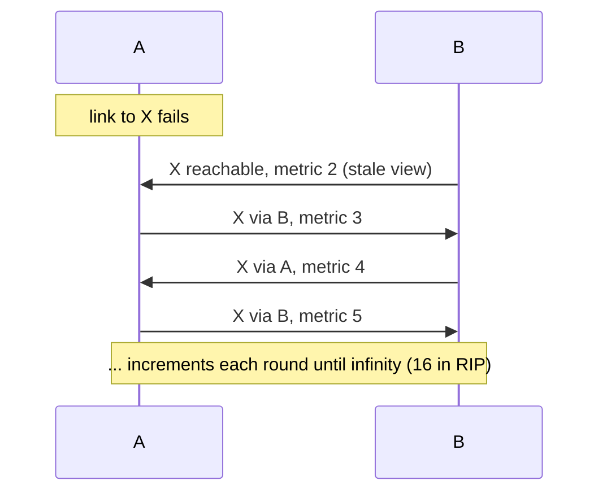

## The algorithm

Distance-vector (DV) protocols use the **distributed Bellman-Ford** algorithm. Each router maintains, for every destination, a *distance* (metric) and *vector* (next hop). It periodically (or on change) tells its neighbors its whole table. On receiving a neighbor's advertisement for destination D with distance `d`, a router computes `d + cost(link to neighbor)` and keeps the best.

```text
Router B hears from A:  "net X, distance 1"
B's cost to A is 1  →  B's route to X = distance 2 via A
B advertises "X: 2" to its neighbors (C).   C: X = 3 via B.
```

Advantages: simple, low CPU/memory, easy to configure. Disadvantages: slow convergence, no global view, loop risks, periodic full updates waste bandwidth.

### Count to infinity

Chain `X — A — B — C`: B reaches X via A at distance 2. Now A's link to X fails. A marks X unreachable, but *before* its triggered update goes out, B's periodic advertisement ("X: 2") arrives. A believes B has a path and installs **X via B at distance 3**. A then advertises X:3 to B; B, whose route is via A, must follow its next hop and updates to 4; A updates to 5, and so on. The two routers bounce traffic for X between them while the metric counts up to "infinity".



With split horizon, B would never have sent "X: 2" back to A, since B learned X from A; this simple case is solved. The residual cases involve three or more routers in a loop.

### Loop-avoidance mechanisms

| Mechanism | Rule |
|---|---|
| **Maximum metric (infinity)** | defines "unreachable" so counting stops: RIP uses 16 (limits network diameter to 15 hops) |
| **Split horizon** | don't advertise a route back out the interface it was learned on |
| **Poison reverse** | do advertise it back, but with metric = infinity (an explicit "don't use me for this") |
| **Triggered updates** | send changes immediately rather than waiting for the periodic timer |
| **Hold-down timers** | after a route is declared unreachable, ignore worse-metric updates for a period so bad news can propagate |
| **Route poisoning** | advertise a failed route with infinity |

These reduce, but do not eliminate, loops (split horizon fails in topologies with 3+ routers in a loop). **DUAL** (EIGRP) and path-vector (BGP) solve the loop problem fundamentally: DUAL by proving a neighbor's route is loop-free before using it (feasibility condition); BGP by listing the AS path.

## RIP (Routing Information Protocol)

### RIPv2 (RFC 2453)

| Property | Value |
|---|---|
| Transport | **UDP port 520**, multicast **224.0.0.9** (RIPv1 used broadcasts) |
| Metric | hop count, **1–15**; **16 = infinity** |
| Update interval | **30 s** (full table) |
| Timeout (route invalid) | **180 s** with no update |
| Garbage collection / flush | **120 s** after the route is marked unreachable (advertised as 16) |
| Max routes per message | **25** route entries (each 20 bytes), message ≤ 512 bytes + auth |
| Features | subnet masks (classless), next-hop field, route tags, authentication (plain text; MD5 / HMAC-SHA RFC 4822) |

Message structure: command (1 = Request, 2 = Response), version, then up to 25 RTEs: Address Family (2 = IP), Route Tag, IP address, Subnet mask, Next hop, Metric. Authentication consumes the first RTE (AFI `0xFFFF`).

Behavior: on startup a router sends a Request for the full table; neighbors respond. Afterwards it sends periodic responses and triggered updates with a random 1–5 s delay to avoid synchronization. Routes inherit AD 120.

**Weaknesses**: metric ignores bandwidth (a 56 kb/s link equals a 10 Gb/s link), 15-hop limit, slow convergence (minutes: 180 s timeout + hold-down), full-table updates every 30 s, ECMP up to a handful of paths. Auto-summary on classful boundaries (RIPv1 behavior) breaks discontiguous networks, so disable `auto-summary`.

### RIPng (RFC 2080)

IPv6 version: UDP port **521**, multicast **ff02::9**, same timers and metric. Next hops are explicit entries (metric 0xFF) because IPv6 uses link-local next hops. Authentication relies on IPsec (AH/ESP).

### FRR configuration

```text
router rip
 version 2
 network 10.0.0.0/8
 no auto-summary
 timers basic 30 180 120
!
interface eth1
 ip rip authentication mode md5
 ip rip authentication key-chain RIPKEY
```

## EIGRP / DUAL (conceptual)

Cisco's **EIGRP** is an "advanced distance-vector" protocol: sends *partial*, triggered updates; uses a composite metric (bandwidth, delay by default); and DUAL for loop-free fast convergence: each router keeps a **successor** (best next hop) and **feasible successors** (neighbors whose reported distance is less than the current feasible distance, thus guaranteed loop-free), so on failure it switches immediately without recomputing. Uses IP protocol 88, multicast 224.0.0.10. RFC 7868 documents it informatively. Not widely supported outside Cisco.

## DV vs. link-state

| | Distance vector | Link-state |
|---|---|---|
| Knowledge | neighbors' views (next hop and distance) | full topology map |
| Updates | periodic full tables / partial triggered | event-driven LSAs, flooded within area |
| Convergence | slow (RIP) to fast (EIGRP) | fast |
| CPU/memory | low | higher (SPF, LSDB) |
| Loops | possible during convergence | transient micro-loops |
| Hierarchy | weak | areas / levels |
| Examples | RIP, EIGRP | OSPF, IS-IS |

## When to use RIP

Almost never in new designs. Tiny or legacy networks, embedded devices, and labs for learning. Use OSPF or IS-IS (or BGP in large fabrics) instead.

## Key takeaways

- DV protocols share routing tables with neighbors and compute distances with Bellman-Ford; they know direction and distance, not topology.
- Count-to-infinity is bounded by an infinity metric (RIP: 16) and mitigated by split horizon, poison reverse, triggered updates and hold-downs.
- RIPv2: UDP 520, 224.0.0.9, 30 s updates, 180 s timeout, hop-count metric ≤ 15; RIPng uses UDP 521 and ff02::9.
- DUAL (EIGRP) gives loop-free fast failover with feasible successors; link-state is preferred in modern networks.
