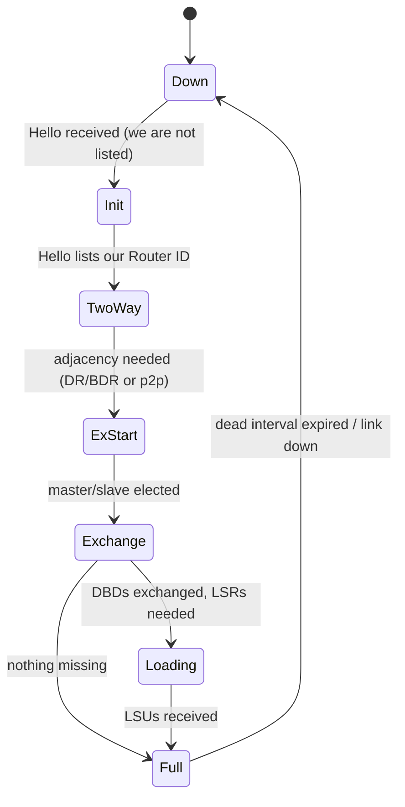

**OSPF** (Open Shortest Path First) is the most widely deployed link-state IGP. Every router in an **area** floods descriptions of its links; each independently builds the same **link-state database (LSDB)** and runs Dijkstra's SPF to compute shortest paths.

It runs directly on IP, **protocol 89**, with TTL 1, to multicast `224.0.0.5` (AllSPFRouters) and `224.0.0.6` (AllDRouters), or unicast to specific neighbors. (OSPFv3 uses `ff02::5` and `ff02::6`.) It brings its own reliability (acknowledgments, retransmissions) instead of using TCP.

## Packet types

Every OSPF packet begins with a 24-byte header: Version (2), Type, Packet Length, **Router ID** (32 bits), **Area ID** (32 bits), Checksum, AuType, Authentication (64 bits).

| Type | Name | Purpose |
|---|---|---|
| 1 | **Hello** | discover/maintain neighbors, elect DR/BDR |
| 2 | **Database Description (DBD/DD)** | summarize LSDB contents (LSA headers) at adjacency formation |
| 3 | **Link-State Request (LSR)** | ask for specific LSAs |
| 4 | **Link-State Update (LSU)** | carry full LSAs (flooding) |
| 5 | **Link-State Acknowledgment (LSAck)** | acknowledge LSAs |

**Router ID** is a 32-bit identifier written like an IPv4 address, unique per router. Set it **explicitly** to a loopback address; automatic selection (highest loopback or interface address) can change unexpectedly, and changing it restarts OSPF. Duplicate router IDs cause LSAs to be treated as stale or "fought over".

## Neighbor discovery: Hello

The Hello carries: network mask, **HelloInterval**, options, router priority, **RouterDeadInterval**, designated router and backup DR addresses, and the list of neighbors seen. Defaults: **10 s hello / 40 s dead** on broadcast and point-to-point; **30 s / 120 s** on NBMA and point-to-multipoint (RFC 2328 defaults; vendors vary).

Two routers become neighbors only if these match:

1. Same **subnet** (and mask on broadcast/NBMA networks).
2. Same **Area ID**.
3. Same **HelloInterval and RouterDeadInterval**.
4. Same **authentication** type and key.
5. Same **area type flags** in options (the E-bit: stub/NSSA/standard must agree).
6. Different Router IDs.

The **MTU** is not in the Hello but is checked in DBD; a mismatch stops the adjacency in ExStart/Exchange, one of the most common problems. (The interface command `ip ospf mtu-ignore` disables the check in FRR and Cisco IOS, but fix the MTU instead.)

### Neighbor state machine



| State | Meaning |
|---|---|
| Down | no Hello heard |
| Init | heard a Hello, but our Router ID isn't in its neighbor list (one-way communication) |
| **2-Way** | bidirectional; DR/BDR election takes place; on broadcast networks **DROther routers remain at 2-Way with each other** (normal) |
| ExStart | decide master/slave (higher Router ID is master) and initial DD sequence number |
| Exchange | DBD packets list LSA headers (not full LSAs) |
| Loading | send LSRs for LSAs that are missing or outdated; receive them in LSUs |
| **Full** | databases synchronized; the adjacency appears in router LSAs |

Troubleshooting by state: stuck in **Init** → unidirectional (ACL, multicast filtered, one side's Hello not received); stuck in **ExStart/Exchange** → MTU mismatch or unicast filtering; flapping **Full** ↔ Down → timer, link or CPU issues; **2-Way** between two DROthers → expected.

## Network types and DR/BDR

| Network type | DR election | Neighbors | Example |
|---|---|---|---|
| Broadcast | yes | dynamic via multicast | Ethernet |
| Point-to-point | no | dynamic | serial, PPP, **Ethernet configured as p2p** |
| NBMA | yes | statically configured | Frame Relay (legacy) |
| Point-to-multipoint | no | dynamic or static | DMVPN, hub-and-spoke |
| Virtual link | no | tunnel through a transit area | repairing area 0 connectivity |

On a multi-access segment with *n* routers a full mesh of adjacencies would need n(n−1)/2 flooding relationships. OSPF elects a **Designated Router (DR)** and **Backup DR (BDR)**; every other router (DROther) forms adjacencies **only with the DR and BDR**, sends updates to `224.0.0.6`, and the DR floods them to `224.0.0.5`. The DR also originates the **Network LSA** (type 2) for the segment.

Election (from Hello fields): highest **router priority** wins (0 = ineligible); ties broken by highest Router ID. It is **non-preemptive**: a router with a higher priority joining later does *not* take over, so the first routers up become DR/BDR. To force a particular DR, bring it up first or reset OSPF.

**Best practice**: configure Ethernet links between two routers as `ip ospf network point-to-point`: no DR election, faster adjacency, one fewer LSA, and quicker convergence. Reserve broadcast mode for real multi-router LANs; set priority 0 on routers that shouldn't become DR.

## Synchronization and flooding

When two routers reach ExStart they form an **adjacency**:

1. Exchange DBD packets: each lists LSA **headers** (20 bytes each: LS age, options, type, Link-State ID, Advertising Router, sequence number, checksum, length).
2. Compare to local LSDB; send **LSR** for missing/newer LSAs; receive them in **LSU**; acknowledge with **LSAck**.
3. Reach Full; add the adjacency to the router's own Router LSA.

**Flooding** is reliable: a received new LSA is installed, acknowledged (delayed/direct), and forwarded out all other OSPF interfaces (to neighbors that don't already have it) until all routers in the flooding scope have it. Unacknowledged LSAs are retransmitted every `RxmtInterval` (5 s).

Which copy is newer? Compare, in order: **sequence number** (signed 32-bit, `0x80000001` first, up to `0x7FFFFFFF`), then **checksum**, then **LS age** (a copy with age = MaxAge wins to purge). Rules and timers:

| Parameter | Value |
|---|---|
| LSRefreshTime | 1800 s (30 min): the originator re-floods its own LSAs with an incremented sequence number |
| MaxAge | 3600 s: an LSA at MaxAge is flushed from all databases |
| MinLSInterval | 5 s: an originator may not generate a new instance of the same LSA more often |
| MinLSArrival | 1 s: ignore instances of an LSA arriving too soon after the previous one |

Flapping links therefore cause a flooding rate-limit per LSA; implementations add **LSA throttling** (exponential backoff).

LSA types are covered in the next note. All routers in an area must have **identical LSDBs** for the area (verify by comparing LSA counts and checksums: `show ip ospf database`).

## SPF calculation

Each router runs Dijkstra on the area's LSDB, with itself as root. The graph vertices are routers and transit networks (DR-generated Network LSAs); edges have the **cost** advertised by the router for its outgoing interface (costs are directional). Results:

- Shortest-path tree → next hop and cost to every router and network in the area.
- Stub networks are attached as leaves with the cost of the interface.
- Inter-area and external routes are added later using summary and external LSAs without rerunning full SPF (partial calculation).

**Cost** = `reference bandwidth / interface bandwidth` (16-bit, 1–65535). The default reference of **100 Mb/s** (Cisco IOS, FRR default) gives cost 1 to every link ≥ 100 Mb/s, so 1G and 10G look identical. Set the reference bandwidth consistently on all routers (e.g. 100 Gb/s or 1 Tb/s) or set per-interface `ip ospf cost`.

```text
router ospf
 ospf router-id 10.255.0.1
 auto-cost reference-bandwidth 100000    # in Mb/s = 100 Gb/s
 passive-interface default               # then enable adjacencies explicitly
!
interface eth1
 ip ospf network point-to-point
 ip ospf area 0
 ip ospf hello-interval 1                # with dead-interval minimal, or use BFD
 ip ospf bfd
```

Equal-cost paths are installed together (ECMP), by default up to 4–64 depending on platform.

**SPF throttling** (RFC 8405) limits recalculation under churn: initial delay (e.g. 50 ms), hold, and max-wait; each event inside the hold interval increases the delay. Too aggressive risks CPU overload; too slow delays convergence.

### Route type preference

When OSPF has several routes for the same prefix (different LSA sources), it prefers: **intra-area (O)** > **inter-area (O IA)** > **external type 1 (E1)** / NSSA type 1 (N1) > **external type 2 (E2)** / N2. A less specific intra-area route does not override a more specific external route, because forwarding still uses longest prefix first (type preference only breaks ties for the same prefix).

## Authentication and security

OSPF accepts packets from any router on the segment that passes its checks. Protect the control plane:

- **Cryptographic authentication**: MD5 (RFC 2328) or better **HMAC-SHA** (RFC 5709); key chains with rollover. Plaintext "simple" authentication is trivially sniffed.
- `passive-interface` on all interfaces that should not form adjacencies (user LANs).
- **TTL security** (GTSM) where supported; filter protocol 89 at edges.
- Attacks include false LSAs ("phantom router", MaxAge-sequence attack, "disguised LSA" requiring fight-back); RFC 2328 and implementations include fight-back mechanisms.

## Operational features to know

- **Stub router / max-metric** (RFC 6987): advertise all links with metric 65535 to drain traffic before maintenance or while booting until BGP converges (`max-metric router-lsa on-startup`).
- **Graceful restart** (RFC 3623) and **NSF** keep forwarding during control-plane restart.
- **Fast reroute**: loop-free alternates (RFC 5286) and Topology-Independent LFA with Segment Routing.
- **BFD** (RFC 5880) to bring detection down to ~150 ms instead of the 40 s dead timer.
- **Prefix suppression** (RFC 6860) for transit link subnets, which reduces LSDB size and attack surface.
- **OSPFv3** (RFC 5340): the same mechanisms for IPv6, but per-link rather than per-subnet, link-local addresses, no embedded authentication (uses IPsec/ RFC 7166), different LSA formats (see next note).

## Show commands (FRR / Cisco-like)

```text
show ip ospf neighbor               # state, DR/BDR role, dead time
show ip ospf interface eth1         # type, cost, timers, DR
show ip ospf database               # LSA summary per type and area
show ip ospf route                  # computed OSPF routes
debug ospf packet hello              # last resort
```

## Key takeaways

- OSPF: IP protocol 89, five packet types, multicast 224.0.0.5/6, Router ID as identity.
- Neighbors need matching area, timers, subnet, authentication and area flags; MTU mismatch shows up in ExStart/Exchange.
- On broadcast segments only the DR/BDR become fully adjacent; use point-to-point mode on router-to-router Ethernet links.
- LSAs are flooded reliably and refreshed every 30 minutes; SPF runs on the identical LSDB at every router and is throttled.
- Fix the reference bandwidth, use cryptographic auth, passive interfaces, BFD and max-metric for operations.
