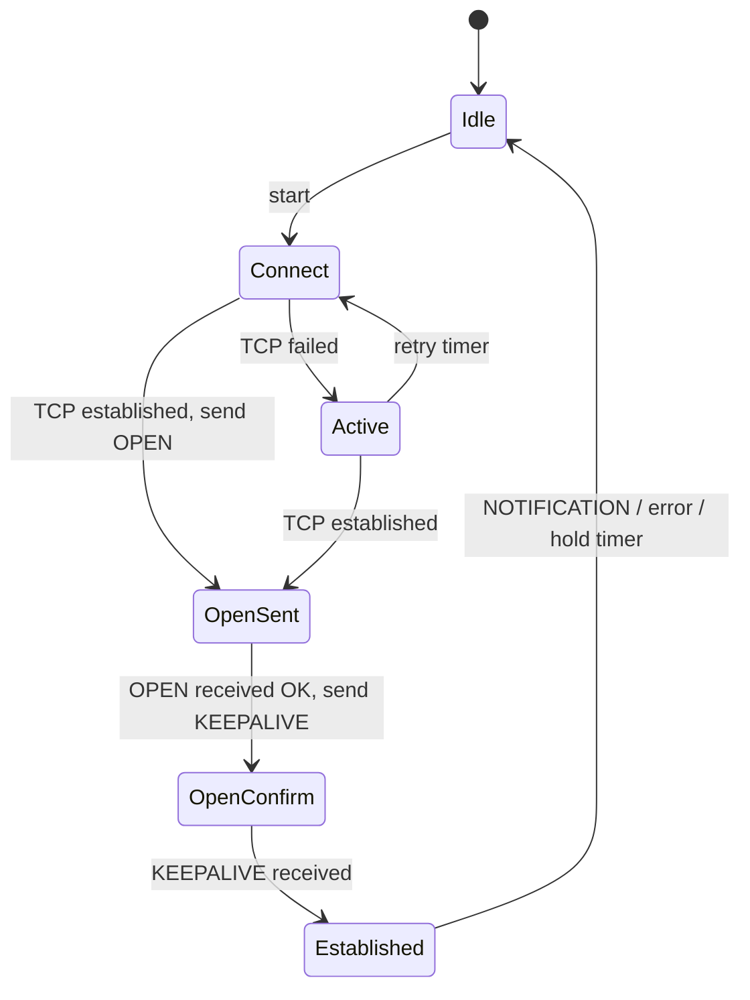

**BGP-4** is the inter-domain routing protocol of the Internet and increasingly the data-center fabric routing protocol. It is a **path-vector** protocol: routers exchange *reachability + path attributes*, and routing decisions are driven by **policy**, not by a single metric.

## Sessions

- BGP runs over **TCP port 179**. Peers are configured explicitly (no discovery); one side initiates (connect), the other listens; collisions are resolved by comparing BGP identifiers.
- A **session between different ASes** is **eBGP**; within the same AS, **iBGP**.
- eBGP peers are normally directly connected (TTL = 1; peering between loopbacks requires `ebgp-multihop`). **GTSM** (RFC 5082) instead sends with TTL 255 and accepts only ≥ 254, protecting against remote attackers.
- Protect sessions with **TCP-AO** (RFC 5925) or legacy **TCP MD5** (RFC 2385), a max-prefix limit, and filtering.

An **ASN** identifies an autonomous system: 16-bit (1–65535) and 32-bit (RFC 6793, written asplain `4200000001` or asdot `64086.59905`). Reserved: `0`, `23456` (**AS_TRANS**, placeholder for 4-byte ASNs toward old speakers), `64496–64511` and `65536–65551` (documentation), `64512–65534` and `4200000000–4294967294` (private, RFC 6996), `65535` and `4294967295` reserved.

## Message types

All messages begin with a 19-byte header: 16-byte marker (all ones), 2-byte length (19–4096; up to 65535 with RFC 8654), 1-byte type.

| Type | Message | Content |
|---|---|---|
| 1 | **OPEN** | version (4), My AS (2 bytes; real 4-byte ASN in a capability), **Hold Time**, BGP Identifier (router ID), optional parameters → **capabilities** (MP-BGP AFI/SAFI, 4-byte AS, route refresh, graceful restart, add-path, extended next hop...) |
| 2 | **UPDATE** | withdrawn routes; path attributes; NLRI (prefixes sharing those attributes) |
| 3 | **NOTIFICATION** | error code/subcode; the session is closed afterwards |
| 4 | **KEEPALIVE** | 19-byte header only; sent every 1/3 of the hold time |
| 5 | ROUTE-REFRESH | ask the peer to resend its Adj-RIB-Out (RFC 2918) |

Defaults: Hold Time suggested 90 s (Keepalive 30 s); the lower value of both OPENs is used (0 = no keepalives); other vendors default to 180 s. Notification error codes: 1 Message Header, 2 OPEN message (e.g. bad peer AS, unsupported capability), 3 UPDATE message (bad attribute), 4 **Hold Timer Expired**, 5 FSM error, 6 **Cease** (admin shutdown, max-prefix hit, reset, collision).

### Finite-state machine



| State | Meaning, and what stuck states imply |
|---|---|
| Idle | waiting; reached after failures with backoff (ConnectRetry 120 s). Stuck: misconfiguration, no route to peer, max-prefix |
| Connect / Active | trying to open TCP. **Active** is "trying to connect / listening", not "up". Stuck: ACL blocking 179, wrong neighbor IP/AS, no route, MD5 mismatch |
| OpenSent / OpenConfirm | OPEN exchange and validation. Stuck/reset: ASN mismatch, capability mismatch, bad authentication |
| **Established** | UPDATEs flow |

## Routes and tables

| Table | Meaning |
|---|---|
| **Adj-RIB-In** | routes received from a peer (before inbound policy) |
| **Loc-RIB** | routes chosen as best by the decision process after inbound policy |
| **Adj-RIB-Out** | routes advertised to a peer (after outbound policy) |

The Loc-RIB best routes are installed in the main RIB/FIB (subject to AD: eBGP 20, iBGP 200), and BGP then advertises the best path per prefix to peers (unless add-path).

## Path attributes

Attribute categories:

| Category | Behavior | Examples |
|---|---|---|
| Well-known mandatory | in every UPDATE with NLRI | ORIGIN, AS_PATH, NEXT_HOP |
| Well-known discretionary | recognized by all, optional presence | LOCAL_PREF (iBGP), ATOMIC_AGGREGATE |
| Optional transitive | passed along even if unrecognized (marked Partial) | COMMUNITIES, AGGREGATOR, Large Communities |
| Optional non-transitive | dropped if unrecognized | MED, ORIGINATOR_ID, CLUSTER_LIST |

| Attribute | Type | Meaning and use |
|---|---|---|
| **ORIGIN** | 1 | IGP (0) < EGP (1) < Incomplete (2): how the route entered BGP (`network`, legacy, redistribution) |
| **AS_PATH** | 2 | ordered list of ASes the route traversed (AS_SEQUENCE; AS_SET after aggregation). eBGP prepends the local ASN on advertisement. Loop prevention: reject a route containing your own ASN. Used for path length and policy |
| **NEXT_HOP** | 3 | IP address to forward to; set to the sender's address on eBGP; **unchanged** when passing over iBGP (hence next-hop-self) |
| **MED** | 4 | Multi-Exit Discriminator: lower preferred; a *hint* from a neighbor AS about entry points; compared only between routes from the same neighbor AS by default |
| **LOCAL_PREF** | 5 | iBGP only: higher preferred (default 100); the primary tool for outbound policy |
| ATOMIC_AGGREGATE / AGGREGATOR | 6 / 7 | aggregate marker; who aggregated |
| **COMMUNITIES** | 8 | 32-bit tags (`ASN:value`) for signalling policy (see next note) |
| ORIGINATOR_ID / CLUSTER_LIST | 9 / 10 | route-reflection loop prevention |
| MP_REACH_NLRI / MP_UNREACH_NLRI | 14 / 15 | multiprotocol extensions: IPv6, VPNv4, EVPN, labeled unicast, etc. (AFI/SAFI) |
| AS4_PATH / AS4_AGGREGATOR | 17 / 18 | transport 4-byte ASNs across old speakers |
| Extended / Large Communities | 16 / 32 | RFC 4360 / RFC 8092 |

## iBGP vs eBGP

| | eBGP | iBGP |
|---|---|---|
| Peers in | different ASes | same AS |
| AS_PATH on send | prepend own ASN | unchanged |
| NEXT_HOP | set to self | **not changed** (unless `next-hop-self`) |
| LOCAL_PREF | not sent | sent |
| TTL | 1 | 255 (loopback peering over IGP) |
| Default AD | 20 | 200 |
| Loop prevention | own ASN in AS_PATH | **iBGP split-horizon**: a route learned from an iBGP peer is *not* advertised to other iBGP peers |

The iBGP rule is why iBGP needs a **full mesh** (n(n−1)/2 sessions) or **route reflectors/confederations** (next note). iBGP sessions are usually between **loopbacks** (stable under link failure) with an IGP providing reachability; for eBGP edges, set `next-hop-self` toward iBGP or distribute the external link subnets in the IGP, so iBGP routers can resolve the next hop recursively. A BGP route whose next hop is not reachable is not considered.

**Synchronization** (old rule requiring IGP knowledge of the prefix before iBGP route use) is disabled in modern implementations; instead, full iBGP coverage or MPLS carries transit traffic. **BGP is not a replacement for an IGP**: it does not discover neighbors, and convergence is slow.

## The decision process

For each prefix with multiple candidate paths, BGP compares them in order until one wins (RFC 4271 §9.1 + common vendor extensions):

1. **Reachable next hop** (resolvable in the RIB); discard otherwise.
2. *(Cisco/FRR)* highest **weight** (local to the router, not advertised).
3. Highest **LOCAL_PREF** (default 100).
4. **Locally originated** routes (network/redistribute/aggregate) preferred.
5. Shortest **AS_PATH** (an AS_SET counts as 1; `bgp bestpath as-path ignore` skips this).
6. Lowest **ORIGIN** (IGP < EGP < incomplete).
7. Lowest **MED** (only from the same neighboring AS unless `always-compare-med`).
8. Prefer **eBGP** over iBGP.
9. Lowest **IGP metric** to the NEXT_HOP (hot-potato routing).
10. If multipath is enabled, ties are installed together; otherwise the **oldest** eBGP path (stability, avoids flaps).
11. Lowest **router ID** (ORIGINATOR_ID if reflected).
12. Shortest **CLUSTER_LIST**.
13. Lowest **neighbor IP address**.

Memorize the front: **weight → LOCAL_PREF → local-origin → AS_PATH → origin → MED → eBGP > iBGP → IGP cost → router ID**. Two corollaries: hot-potato (step 9) hands traffic to the nearest exit; MED can create non-transitive "oscillations" (MED comparison is only between a subset), and deterministic-MED options avoid ordering dependence.

## Origination and aggregation

- `network 203.0.113.0/24` advertises a prefix only if a matching route exists in the RIB (usually a static route to Null0 for aggregates).
- `redistribute` imports routes from other protocols (ORIGIN = incomplete).
- **Aggregation** (`aggregate-address`) creates a covering prefix; with `as-set` it preserves the AS_PATH information of components, and `summary-only` suppresses the specifics.

## Capabilities, IPv6 and MP-BGP

BGP carries IPv6 (and VPNs, EVPN, flowspec...) using MP_REACH/MP_UNREACH with an **address family**: AFI 1 = IPv4, 2 = IPv6, 25 = L2VPN; SAFI 1 = unicast, 2 = multicast, 4 = labeled unicast, 128 = MPLS VPN, 70 = EVPN. The session transport (IPv4 or IPv6) is independent of the address families carried. For IPv6 over an IPv4 session, a NEXT_HOP in MP_REACH must be set to a valid IPv6 address (global and, optionally, link-local).

## Timers and errors

- **Keepalive/Hold**: 60/180 s (many vendors) or 30/90 s: use **BFD** for fast failure detection.
- **MRAI** (MinRouteAdvertisementInterval): RFC 4271 suggests 30 s for eBGP and 5 s for iBGP; implementations commonly set eBGP = 0–30 s and iBGP = 0, trading convergence time against update churn.
- **RFC 7606** error handling: an UPDATE with a malformed *non-critical* attribute is treated as a **withdraw** or the attribute is discarded, instead of resetting the session (the older behavior, which turned one bad route into a session flap).
- **Graceful restart** (RFC 4724) keeps forwarding while a peer restarts.
- **RFC 8212**: eBGP sessions should not exchange routes unless an explicit import/export policy is configured (FRR's `bgp ebgp-requires-policy`, enabled by default, and Junos behave this way), preventing accidental leaks.

## FRR example

```text
router bgp 65001
 bgp router-id 10.255.0.1
 no bgp default ipv4-unicast
 neighbor 192.0.2.2 remote-as 65002
 neighbor 192.0.2.2 description upstream-A
 neighbor 192.0.2.2 password S3cr3t
 neighbor 192.0.2.2 ttl-security hops 1
 neighbor 192.0.2.2 bfd
 !
 address-family ipv4 unicast
  network 203.0.113.0/24
  neighbor 192.0.2.2 activate
  neighbor 192.0.2.2 maximum-prefix 1000000 90
  neighbor 192.0.2.2 route-map UP-IN in
  neighbor 192.0.2.2 route-map UP-OUT out
 exit-address-family
```

```text
show bgp summary                      # state/prefixes per neighbor
show bgp ipv4 unicast 203.0.113.0/24  # all paths and the best one with attributes
show bgp neighbor 192.0.2.2 advertised-routes
```

## Key takeaways

- BGP is path-vector over TCP/179 with OPEN/UPDATE/KEEPALIVE/NOTIFICATION; "Active" means failing to connect.
- AS_PATH provides loop detection and path length; NEXT_HOP is not changed by iBGP; LOCAL_PREF is iBGP-only; MED hints at entry points.
- The iBGP split-horizon rule drives the need for full mesh/route reflectors.
- Best path: weight → LOCAL_PREF → AS_PATH → origin → MED → eBGP over iBGP → IGP metric → router ID.
- Protect sessions (TCP-AO/GTSM, max-prefix, policy) and use BFD and RFC 7606 behavior for robustness.
