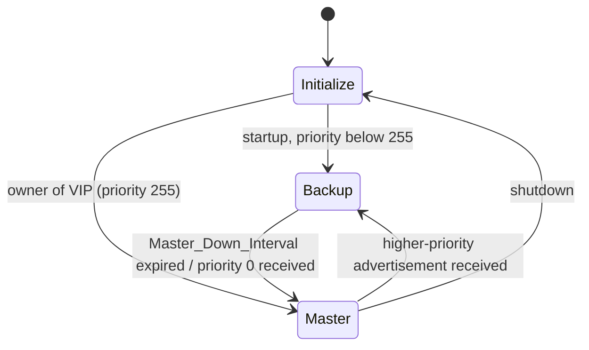

A host has one configured default gateway. If that router fails, the host is stranded even if a second router exists. **First-hop redundancy protocols (FHRP)** let two or more routers share a **virtual IP (VIP)** and a **virtual MAC** that hosts use as their gateway; the group elects which router actively answers for it.

## VRRP (RFC 5798)

An open standard (VRRPv3 covers IPv4 and IPv6; v2 was RFC 3768, IPv4 only).

| Item | Detail |
|---|---|
| Transport | IP protocol **112**, multicast **224.0.0.18** (IPv4) / **ff02::12** (IPv6), TTL/hop limit **255** (receivers must check) |
| Virtual Router ID (VRID) | 1–255, per interface/VLAN; routers with the same VRID and VIP form a virtual router |
| Virtual MAC | IPv4: `00-00-5E-00-01-<VRID>`; IPv6: `00-00-5E-00-02-<VRID>` |
| Priority | 1–254 configurable (default 100); **255** = the owner of the VIP (the address is its real interface address); **0** = the master is abdicating |
| Advertisement interval | default 1 s (v3: in centiseconds, 12-bit field, sub-second possible) |
| Roles | **Master** (sends advertisements, answers ARP/ND for the VIP, forwards traffic to the virtual MAC) and **Backups** (listen) |
| Preemption | on by default: a higher-priority router that comes up takes over |

### Election and failover

The router with the highest priority becomes Master; ties are broken by the **highest primary IP address** on the interface. Backups wait for advertisements:

`Master_Down_Interval = 3 × Advertisement_Interval + Skew_Time`, where `Skew_Time = ((256 − Priority) × Advertisement_Interval) / 256`.

With a 1 s interval, failover takes about **3–4 s**, and the skew makes higher-priority backups time out slightly sooner, so that the best backup wins without collisions. The new Master sends gratuitous ARP/unsolicited NA for the VIP, and frames sourced from the virtual MAC, so switches immediately relearn the MAC on the new port. Hosts do not change anything: same IP, same MAC.



A router that is the VIP "owner" (priority 255) answers ping to the VIP; in other cases the **accept mode** must be enabled for the Master to accept packets addressed to the VIP (ICMP echo, but not other services), which matters for monitoring.

### Packet

Version (4 bits = 3) + Type (4 = advertisement), VRID, Priority, Count of IP addresses, reserved + Max Adver Interval (12 bits, centiseconds), checksum, list of VIPs. v3 removed authentication (relying on TTL 255 and L2 trust, or IPsec AH).

### Configuration (FRR / keepalived)

```text
# keepalived.conf (Linux)
vrrp_instance VI_1 {
    state BACKUP
    interface eth0
    virtual_router_id 51
    priority 100
    advert_int 1
    virtual_ipaddress { 192.0.2.1/24 }
    track_interface { eth1 weight -30 }     # drop priority if uplink fails
}
```

```text
# FRR vrrpd
interface eth0
 vrrp 51 version 3
 vrrp 51 priority 120
 vrrp 51 advertisement-interval 100         # centiseconds
 vrrp 51 ip 192.0.2.1
```

## HSRP and GLBP (Cisco)

**HSRP** (Hot Standby Router Protocol) is the original (RFC 2281, informational). Differences:

| | VRRP | HSRP |
|---|---|---|
| Standard | IETF | Cisco proprietary |
| Roles | Master / Backups | Active / Standby / Listening routers (one standby only) |
| Transport | IP 112 | UDP 1985, multicast 224.0.0.2 (v1), 224.0.0.102 (v2); v2 also IPv6 |
| Virtual MAC | `0000.5E00.01xx` | `0000.0C07.ACxx` (v1), `0000.0C9F.Fxxx` (v2) |
| Timers | advert 1 s, master down ≈ 3 s | hello 3 s, hold 10 s (tunable to msec) |
| Preempt | **default on** | **default off** (must be configured) |
| VIP | can be the owner's real IP | must be a separate address |

**GLBP** (Gateway Load Balancing Protocol) gives different hosts different virtual MACs in a round-robin to share load across routers; it is Cisco-only and rarely used now.

## Load sharing

Only the Master forwards for a group, so one router sits idle. Common approach: configure **two groups** on the VLAN, with different masters (VIP-A master on R1, VIP-B master on R2), and give half of the hosts each VIP (via DHCP scopes), or use different VLANs per router. Because load is shared by host assignment, balance is coarse. With **MLAG/vPC**, both switches can forward for the same virtual MAC (active-active), so FHRP master/standby is only a control-plane concept.

## Anycast gateway (modern fabrics)

In EVPN/VXLAN fabrics every leaf is configured with the **same gateway IP and MAC** for each VLAN (distributed anycast gateway, RFC 9135 context), so each host uses its local leaf as first hop, with no election, no failover protocol and no hair-pinning across the fabric. Failure of a leaf affects only its attached hosts, which have redundancy via multihoming (EVPN ESI/MLAG). This eliminates VRRP/HSRP in new data-center designs; campus networks usually remain on FHRP, or on routed-access designs with a gateway per closet.

## Design considerations and failure modes

1. **Align with STP/L2 topology**: the VRRP master should be the STP root for the VLAN, or traffic crosses the inter-switch link twice.
2. **Track upstream**: if the master loses its uplink but still receives host traffic, it forwards into a black hole. Decrement priority on tracked interface or route failure, using the "track" feature, so the backup takes over.
3. **Split brain**: if the VLAN is partitioned (the advertisement path fails), both routers become master, so both ARP for the VIP and the MAC flaps. Detect via logs; use a redundant L2 path between routers.
4. **Preempt delay**: after reboot a router should wait (`preempt delay minimum 60`) until its routing has converged before taking over, otherwise it takes over and drops traffic.
5. **Asymmetric traffic with stateful firewalls**: the flow's return path may use the other router; use state sync or symmetric routing.
6. **ARP/ND timers on hosts**: hosts keep the virtual MAC mapping, which stays valid, but the *switch's* MAC table must relearn the virtual MAC on the new port. This is the gratuitous frame's job; if traffic stays blackholed, check the switch FDB.
7. **Sub-second failover**: use VRRPv3 centisecond timers or HSRP msec timers plus BFD (vendor-specific integration), but ensure that the CPU can sustain them.
8. IPv6: hosts can also use RA with router preferences and multiple routers (RFC 4191); VRRP for IPv6 works with the virtual link-local address `fe80::...` as the gateway.

## Key takeaways

- FHRPs present a virtual IP and virtual MAC; the elected Master/Active answers ARP/ND and forwards; failover requires no host change.
- VRRP: IP 112, 224.0.0.18, VRID, priority 1–254 (255 = owner), failover ≈ 3 × advert + skew, preempt on by default.
- HSRP is Cisco's equivalent (preempt off by default, UDP 1985); both give only one active forwarder per group, so load share by using multiple groups.
- Track upstream links, align with STP, watch for split brain; in EVPN fabrics use distributed anycast gateways instead.
