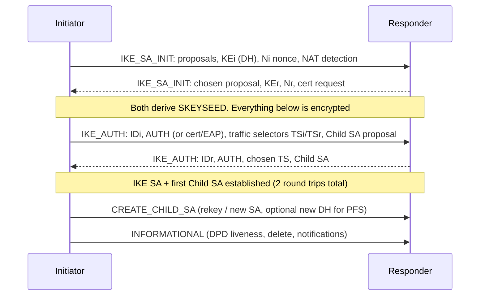

**IPsec** secures IP traffic at layer 3: confidentiality, integrity, origin authentication and replay protection, transparent to the applications. It is the standard for site-to-site and remote-access VPNs.

## Architecture (RFC 4301)

| Component | Role |
|---|---|
| **Security Association (SA)** | a one-way agreement (keys, algorithms, lifetime) identified by **SPI** (32-bit) + destination + protocol. Two SAs (one each way) form a connection |
| **SPD** (Security Policy Database) | ordered rules: for traffic matching selectors (src/dst/proto/ports), **PROTECT (apply IPsec)**, **BYPASS** or **DISCARD** |
| **SAD** (Security Association Database) | the negotiated SAs, looked up by SPI for inbound, by policy for outbound |
| **IKE** | the key management protocol that negotiates and rekeys SAs automatically |

Outbound: consult SPD → if PROTECT, find or create SA → encapsulate. Inbound: look up SA by SPI → verify/decrypt → check that the *inner* packet matches the SPD's policy for that SA (prevents an authenticated peer from sending traffic outside its allowed selectors).

### Protocols

| | **ESP** (IP protocol 50) | **AH** (IP protocol 51) |
|---|---|---|
| Confidentiality | yes (optional "NULL" cipher) | **no** |
| Integrity/auth | yes (ICV over ESP header..trailer, not the outer IP header) | yes, **including immutable fields of the outer IP header** |
| NAT-friendly | yes (with UDP encapsulation) | **no**: NAT changes covered fields |
| Use | essentially all deployments | rare; mostly obsolete |

**ESP packet**: `SPI (4) | Sequence Number (4) | IV / payload | Padding | Pad Length (1) | Next Header (1) | ICV`. Authenticated-encryption algorithms (AES-GCM, ChaCha20-Poly1305) combine encryption and integrity (AEAD). The 32-bit sequence number (or 64-bit ESN) enables a sliding **anti-replay window** (default 32–64 packets, larger needed on reordering networks, e.g. 1024+ with multi-queue NICs or ECMP).

### Modes

- **Transport mode**: the original IP header is kept, ESP is inserted between IP and TCP/UDP. Protects host-to-host traffic; end-to-end only.
- **Tunnel mode**: the original packet is encrypted entirely and wrapped in a new IP header between the **security gateways**. Used for site-to-site and remote-access VPNs.
- GRE/L2TP over IPsec in transport mode: tunnel first, encrypt second.

## IKEv2 (RFC 7296)

IKEv2 runs on **UDP 500**, and switches to **UDP 4500** when NAT is detected (NAT-T). It builds an **IKE SA** (control channel) and one or more **Child SAs** (the ESP SAs for traffic).



- **IKE_SA_INIT**: negotiate cryptographic suite (encryption, PRF, integrity, DH group), exchange DH public values and nonces, detect NAT (hashes of IP/ports). Derives keys; the responder can use **cookies** (anti-DoS) under load.
- **IKE_AUTH**: encrypted; exchange identities, authenticate (pre-shared key, digital signatures with X.509 certificates, or EAP for remote-access users), negotiate the first **Child SA** and **traffic selectors** (which traffic it protects).
- **CREATE_CHILD_SA**: rekeys IKE or Child SAs, or creates additional ones; include a DH exchange for **Perfect Forward Secrecy (PFS)**.
- **INFORMATIONAL**: liveness checks (empty message = **DPD**), deletion, error notifications (`NO_PROPOSAL_CHOSEN`, `AUTHENTICATION_FAILED`, `TS_UNACCEPTABLE`, `INVALID_KE_PAYLOAD`).

IKEv1 (RFC 2409; main/aggressive mode + quick mode) is legacy, with more messages and known weaknesses (aggressive mode with PSK is offline-crackable). Use IKEv2.

### Algorithm choices (RFC 8221 / current guidance)

| Purpose | Recommended | Avoid |
|---|---|---|
| Encryption | AES-GCM-256/128 (AEAD), ChaCha20-Poly1305 | DES, 3DES, AES-CBC without good MAC, NULL |
| Integrity | HMAC-SHA2-256/384 (non-AEAD) | MD5, SHA-1 (legacy) |
| DH group | 19/20/21 (NIST ECP), **31 (Curve25519)**, 14+ (MODP-2048+) | groups 1, 2, 5 (768–1536 bit) |
| Authentication | certificates (ECDSA/RSA-PSS, RFC 7427), EAP-TLS/MSCHAPv2 | weak PSK |
| Post-quantum | hybrid/PSK mixing (RFC 8784), ML-KEM draft | |

Lifetimes: IKE SA ~ 8–24 h, Child SA ~ 1–8 h (or volume-based), rekeyed before expiry (make-before-break).

## NAT traversal

NAT breaks ESP (no ports) and AH. IKE detects NAT in `IKE_SA_INIT` (NAT_DETECTION_SOURCE_IP / DESTINATION_IP hashes). If NAT is in the path, both switch to **UDP 4500**, ESP is wrapped as `outer IP | UDP(4500) | ESP`, with a keepalive (1-byte `0xFF` packet every 20 s) to hold NAT mappings (RFC 3948). Non-ESP markers (a 4-byte zero) distinguish IKE from ESP on port 4500.

## Overhead and MTU

Tunnel-mode ESP with AES-GCM over IPv4:

`outer IP (20) + ESP header (8) + IV (8) + padding (0–3, to 4-byte alignment) + pad length/next header (2) + ICV (16)` ≈ **54–57 bytes** (NAT-T adds 8 for UDP).

So with a 1500 B underlay, the inner MTU is at most ≈ **1446** (≈ **1438** with NAT-T, since the padded payload must be 4-byte aligned); the commonly used safe value is **1400**. Fragmentation occurs *after* encryption by default (outer packet), which requires reassembly before decryption at the receiver and interacts badly with firewalls; prefer correct inner MTU plus **MSS clamping** and PMTUD. Some implementations pre-fragment (fragment before encryption).

## Policy-based vs route-based VPNs

| | Policy-based | Route-based |
|---|---|---|
| Selection of traffic | SPD selectors (ACL-like crypto maps) | any packet **routed into a virtual tunnel interface** (VTI/xfrm interface) with traffic selectors `0.0.0.0/0 ↔ 0.0.0.0/0` |
| Routing protocols over the tunnel | no | yes (OSPF, BGP) |
| Complexity | selector pairs multiply with subnets | simple, flexible, fits cloud VPN |
| Failover/ECMP | hard | natural with routing |

Linux supports route-based VPNs with **VTI** or modern **xfrm interfaces** (`ip link add ipsec0 type xfrm dev eth0 if_id 42`).

## Linux and strongSwan

```text
# /etc/swanctl/conf.d/site.conf
connections {
  site-b {
    version = 2
    local_addrs  = 198.51.100.1
    remote_addrs = 203.0.113.9
    proposals = aes256gcm16-prfsha384-curve25519
    local  { auth = psk;  id = hq }
    remote { auth = psk;  id = branch }
    children {
      lan {
        local_ts = 10.1.0.0/16
        remote_ts = 10.2.0.0/16
        esp_proposals = aes256gcm16-curve25519
        start_action = start
        dpd_action = restart
      }
    }
  }
}
secrets { ike-site { id-1 = hq; id-2 = branch; secret = "use-a-long-random-key" } }
```

```bash
swanctl --load-all ; swanctl --list-sas       # state, SPIs, traffic counters
ip xfrm state ; ip xfrm policy                # kernel SAD/SPD
tcpdump -ni eth0 'esp or udp port 500 or udp port 4500'
```

## Troubleshooting

| Symptom | Check |
|---|---|
| IKE_SA_INIT never answered | UDP 500/4500 blocked, wrong peer IP, NAT |
| `NO_PROPOSAL_CHOSEN` | cipher/DH/PRF mismatch between peers |
| `AUTHENTICATION_FAILED` | PSK/ID/cert mismatch (wrong identity type) |
| `TS_UNACCEPTABLE` | traffic selectors don't match (mirror image needed) |
| Tunnel up, no traffic | routing/policy, firewall `ESP` or NAT-T, overlapping subnets |
| Large packets hang | MTU/MSS (see above), ICMP blocked |
| Periodic drops at rekey | lifetime mismatch, rekey collision, DPD too aggressive |
| One-way traffic | asymmetric routing, anti-replay window drops after reordering |

## Alternatives

**WireGuard** (UDP, Noise protocol, Curve25519/ChaCha20-Poly1305): a minimal route-based VPN, with ~4k lines of kernel code, static keys, and fast roaming; lacks IKE's negotiation flexibility, certificates, and standard interoperability. **TLS-based VPNs** (OpenVPN, DTLS, SSL VPN) for remote access and **MACsec** for L2 links. In clouds, managed IPsec VPNs and MACsec/WireGuard meshes are common.

## Key takeaways

- IPsec = SAs (keys + algorithms, per direction) selected via SPD; ESP (50) provides encryption + integrity, AH (51) is rarely used.
- IKEv2: IKE_SA_INIT (DH + nonces) then IKE_AUTH (identity + first Child SA) in two round trips; CREATE_CHILD_SA rekeys; NAT-T switches to UDP 4500.
- Use AEAD ciphers (AES-GCM / ChaCha20-Poly1305), strong DH (Curve25519 / ECP), certificates or strong PSKs.
- Budget ~55–70 bytes of overhead: set MTU ≈ 1400 and clamp MSS.
- Prefer route-based VPNs (VTI/xfrm interfaces) to run routing protocols and ECMP.
