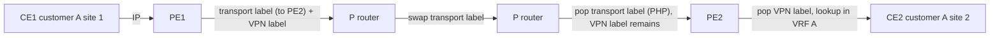

**Multiprotocol Label Switching (MPLS)** forwards packets by looking up a short fixed-length **label** instead of a longest-prefix IP match. Its original motivation (faster lookups) disappeared with hardware routers, but MPLS persisted because labels enable **VPNs, traffic engineering and fast reroute** with a clean separation between edge (services) and core (transport).

## The label stack entry

MPLS sits between layer 2 and layer 3 (a "layer 2.5" shim). Ethernet EtherType `0x8847` (unicast) / `0x8848` (multicast). Each label stack entry (LSE) is 4 bytes:

```text
 0                   1                   2                   3
 0 1 2 3 4 5 6 7 8 9 0 1 2 3 4 5 6 7 8 9 0 1 2 3 4 5 6 7 8 9 0 1
+-------------------------------------+-----+-+-----------------+
|             Label (20)              | TC  |S|     TTL (8)     |
+-------------------------------------+-----+-+-----------------+
```

- **Label** (20 bits, ~1M values), **TC** (traffic class, 3 bits, was EXP; used for QoS), **S** (bottom of stack; 1 on the last entry), **TTL**.
- Labels stack: the topmost label is processed by the forwarding nodes; inner labels carry services.
- Reserved labels: **0** IPv4 explicit null, **1** router alert, **2** IPv6 explicit null, **3 implicit null** (signalling "pop it"), 7 entropy label indicator, 13 GAL, 14 OAM alert; 16+ are dynamically allocated (16–1,048,575).
- Each label adds 4 bytes to the packet: account for **MTU** (a 2-label VPN frame needs +8; typically set the core MTU to 1530+ or jumbo).

## Roles and operations

| Role | Description |
|---|---|
| **LER / PE** (Label Edge Router / Provider Edge) | at the border: classifies packets into a FEC and **pushes** labels (ingress), or pops (egress) |
| **LSR / P** (Label Switching Router / Provider) | core: **swaps** labels by exact-match lookup in the LFIB |
| **CE** | customer edge router, not MPLS-aware |
| **FEC** (Forwarding Equivalence Class) | a group of packets forwarded the same way (e.g. all packets to prefix 10.1.0.0/16) |
| **LSP** | the unidirectional path of labels from ingress to egress |

Three label operations: **push** (add), **swap** (replace the top label), **pop** (remove). Each LSR's label forwarding table maps *incoming label → outgoing label + next hop*.

**Penultimate Hop Popping (PHP)**: the last LSR before the egress pops the label (the egress advertised implicit-null, label 3), so the egress does a single IP (or VPN-label) lookup instead of label lookup + IP lookup. Where QoS must be preserved in the TC bits to the end, use explicit null.

**TTL**: by default, the ingress copies the IP TTL into the MPLS TTL (decremented per hop) so traceroute shows LSRs; providers often hide the core with `no mpls ip propagate-ttl` (pipe/short-pipe models, RFC 3443).

## Label distribution

### LDP (RFC 5036)

The simplest mechanism: each LSR allocates a label for every IGP prefix and tells its neighbors, building LSPs that follow the **IGP shortest paths**.

- **Discovery**: UDP 646 Hellos to 224.0.0.2 (all routers); **Session**: TCP 646 between the LDP router IDs (transport address, usually loopback); the higher transport address initiates.
- Messages: Initialization, Keepalive, **Label Mapping** (advertises a FEC→label binding), Label Request, Label Withdraw/Release, Notification.
- Mode defaults: **downstream unsolicited** advertisement, **liberal** label retention, **ordered** control (the egress originates a label first, and each upstream router advertises after receiving from downstream).
- Requires an IGP: LDP follows the RIB; if the IGP and LDP are out of sync (a link up in IGP before LDP converges) traffic black-holes → **LDP-IGP synchronization** (advertise max metric until LDP is up).
- Constraints: no traffic engineering, no explicit paths, additional protocol state.

### Segment Routing (SR-MPLS)

**Segment Routing** (RFC 8402) removes LDP/RSVP: the IGP (OSPF/IS-IS) distributes **segment identifiers (SIDs)**:

- **Prefix SID**: a globally unique index (+SRGB base) identifying a prefix (a node), so all routers use the same label to reach that node via ECMP shortest paths.
- **Adjacency SID**: a local label for a specific link.
- The source encodes a path as a **stack of SIDs** (explicit path, traffic engineering) without per-flow state in the core. **TI-LFA** gives 50 ms protection with automatic loop-free repair paths.
- The IPv6 data plane variant is **SRv6** (segment lists in an IPv6 routing header with 128-bit SIDs).

### RSVP-TE

Signals explicit, bandwidth-reserving **TE tunnels** with fast reroute (link and node protection, 50 ms), at the cost of per-LSP state at each hop. Being replaced by SR-TE in new deployments.

## MPLS Layer 3 VPN (RFC 4364)

Goal: provide customers with private IP routing over a shared provider backbone, **allowing overlapping address spaces**. Components:

| Element | Function |
|---|---|
| **VRF** (Virtual Routing and Forwarding) | a separate routing table + FIB per customer on each PE; customer-facing interfaces are bound to a VRF |
| **Route Distinguisher (RD)** | 64-bit value prepended to a customer IPv4 prefix to make **VPNv4** prefixes globally unique (`65000:100:10.1.1.0/24`); purely an identifier, doesn't control policy |
| **Route Target (RT)** | BGP **extended community** attached to VPN routes; the *export RT* tags routes leaving a VRF and the *import RT* selects which VPN routes enter a VRF. RTs implement the topology: full mesh, hub-and-spoke, extranet |
| **MP-BGP** | PEs exchange VPNv4/VPNv6 routes (AFI 1 / 2, **SAFI 128**), carrying the **VPN label** and RT; typically through route reflectors |
| **CE-PE routing** | static, eBGP (most common), OSPF/IS-IS, RIP |

### Forwarding: two labels



1. CE1 sends a plain IP packet to PE1; PE1 looks up the destination in **VRF A**, finding a BGP route for PE2's loopback as next hop and a **VPN label** (assigned by PE2 for that VRF/prefix).
2. PE1 pushes the **inner (VPN) label** and, on top, the **transport label** of the LSP towards PE2's loopback (from LDP/SR).
3. P routers forward on the **outer label only**; they know nothing of customers (a P router doesn't need VPN routes: the *BGP-free core*).
4. The penultimate P pops the transport label; PE2 receives the VPN label, which identifies the VRF (and possibly the outgoing CE); PE2 pops it and forwards the IP packet to CE2.

Control plane: PE2 learns the CE2 prefix (via CE-PE routing) → installs in VRF A → exports as VPNv4 route `RD:prefix`, RT export, VPN label, next hop = PE2 loopback → via MP-BGP (RR) → PE1 imports if RT matches → installs in VRF A with next hop PE2 via the transport LSP.

### Variants and extensions

- **Inter-AS VPNs** (Options A/B/C): connecting VPNs across providers.
- **Carrier Supporting Carrier**, **6PE/6VPE** (IPv6 over an IPv4/MPLS core), **Internet-in-a-VRF**, **Extranets** with RT import/export manipulation.
- **L2VPN**: **VPWS** (pseudowire, point-to-point Ethernet via LDP RFC 4447 or BGP), **VPLS** (multipoint Ethernet; RFC 4761/4762), now superseded by **EVPN** (RFC 7432, same MPLS or VXLAN data plane).
- **Shared services**, filtering via RT policies, and per-VRF route limits for protection.

## Operations and troubleshooting

```text
show mpls ldp neighbor        / show mpls ldp bindings
show mpls forwarding-table    (LFIB: in label → out label, next hop)
show ip route vrf A           / show bgp vpnv4 unicast all
ping vrf A 10.2.2.2 source ...    traceroute mpls ipv4 <fec>   (LSP ping, RFC 8029)
```

| Problem | Typical causes |
|---|---|
| VPN prefix not in remote VRF | RT import/export mismatch, RD/RR config, `send-community extended` missing |
| VRF route present, no forwarding | no transport LSP (LDP down, IGP/LDP sync, label missing for PE loopback — advertise /32 loopbacks, avoid summarization) |
| Large packets dropped | core MTU smaller than customer MTU + labels (MPLS adds 4 bytes per label; ICMP "frag needed" generation inside the VPN is limited) |
| Traceroute shows odd hops | TTL propagation settings, ICMP tunneling through the LSP |
| Blackhole after a link failure | LDP/IGP convergence, no FRR; check TI-LFA/RSVP FRR |

Linux has a basic MPLS data plane (`modprobe mpls_router`; `ip route add 10.2.0.0/16 encap mpls 100 via 192.0.2.2`; `ip -f mpls route add 100 as 200 via inet 192.0.2.6`), and FRR provides LDP and SR; useful in labs.

## Key takeaways

- MPLS forwards on 20-bit labels in a 4-byte shim: push/swap/pop, PHP, TTL and TC bits; MTU grows by 4 bytes per label.
- LDP builds LSPs along IGP paths; Segment Routing encodes paths in the IGP with prefix/adjacency SIDs and removes LDP/RSVP.
- L3VPN = VRFs on PEs + MP-BGP VPNv4 (RD makes prefixes unique, RT controls import/export) + two labels (transport and VPN); P routers stay customer-unaware.
- Debug in layers: VRF route → BGP VPN route and RT → transport LSP → MTU.
