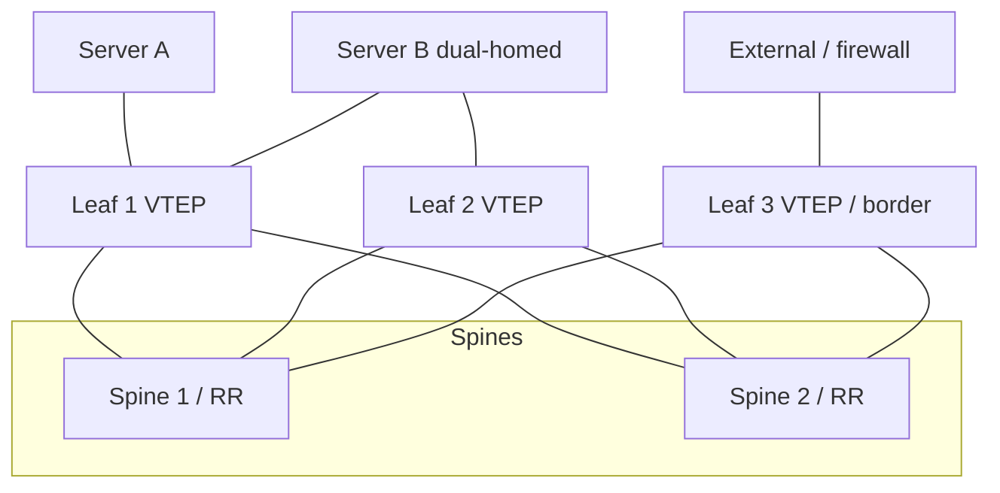

## Why overlays

Data centers need (1) many isolated tenant networks (> 4094 VLANs), (2) VM/container mobility with the same IP/subnet, and (3) an underlay without STP, all links routed with ECMP. An **overlay** builds virtual L2/L3 networks on top of a routed **underlay** by encapsulating tenant frames in IP packets between **tunnel endpoints**. The underlay only needs IP reachability between VTEP loopbacks.

## VXLAN (RFC 7348)

VXLAN wraps an Ethernet frame in UDP:

```text
| Outer Eth | Outer IP | UDP (dst 4789) | VXLAN (8 B) | Inner Eth frame |
```

- **VNI** (VXLAN Network Identifier): 24 bits → **16 million** segments.
- VXLAN header (8 bytes): flags (the **I** bit = `0x08` indicates a valid VNI), reserved, VNI (24), reserved.
- **UDP destination port 4789**; the **source port is a hash of the inner flow** (5-tuple), so the underlay's ECMP spreads tenant flows across all paths: an advantage over GRE.
- **Overhead** ≈ **50 bytes** (14 Eth + 20 IPv4 + 8 UDP + 8 VXLAN; 54 with an outer VLAN tag; 70 for IPv6 underlay). The underlay MTU must be ≥ tenant MTU + 50 (set 9216 jumbo to carry 9000 tenant frames).
- **VTEP** (VXLAN tunnel endpoint): encapsulates/decapsulates; in the leaf switch (hardware VTEP) or in hypervisor vSwitch (software VTEP, e.g. OVS, Linux bridge, Kubernetes CNIs like Flannel/Calico VXLAN mode).
- The 802.1Q VLAN ↔ VNI mapping happens at the leaf; VLANs become locally significant.
- VXLAN does **no** encryption or authentication. Geneve (RFC 8926) is a more extensible alternative (TLV options; used by OVN/NSX).

### Without a control plane: flood-and-learn

Basic VXLAN learns MAC → remote VTEP as a bridge does (from received encapsulated frames). **BUM** (Broadcast, Unknown unicast, Multicast) traffic must reach all VTEPs of a VNI: via **underlay IP multicast** (a group per VNI, requires PIM in the underlay) or **head-end (ingress) replication** (unicast copies). It scales poorly (flooding, ARP storms) and has no ARP suppression or multihoming.

## EVPN: BGP as the control plane

**EVPN** (RFC 7432, adapted to VXLAN by RFC 8365) distributes MAC and IP reachability with **MP-BGP** (AFI 25 L2VPN, SAFI 70), so VTEPs learn endpoints from routes, not from flooding. Typically iBGP with spine route reflectors, or eBGP in the fabric (RFC 7938).

### Route types

| Type | Name | Purpose |
|---|---|---|
| **1** | Ethernet Auto-Discovery (per ES / per EVI) | multihoming: fast convergence on link failure ("mass withdraw"), aliasing for load balancing |
| **2** | **MAC/IP Advertisement** | MAC (and optionally IP) of a host, VNI/label, ESI, next hop = VTEP; carries the MAC mobility sequence number |
| **3** | **Inclusive Multicast Ethernet Tag (IMET)** | VTEP membership of a VNI and BUM replication tunnel (builds the ingress-replication list) |
| **4** | Ethernet Segment | multihoming discovery, **Designated Forwarder** election for BUM |
| **5** | **IP Prefix** (RFC 9136) | external/aggregated IP prefixes for inter-subnet routing in a VRF (e.g. from border leaf, default route) |

Key attributes: **Route Target** (extended communities) for import/export per VNI/VRF; **RD** per EVI per VTEP to keep routes unique; **Router's MAC** extended community (for symmetric IRB), **MAC Mobility** (sequence number: when a VM moves, the new VTEP advertises a higher sequence and all others update), **ESI label**, **Default Gateway**, and **Encapsulation** (VXLAN).

Behaviors:

- **MAC learning is control-plane driven**: a leaf learns local MACs from the data plane (ARP/GARP) and advertises them in type-2 routes; remote MACs are installed from BGP. Unknown unicast flooding largely disappears.
- **ARP/ND suppression**: since the type-2 route includes IP, the leaf answers ARP requests locally from its EVPN table, preventing broadcast flooding across the fabric.
- **MAC mobility** detection also prevents loops and duplicate-MAC flapping (duplicate detection thresholds, e.g. 5 moves in 180 s).

### Multihoming (EVPN-LAG)

A server connects to two leaves with a LAG whose members terminate on different switches, an **Ethernet Segment (ES)** identified by a 10-byte **ESI**. EVPN standardizes what MLAG did proprietarily:

- **All-active** mode: both leaves forward; traffic is load balanced (aliasing via type-1 routes).
- **DF election** (type 4) picks one leaf per VLAN to forward BUM into the ES, preventing duplicates; **split-horizon** filtering prevents looping BUM back to the same ES.
- On link failure, a leaf withdraws its type-1 per-ES route → remote VTEPs immediately remove it from the ECMP set (faster than MAC-by-MAC withdrawals).

### Inter-subnet routing: IRB

Integrated Routing and Bridging puts L3 gateways on the VTEPs. Two models:

| | **Asymmetric IRB** | **Symmetric IRB** (recommended) |
|---|---|---|
| Routing | ingress VTEP routes into the destination VNI, then bridges | route at ingress, **route again at egress**; transport in a dedicated **L3 VNI** per VRF |
| Requirements | every VTEP needs all VNIs/MACs of all VLANs | only locally-attached VNIs plus the L3 VNI |
| Scale | poor | good |
| Forwarding | different VNIs in each direction | same VNI both ways |

Symmetric IRB uses type-2 (MAC+IP) and type-5 routes in a tenant **VRF**; the L3 VNI and the **router MAC** (extended community) of the remote VTEP tell the ingress which inner destination MAC to use inside the VXLAN tunnel.

**Distributed anycast gateway**: every leaf uses the same gateway IP and MAC for the VLAN, so hosts reach their gateway locally, and a VM moving between leaves doesn't need re-ARP or gateway changes; no VRRP/HSRP required.

### Fabric architecture



Underlay: point-to-point routed links, eBGP or IGP, ECMP across spines, BFD, jumbo MTU, loopbacks as VTEP IPs. Overlay: iBGP EVPN or eBGP EVPN sessions between leaves and spines (spines need not be VTEPs).

## Linux example (static VXLAN + bridge; EVPN via FRR)

```bash
# VTEP with local loopback 10.0.0.1; VNI 100 bridged with VLAN-unaware bridge
ip link add vxlan100 type vxlan id 100 local 10.0.0.1 dstport 4789 nolearning
ip link add br100 type bridge
ip link set vxlan100 master br100 ; ip link set eth1 master br100   # eth1 = tenant port
ip link set vxlan100 up ; ip link set br100 up
bridge fdb append 00:00:00:00:00:00 dev vxlan100 dst 10.0.0.2       # head-end replication to VTEP 2
```

```text
# FRR EVPN (leaf)
router bgp 65101
 neighbor 10.0.1.1 remote-as 65000
 address-family l2vpn evpn
  neighbor 10.0.1.1 activate
  advertise-all-vni
 exit-address-family
!
vrf TENANT-A
 vni 5000        ! L3 VNI for symmetric IRB
```

```text
show bgp l2vpn evpn route type macip
show evpn vni ; show evpn mac vni 100 ; show evpn arp-cache vni 100
```

## Operations and pitfalls

- **MTU**: underlay jumbo; verify end-to-end with DF pings of full tenant size + 50.
- **Underlay ECMP and BFD**: VXLAN's UDP source-port entropy requires hardware that hashes on L4; monitor for polarization.
- **Duplicate IP/MAC and mobility storms**: configure duplicate detection and static MAC pinning for known anomalies (clusters with moving virtual IPs).
- **BUM handling**: use ingress replication for small fabrics, multicast underlay for large ones; storm control at the edge.
- **Border and external connectivity**: border leaves do type-5 route exchange with external routers/firewalls; plan route leaking between VRFs deliberately.
- **Security**: no encryption: use MACsec between switches or IPsec for inter-DC; secure BGP sessions; limit who can join a VNI (route-target policy).
- **Troubleshooting order**: underlay reachability (VTEP loopbacks) → BGP EVPN session → type-2/3 routes present and RT imported → VNI/VRF mapping → local learning (MAC on access port) → MTU.

## Key takeaways

- VXLAN encapsulates Ethernet in UDP 4789 with a 24-bit VNI (~50 B overhead); the source port carries flow entropy for ECMP.
- EVPN replaces flood-and-learn with BGP-advertised MAC/IP (type 2), VTEP discovery (type 3), multihoming (types 1, 4) and prefixes (type 5); ARP suppression removes most BUM.
- Symmetric IRB with an L3 VNI per VRF and distributed anycast gateways is the scalable inter-subnet design.
- EVPN multihoming (ESI, DF election) is the standard alternative to vendor MLAG.
- Always plan underlay MTU, ECMP, BFD, and overlay security.
