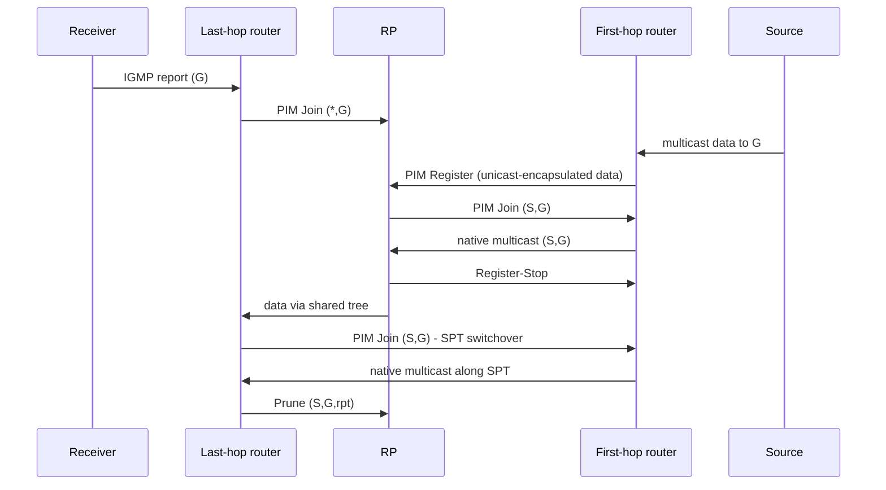

**Protocol Independent Multicast (PIM)** builds multicast distribution trees between routers. "Protocol independent" means it uses the existing **unicast routing table** (any protocol) for RPF decisions instead of its own routing exchange. **PIM Sparse Mode (PIM-SM)** is the dominant mode: receivers must explicitly request traffic, and routers keep state only along paths with receivers.

## Foundations

### RPF check

Multicast forwarding is driven by the **source**, not the destination. A router accepts a multicast packet only if it arrived on the interface it would use to reach the **source** (the RPF interface, from the unicast RIB/MRIB). Otherwise it is dropped. This loop-prevention rule makes multicast sensitive to unicast routing: asymmetric routing, ECMP, or a missing route breaks it.

### Trees and state

| Notation | Meaning |
|---|---|
| **(S, G)** | state for a specific source S and group G: **shortest path tree (SPT)** rooted at the source |
| **(\*, G)** | state for any source of group G: **shared tree (RPT)** rooted at the **Rendezvous Point (RP)** |
| Incoming interface (IIF) | the RPF interface; Outgoing interface list (OIL): downstream interfaces with receivers |

Two trade-offs: the shared tree needs only one state per group but paths may be longer; the SPT gives the best path but state per source.

## PIM-SM operation

1. **Neighbors**: PIM Hellos (protocol **103**, to `224.0.0.13` / `ff02::d`, every **30 s**, holdtime 105 s). On a LAN, a **Designated Router (DR)** is elected (highest priority, then highest IP) to handle joins for local receivers and registers for local sources.
2. **Receiver joins**: a host signals via IGMP/MLD. The **last-hop router (LHR)/DR** creates `(*,G)` state and sends a **PIM Join/Prune** hop-by-hop toward the **RP** (RPF neighbor for the RP address), building the **shared tree**. Join/Prune messages are periodic (60 s refresh, holdtime 210 s) and go to `224.0.0.13`.
3. **Source starts**: the **first-hop router (FHR)/DR** doesn't know where receivers are. It **unicast-encapsulates** the multicast packets in **PIM Register** messages to the RP.
4. **RP**: decapsulates and forwards Registers down the shared tree; then sends an `(S,G)` Join toward the source to pull native traffic, which creates the SPT between source and RP. Once native packets arrive, the RP sends **Register-Stop** so the FHR stops encapsulating.
5. **SPT switchover**: when the LHR receives packets via the shared tree it normally switches to the shortest path by sending an `(S,G)` Join toward the source and, once data arrives on the SPT, an `(S,G,rpt)` **Prune** up the shared tree to stop duplicates. (Cisco default threshold: switch at the first packet; can be set to "never".)



### Asserts and LAN behavior

If two routers on a LAN both forward the same (S,G) onto it, they detect duplicates and run an **Assert**: the one with the better route (lower AD, then metric, then higher IP) wins and the other stops forwarding. Joins on a LAN are overheard: **join suppression** and **prune override** (a router that still needs the traffic sends a Join within the override interval, about 3 s, to cancel a Prune from another downstream router).

## RP discovery

Every router must agree on the group → RP mapping:

| Method | Description |
|---|---|
| **Static RP** | configured on all routers; simple, no extra protocol; no failover unless Anycast-RP |
| **BSR** (RFC 5059) | standard dynamic: candidate RPs advertise to a bootstrap router that floods the RP-set |
| **Auto-RP** | Cisco: RP announcements/discoveries via dense-mode groups 224.0.1.39/40 (needs sparse-dense or listener tricks) |
| **Embedded RP** (IPv6, RFC 3956) | the RP address is encoded in the group address |
| **Anycast RP** | several RPs share the same address; senders use the nearest; RPs sync source info via **MSDP** (RFC 3446) or PIM (RFC 4610) for redundancy and load sharing |

Design: put RPs on loopbacks of stable core routers, use Anycast-RP for redundancy, and keep a different RP set for admin-scoped ranges.

## Other modes

- **SSM** (Source-Specific Multicast, RFC 4607, `232.0.0.0/8` / `ff3x::/32`): the receiver names the source `(S,G)` via IGMPv3/MLDv2. The LHR sends `(S,G)` Joins straight to the source: **no RP, no registers, no shared tree**, and no need for source discovery protocols. Simplest and most scalable for known-source applications (IPTV, market data); needs v3 on hosts.
- **Bidirectional PIM** (RFC 5015): shared trees only, no register; traffic flows up and down the same tree through the RP; used for many-to-many (low state), some trading/telecom use.
- **PIM-DM** (dense mode, RFC 3973): flood and prune; obsolete outside small labs.

## Multicast routing table

`show ip mroute` (Cisco), `show ip mroute` (FRR), or `ip mroute show` (Linux kernel MRIB) show state entries.

```text
(*, 239.1.1.1), 00:05:12/stopped, RP 10.255.0.1, flags: SJC
  Incoming interface: Ethernet1, RPF nbr 10.0.0.1
  Outgoing interface list:
    Ethernet2, Forward/Sparse, 00:05:12/00:02:37
(10.9.9.9, 239.1.1.1), 00:01:03/00:02:01, flags: JT
  Incoming interface: Ethernet3, RPF nbr 10.0.1.1
  Outgoing interface list:
    Ethernet2, Forward/Sparse, 00:01:03/00:02:37
```

Flags: **S** sparse, **C** connected receiver, **J** joined SPT, **T** SPT-bit set (native SPT flow), **F** register flag on the FHR, **P** pruned. The `(*,G)` entry points to the RP; `(S,G)` to the source.

## Configuration (FRR pimd)

```text
interface eth0
 ip pim                      ! enable PIM-SM on the interface
 ip igmp                     ! host-facing: enable IGMP
 ip igmp version 3
!
ip pim rp 10.255.0.1 239.0.0.0/8
ip pim ssm prefix-list SSM-RANGE      ! 232.0.0.0/8
ip pim keep-alive-timer 210
```

```text
show ip pim neighbor ; show ip pim rp-info ; show ip pim join ; show ip mroute ; show ip rpf 10.9.9.9
```

## Troubleshooting

Walk the path in order:

1. **Sender**: is it sending (check TTL > 1, correct interface, `tcpdump`)? FHR has `(S,G)` with flag F?
2. **RP reachability**: all routers agree on the RP (`show ip pim rp-info`); FHR can register (unicast path FHR↔RP, no ACL on protocol 103/registers).
3. **Receiver side**: IGMP membership present on the LHR (`show ip igmp groups`) and querier election, IGMP snooping in between.
4. **RPF**: `show ip rpf <source>` or `<RP>` must resolve out the interface where the PIM neighbor is; RPF failures show as "RPF fail" drops. Common fixes: static mroutes, correct unicast routes, ECMP RPF selection (hash), `ip multicast multipath`.
5. **Tree state**: `(*,G)` exists on all routers toward the RP; `(S,G)` with OIL not null.
6. **Data plane**: TTL thresholds; hardware limitations (mroute table capacity), unicast encapsulation MTU on register path.
7. **Security/policy**: PIM neighbor filters, RP/ group-range ACLs, `ip multicast boundary` for scoping.

## Multicast in other contexts

- **Data center**: underlay multicast for VXLAN BUM (PIM bidir, a group per VNI), or ingress replication to avoid it.
- **MVPN** (RFC 6513/6514): multicast in L3VPNs over MPLS; **mLDP/ P2MP RSVP-TE** trees; **EVPN** IGMP proxy/ OISM for tenant multicast in fabrics.
- **Security**: restrict sources (SSM, ACLs), rate-limit joins and register, protect RPs from register floods (register policing), and monitor mroute counts.

## Key takeaways

- Multicast forwarding uses RPF against the source; a missing/asymmetric unicast route breaks it.
- PIM-SM: receivers join `(*,G)` toward the RP; sources register; routers switch to `(S,G)` SPT for efficiency.
- RP discovery: static, BSR, Auto-RP, embedded RP; use Anycast-RP for redundancy.
- SSM removes the RP: use IGMPv3/MLDv2 and `232/8` whenever sources are known.
- Debug in order: sender TTL → RP/register → IGMP at LHR → RPF → mroute state → hardware/policy.
