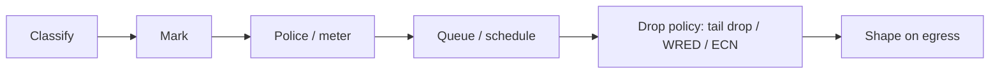

IP networks are best-effort: every packet competes for the same queues. **Quality of Service** manages that competition for latency-sensitive (voice, interactive, control) and bandwidth-hungry (bulk, backup) traffic. QoS only matters where there is **congestion** (a queue builds): on an uncongested link every class gets what it needs, which is also why *adding capacity* is often the better first fix.

## The QoS toolchain



1. **Classification**: identify the traffic by ACL (5-tuple), DSCP/PCP, application (NBAR/DPI), interface or VLAN.
2. **Marking**: set DSCP (L3), PCP (802.1p, L2), or MPLS TC, at the **trust boundary**.
3. **Metering and policing**: enforce rates.
4. **Queuing and scheduling**: decide which packet goes next.
5. **Congestion avoidance**: early drop/mark to signal senders.
6. **Shaping**: smooth bursts to a contract rate.

## Markings

### DSCP (L3) and PHBs

The 6-bit **DSCP** (high bits of the old ToS byte, RFC 2474) selects a **Per-Hop Behavior** (PHB): a locally-defined treatment, not an end-to-end guarantee. The 2 low bits are **ECN**.

| PHB | DSCP (decimal / binary) | Intent |
|---|---|---|
| **DF / CS0** (default) | 0 / `000000` | best effort |
| **CS1** | 8 | low-priority / scavenger |
| **AF11 / AF12 / AF13** | 10 / 12 / 14 | assured forwarding class 1, drop precedence low/med/high |
| **AF21–23** | 18 / 20 / 22 | class 2 |
| **AF31–33** | 26 / 28 / 30 | class 3 |
| **AF41–43** | 34 / 36 / 38 | class 4 |
| **CS2…CS7** | 16, 24, 32, 40, 48, 56 | class selector (compatible with legacy IP precedence) |
| **EF** | **46** / `101110` | expedited forwarding: low loss, low delay, low jitter (voice) |
| VOICE-ADMIT | 44 | admission-controlled voice |

**AFxy**: class *x* (1–4) gets a bandwidth share; *y* (1–3) is the drop precedence within the class (higher = dropped first under congestion). DSCP = 8x + 2y. EF is typically given a strict priority queue with a **policer** to prevent starving others (RFC 3246).

### L2 and other

- **802.1p PCP**: 3 bits in the VLAN tag (0–7): 7 network control, 6 voice, 5 video, 4 controlled load, 3 excellent effort, 0 best effort, 2 spare, 1 background (lowest; 802.1Q reordered 0 and 1). Needs a VLAN tag (or priority-tagged frames, VID 0).
- **MPLS TC** (3 bits) carries class across the MPLS core (RFC 3270 models: uniform, pipe, short-pipe).
- **Mapping**: DSCP ↔ PCP/TC must be configured at each boundary (typically EF→PCP 5 or 6, CS3→3).
- The Internet generally does **not honor** DSCP between providers (often bleached to 0); QoS is realized within a managed domain (enterprise WAN, MPLS VPN, ISP access).

### Trust boundary

Mark (or re-mark) as close to the source as possible and **don't trust** DSCP from untrusted endpoints, otherwise any user can claim EF. Trust phones (via LLDP-MED/CDP) and servers; re-mark everything else at the access switch.

## RFC 4594 service classes (reference model)

| Class | DSCP | Treatment |
|---|---|---|
| Network control (routing) | CS6 | guaranteed minimum, small queue |
| Telephony | EF | strict priority + policer |
| Signaling | CS5 | guaranteed bandwidth |
| Real-time interactive | CS4 | priority/CBWFQ |
| Multimedia conferencing | AF41 | WFQ + DSCP-based WRED |
| Broadcast video | CS3 | high-priority, low loss |
| Multimedia streaming | AF31 | WFQ |
| Low-latency data (transactional) | AF21 | WFQ |
| OAM | CS2 | |
| High-throughput data | AF11 | WFQ |
| Low-priority (scavenger) | CS1 | gets leftovers |
| Standard | DF | default |

In practice 4–8 classes are used; more classes = more complexity with diminishing returns. Typical requirements often cited for voice: one-way delay ≤ 150 ms (ITU-T G.114), jitter ≲ 30 ms and loss ≲ 1 %.

## Metering: policing vs. shaping

Both rely on a **token bucket**: tokens accumulate at the committed rate (**CIR**, bits/s) up to a burst size (**Bc/CBS**, bytes). A packet of size *n* conforms if ≥ *n* tokens are available (tokens are consumed); otherwise it exceeds.

| | **Policing** | **Shaping** |
|---|---|---|
| Action on non-conforming | **drop** or re-mark (e.g. to higher drop precedence) | **buffer** (delay) until tokens exist |
| Effect | clips bursts; TCP sees loss | smooths traffic, adds latency/jitter |
| Direction | ingress or egress | **egress** only |
| Memory | none | queue memory |
| Use | enforce a customer SLA, protect priority queues, rate-limit abuse | match the CIR of a service you're sending into (e.g. 100 Mb/s on a 1 Gb/s handoff), avoid the provider's policer dropping you |

Shaper time interval `Tc = Bc / CIR`: the shaper releases up to Bc bits per Tc.

**Color markers**: *single-rate three-color* (srTCM, RFC 2697: CIR, CBS, EBS) and *two-rate* (trTCM, RFC 2698: CIR/CBS plus PIR/PBS) mark packets **green** (conforming), **yellow** (exceeding, e.g. remark to AFx2/AFx3) or **red** (violating, drop).

Shaping *toward* a policer is the standard practice: a customer sending 1 Gb/s bursts into a 100 Mb/s policed service loses packets; shaping to 98 Mb/s avoids the loss and lets TCP stabilize.

## Queuing and scheduling

| Scheduler | Behavior |
|---|---|
| **FIFO / tail drop** | one queue; the default; unfair, causes latency under load |
| **Strict priority (PQ)** | higher queue always served first; starvation risk → police the priority class |
| **Weighted Round Robin / DWRR** | classes served in proportion to weights/quanta, bandwidth guarantees |
| **WFQ / CBWFQ** | per-flow or per-class weighted fairness; **LLQ** = CBWFQ + a strict-priority queue for voice |
| **HTB / HFSC** (Linux) | hierarchical rate guarantees with borrowing |
| **FQ-CoDel, CAKE** (Linux) | per-flow fair queuing + AQM, near-zero config |

Hardware switches typically offer 8 queues per port with strict priority + DWRR and per-queue buffer thresholds. Remember the lookup order: classification → queue selection → WRED/drop thresholds → scheduler → shaper → wire.

## Congestion avoidance: AQM, ECN, bufferbloat

**Tail drop** fills the queue to the limit, which causes **global synchronization** (many TCP flows back off together) and **bufferbloat**: large buffers cause hundreds of ms of queueing delay on slow links.

- **RED/WRED**: randomly drop with increasing probability between min and max thresholds (WRED per DSCP/precedence), signalling TCP early. Tuning is delicate.
- **CoDel / FQ-CoDel / CAKE (RFC 8289/8290)**: control the *queueing delay* (target ~5 ms, interval ~100 ms) rather than queue length; auto-tuning and fair per-flow queues; the default `fq_codel` on modern Linux (`net.core.default_qdisc`) fixes bufferbloat on home and edge links.
- **ECN (RFC 3168)**: instead of dropping, the router marks **CE** (codepoint `11` in the IP ECN field) when ECN-capable traffic (ECT(0)=`10`, ECT(1)=`01`) congests; the receiver echoes it via TCP ECE/CWR flags and the sender reduces its window. Needs ECN support at both ends (`net.ipv4.tcp_ecn=1`); standard in data centers (**DCTCP**).
- **L4S** (RFC 9330–9332): scalable, low-latency congestion control using ECT(1) and a dual-queue coupled AQM for sub-millisecond queues.
- In lossless RDMA networks, **PFC + ECN (DCQCN)** (see the Ethernet PHY note).

## Where QoS applies in practice

| Place | Typical policy |
|---|---|
| Access switch | trust boundary, mark, police rogue marking, 802.1p |
| WAN edge | classify, **shape** to the circuit rate, LLQ for voice, CBWFQ for data, WRED |
| Provider | policing per class at the ingress, per-class queues in the core |
| Data center | ECN/DCTCP, PFC for storage/RDMA classes, ETS bandwidth shares |
| Wi-Fi | WMM access categories (voice/video/best effort/background) map from DSCP |

## Linux tc examples

```bash
# 1. Shape egress to 100 Mbit with a priority class for EF, fair-queued
tc qdisc add dev eth0 root handle 1: htb default 30
tc class add dev eth0 parent 1:  classid 1:1  htb rate 100mbit ceil 100mbit
tc class add dev eth0 parent 1:1 classid 1:10 htb rate 20mbit  ceil 100mbit prio 0   # voice
tc class add dev eth0 parent 1:1 classid 1:30 htb rate 50mbit  ceil 100mbit prio 2   # default
tc qdisc add dev eth0 parent 1:10 handle 10: fq_codel
tc qdisc add dev eth0 parent 1:30 handle 30: fq_codel
tc filter add dev eth0 parent 1: protocol ip prio 1 u32 match ip dsfield 0xb8 0xfc flowid 1:10   # DSCP EF (46<<2 = 0xb8)

# 2. One-liner for a home/edge link: CAKE with 4 DSCP tiers
tc qdisc replace dev eth0 root cake bandwidth 95mbit diffserv4 nat wash

# 3. Ingress policing (drop above 1 Mbit)
tc qdisc add dev eth0 handle ffff: ingress
tc filter add dev eth0 parent ffff: protocol ip prio 1 u32 match ip src 0.0.0.0/0 police rate 1mbit burst 100k drop

# 4. Emulate a WAN for testing (delay 50 ms ±10, 1 % loss)
tc qdisc replace dev eth0 root netem delay 50ms 10ms loss 1%

tc -s qdisc show dev eth0 ; tc -s class show dev eth0   # counters: drops, overlimits, backlog
```

DSCP marking with nftables: `nft add rule ip mangle forward tcp dport 5060 ip dscp set cs5`. To observe marks: `tcpdump -vv -ni eth0` (shows `tos 0xb8`).

## Common problems

| Symptom | Cause |
|---|---|
| Voice still choppy despite "QoS" | congestion elsewhere (policy only on one hop), DSCP bleached/re-marked, priority queue too small or bursts hitting the policer |
| Bulk transfer starves others | no per-flow fairness, no shaping to the bottleneck rate (queue forms in the unmanaged device) |
| QoS has no effect | link not congested; policy applied in the wrong direction/interface; software forwarding path bypasses hardware QoS |
| Latency spikes under load | bufferbloat: enable fq_codel/CAKE or shape slightly below the real line rate |
| Shaper hurts throughput | Bc too small for the RTT/line rate; counted L2 overhead (use `overhead` options in CAKE/HTB) |

## Key takeaways

- QoS matters only under congestion; classify and mark at the trust boundary, then apply consistent per-hop behavior.
- DSCP selects a PHB (EF=46 for voice, AFxy for assured classes); map to PCP/TC at L2/MPLS boundaries.
- Policing drops/remarks; shaping buffers. Shape *toward* any policed service.
- Use an LLQ/strict-priority class (policed) for voice, weighted queues for the rest, and AQM (fq_codel/CAKE/WRED+ECN) to avoid bufferbloat.
