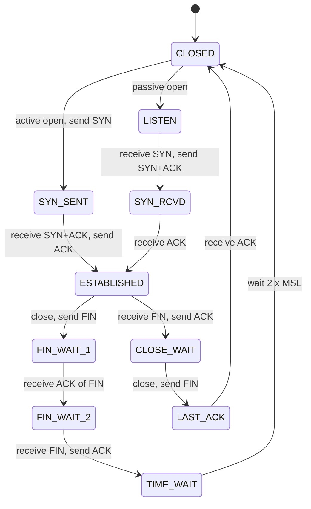

IP delivers packets from one host to another and promises nothing else: packets can be lost, duplicated, reordered or delayed. Most programs want more: to talk to a particular *program* on the other host, and often to have bytes arrive intact and in order. The **transport layer** adds exactly that on top of IP. Two protocols do almost all of it: **UDP** (a thin layer, no guarantees) and **TCP** (a reliable ordered byte stream, with flow control and congestion control).

## Ports and sockets

An IP address names a host; a **port** (16 bits, 0 to 65,535) names a program on it. A transport connection is identified by the **5-tuple**: protocol, source address, source port, destination address, destination port. A web server listens on `*:443`; a thousand clients connect to it and each connection is a different 5-tuple, so the server can tell them apart. Ports 0 to 1023 are "well-known" (80 HTTP, 443 HTTPS, 22 SSH, 53 DNS), 1024 to 49151 are registered, and clients usually get a random **ephemeral** port (Linux: 32768 to 60999) for each outgoing connection. A **socket** is the operating-system object a program uses to send and receive through a port (see *Sockets Programming in C* and *Sockets, TCP Behavior and Linux Network Tuning*).

## UDP: datagrams with a port

UDP (RFC 768) adds only ports, a length and a checksum to IP: an 8-byte header.

| Field | Size | Meaning |
|---|---|---|
| Source port | 16 bits | sender's port (may be 0 if no reply is wanted) |
| Destination port | 16 bits | receiver's port |
| Length | 16 bits | header plus data |
| Checksum | 16 bits | covers header, data and an IP pseudo-header (mandatory in IPv6) |

Each `sendto` is one **datagram**; message boundaries are preserved; nothing is retransmitted, ordered, or paced. That is what you want for DNS queries (one request, one reply, retry in the application), voice and video (a late packet is worthless), games, DHCP, SNMP, syslog, tunnels (VXLAN, WireGuard) and QUIC, which re-implements reliability and congestion control in user space on top of UDP. A UDP sender that ignores the network can flood it: well-behaved UDP applications implement their own rate control.

## TCP: a reliable byte stream

TCP (RFC 9293) turns IP's unreliable packets into a **bidirectional, ordered, reliable stream of bytes**. There are no message boundaries: a `send` of 100 bytes and another of 100 bytes can arrive as one read of 200 bytes. Applications must frame their own messages (a length prefix, a delimiter, or a protocol such as HTTP). To do this TCP keeps state at both ends and numbers every byte.

### The header

| Field | Bits | Purpose |
|---|---|---|
| Source / destination port | 16 + 16 | identify the connection ends |
| Sequence number | 32 | number of the first data byte in this segment (every byte has a number) |
| Acknowledgment number | 32 | the next byte the sender of this segment *expects* to receive (cumulative: everything before it arrived) |
| Data offset | 4 | header length in 32-bit words (5 to 15), so up to 40 bytes of options |
| Flags | 8 | `SYN` (open), `ACK` (ack field valid), `FIN` (no more data from me), `RST` (abort), `PSH` (deliver now), `URG`, `ECE`/`CWR` (ECN, see below) |
| Window | 16 | how many more bytes the sender of this segment is willing to receive (flow control) |
| Checksum | 16 | over header, data and pseudo-header |
| Urgent pointer | 16 | rarely used |
| Options | 0 to 320 | negotiated extensions (below) |

The important **options**, all negotiated on the SYN: **MSS** (maximum segment size: the biggest payload the receiver accepts, normally the MTU minus 40 bytes of IP and TCP headers, so 1460 on Ethernet), **window scale** (RFC 7323: multiplies the 16-bit window by a power of two so windows can exceed 64 KB, essential on fast long paths), **SACK permitted** (selective acknowledgments, RFC 2018) and **timestamps** (round-trip measurement and protection against old duplicate segments).

## The handshake, captured

A connection opens with a **three-way handshake**: the client sends `SYN` with its **initial sequence number** (ISN, chosen unpredictably so that blind attackers cannot guess it); the server replies `SYN+ACK` with its own ISN and acknowledging the client's; the client sends `ACK`. After that both sides know the other's ISN, and the options in the SYN packets are agreed.

The script below builds a client and a server as network namespaces joined by a virtual cable (as in *What Is a Network?*), adds 10 ms of delay in the server-to-client direction with `tc netem`, and captures one complete connection with a small packet printer written in Python on a raw socket. It shows what `tcpdump`/Wireshark would, with sequence numbers made relative to each side's ISN.

```bash
#!/bin/sh
# Two hosts joined by a veth pair. Capture a complete TCP connection: handshake, a request/response, and teardown.
mount -t tmpfs tmpfs /run; mkdir -p /run/netns
ip netns add client; ip netns add server; ip link add vc type veth peer name vs; ip link set vc netns client; ip link set vs netns server
ip -n client addr add 10.0.0.1/24 dev vc; ip -n server addr add 10.0.0.2/24 dev vs
for x in "client vc" "server vs"; do set -- $x; ip -n $1 link set $2 up; ip -n $1 link set lo up; done
ip netns exec server tc qdisc add dev vs root netem delay 10ms             # 10 ms on the server -> client direction, so the round-trip time is about 10 ms
ip netns exec server python3 -c '
import socket
l = socket.socket(); l.setsockopt(socket.SOL_SOCKET, socket.SO_REUSEADDR, 1); l.bind(("10.0.0.2", 5000)); l.listen(5)
c, _ = l.accept(); req = c.recv(100); c.sendall(b"HTTP/1.0 200 OK\r\n\r\nhello"); c.close()' &
sleep 0.5
ip netns exec client python3 sniff.py vc 5000 12 &
sleep 0.5
ip netns exec client python3 -c '
import socket
s = socket.create_connection(("10.0.0.2", 5000)); s.sendall(b"GET / HTTP/1.0\r\n\r\n"); print("client got:", s.recv(100)[-5:]); s.close()'
wait
```

```text
$ unshare -Urnm sh handshake.sh 2>&1
     0.0 ms  10.0.0.1:44816 > 10.0.0.2:5000  [S  ] seq=0      ack=-      len=0     win=64240  mss=1460,sackOK,ts,wscale=7
    10.0 ms  10.0.0.2:5000  > 10.0.0.1:44816 [SA ] seq=0      ack=1      len=0     win=65160  mss=1460,sackOK,ts,wscale=7
    10.1 ms  10.0.0.1:44816 > 10.0.0.2:5000  [A  ] seq=1      ack=1      len=0     win=502    ts
    10.1 ms  10.0.0.1:44816 > 10.0.0.2:5000  [PA ] seq=1      ack=1      len=18    win=502    ts
    20.2 ms  10.0.0.2:5000  > 10.0.0.1:44816 [A  ] seq=1      ack=19     len=0     win=509    ts
    20.2 ms  10.0.0.2:5000  > 10.0.0.1:44816 [PA ] seq=1      ack=19     len=24    win=509    ts
    20.3 ms  10.0.0.1:44816 > 10.0.0.2:5000  [A  ] seq=19     ack=25     len=0     win=502    ts
    20.3 ms  10.0.0.2:5000  > 10.0.0.1:44816 [FA ] seq=25     ack=19     len=0     win=509    ts
client got: b'hello'
    20.4 ms  10.0.0.1:44816 > 10.0.0.2:5000  [FA ] seq=19     ack=26     len=0     win=502    ts
    30.4 ms  10.0.0.2:5000  > 10.0.0.1:44816 [A  ] seq=26     ack=20     len=0     win=509    ts
```

Reading the capture (times are as seen at the client's interface; the interleaving of the last few lines can differ slightly from run to run):

1. **`[S]` at 0 ms**: the client's `SYN`. It advertises `mss=1460`, `sackOK` (selective acknowledgments), `ts` (timestamps) and `wscale=7` (multiply the window field by 2⁷), with window 64,240.
2. **`[SA]` at 10 ms**: the server's `SYN+ACK`, `ack=1` (the SYN consumed one sequence number). The gap from the SYN is the **round-trip time**: the first moment the client can measure it. Both sides offered the same options, so they are all in use.
3. **`[A]`**: the client completes the handshake. Because the handshake costs one RTT before any data can flow, opening connections is expensive on long links, which is why browsers reuse connections and why TLS 1.3 and QUIC work to save round trips.
4. **`[PA]` len=18**: the client sends 18 bytes of request (`PSH` asks the receiver to deliver it immediately). The next segment from the server, `[A] ack=19`, acknowledges everything up to byte 18 (the *next expected* byte is 19).
5. **`[PA]` len=24**: the server's response; the client acknowledges with `ack=25`.
6. **`[FA]`** from each side: each direction is closed separately with `FIN`. Here the server closed first, then the client; the last `ACK` acknowledges the client's FIN. A `FIN` also consumes one sequence number.

Notice that the window values in later segments (502, 509) look tiny: they must be multiplied by 2⁷ = 128, giving about 64 KB. Packet printers show the *raw* field unless they know the scale from the SYN.

## States and teardown

TCP is a **state machine**: each end tracks where it is in the connection life cycle. `ss -tan` shows these states.



The states you will meet in practice:

- **LISTEN**: a server waiting for connections.
- **ESTABLISHED**: normal operation.
- **CLOSE_WAIT**: the *peer* closed, but **your application has not closed its side yet**. A pile of CLOSE_WAIT sockets is almost always an application bug (forgot to `close`).
- **TIME_WAIT**: the side that closes first lingers (Linux: 60 seconds, twice the maximum segment lifetime) so that a late duplicate segment cannot be mistaken for part of a new connection with the same 5-tuple and so a lost final ACK can be re-sent. Thousands of TIME_WAIT entries on a busy client or proxy are normal; running out of ephemeral ports because of them is a real failure mode (see pitfalls).
- **SYN_RECV**: server received a SYN. A flood of these is a **SYN flood**; the defence is **SYN cookies** (RFC 4987), which encode the state in the ISN so the server keeps no memory per half-open connection.
- **RST**: an abort (`RST` flag): the connection does not exist or the application refused it (closed port), or the peer crashed. The sender of an RST gets no acknowledgment.

## Reliability: sequence numbers, ACKs and retransmission

Every byte has a sequence number, and an ACK means "I have received every byte before this number". If the sender does not see an ACK, it **retransmits**. Two mechanisms detect loss:

- **Timeout (RTO)**: the sender measures the round-trip time (RTT) of every acknowledged segment, keeps a smoothed average and a variance (Jacobson/Karels, RFC 6298: `RTO = SRTT + 4 × RTTVAR`, at least 200 ms on Linux), and if no ACK arrives within the RTO it retransmits and **doubles** the RTO (exponential backoff). Timeouts are expensive: the connection stalls and then restarts from a tiny congestion window.
- **Fast retransmit**: if the receiver gets segments out of order it immediately sends **duplicate ACKs** for the last in-order byte. Three duplicate ACKs tell the sender a segment was lost while later ones arrived, so it retransmits at once without waiting for the timer.

**SACK** (RFC 2018) improves this: the receiver tells the sender exactly which ranges it holds beyond the cumulative ACK, so only the missing segments are resent. Without SACK, recovering from several losses in one window can take many round trips. **Delayed ACKs** (RFC 9293: at most every second segment and within 500 ms; Linux uses about 40 ms) reduce overhead, and interact badly with **Nagle's algorithm** (hold back small segments until outstanding data is acknowledged): a request/response program that writes a small message in two `send` calls can stall about 40 ms on every exchange. The fix is to write the message in one call or set `TCP_NODELAY`.

## Flow control: the receiver's window

The **receive window** is how much unacknowledged data the receiver is willing to hold (limited by its buffer). The sender may have at most one window of bytes in flight, so the throughput of a single connection is bounded by

> **throughput ≤ window / RTT**

On a 40 ms path, a 64 KB window allows only 64 KB / 0.040 s ≈ 13 Mbit/s however fast the link is: this is why **window scaling** exists and why the **bandwidth-delay product** (BDP = bandwidth × RTT, the amount of data needed in flight to fill the pipe) matters. For a 100 Mbit/s link with 40 ms RTT, BDP = 12.5 MB/s × 0.04 s = 500,000 bytes.

The next experiment sets a fixed receive buffer on the client and measures the transfer rate, then shows the sender's own view with `ss -ti` while a default connection runs.

```python
#!/usr/bin/env python3
"""server: send for DURATION seconds using a chosen congestion control algorithm; client: count what arrives."""
import socket, sys, time

def retrans():
    with open("/proc/net/snmp") as f:
        lines = [l.split() for l in f if l.startswith("Tcp:")]
    return int(dict(zip(lines[0], lines[1]))["RetransSegs"])

role = sys.argv[1]
if role == "server":
    cc, duration = sys.argv[2], float(sys.argv[3])
    l = socket.socket(); l.setsockopt(socket.SOL_SOCKET, socket.SO_REUSEADDR, 1); l.bind(("10.0.0.2", 5001)); l.listen(1)
    c, _ = l.accept(); c.setsockopt(socket.IPPROTO_TCP, socket.TCP_CONGESTION, cc.encode())
    r0 = retrans(); chunk = b"x" * 65536; end = time.time() + duration
    while time.time() < end: c.sendall(chunk)
    c.shutdown(socket.SHUT_WR); c.recv(1); print(retrans() - r0)           # prints retransmitted segments
else:
    s = socket.socket()
    if len(sys.argv) > 2: s.setsockopt(socket.SOL_SOCKET, socket.SO_RCVBUF, int(sys.argv[2]))      # optional: fixed receive buffer in bytes
    s.connect(("10.0.0.2", 5001)); t0 = time.time(); got = 0
    while True:
        d = s.recv(1 << 20)
        if not d: break
        got += len(d)
    dt = time.time() - t0; print(f"{got * 8 / dt / 1e6:.1f}")                 # Mbit/s
```

```bash
#!/bin/sh
# The receive window limits throughput to  window / RTT.  100 Mbit/s path, 40 ms round-trip time, 6 s flows, no loss.
mount -t tmpfs tmpfs /run; mkdir -p /run/netns
ip netns add client; ip netns add server; ip link add vc type veth peer name vs; ip link set vc netns client; ip link set vs netns server
ip -n client addr add 10.0.0.1/24 dev vc; ip -n server addr add 10.0.0.2/24 dev vs
for x in "client vc" "server vs"; do set -- $x; ip -n $1 link set $2 up; ip -n $1 link set lo up; done
for ns_if in "client vc" "server vs"; do set -- $ns_if; ip netns exec $1 tc qdisc replace dev $2 root netem delay 20ms rate 100mbit limit 1000; done
echo "bandwidth-delay product = 100 Mbit/s x 0.040 s = 500000 bytes"
printf "%-26s %10s %22s\n" "client receive buffer" "Mbit/s" "window/RTT prediction"
for buf in 32768 131072 524288 ""; do
  ip netns exec server python3 transfer.py server cubic 6 > /dev/null &
  sleep 0.3
  rate=$(ip netns exec client python3 transfer.py client $buf); wait
  if [ -n "$buf" ]; then pred=$(python3 -c "print(f'{$buf*8/0.04/1e6:.0f}')"); lbl="$buf bytes (requested)"; else pred="(auto-tuned)"; lbl="default (auto-tuning)"; fi
  printf "%-26s %10s %22s\n" "$lbl" "$rate" "$pred"
done
echo; echo "ss -ti on the sender while a default flow runs (cwnd, rtt, mss, bytes in flight):"
ip netns exec server python3 transfer.py server cubic 4 > /dev/null &
sleep 0.3; ip netns exec client python3 transfer.py client > /dev/null &
sleep 2
ip netns exec server ss -ti dst 10.0.0.1 | python3 -c "
import sys
t = sys.stdin.read().split()
want = ('cubic', 'rto:', 'rtt:', 'mss:', 'cwnd:', 'ssthresh:', 'bytes_retrans:', 'retrans:')
print('  ' + ' '.join(x for x in t if x.startswith(want)))
print('  delivery_rate', t[t.index('delivery_rate') + 1], '  (the base round-trip time is 40 ms; the larger rtt is queueing in the 1000-packet buffer)')"
wait
```

```text
$ unshare -Urnm sh window.sh 2>&1
bandwidth-delay product = 100 Mbit/s x 0.040 s = 500000 bytes
client receive buffer          Mbit/s  window/RTT prediction
32768 bytes (requested)           9.1                      7
131072 bytes (requested)         36.8                     26
524288 bytes (requested)         49.5                    105
default (auto-tuning)            92.5           (auto-tuned)

ss -ti on the sender while a default flow runs (cwnd, rtt, mss, bytes in flight):
  cubic rto:336 rtt:134.606/0.329 mss:1448 cwnd:1172 ssthresh:486
  delivery_rate 95.7Mbps   (the base round-trip time is 40 ms; the larger rtt is queueing in the 1000-packet buffer)
```

- **A small buffer limits the rate**: 32 KB gives about 9 Mbit/s and 128 KB about 37 Mbit/s on a path that could carry 100. (The kernel doubles the requested buffer size for its own bookkeeping, and only about half of a buffer is advertised as window, so the "window/RTT" prediction column is approximate.)
- **Larger requested values are capped by `net.core.rmem_max`**: asking for 512 KB did not give 105 Mbit/s but about 49, because the request was clamped to `rmem_max` (212,992 bytes by default, see the settings below).
- **The default (auto-tuning) fills the path**: Linux grows the receive buffer automatically up to `tcp_rmem[2]` (6 MB here), which is why you should normally **not** set `SO_RCVBUF` yourself: it turns auto-tuning off.
- **The `ss -ti` snapshot shows bufferbloat.** The path's real RTT is 40 ms, but the sender reports `rtt` around 135 ms: the extra 95 ms is time packets spend waiting in the 1000-packet queue in front of the 100 Mbit/s bottleneck. The connection is achieving full throughput (`delivery_rate` about 95 Mbit/s) but at the price of latency for everyone sharing that queue. Loss-based congestion control keeps filling any buffer it is given.

## Congestion control: not overrunning the network

Flow control protects the *receiver*; **congestion control** protects the *network*. Without it, every sender transmitting as fast as the receiver allowed would overflow router queues and collapse throughput (it happened in 1986). Each sender keeps a **congestion window (`cwnd`)** limiting data in flight to `min(cwnd, receive window)`, and adjusts it from feedback:

1. **Slow start**: `cwnd` starts small (Linux and the RFC 6928 default: 10 segments) and **doubles every RTT** (it increases by one segment per ACK). It is "slow" only compared with sending a full window at once; it is exponential.
2. **Congestion avoidance**: when `cwnd` reaches the slow-start threshold `ssthresh`, or at the first loss, growth becomes **linear**: about one segment per RTT.
3. **On loss**: halve (`ssthresh = cwnd / 2`, then continue linearly). This **additive increase, multiplicative decrease (AIMD)** rule makes competing flows converge to a fair share.
4. **On timeout**: restart from the initial window.

**Reno** is the classic implementation (RFC 5681). **CUBIC** (RFC 9438; the Linux default since 2006) grows `cwnd` along a cubic function of the time since the last loss, probing quickly toward the old maximum and then slowly beyond it, which uses long fat links better than Reno. **BBR** (Google) takes a different approach: it estimates the bottleneck bandwidth and minimum RTT and paces to that, rather than reacting to loss, aiming for full throughput with short queues (it is a kernel module where available; this machine's kernel offers only `reno` and `cubic`). **ECN** (RFC 3168) lets routers mark packets instead of dropping them, so senders slow down without loss.

**Throughput versus loss.** A classic result (Mathis et al., 1997) says a loss-based sender's steady throughput is about

> **rate ≈ 1.22 × MSS / (RTT × √p)**

for loss probability `p`: halving the loss does *not* double the speed, but cutting loss by 100× makes TCP 10× faster, and a path with 1 % loss and 20 ms RTT cannot exceed about 8 Mbit/s however large the pipe. The experiment checks this: a 100 Mbit/s, 20 ms RTT path, each flow running 8 seconds, with random loss added by netem, for both algorithms, each setting run twice.

```bash
#!/bin/sh
# Throughput of one TCP flow vs random packet loss, for two congestion control algorithms.
# Path: 100 Mbit/s, 20 ms round-trip time (10 ms each way); each flow runs for 8 seconds; every setting is run twice.
mount -t tmpfs tmpfs /run; mkdir -p /run/netns
ip netns add client; ip netns add server; ip link add vc type veth peer name vs; ip link set vc netns client; ip link set vs netns server
ip -n client addr add 10.0.0.1/24 dev vc; ip -n server addr add 10.0.0.2/24 dev vs
for x in "client vc" "server vs"; do set -- $x; ip -n $1 link set $2 up; ip -n $1 link set lo up; done
SECS=8
printf "%-8s %-6s %22s %22s\n" "algo" "loss" "Mbit/s (run 1, run 2)" "retransmits (1, 2)"
for cc in reno cubic; do
  for loss in 0% 0.1% 1% 2%; do
    for ns_if in "client vc" "server vs"; do set -- $ns_if; ip netns exec $1 tc qdisc replace dev $2 root netem delay 10ms loss $loss rate 100mbit limit 1000; done
    out=""; rx=""
    for run in 1 2; do
      ip netns exec server python3 transfer.py server $cc $SECS > /tmp/retx.$$ &
      sleep 0.3
      rate=$(ip netns exec client python3 transfer.py client); wait
      out="$out $rate"; rx="$rx $(cat /tmp/retx.$$)"
    done
    printf "%-8s %-6s %22s %22s\n" $cc $loss "$out" "$rx"
  done
done
rm -f /tmp/retx.$$
```

```text
$ unshare -Urnm sh loss.sh 2>&1
algo     loss    Mbit/s (run 1, run 2)     retransmits (1, 2)
reno     0%                  94.7 94.7                    0 0
reno     0.1%                87.4 79.3                  76 83
reno     1%                  10.0 11.3                  68 54
reno     2%                    6.3 6.4                119 110
cubic    0%                  94.6 94.7                    0 0
cubic    0.1%                55.8 75.4                  58 78
cubic    1%                   8.5 11.6                 64 104
cubic    2%                   5.4 10.0                 76 194
```

How to read it:

- **No loss: 94.6 Mbit/s** for both: the path is the bottleneck (100 Mbit/s minus header overhead). Both algorithms behave identically until something is lost.
- **0.1 % loss is where results become unpredictable.** Across several runs of this experiment the same setting ranged from *no loss of throughput* to about a 40 % loss, and Reno and CUBIC swapped places from one run to the next (compare the two algorithms' rows in the table above with those from your own run: either may be the better one). A few losses per second keep halving the window, and whether an 8-second run suffers a bad loss pattern or a lucky one dominates the result. **A single measurement of a TCP flow under loss tells you very little**; repeat it and compare distributions.
- **1 % and 2 % loss collapse throughput to tens, then single digits of Mbit/s**, in the same ballpark as the Mathis formula (about 7 and 5 Mbit/s with these parameters); individual runs usually land between 5 and 12 Mbit/s and occasionally reach 25 or more. Real stacks with SACK and large initial windows do somewhat better than the formula's constant, and the formula assumes steady state.
- **Retransmit counts** rise with loss but not in proportion to throughput lost: most of the damage is not the resent packets themselves but the *waiting* and the window reductions that follow.
- **Loss on the path is not always congestion**: wireless and some WAN links drop packets randomly, and loss-based TCP interprets every loss as congestion. This is a core reason for BBR and for link-layer retransmission in Wi-Fi and cellular networks.

## Linux settings and tools

The defaults of this kernel, as seen from a fresh network namespace:

```bash
#!/bin/sh
# TCP-related kernel settings as seen from a fresh network namespace (defaults of this kernel).
sysctl net.ipv4.tcp_congestion_control net.ipv4.tcp_available_congestion_control net.ipv4.tcp_rmem net.ipv4.tcp_wmem net.core.rmem_max net.ipv4.tcp_sack net.ipv4.tcp_timestamps net.ipv4.tcp_window_scaling net.ipv4.tcp_syncookies net.ipv4.tcp_fin_timeout net.ipv4.tcp_retries2 net.ipv4.tcp_syn_retries net.ipv4.tcp_ecn net.ipv4.tcp_slow_start_after_idle
```

```text
$ unshare -Urnm sh sysctls.sh 2>&1
net.ipv4.tcp_congestion_control = cubic
net.ipv4.tcp_available_congestion_control = reno cubic
net.ipv4.tcp_rmem = 4096	131072	6291456
net.ipv4.tcp_wmem = 4096	16384	4194304
net.core.rmem_max = 212992
net.ipv4.tcp_sack = 1
net.ipv4.tcp_timestamps = 1
net.ipv4.tcp_window_scaling = 1
net.ipv4.tcp_syncookies = 1
net.ipv4.tcp_fin_timeout = 60
net.ipv4.tcp_retries2 = 15
net.ipv4.tcp_syn_retries = 6
net.ipv4.tcp_ecn = 2
net.ipv4.tcp_slow_start_after_idle = 1
```

- `tcp_rmem` / `tcp_wmem` are the minimum, default and **maximum** receive and send buffer sizes the kernel will auto-tune between; the maximum limits the achievable window (and therefore throughput on long paths). `rmem_max` caps what an application can request with `SO_RCVBUF`.
- `tcp_sack`, `tcp_timestamps` and `tcp_window_scaling` should stay at 1. `tcp_syncookies = 1` enables SYN-flood protection. `tcp_syn_retries = 6` means a connect to an unreachable host takes about 127 s to give up; `tcp_retries2 = 15` means an established connection with no ACKs survives roughly 15 minutes before it is declared dead. `tcp_slow_start_after_idle = 1` restarts slow start after an idle period, which hurts connections that send in bursts.
- `ss -tan` lists connections and states; `ss -ti` adds per-connection internals (`cwnd`, `rtt`, `retrans`, `delivery_rate`, whether it is `app_limited`); `ss -s` summarizes counts by state; `nstat -az TcpRetransSegs` (or `/proc/net/snmp`) counts retransmissions system-wide; `tcpdump -nni IFACE 'tcp port 443'` and Wireshark show the packets (see the packet-capture note when available).

## Failure modes and troubleshooting

| Symptom | Likely cause | Check |
|---|---|---|
| Connect hangs, then times out | firewall silently dropping SYN, wrong route, host down | `ss -tn state syn-sent`; capture shows SYN with no reply |
| Connection refused immediately | nothing listening (kernel sends RST) | `ss -ltn` on the server |
| Connection stalls mid-transfer for seconds | loss and RTO, or **MTU black hole** (large packets dropped because ICMP "fragmentation needed" is filtered, see *IPv4 Header, Fragmentation and MTU*): small requests work, big responses hang | capture; lower the MTU/MSS (`tcp_mtu_probing=1`) |
| Throughput far below link rate on a long path | window too small (BDP), buffers capped, or loss | `ss -ti` (`cwnd`, `rcv_space`), `tcp_rmem` max |
| Latency spikes under load | bufferbloat in a queue | `ping` while transferring; fair-queueing qdisc (`fq_codel`, `cake`) |
| 40 ms delay on every small request | Nagle plus delayed ACK | `TCP_NODELAY`, single `send` |
| Many CLOSE_WAIT | application not closing sockets | fix the application |
| `Cannot assign requested address` on clients | ephemeral ports exhausted by TIME_WAIT to a single destination | more destination addresses or ports, connection reuse, widen `ip_local_port_range` |
| Many SYN_RECV | SYN flood or overloaded accept queue | syncookies, `somaxconn`, backlog |

## Key takeaways

1. The transport layer adds ports (programs) to IP's hosts; UDP adds nothing else, TCP adds a reliable ordered byte stream.
2. TCP numbers bytes, acknowledges cumulatively, and retransmits on timeout or three duplicate ACKs; SACK makes recovery precise.
3. The three-way handshake costs one RTT and negotiates MSS, window scaling, SACK and timestamps; each direction is closed separately, and the closing side waits in TIME_WAIT.
4. Single-flow throughput is at most window/RTT (flow control) and, under loss, about 1.22·MSS/(RTT·√p) (congestion control); a fixed small buffer or 1 % loss each cut a 100 Mbit/s path to a fraction.
5. Slow start doubles `cwnd` each RTT, congestion avoidance adds one segment per RTT, loss halves it; CUBIC and BBR improve on Reno for fast long paths.
6. Loss-based congestion control fills buffers (bufferbloat); measure TCP under loss several times, and use `ss -ti` to see `cwnd`, RTT and retransmissions.
